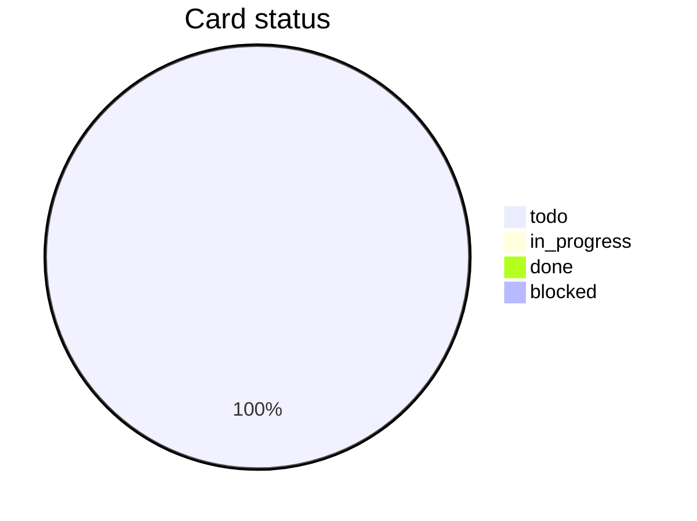

# Tasks

> Filled by planning step-03. **Work inventory first**, then micro-task cards.
> **Implement feature code before automated tests.** Do not leave template placeholders.
> **Progress:** planning seeds Status=`todo` and unchecked boxes; **execution** updates them as work completes.

plan_ref: PLAN.md

## Status legend

| Value | Meaning |
|-------|---------|
| `todo` | Not started |
| `in_progress` | Currently executing |
| `done` | Card AC verified for this task |
| `blocked` | Cannot proceed (note reason under Notes or on the card) |
| `skipped` | Intentionally not done (document why) |

## Work inventory

| Inv | Unit (noun + verb) | Trace (doc § / AC / contract) | Layer |
|-----|--------------------|-------------------------------|-------|
| I-01 | Fix Global E2E Context Mocking | INVESTIGATE | api |
| I-02 | Fix Export Job processing status hang | INVESTIGATE | api |
| I-03 | Add PostgreSQL SAVEPOINT for partial imports | INVESTIGATE | api |
| I-04 | Convert ListAuditLogs error to AppError | INVESTIGATE | api |
| I-05 | Add Error logging for Storage cleanup | INVESTIGATE | api |
| I-06 | Clean up and ignore `.pyc` files | INVESTIGATE | repo |

## Progress board

| Done | ID | Title | Status |
|------|----|-------|--------|
| [x] | T-001 | Mock Global Context E2E | done |
| [x] | T-002 | Export Job Lifecycle | done |
| [x] | T-003 | Import Tx Savepoints | done |
| [x] | T-004 | ListAudit Error Mapping | done |
| [x] | T-005 | Storage Cleanup Error Logging | done |
| [x] | T-006 | Repo Hygiene | done |

## Progress chart

## Execution order

T-001 → T-002 → T-003 → T-004 → T-005 → T-006

## Notes

- Để bypass context E2E, chúng ta có thể parse header `x-organization-id` trong `AuthGuard` nếu đang ở môi trường Test, hoặc bổ sung trực tiếp vào middleware test setup. 

## Tasks

### T-001: Mock Global Context E2E

- Status: done
- Trace: INVESTIGATE
- Depends: none
- Work items:
  - [x] 1. Sửa `AuthGuard` hoặc `JwtStrategy` (tùy theo logic lấy user) để nếu header `x-organization-id` bằng empty `""` và môi trường là test/dev thì set `user.organizationId = null`.
- Description: Đảm bảo E2E test cho global scope thực sự giả lập user không có organizationId.
- AC: Token parse ra user với org = null nếu header được cung cấp.
- Verify: Biên dịch thành công, test E2E truyền header sẽ ăn logic.
- Files/scope: `apps/api/src/shell/auth.guard.ts` (known)

### T-002: Export Job Lifecycle

- Status: done
- Trace: INVESTIGATE
- Depends: none
- Work items:
  - [x] 1. Trong `CreateExportUseCase`, dời block `try` bao luôn các lệnh `adapter.resolve`, `listForExport`, `toCsv` và `objectStorage.upload`.
  - [x] 2. Trong block `catch`, thêm flag để biết nếu đã upload thì mới gọi `objectStorage.delete`. Mark job FAILED.
- Description: Tránh kẹt job ở trạng thái PROCESSING nếu có lỗi xảy ra trước bước DB transaction.
- AC: Bất kì exception nào cũng đổi job sang FAILED.
- Verify: Unit test/E2E test.
- Files/scope: `packages/api-platform/src/modules/exports/application/use-cases/create-export.use-case.ts` (known)

### T-003: Import Tx Savepoints

- Status: done
- Trace: INVESTIGATE
- Depends: none
- Work items:
  - [x] 1. Sửa `ConfirmImportUseCase`: chạy raw query `SAVEPOINT import_row_${index}` trước khi importRow.
  - [x] 2. Bắt exception, nếu có lỗi thì chạy `ROLLBACK TO SAVEPOINT import_row_${index}`. Nếu không thì `RELEASE SAVEPOINT import_row_${index}`.
- Description: Implement partial-success database semantics.
- AC: Import không bị vỡ transaction giữa chừng khi 1 row lỗi.
- Verify: Biên dịch và chạy thử.
- Files/scope: `packages/api-platform/src/modules/imports/application/use-cases/confirm-import.use-case.ts` (known)

### T-004: ListAudit Error Mapping

- Status: done
- Trace: INVESTIGATE
- Depends: none
- Work items:
  - [x] 1. Thay `throw new Error(...)` bằng `throw new AppError(ERROR_CODES.AUTH_FORBIDDEN, ...)` trong `ListAuditLogsUseCase`.
- Description: Sửa lỗi 500 thành Error domain chuẩn.
- AC: Không còn Error thường.
- Verify: Code compilation.
- Files/scope: `packages/api-platform/src/modules/audit/application/use-cases/list-audit-logs.use-case.ts` (known)

### T-005: Storage Cleanup Error Logging

- Status: done
- Trace: INVESTIGATE
- Depends: none
- Work items:
  - [x] 1. Thêm `console.error` hoặc Logger object vào catch blocks xoá storage object (ở `export-audit-logs.use-case.ts`, `delete-file.use-case.ts`...) để ghi lại S3 cleanup failure do thiếu hệ thống worker.
- Description: Tăng cường visibility cho các rủi ro orphan object.
- AC: Lỗi không bị ẩn lặng lẽ (silently swallowed).
- Verify: Code inspection.
- Files/scope: `packages/api-platform/src/modules/audit/application/use-cases/export-audit-logs.use-case.ts`

### T-006: Repo Hygiene

- Status: done
- Trace: INVESTIGATE
- Depends: none
- Work items:
  - [x] 1. Xoá tất cả `.pyc` files trong `.agents/skills/office-common/python/office_common/__pycache__/`.
  - [x] 2. Thêm `.gitignore` pattern.
- Description: Cleanup source control.
- AC: Không còn `.pyc` trong track của git.
- Verify: `git status`.
- Files/scope: `.gitignore` and `__pycache__` directories.
