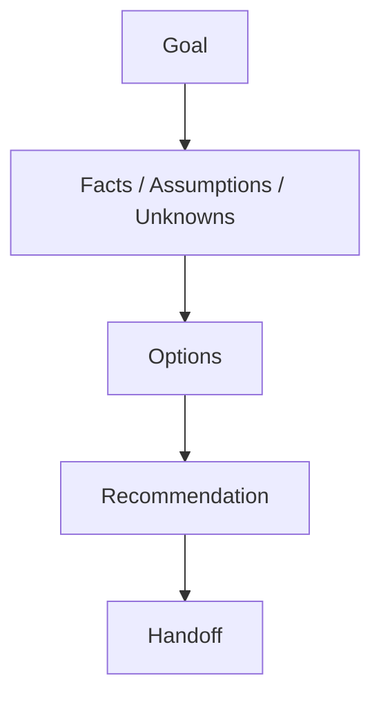

# Discussion

> Seeded by brainstorming step-01. Fill via steps 02–04. Do **not** invent PLAN/TASKS/design detail here.
> Separate **facts** vs **assumptions** vs **unknowns**. End with one clear **recommendation** + **handoff**.

## Step ledger (mandatory — update every step)

| Step | Name | Status | Evidence |
|---|---|---|---|
| 01 | Init template | `done` | `.agents/sessions/Task-3-Task-2-feature-06-notifications/DISCUSSION.md` |
| 02 | Frame + Spec quality | `done` | Feasibility/Correctness/Capability filled |
| 03 | Scope + options | `done` | Scope in/out + options matrix |
| 04 | Recommend + handoff | `done` | Choose + next skill |
| 05 | Self-check | `done` | checklist passed |

> **Hard rule:** Do not mark a later step `done` while an earlier step is still
> `todo`/`blocked`. Do not skip Spec quality review.

## Executive summary (80/20)

- **Direction**: Hardening Notification Feature (Feature 06) by ensuring tenant isolation and delivery idempotency.
- **Findings**: Existing inbox incorrectly aggregates multi-tenant notifications globally, and retried delivery jobs cause duplicate items + push spam.
- **Recommendation**: Add `jobId` to `notifications` with a unique constraint for `ON CONFLICT DO NOTHING` delivery, and strictly filter inbox endpoints by `organizationId`.
- **Next Action**: Proceed to `planning` skill to break down DB migrations and repository fixes into executable tasks.

## Developer overview

| Field | Value |
|---|---|
| Status | `recommended` |
| Open Critical/blocking | `0` |
| Visual decisions pending | `0` |
| Next action | Handoff to `planning` |

## Charts (when useful)

<!-- Replace with a real options/risk chart when trade-offs exist. Use N/A if a
chart adds no decision value. -->

## Goal

<!-- One sentence. -->

_(TODO)_

## Desired outcome

<!-- What success looks like. -->

_(TODO)_

## Confirmed facts

<!-- From user, repo, or research — not guesses. -->

- The `notifications` table has both `organizationId` and `userId`.
- The `notification_jobs` table supports `idempotencyKey` tied to `actorId`.
- Device tokens support `upsert` on the unique token, moving ownership to the last logged-in user.
- Invalid FCM tokens are cleaned up automatically.
- SSE stream runs over a global Redis Pub/Sub channel (`notifications.stream`) where all nodes receive all events and filter them in memory by `userId`.

## Constraints

| Constraint | Source |
|------------|--------|
| Must align with the existing `TenantContextService` and tenant isolation rules. | Repo |
| Must ensure reliable delivery without creating duplicate notifications if a delivery job fails midway and is retried. | Architecture |

## Assumptions

| Assumption | Risk | Confirmed |
|------------|------|-----------|
| **Tenant Isolation**: Notifications should be tenant-isolated. Currently, the inbox API filters only by `userId`, causing mixed organization notifications. | High | No |
| **Push Payload Security**: `data` might contain sensitive IDs or text; currently sent verbatim to FCM without scrubbing. | Medium | No |

## Unknowns

| Unknown | Blocking? | Owner |
|---------|-----------|-------|
| **Job Retry Semantics**: Does the system retry `FAILED` jobs? Current `processJob` logic lacks a unique constraint or idempotency per `(jobId, userId)`. | Yes | Backend |
| **Job Timeout/Orphan**: If server crashes during `processJob`, job remains `PROCESSING` forever. Is there a sweeper for dead jobs? | No | Backend |

## Issue triage

<!-- Severity: Critical/High/Medium/Low. Clarity: Clear/Partial/Unknown.
Blocking=Yes means recommendation/planning must stop until answered. -->

| ID | Issue / decision | Severity | Clarity | Blocking? | Owner | Status |
|---|---|---|---|---|---|---|
| ISS-001 | Tenant isolation in inbox is missing (`organizationId` not filtered) | High | Clear | Yes | Backend | Resolved |
| ISS-002 | Duplicate delivery on job retry | High | Partial | Yes | Backend | Resolved |
| ISS-003 | Orphaned `PROCESSING` jobs | Medium | Partial | No | Backend | Open |
| ISS-004 | Global Redis Pub/Sub channel for all notifications | Low | Clear | No | Backend | Open |

## Clarification checkpoint

| Issue ID | Focused question | Why it blocks | User answer / evidence | Resolved? |
|---|---|---|---|---|
| ISS-001 | Should inbox APIs only return/affect notifications for the user's current `organizationId`, or is it global? | Defines core architectural behavior for data access. | Update API to filter by `organizationId` from request context. | Yes |
| ISS-002 | If a delivery job is retried, it creates duplicate notifications. Should we add `jobId` to `notifications` and handle uniqueness? | Directly causes data corruption/duplicates. | Add `jobId` and use `INSERT ... ON CONFLICT DO NOTHING`. | Yes |

> **STOP gate:** Do not continue to Scope/Options while any Critical issue or
> blocking unknown is unresolved.

## Spec quality review

<!-- Do NOT treat specs as automatically correct. Challenge them before
recommending. Verdicts: Pass / Pass-with-gaps / Fail / Unknown. -->

### 1. Feasibility (tính khả thi)

| Question | Finding | Evidence | Verdict |
|---|---|---|---|
| Can this be built with current stack, data, auth, ops, and timeline? | Yes, current DB + Redis + FCM stack supports it. | Codebase inspection | Pass |

- Blockers if not feasible: none

### 2. Correctness (tính đúng đắn)

| Question | Finding | Evidence | Verdict |
|---|---|---|---|
| Do specs match real system behavior / domain rules / existing APIs / UI? | The inbox API mixes organizations; jobs can produce duplicate notifications if retried. | Codebase inspection | Fail |

- Spec vs system mismatches: Notifications are scoped to user globally, which may violate tenant isolation rules. Duplicate notifications on job retry violates exactly-once delivery assumptions.

### 3. Capability recommendations (khả năng feature / gaps)

<!-- Ask what a feature of this type should normally include even if specs omit it.
Example: upload feature without max size, MIME allowlist, virus scan, overwrite
policy, progress UX, or error recovery. -->

| Gap ID | Missing / weak capability | Why it matters | Suggested question / default | Blocking? |
|---|---|---|---|---|
| CAP-001 | Organization isolation | Prevents data leakage between tenants | Add `organizationId` filter to inbox APIs? | Yes |
| CAP-002 | Idempotency on delivery | Prevents duplicate push notifications/inbox items | Add `jobId` to `notifications` table and handle conflict? | Yes |

> **STOP gate:** If Feasibility or Correctness is `Fail` / `Unknown` and
> Blocking=Yes, stop and ask. Capability gaps marked Blocking=Yes also stop
> recommendation until answered or explicitly deferred.

## Visual triage

| Issue ID | Visual need | Recommended format | Why this format helps | User confirmed? | Artifact/status |
|---|---|---|---|---|---|
| ISS-001 | none | text | Not a UI issue | N/A | none |

## Scope in

- **Tenant Isolation**: Update `NotificationInboxUseCase` and `NotificationsRepository` to filter and update notifications strictly within the current request context's `organizationId` (from `AuthenticatedRequestUser`).
- **Delivery Idempotency**: Add `jobId` column to `notifications` table, create a unique constraint on `(job_id, user_id)`, and use `ON CONFLICT DO NOTHING` during insertion.
- **Payload Security**: Best-effort security warning: ensure application code knows that `data` payload is sent to FCM unencrypted, preventing secret leakage.

## Scope out

- **Advanced Retry Policies**: Not altering the retry mechanisms outside of what already exists.
- **Dead Job Sweeper**: We will focus strictly on making jobs idempotent; if a job remains `PROCESSING`, another task handles it or it's resolved manually. Out of scope for this feature patch.
- **Multi-channel**: No email or SMS notifications in this feature iteration.

## Non-goals

- Refactoring the entire `notifications.stream` SSE Pub/Sub logic; filtering in-memory by `userId` is acceptable given the scale.

## Options considered

| Option | Pros | Cons | Effort | Risk | Reversible? | How to verify |
|--------|------|------|--------|------|-------------|---------------|
| A — Explicit `organizationId` matching & Unique constraint on `jobId` + `userId` (ON CONFLICT DO NOTHING) | Directly solves the bugs; fulfills user requirement; fits within current Drizzle API. | Schema change required. | Medium | Low | Yes | Write tests creating jobs twice and verify no duplicate items; switch tenants and check inbox. |

<!-- At least one option. Prefer 2+ when trade-offs exist. -->

## Recommendation

- **Choose:** Option A — Explicit `organizationId` matching & Unique constraint on `jobId` + `userId`
- **Reason:** The user confirmed this direction. Adding `jobId` ensures perfectly idempotent delivery without risk of duplicate push. Filtering by `organizationId` corrects the global inbox bug and aligns with TenantContext isolation requirements.
- **Not choosing:** N/A (single agreed-upon option)
- **Confidence:** High

## Risks

| Risk | Impact | Mitigation |
|------|--------|------------|
| Schema change for `jobId` on large table | Downtime | Add `jobId` as nullable without default; use safe Drizzle migrations. |
| Inbox API changes break mobile clients if org header missing | Medium | `AuthenticatedRequestUser` should already enforce `organizationId` for tenant endpoints; we will verify the controller properly passes it. |

## Handoff

- **Next skill:** `planning`
- **Why:** The architectural changes are scoped and confirmed. We can proceed directly to writing implementation tasks.
- **Blockers before next skill:** none
