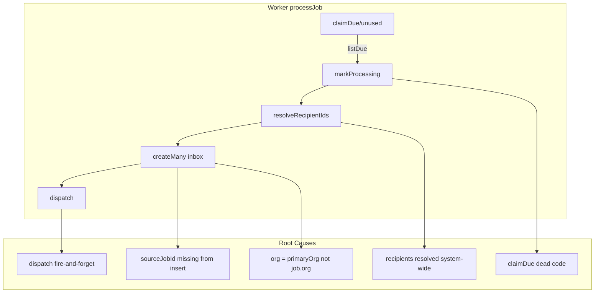

# INVESTIGATE — Feature 06 Notifications

## Executive summary

- **P0 — `sourceJobId` không được truyền khi insert inbox**: Port `CreateNotificationInput` thiếu trường `sourceJobId`. Worker `processJob()` không set giá trị. Unique partial index `WHERE source_job_id IS NOT NULL` không bao giờ fire → retry tạo duplicate inbox.
- **P0 — Recipient resolution không tenant-scoped**: `UserLookup.findById/filterExistingUserIds/listDeliverableUserIds` query `users` toàn hệ thống, không filter theo organization membership → USER/USERS/ALL có thể target user ngoài tenant.
- **P0 — Notification organization attribution sai**: Worker gọi `findPrimaryOrganizationId(userId)` thay vì dùng `locked.organizationId` → notification gán sai tenant.
- **P0 — Push delivery thiếu retry/dedup**: `dispatch()` fire-and-forget, error bị swallow. Không có `notification_deliveries` table → crash mất push vĩnh viễn.
- **P1-P2 — `claimDue`, admin job scope, SSE duplicate, atomicity, subject leak**: Đều có evidence xác nhận.

## Developer overview

| Field | Value |
|-------|-------|
| Investigation status | **Root Cause Confirmed** — 4 P0, 3 P1, 2 P2 findings verified |
| Strongest hypothesis | Worker `processJob()` tại `notification-delivery.use-case.ts:219` không wire `sourceJobId`, không tenant-scope recipient resolution, gán sai organization |
| Evidence gap | Không có E2E test tenant isolation / idempotency / concurrency |
| Next action | Viết PLAN cho fix round, ưu tiên 6 nhóm: sourceJobId wiring → recipient scope → org attribution → delivery table → claimDue → E2E |

## Charts



## Question

Feature 06 — Notifications review commit `a184c2b` identifies 10 issues (4 P0, 3 P1, 2 P2, 1 missing CI). Các claim có chính xác không?

## Status

**Root Cause Confirmed** — tất cả findings đều có evidence trong codebase.

## Context

- **HEAD:** `a184c2b966ec178835be186f38761b3b2d161a76`
- **Commit:** `feat(notifications): harden tenant isolation, idempotency and SSE scoping`
- **Session:** `.agents/sessions/Task-3-Task-2-feature-06-notifications/`
- **Review verdict:** 6.8/10 — NEEDS CHANGES

## Evidence

| ID | Source | Observation | Supports hypothesis? | Confidence |
|----|--------|-------------|---------------------|------------|
| E-001 | `notifications.repository.port.ts:18-26` | `CreateNotificationInput` không có trường `sourceJobId` | H-001 (sourceJobId missing) | **Cao** |
| E-002 | `notification-delivery.use-case.ts:247-260` | `processJob()` batch insert không truyền `sourceJobId: locked.id` | H-001 | **Cao** |
| E-003 | `notifications.repository.ts:44-49` | `createMany` gọi `onConflictDoNothing()` với comment tự nhận idempotency dựa trên unique constraint | H-001 | **Cao** |
| E-004 | `notifications.ts:58-62` (schema) | Unique index `notifications_source_job_id_user_id_unique` có `WHERE source_job_id IS NOT NULL` | H-001 | **Cao** |
| E-005 | `user-lookup.port.ts:8-12` | `UserLookup` interface không có tham số organizationId | H-002 (recipient not scoped) | **Cao** |
| E-006 | `users.repository.ts:205-234` | `listDeliverableUserIds()` và `filterExistingUserIds()` query `users` toàn hệ thống, không join organization_members | H-002 | **Cao** |
| E-007 | `notification-delivery.use-case.ts:249-253` | `processJob()` gọi `findPrimaryOrganizationId(userId)` thay vì dùng `locked.organizationId` | H-003 (org attribution sai) | **Cao** |
| E-008 | `notification-dispatch.service.ts:21-42` | `dispatch()` fire-and-forget, `.catch(() => {})` swallow error | H-004 (push delivery) | **Cao** |
| E-009 | `notification-jobs.repository.ts:142-168` | `claimDue()` implementation tồn tại nhưng không được gọi | H-005 (claimDue dead code) | **Cao** |
| E-010 | `notification-delivery.use-case.ts:202-216` | `processDueJobs()` gọi `listDue()` chứ không gọi `claimDue()` | H-005 | **Cao** |
| E-011 | `notification-jobs.repository.port.ts:71-110` | Port interface không khai báo `claimDue()` | H-005 | **Cao** |
| E-012 | `notification-stream.service.ts:66-70` | `emit()` gọi `subject.next()` local + `publish()` Redis cho cùng event | H-006 (SSE duplicate) | **Cao** |
| E-013 | `notification-stream.service.ts:123-133` | Redis subscriber nhận echo và gọi `subject.next()` lần nữa | H-006 | **Cao** |
| E-014 | `notifications.controller.ts:178-213` | Admin list/get/cancel job không nhận actor organization context | H-007 (admin scope) | **Cao** |
| E-015 | `notification-jobs.repository.ts:60-68` | `findById()` chỉ filter theo `id`, không filter `organizationId` | H-007 | **Cao** |
| E-016 | `notification-jobs.repository.ts:89-120` | `list()` không có filter organizationId trong query | H-007 | **Cao** |
| E-017 | Migration `0005_expand_organization_rls.sql:12` | RLS policy `notification_jobs_tenant_isolation` cho phép `organization_id IS NULL` | H-007 (SUPER_ADMIN bypass) | **Cao** |
| E-018 | `notification-delivery.use-case.ts:96-128` | Audit log ghi sau `create()` job, không cùng transaction | H-008 (atomicity) | **Cao** |
| E-019 | `notification-delivery.use-case.ts:170-196` | Audit log ghi sau `markCancelled()`, không cùng transaction | H-008 | **Cao** |
| E-020 | `notification-stream.service.ts:86-96` | `getSubject()` luôn tạo subject mới, không cleanup khi subscriber disconnect | H-010 (subject leak) | **Cao** |
| E-021 | `notification-stream.service.spec.ts:9-15` | Unit test dùng `REDIS_URL: undefined` → không phát hiện duplicate | H-006 (test gap) | **Cao** |

## Reproduction

### P0-1: sourceJobId missing

```
Step 1: Worker gọi processJob(jobId)
Step 2: markProcessing(jobId) trả về job record với locked.id = <uuid>
Step 3: createMany() nhận values array, mỗi value không có sourceJobId
Step 4: Drizzle insert → source_job_id = NULL
Step 5: Retry cùng job → insert row mới (unique index WHERE IS NOT NULL không fire)
Expected: source_job_id = locked.id, retry bị ON CONFLICT DO NOTHING chặn
Actual: source_job_id = NULL, retry tạo duplicate
```

### P0-2: Recipient không tenant-scoped

```
Step 1: Admin Org A tạo job với audience = 'ALL'
Step 2: resolveRecipientIds() gọi listDeliverableUserIds()
Step 3: Query trả về ALL active user trong hệ thống
Expected: Chỉ member của Org A
Actual: Tất cả user toàn platform
```

### P0-3: Org attribution sai

```
Step 1: User X có primary = Org A, secondary = Org B
Step 2: Admin Org B tạo notification, job.organizationId = Org B
Step 3: Worker gọi findPrimaryOrganizationId(X) → trả về Org A
Step 4: Notification được insert với organization_id = Org A
Expected: organization_id = Org B (nơi phát sinh)
Actual: organization_id = Org A (primary)
```

### P0-4: Push delivery

```
Step 1: Worker insert inbox, gọi dispatch()
Step 2: dispatch() emits SSE, gọi FCM send (fire-and-forget Promise)
Step 3: FCM throws, .catch(() => {}) swallow error
Step 4: Job vẫn COMPLETED
Expected: Push retry mechanism hoặc delivery tracking
Actual: Push mất vĩnh viễn
```

## Observed facts

| Fact | Source |
|------|--------|
| `sourceJobId` column tồn tại trong DB schema (nullable FK) | `0021_notification_hardening.sql` |
| Partial unique index `(source_job_id, user_id) WHERE source_job_id IS NOT NULL` tồn tại | `notifications.ts:58-62` |
| `CreateNotificationInput` port không có trường `sourceJobId` | `notifications.repository.port.ts:18-26` |
| Worker `processJob()` không set `sourceJobId` trong batch insert | `notification-delivery.use-case.ts:247-260` |
| `UserLookup` interface không nhận organization param | `user-lookup.port.ts:8-12` |
| `listDeliverableUserIds()` query users toàn bảng không filter org | `users.repository.ts:205-212` |
| Worker dùng `findPrimaryOrganizationId(userId)` thay vì `locked.organizationId` | `notification-delivery.use-case.ts:249-253` |
| `dispatch()` là fire-and-forget, error bị catch rỗng | `notification-dispatch.service.ts:21-42` |
| `claimDue()` implementation tồn tại nhưng port không khai báo, worker không gọi | `notification-jobs.repository.ts:142-168`, `notification-jobs.repository.port.ts` |
| SSE emit gửi cả local subject + Redis publish; subscriber nhận echo | `notification-stream.service.ts:66-70`, `123-133` |
| Admin job list/get/cancel không filter organizationId | `notifications.controller.ts:178-213`, `notification-jobs.repository.ts:60-68` |
| Audit log nằm ngoài transaction của job mutation | `notification-delivery.use-case.ts:96-128`, `170-196` |
| in-memory Subject map không cleanup khi subscriber disconnect | `notification-stream.service.ts:86-96` |

## Hypotheses

| ID | Hypothesis | Supporting evidence | Counter evidence | Verification method | Confidence |
|----|-----------|-------------------|------------------|-------------------|------------|
| H-001 | `sourceJobId` không được wire vào insert → idempotency không hoạt động | E-001, E-002, E-003, E-004 | None | Review port + use-case code | **Cao** |
| H-002 | Recipient resolution không giới hạn theo organization → cross-tenant delivery | E-005, E-006 | None | Review UserLookup implementation | **Cao** |
| H-003 | Organization attribution dùng primaryOrg → notification gán sai tenant | E-007 | Worker có fallback về `locked.organizationId` nếu primary null | Review processJob logic | **Cao** |
| H-004 | Push delivery thiếu retry/dedup → mất push khi fail | E-008 | Comment "best-effort" là intentional | Review dispatch service | **Cao** |
| H-005 | `claimDue()` dead code → processDueJobs không atomic claim | E-009, E-010, E-011 | `markProcessing()` có conditional update PENDING→PROCESSING | Review job processor flow | **Cao** |
| H-006 | SSE emit duplicate khi Redis bật | E-012, E-013, E-021 | Không có Redis trong CI/test, không reproduction evidence | Integration test with Redis | **Trung bình** |
| H-007 | Admin job CRUD không enforce org → cross-tenant operation | E-014, E-015, E-016, E-017 | RLS giúp tenant ADMIN (không bypass) | Review controller + repository | **Cao** |
| H-008 | Job mutation + audit không atomic → audit missing khi success | E-018, E-019 | `createIdempotent()` trong transaction 1 phần | Review use-case code | **Cao** |
| H-009 | markRead/delete nên filter userId trong SQL | E-003 (repository markRead/delete filter orgId) | Ownership check tồn tại trong use-case | Review repository query | **Cao** |
| H-010 | SSE subjects memory leak khi subscriber disconnect | E-020 | Chưa có production evidence về leak nghiêm trọng | Load test | **Trung bình** |

## Code path

| Layer | File/Component | Role | Observation |
|-------|---------------|------|-------------|
| Controller | `notifications.controller.ts` | HTTP routing | Admin endpoints không pass org context; user endpoints dùng `requireOrganizationId` |
| Use case | `notification-delivery.use-case.ts:219-284` | Worker processJob | sourceJobId missing, wrong org attribution, fire-and-forget dispatch |
| Use case | `notification-delivery.use-case.ts:286-303` | Recipient resolution | System-wide UserLookup, không org filter |
| Use case | `notification-delivery.use-case.ts:63-139` | Job creation | Audit ngoài transaction |
| Use case | `notification-delivery.use-case.ts:166-200` | Job cancel | Audit ngoài transaction |
| Use case | `notification-delivery.use-case.ts:202-216` | processDueJobs | Dùng listDue thay vì claimDue |
| Port | `notifications.repository.port.ts:18-26` | CreateNotificationInput | Thiếu sourceJobId |
| Port | `notification-jobs.repository.port.ts` | Job repository port | Không khai báo claimDue |
| Port | `user-lookup.port.ts:8-12` | UserLookup | Không nhận org param |
| Repository | `notifications.repository.ts:35-50` | createMany | onConflictDoNothing nhưng không có conflict vì sourceJobId null |
| Repository | `notification-jobs.repository.ts:142-168` | claimDue implementation | Dead code — không wiring |
| Repository | `notification-jobs.repository.ts:89-120` | list | Không filter organizationId |
| Repository | `notification-jobs.repository.ts:60-68` | findById | Không filter organizationId |
| Service | `notification-dispatch.service.ts:21-42` | dispatch | Fire-and-forget push, error swallow |
| Service | `notification-stream.service.ts:66-70` | SSE emit | Local subject + Redis publish (cùng event 2 lần) |
| Service | `notification-stream.service.ts:86-96` | Subject management | Không cleanup khi subscriber unsubscribe |
| DB | `0021_notification_hardening.sql` | Migration | Unique index WHERE IS NOT NULL |
| DB | `0005_expand_organization_rls.sql:12` | RLS policy | Cho phép organization_id IS NULL |
| DB | `users.repository.ts:205-234` | User query | System-wide, không join org |

## Root cause

4 root causes được xác nhận cho các P0:

1. **sourceJobId không wire** (`notifications.repository.port.ts:18-26` + `notification-delivery.use-case.ts:247-260`): Port interface thiếu trường `sourceJobId`. Worker insert không set giá trị. Partial unique index không bao giờ fire. Retry tạo duplicate inbox.

2. **Recipient resolution system-wide** (`user-lookup.port.ts:8-12` + `users.repository.ts:205-234`): `UserLookup` interface không tenant-aware. Implementation query `users` không filter organization membership. `ALL` audience = mọi user toàn platform.

3. **Sai organization attribution** (`notification-delivery.use-case.ts:249-253`): Worker gọi `findPrimaryOrganizationId(userId)` thay vì dùng `locked.organizationId`. Notification gán sai tenant.

4. **Push delivery không có retry/dedup** (`notification-dispatch.service.ts:21-42`): Fire-and-forget với `.catch(() => {})`. Không có delivery tracking table. Crash → mất push vĩnh viễn.

## Impact

| Area affected | Impact | Confidence |
|---------------|--------|------------|
| Inbox idempotency | Retry notification job tạo duplicate inbox rows cho user | **Cao** |
| Cross-tenant data leak | Notification gửi tới user ngoài tenant (USER/USERS/ALL) | **Cao** |
| Notification attribution | Notification xuất hiện sai tenant inbox | **Cao** |
| Push delivery reliability | Push notification mất khi FCM fail hoặc worker crash | **Cao** |
| Job processing concurrency | `processDueJobs` không atomic → duplicate processing | **Cao** |
| SSE duplicate | User nhận duplicate notification event khi Redis bật | **Trung bình** |
| Admin cross-tenant operation | SUPER_ADMIN list/get/cancel job từ org khác | **Cao** |
| Audit atomicity | Job tạo/cancel thành công nhưng audit có thể missing | **Cao** |
| Memory leak | SSE subject không cleanup → memory tăng theo thời gian | **Thấp** |
| TOCTOU mark/delete | Repository filter không gồm userId (chỉ orgId) | **Thấp** |

## Recommendation

Fix bắt buộc (theo thứ tự ưu tiên):

1. **sourceJobId wiring**: Thêm `sourceJobId: string` vào `CreateNotificationInput`. Worker truyền `locked.id`. Chỉ rõ conflict target trong `onConflictDoNothing`.
2. **Recipient tenant scope**: Thêm method tenant-aware vào `UserLookup` (hoặc tạo port mới). `ALL` = member của `locked.organizationId`. `USER/USERS` validate membership.
3. **Org attribution**: Dùng `locked.organizationId` thay vì `findPrimaryOrganizationId()`. Bỏ gọi primary org trong worker.
4. **Push delivery tracking**: Tạo `notification_deliveries` table với status machine. Worker upsert delivery rows, delivery worker retry + dedup.
5. **claimDue wiring**: Chọn `claimDue()` (atomic) hoặc bỏ dead code. Thêm stale-job recovery cho PROCESSING timeout.
6. **Admin job scope**: Thêm organizationId filter vào list/get/cancel. Resolve từ actor context.
7. **Job + audit atomicity**: Audit log trong cùng transaction với job mutation.
8. **SSE duplicate**: Chỉ publish Redis hoặc thêm originInstanceId filter.
9. **Subject cleanup**: Finalize subject khi 0 subscriber.
10. **E2E tests**: Tenant isolation, idempotency, concurrency.

## Open questions

| Question | Owner | Blocking? |
|----------|-------|-----------|
| `ALL` audience nên reject user ngoài tenant hay silent skip? | Nhóm feature | **Có** — ảnh hưởng design decisions |
| `PROCESSING` stale-job timeout bao nhiêu giây? | Nhóm feature | Không — có thể config |
| Delivery worker nên là cron mới hay mở rộng processor hiện tại? | Nhóm feature | Không |
| `USERS` audience: reject nếu có user ngoài tenant -> 400, hay chỉ giữ valid members -> log warning? | Nhóm feature | **Có** — ảnh hưởng UX |
| Có cần `notification_deliveries` table ngay hay batch-first approach? | Nhóm feature | **Có** — ảnh hưởng scope |

## Handoff

| Field | Value |
|-------|-------|
| Ready for planning? | **Có** — root causes confirmed, recommendations clear |
| Ready for execution? | Chưa — cần plan chi tiết |
| Suggested next skill | `planning` → `execution` → `review` |
