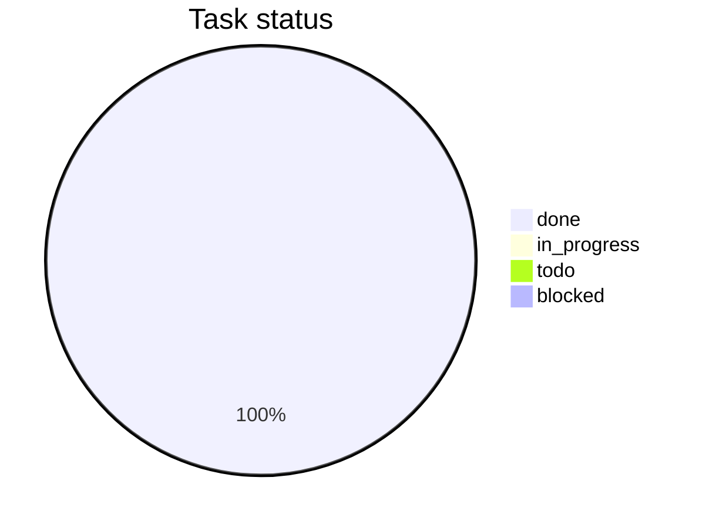
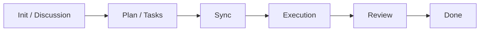

# Session overview

> Developer landing page. Keep this scannable. Refresh after sync, execution,
> review, and done. Detail lives in sibling artifacts; this file is the map.

## At a glance (80/20)

| Field | Value |
|---|---|
| Status | `done` |
| Goal | Fix 4 P0 + 3 P1 + 2 P2 issues từ Feature 06 Notifications Review Round 1 |
| Progress | `13/13` cards done · `0` blocked · `0` needs info |
| Top risk / blocker | (none) |
| Next action | Merge PR → deploy migration → deploy worker |
| Owner | _(not assigned)_ |

## Progress chart

## Open decisions

| ID | Severity | Blocking? | Visual? | Question / decision | Status |
|---|---|---|---|---|---|
| INV-001→INV-008 | All resolved | No | none | Xem PLAN.md §Pre-planning decision gate | Resolved |

## Artifact map

| Artifact | Purpose | Freshness |
|---|---|---|
| `DISCUSSION.md` | Direction / options | current |
| `INVESTIGATE.md` | Root cause analysis | current |
| `PLAN.md` / `TASKS.md` | Strategy + work | current |
| `SYNC.md` | Readiness | missing |
| `EXECUTION.md` | Implementation log | stale (old round) |
| `REVIEW.md` | Quality gate | current — verdict: Ready |
| `DONE.md` | Handoff | current |

## Developer notes

- Commands to run next:
  - `pnpm run test:e2e` — verify E2E
  - `pnpm run typecheck` — verify types
- Files/paths to inspect first:
  - `packages/api-platform/src/modules/notifications/`
  - `packages/api-core/src/ports/user-lookup.port.ts`
  - `packages/api-database/src/schema/platform/notifications.ts`
- What not to touch: migration files from 0021 (already applied)
