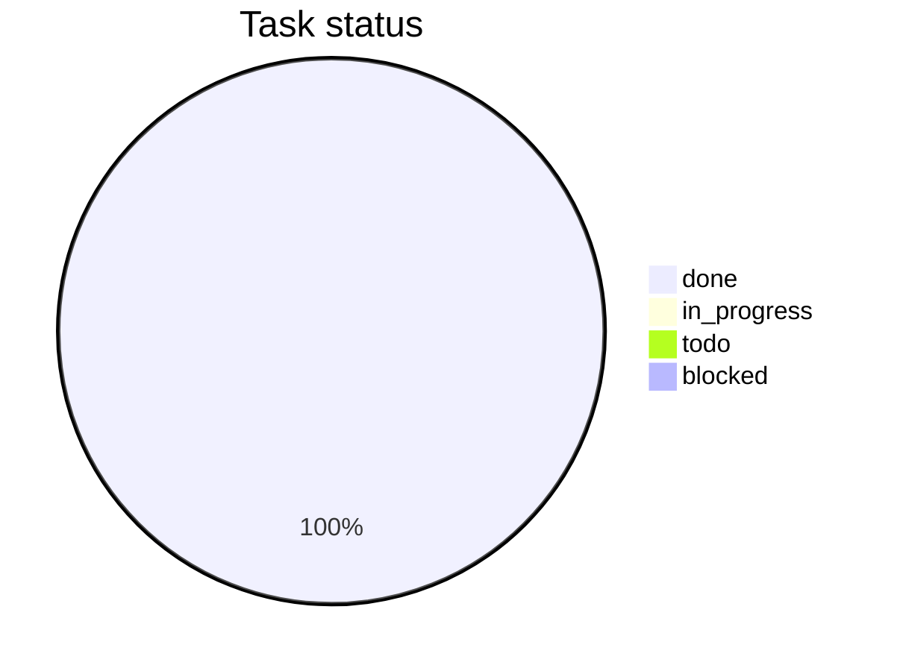
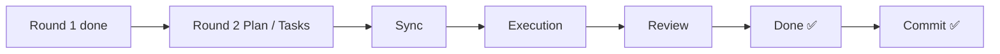

# Session overview

> Developer landing page. Keep this scannable. Refresh after sync, execution,
> review, and done. Detail lives in sibling artifacts; this file is the map.

## At a glance (80/20)

| Field | Value |
|---|---|---|
| Status | `done` ✅ |
| Goal | Fix 5 Round 2 items: partial ON CONFLICT, delivery processor, atomic transaction, retry/backoff, integration tests |
| Progress | `18/18` cards done · `0` pending · `0` needs info |
| Top risk / blocker | None — e2e tests viết sẵn, cần Docker để chạy |
| Next action | Commit → merge |
| Owner | _(not assigned)_ |

## Progress chart

## Open decisions

| ID | Severity | Blocking? | Visual? | Question / decision | Status |
|---|---|---|---|---|---|
| R2-001 | Critical | No | none | ON CONFLICT WHERE predicate: Option A (thêm where) — chọn | Closed — ✅ resolved |
| R2-002a | High | No | none | FcmPushService.sendToToken() method mới | Closed — ✅ resolved |

## Artifact map

| Artifact | Purpose | Freshness |
|---|---|---|
| `INVESTIGATE.md` | R2 root cause analysis | current |
| `PLAN.md` / `TASKS.md` | Strategy + work (Round 2) | current |
| `SYNC.md` | Readiness | current |
| `EXECUTION.md` | Implementation log | current |
| `REVIEW.md` | Quality gate | current — review Round 2 |
| `DONE.md` | Handoff | needs update — done with review |

## Developer notes

- Commands to run:
  - `bash .agents/tools/session/session.sh status` — progress refresh
  - `npm run typecheck -w packages/api-platform` — verify types
  - `npm run test -w packages/api-platform` — unit tests
  - `npm run test:e2e -w apps/api` — e2e tests (cần Docker+Postgres)
- Key files changed:
  - `packages/api-platform/src/modules/notifications/infrastructure/notifications.repository.ts` — ON CONFLICT WHERE + findBySourceJobAndUsers
  - `packages/api-platform/src/modules/notifications/application/use-cases/notification-delivery.use-case.ts` — atomic transaction
  - `packages/api-platform/src/modules/notifications/application/services/notification-delivery.processor.ts` — delivery processor (new)
  - `packages/api-platform/src/modules/notifications/application/services/notification-dispatch.service.ts` — upsertDeliveriesForNotification
  - `packages/api-platform/src/modules/notifications/infrastructure/deliveries.repository.ts` — retry/backoff + recoverStaleProcessing
  - `packages/api-platform/src/modules/notifications/infrastructure/fcm-push.service.ts` — sendToToken
  - `apps/api/test/notifications.e2e.spec.ts` — integration tests (new)
