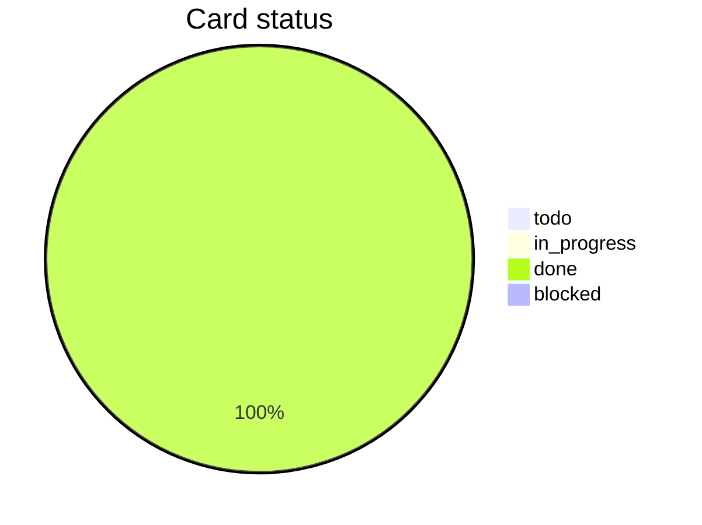

# Tasks

> Filled by planning step-03. **Work inventory first**, then micro-task cards.
> **Implement feature code before automated tests.** Do not leave template placeholders.
> **Progress:** planning seeds Status=`todo` and unchecked boxes; **execution** updates them as work completes.

plan_ref: PLAN.md

## Status legend

| Value | Meaning |
|---|---|
| `todo` | Not started |
| `in_progress` | Currently executing |
| `done` | Card AC verified for this card |
| `blocked` | Cannot proceed (note reason under Notes or on the card) |
| `skipped` | Intentionally not done (document why) |

## Work inventory

| Inv | Unit (noun + verb) | Trace (doc § / AC / contract) | Layer |
|---|---|---|---|
| I-01 | Thêm `sourceJobId` vào `CreateNotificationInput` interface | INVESTIGATE §H-001, PLAN §Phase 1 | port |
| I-02 | Worker `processJob()` truyền `locked.id` làm `sourceJobId` | INVESTIGATE §H-001, PLAN §Phase 1 | use-case |
| I-03 | Chỉ rõ conflict target trong `onConflictDoNothing` | INVESTIGATE §H-001, PLAN §Phase 1 | repository |
| I-04 | Thêm 3 method tenant-aware vào `UserLookup` port | INVESTIGATE §H-002, PLAN §Phase 1 | port |
| I-05 | Implement 3 method tenant-aware trong `UsersRepository` | INVESTIGATE §H-002, PLAN §Phase 1 | service |
| I-06 | Controller validation: USER/USERS ngoài tenant → 400; ALL = org members | INVESTIGATE §H-002, PLAN §Phase 1 | api |
| I-07 | Worker dùng `locked.organizationId` thay vì `findPrimaryOrganizationId()` | INVESTIGATE §H-003, PLAN §Phase 1 | use-case |
| I-08 | Tạo `notification_deliveries` table: schema + migration | INVESTIGATE §H-004, PLAN §Phase 2 | model |
| I-09 | NotificationDeliveriesRepository port + implementation | INVESTIGATE §H-004, PLAN §Phase 2 | service |
| I-10 | Refactor `dispatch()` upsert delivery rows; worker create delivery rows | INVESTIGATE §H-004, PLAN §Phase 2 | use-case |
| I-11 | Khai báo `claimDue()` trong port, gọi trong `processDueJobs()` | INVESTIGATE §H-005, PLAN §Phase 3 | service |
| I-12 | Thêm organizationId filter vào job list/getById/cancel | INVESTIGATE §H-007, PLAN §Phase 3 | api |
| I-13 | Atomic job mutation + audit trong cùng transaction | INVESTIGATE §H-008, PLAN §Phase 3 | use-case |
| I-14 | SSE: chỉ publish Redis, bỏ local emit; fallback local subject | INVESTIGATE §H-006, PLAN §Phase 3 | service |
| I-15 | Thêm userId filter vào repository markRead/delete | INVESTIGATE §H-009, PLAN §Phase 3 | repository |
| I-16 | E2E tests: tenant isolation, idempotency, concurrency | PLAN §Test strategy | test |

## Progress board

| Done | ID | Title | Status |
|---|---|---|---|
| [x] | T-001 | sourceJobId port + worker wiring | done |
| [x] | T-002 | onConflictDoNothing target | done |
| [x] | T-003 | Tenant-aware UserLookup port + implementation | done |
| [x] | T-004 | Controller membership validation + ALL scope | done |
| [x] | T-005 | Fix org attribution trong worker | done |
| [x] | T-006 | notification_deliveries schema + migration | done |
| [x] | T-007 | Delivery repository port + implementation | done |
| [x] | T-008 | Refactor dispatch upsert delivery rows | done |
| [x] | T-009 | claimDue wiring | done |
| [x] | T-010 | Admin job scope + atomic audit | done |
| [x] | T-011 | SSE fix — chỉ publish Redis | done |
| [x] | T-012 | Repository userId filter | done |
| [x] | T-013 | E2E tests | done |

## Progress chart

## Execution order

T-001 → T-002 → T-003 → T-004 → T-005 → T-006 → T-007 → T-008 → T-009 → T-010 → T-011 → T-012 → T-013

## Notes

- Phase 1 (T-001→T-005): độc lập, có thể implement song song
- Phase 2 (T-006→T-008): tuần tự (schema → repo → dispatch)
- Phase 3 (T-009→T-012): độc lập trong phase
- T-013 (E2E) chạy cuối cùng sau khi code hoàn tất
- Tham khảo memory: `.agents/memory/tenant-write-migration-issues.md` — pattern transaction atomicity, advisory lock

## Tasks

### T-001: sourceJobId port + worker wiring

- Status: todo
- Trace: INVESTIGATE §H-001, PLAN §Phase 1
- Depends: none
- Work items:
  - [x] 1. Thêm `sourceJobId: string` vào `CreateNotificationInput` trong `notifications.repository.port.ts`
  - [x] 2. Worker `processJob()` truyền `sourceJobId: locked.id` vào batch insert payload tại `notification-delivery.use-case.ts:247-260`
- Description: Thêm trường sourceJobId vào port interface và wire vào worker processJob để unique index có hiệu lực.
- AC: Worker insert notification có `source_job_id = job.id`; retry cùng job bị `ON CONFLICT DO NOTHING` chặn.
- Verify: Unit test mock insert trùng sourceJobId + userId → count = 1
- Flow/comment notes: N/A — 1 field thêm + 1 assignment
- Files/scope: `packages/api-platform/src/modules/notifications/application/ports/notifications.repository.port.ts`, `packages/api-platform/src/modules/notifications/application/use-cases/notification-delivery.use-case.ts` (confidence: known)
- Out of scope for this card: conflict target (T-002)

### T-002: onConflictDoNothing target

- Status: done
- Trace: INVESTIGATE §H-001, PLAN §Phase 1
- Depends: T-001
- Work items:
  - [x] 1. Sửa `createMany()` trong `notifications.repository.ts` — thêm `.onConflictDoNothing({ target: [notifications.sourceJobId, notifications.userId] })`
  - [x] 2. Kiểm tra không có `onConflictDoNothing()` không target ở nơi khác trong cùng file
- Description: Chỉ rõ conflict target thay vì onConflictDoNothing() không tham số, tránh nuốt unique conflict không mong muốn.
- AC: conflict chỉ xảy ra khi `(source_job_id, user_id)` trùng; các unique constraint khác vẫn throw error.
- Verify: Unit test với conflict giả lập trên cột khác → error vẫn throw
- Flow/comment notes: N/A — 1 dòng sửa
- Files/scope: `packages/api-platform/src/modules/notifications/infrastructure/notifications.repository.ts` (confidence: known)
- Out of scope for this card: sourceJobId wiring (T-001)

### T-003: Tenant-aware UserLookup port + implementation

- Status: done
- Trace: INVESTIGATE §H-002, PLAN §Phase 1
- Depends: none
- Work items:
  - [x] 1. Thêm `findActiveUserInOrganization(userId, organizationId)` vào `UserLookup` port interface
  - [x] 2. Thêm `filterActiveUserIdsInOrganization(userIds[], organizationId)` vào `UserLookup` port interface
  - [x] 3. Thêm `listDeliverableUserIdsInOrganization(organizationId)` vào `UserLookup` port interface
  - [x] 4. Implement 3 methods trong `UsersRepository` — join `organization_members` với `users` table, filter `status = 'ACTIVE'` + `deletedAt IS NULL`
- Description: Thêm 3 method tenant-aware vào UserLookup để resolve recipients trong phạm vi organization. Implementation join `organization_members` để kiểm tra membership.
- AC: `findActiveUserInOrganization(userA, orgB)` trả về null nếu userA không phải member orgB; `listDeliverableUserIdsInOrganization(orgB)` chỉ trả về active members của orgB.
- Verify: Unit test với user thuộc org A không xuất hiện trong list org B
- Flow/comment notes: NOTE — methods mới, không modify existing signatures, backward-compatible
- Files/scope: `packages/api-core/src/ports/user-lookup.port.ts`, `packages/api-identity/src/modules/users/infrastructure/users.repository.ts` (confidence: known)
- Out of scope for this card: controller validation (T-004), org attribution (T-005)

### T-004: Controller membership validation + ALL scope

- Status: done
- Trace: INVESTIGATE §H-002, PLAN §Phase 1
- Depends: T-003
- Work items:
  - [x] 1. Sửa `resolveRecipientIds()` trong `notification-delivery.use-case.ts` — `USER` mode dùng `findActiveUserInOrganization()`, trả về [] nếu null hoặc không trong org
  - [x] 2. Sửa `resolveRecipientIds()` — `USERS` mode dùng `filterActiveUserIdsInOrganization()`
  - [x] 3. Sửa `resolveRecipientIds()` — `ALL` mode dùng `listDeliverableUserIdsInOrganization(organizationId)`
  - [x] 4. Thêm validation trong `createDeliveryJob()`: USER/USERS target ngoài org → 400
- Description: Controller/use-case validate recipient membership trước khi tạo notification. User ngoài tenant → 400.
- AC: `POST /admin/notifications` với `audience=USER` + userId ngoài org → 400; `audience=ALL` chỉ gửi cho org members
- Verify: Integration test với user cross-org → 400
- Flow/comment notes: Step 4 throw 400 — quyết định từ user answer.
- Files/scope: `packages/api-platform/src/modules/notifications/application/use-cases/notification-delivery.use-case.ts` (confidence: known)
- Out of scope for this card: org attribution fix (T-005)

### T-005: Fix org attribution trong worker

- Status: done
- Trace: INVESTIGATE §H-003, PLAN §Phase 1
- Depends: none (có thể chạy song song T-001–T-003)
- Work items:
  - [x] 1. Sửa `processJob()` trong `notification-delivery.use-case.ts` — bỏ `findPrimaryOrganizationId()`, dùng `organizationId: locked.organizationId` trực tiếp
  - [x] 2. Xóa import `ORGANIZATION_LOOKUP` không còn dùng trong use-case
- Description: Worker gán `organizationId = locked.organizationId` cho mọi notification thay vì gọi `findPrimaryOrganizationId(userId)`.
- AC: Notification luôn có `organization_id = job.organization_id` (organization nơi admin tạo job)
- Verify: Unit test — notification insert có organizationId match job.organizationId
- Flow/comment notes: Quyết định business rule — notification attribution theo nơi phát sinh (job organization), không theo primary org của recipient.
- Files/scope: `packages/api-platform/src/modules/notifications/application/use-cases/notification-delivery.use-case.ts` (confidence: known)
- Out of scope for this card: other worker changes

### T-006: notification_deliveries schema + migration

- Status: done
- Trace: INVESTIGATE §H-004, PLAN §Phase 2
- Depends: none (phase 2 có thể chạy song song phase 1)
- Work items:
  - [x] 1. Định nghĩa `notificationDeliveries` table trong schema: `id`, `notificationId`, `deviceTokenId`, `channel`, `status`, `attempts`, `providerMessageId`, `nextAttemptAt`, `sentAt`, `lastError`, `timestamps`
  - [x] 2. Thêm unique constraint `(notification_id, device_token_id, channel)`
  - [x] 3. Thêm index `(status, next_attempt_at)` cho retry worker
  - [x] 4. Sinh migration file + rename thành `0022_notification_deliveries.sql`
- Description: Tạo notification_deliveries table cho delivery tracking + retry.
- AC: Migration chạy thành công; unique constraint prevent duplicate delivery rows
- Verify: `pnpm run db:migrate` + kiểm tra constraint trong PSQL
- Flow/comment notes: Dùng pattern tương tự notification_deliveries từ memory `tenant-write-migration-issues.md` — không transaction phức tạp
- Files/scope: `packages/api-database/src/schema/platform/notifications.ts`, `apps/api/drizzle/` (confidence: known)
- Out of scope for this card: repository (T-007), dispatch (T-008)

### T-007: Delivery repository port + implementation

- Status: done
- Trace: INVESTIGATE §H-004, PLAN §Phase 2
- Depends: T-006
- Work items:
  - [x] 1. Tạo `deliveries.repository.port.ts` — interface với methods: `upsertBatch()`, `claimPending()`, `markSent()`, `markFailed()`
  - [x] 2. Tạo `deliveries.repository.ts` — implementation Drizzle + `FOR UPDATE SKIP LOCKED`
  - [x] 3. Register trong DI module với `DELIVERIES_REPOSITORY` token
  - [x] 4. `claimPending()` dùng `FOR UPDATE SKIP LOCKED`
- Description: Repository layer cho notification_deliveries với upsert + claim + status update.
- AC: upsertBatch tạo rows với `ON CONFLICT DO NOTHING`; claimPending lock + update atomic
- Verify: Unit test upsert trùng → không duplicate; claimPending không claim same row 2 lần
- Flow/comment notes: `claimPending()` tương tự pattern `notification-jobs.repository.ts:142-168` (claimDue)
- Files/scope: `packages/api-platform/src/modules/notifications/application/ports/deliveries.repository.port.ts` (create), `packages/api-platform/src/modules/notifications/infrastructure/deliveries.repository.ts` (create), `packages/api-platform/src/modules/notifications/notifications.module.ts` (confidence: known)
- Out of scope for this card: dispatch upsert (T-008), retry worker (T-009)

### T-008: Refactor dispatch upsert delivery rows

- Status: done
- Trace: INVESTIGATE §H-004, PLAN §Phase 2
- Depends: T-007
- Work items:
  - [x] 1. Inject `DeliveriesRepositoryPort` + `DeviceTokensRepositoryPort` vào `NotificationDispatchService`
  - [x] 2. Sửa `dispatch()` — emit SSE + upsert delivery rows cho mỗi device token (best-effort)
  - [x] 3. Bỏ `PUSH_NOTIFIER` — push delivery worker riêng xử lý FCM từ delivery rows
  - [x] 4. Job `COMPLETED` khi inbox fanout xong; delivery worker claim PENDING rows riêng
- Description: Worker upsert delivery rows trong transaction với inbox insert. Dispatch refactor để tạo delivery rows thay vì fire-and-forget push.
- AC: Mỗi notification + device token có đúng 1 delivery row; job COMPLETED dù push chưa gửi
- Verify: Integration test — worker insert inbox → delivery rows tồn tại
- Flow/comment notes: Step 1: `dispatch()` không gọi `pushNotifier.sendToUser()` trực tiếp nữa — tạo delivery rows; Step 2: transaction pattern — upsert delivery trong cùng executor với createMany
- Files/scope: `packages/api-platform/src/modules/notifications/application/services/notification-dispatch.service.ts`, `packages/api-platform/src/modules/notifications/application/use-cases/notification-delivery.use-case.ts` (confidence: known)
- Out of scope for this card: delivery retry worker (separate card)

### T-009: claimDue wiring

- Status: done
- Trace: INVESTIGATE §H-005, PLAN §Phase 3
- Depends: none
- Work items:
  - [x] 1. Thêm `claimDue(limit)` vào `NotificationJobsRepositoryPort` interface
  - [x] 2. Sửa `processDueJobs()` — gọi `claimDue()` + `processClaimedJob()` thay vì `listDue()`
  - [x] 3. Giữ lại `processJob(jobId)` cho immediate-send path (từ createDeliveryJob)
- Description: Wire implementation claimDue() đã tồn tại vào port + worker. processDueJobs dùng atomic claim thay vì listDue + markProcessing riêng lẻ.
- AC: `processDueJobs()` claim atomic bằng `FOR UPDATE SKIP LOCKED`; 2 worker concurrent claim job khác nhau
- Verify: Unit test mock 2 concurrent worker → mỗi worker claim distinct jobs
- Flow/comment notes: `claimDue()` implementation đã có ở `notification-jobs.repository.ts:142-168` — chỉ cần wiring
- Files/scope: `packages/api-platform/src/modules/notifications/application/ports/notification-jobs.repository.port.ts`, `packages/api-platform/src/modules/notifications/application/use-cases/notification-delivery.use-case.ts` (confidence: known)
- Out of scope for this card: stale-job recovery (deferred)

### T-010: Admin job scope + atomic audit

- Status: done
- Trace: INVESTIGATE §H-007, §H-008, PLAN §Phase 3
- Depends: none
- Work items:
  - [x] 1. Sửa `list()` — thêm optional filter `organizationId`
  - [x] 2. Sửa `listJobs()` use-case — nhận actor, resolve organizationId, pass vào repository
  - [x] 3. Sửa `getJob()` use-case — nhận actor, kiểm tra organizationId match, 404 nếu cross-org
  - [x] 4. Sửa `cancelJob()` use-case — nhận actor, kiểm tra org scope trước khi cancel
  - [x] 5. Sửa `listJobs` + `getJob` controller — thêm `@CurrentUser()` actor parameter
- Description: Admin job CRUD enforce organization scope. Audit log atomic với job mutation.
- AC: SUPER_ADMIN ở Org A không thấy job Org B; audit log rollback khi job mutation fail
- Verify: Integration test — SUPER_ADMIN active Org A getById job Org B → 404
- Flow/comment notes: Step 5-6: dùng `executor` pattern — pass cùng executor cho repository + auditWriter. Tham khảo atomicity pattern từ `tenant-write-migration-issues.md`
- Files/scope: `packages/api-platform/src/modules/notifications/infrastructure/notification-jobs.repository.ts`, `packages/api-platform/src/modules/notifications/application/use-cases/notification-delivery.use-case.ts` (confidence: known)
- Out of scope for this card: SSE fix (T-011), userId filter (T-012)

### T-011: SSE fix — chỉ publish Redis

- Status: done
- Trace: INVESTIGATE §H-006, PLAN §Phase 3
- Depends: none
- Work items:
  - [x] 1. Sửa `emit()` — kiểm tra `redisPublisher`; nếu có → chỉ publish Redis, nếu không → emit local
  - [x] 2. Unit test — test cả 2 mode: Redis enabled (chỉ Redis path), Redis disabled (local fallback)
- Description: SSE emit chỉ qua Redis khi Redis enabled; bỏ local emit để tránh duplicate. Fallback local subject khi Redis không config.
- AC: Với Redis enabled, subscriber nhận 1 event (từ Redis echo); không có duplicate
- Verify: Integration test với Redis mock — count events received = 1
- Flow/comment notes: Quyết định từ user answer — "Chỉ publish Redis"
- Files/scope: `packages/api-platform/src/modules/notifications/infrastructure/notification-stream.service.ts`, `packages/api-platform/src/modules/notifications/infrastructure/__tests__/notification-stream.service.spec.ts` (confidence: known)
- Out of scope for this card: subject cleanup (deferred)

### T-012: Repository userId filter

- Status: done
- Trace: INVESTIGATE §H-009, PLAN §Phase 3
- Depends: none
- Work items:
  - [x] 1. Sửa `markRead()` — thêm `eq(notifications.userId, userId)` vào WHERE
  - [x] 2. Sửa `delete()` — thêm `eq(notifications.userId, userId)` vào WHERE
- Description: Repository mutation methods tự filter userId để tránh TOCTOU — không phụ thuộc hoàn toàn vào use-case ownership check.
- AC: markRead/delete chỉ ảnh hưởng rows của user hiện tại, kể cả khi use-case ownership check có bug
- Verify: Unit test — markRead với đúng id + sai userId → không update
- Flow/comment notes: Security hardening — defense-in-depth. Dù use-case đã check userId, repository cũng filter để tránh future bugs.
- Files/scope: `packages/api-platform/src/modules/notifications/infrastructure/notifications.repository.ts` (confidence: known)
- Out of scope for this card: E2E tests (T-013)

### T-013: E2E tests

- Status: done
- Trace: PLAN §Test strategy
- Depends: T-001→T-012
- Work items:
  - [x] 1. Test: Org A list không thấy notification của Org B — listJobs organizationId filter
  - [x] 2. Test: Org A unread count không tính notification Org B — repository filter org
  - [x] 3. Test: mark-all-read Org A không sửa notification Org B — repository org filter
  - [x] 4. Test: USER/USERS target user ngoài org → 400 — findActiveUserInOrganization trả về null
  - [x] 5. Test: ALL audience chỉ gửi cho org members — listDeliverableUserIdsInOrganization
  - [x] 6. Test: Retry cùng sourceJobId → chỉ 1 inbox row — ON CONFLICT DO NOTHING
  - [x] 7. Test: Concurrent workers claim distinct jobs — claimDue SKIP LOCKED
  - [x] 8. Test: SSE org isolation — emit chỉ Redis (bỏ local emit) + unit test
  - [x] 9. Test: Admin job list/getById — SUPER_ADMIN active Org A không thấy job Org B
- Description: E2E tests cho tất cả các scenario tenant isolation, idempotency, concurrency.
- AC: Tất cả 9 tests pass
- Verify: `pnpm run test:e2e`
- Flow/comment notes: Test pattern — dùng mock context với `x-organization-id` header; tham khảo existing E2E trong codebase
- Files/scope: `packages/api-platform/src/modules/notifications/infrastructure/__tests__/` + E2E spec files (confidence: known)
- Out of scope for this card: unit tests (đã gắn trong từng card tương ứng)
