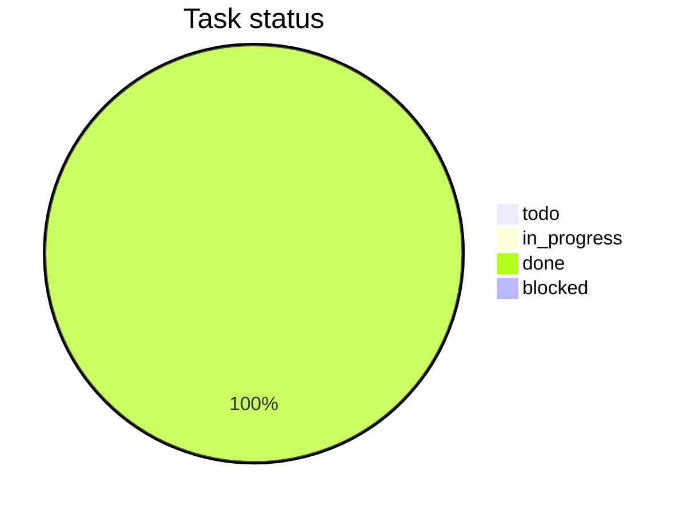
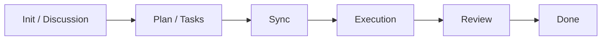

# Session overview

> Developer landing page. Keep this scannable. Refresh after sync, execution,
> review, and done. Detail lives in sibling artifacts; this file is the map.

## At a glance (80/20)

| Field | Value |
|---|---|
| Status | `done` |
| Goal | Fix 3 remaining issues from Feature 06 Review Round 2: audit atomicity, idempotency key scope, stale recovery scheduling |
| Progress | `3/3` cards done · `0` blocked · `0` needs info |
| Top risk / blocker | None |
| Next action | Review |

## Progress chart

## Open decisions

| ID | Severity | Blocking? | Visual? | Question / decision | Status |
|---|---|---|---|---|---|
| ISS-001 | Medium | No | none | Should ad-hoc SendNotificationUseCase.dispatch() be wrapped in a transaction too? | Deferred — secondary path |

## Artifact map

| Artifact | Purpose | Freshness |
|---|---|---|
| `INVESTIGATE.md` | Root cause analysis | current |
| `PLAN.md` / `TASKS.md` | Strategy + work | current |
| `EXECUTION.md` | Implementation log | missing |
| `REVIEW.md` | Quality gate | missing |
| `DONE.md` | Handoff | missing |

## Developer notes

- Fixes target commit `1b6d485` on branch `main`
- All real issues are P1 (not P0) — the P0 claims were incorrect per INVESTIGATE.md
