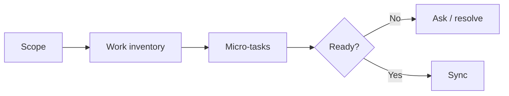

# Plan

> Filled by planning step-02. Strategy only — **no** full task cards (`### T-00x` with AC/Verify/Files) in this file.
> Session path: `.agents/sessions/Task-4-feature-06-investigate-review-round-2`. See `TASKS.md` for executable work.

## Step ledger (mandatory — update every step)

| Step | Name | Status | Evidence |
|---|---|---|---|
| 01 | Init templates | `done` | PLAN.md + TASKS.md exist |
| 02 | Fill PLAN + Spec quality | `done` | All sections filled, no blocking issues |
| 03 | Fill TASKS inventory/cards | `done` | 7 inventory rows → 3 micro-task cards |
| 04 | Self-check | `done` | All 14 checks pass |

> **Hard rule:** Do not mark a later step `done` while an earlier step is still
> `todo`/`blocked`. Do not fill TASKS before Spec quality review is done.

## Executive summary (80/20)

- Fix 3 confirmed issues from Feature 06 Review Round 2: audit atomicity, idempotency key tenant scope, and stale delivery recovery scheduling
- Approach: transaction-wrap audit logs → migrate unique index → schedule stale recovery cron
- Top risk: idempotency index migration requires care with existing data (partial index on nullable key)
- Readiness: well-scoped, no blockers — ready for TASKS definition
- Next action: fill TASKS.md inventory + micro-cards (step-03)

## Developer overview

| Field | Value |
|---|---|
| Status | `planning` |
| Cards drafted | `3` |
| Critical open decisions | `0` |
| Next action | Fill TASKS.md (step-03) |

## Charts (when useful)

## Pre-planning decision gate

| Issue ID/source | Issue / decision | Severity | Clarity | Blocking? | Visual need/format | Resolution evidence | Status |
|---|---|---|---|---|---|---|---|---|
| INV-001 | Audit atomicity: wrap job create/cancel + audit in transaction | High | Clear | No | none | INVESTIGATE.md E-005 | Resolved |
| INV-002 | Idempotency key missing `organization_id` scope | High | Clear | No | none | INVESTIGATE.md E-006 | Resolved |
| INV-003 | Stale delivery recovery not scheduled | Medium | Clear | No | none | INVESTIGATE.md E-004 | Resolved |
| INV-004 | Ad-hoc dispatch atomicity (SendNotificationUseCase) | Medium | Clear | No | none | Deferred — secondary path | Deferred |

### Questions requiring user input

| Issue | Focused question | Why the plan changes | Answer |
|---|---|---|---|
| _(none)_ | — | — | — |

> **STOP gate:** Strategy and TASKS stay unfilled while any Critical issue,
> blocking unknown, or unconfirmed `html-recommended` item is open.

## Spec quality review

### 1. Feasibility (tính khả thi)

| Finding | Evidence | Verdict |
|---|---|---|---|
| Audit atomicity — wrapping mutation + audit in same transaction is feasible with existing `TransactionPort` | Codebase already uses `transactionPort.run()` in `processClaimedJob` | Pass |
| Idempotency key + org migration is feasible — adding column to existing partial unique index | PostgreSQL allows DROP + CREATE on unique index; no data migration needed | Pass |
| Stale recovery scheduling is trivial — just add a call in existing processor | `NotificationDeliveryProcessor` already runs every 30s | Pass |

### 2. Correctness (tính đúng đắn)

| Finding | Evidence | Verdict |
|---|---|---|
| Audit should share the same DB transaction as the mutation | INVESTIGATE.md E-005 | Pass |
| Idempotency unique identity must include `organization_id` for cross-tenant safety | INVESTIGATE.md E-006 | Pass |
| `recoverStaleProcessing` exists but has no production caller — need to invoke it | INVESTIGATE.md E-004 | Pass |

### 3. Capability recommendations (khả năng feature / gaps)

| Gap ID | Missing / weak capability | Suggested question / default | Blocking? | Status |
|---|---|---|---|---|
| CAP-001 | `SendNotificationUseCase` ad-hoc dispatch not atomic | Defer — secondary path, worker scheduled jobs are the primary delivery mechanism | No | Deferred |

## Goal

Wrap job create/cancel + audit logs in shared transactions, add `organization_id` to job idempotency unique index, and schedule stale delivery recovery.

## Scope

- **T-001 — Audit atomicity for job create + cancel**: wrap `createDeliveryJob()` mutation + `auditWriter.log()` in `transactionPort.run()`; wrap `cancelJob()` `markCancelled()` + `auditWriter.log()` in same pattern; also fix `SendNotificationUseCase.execute()`
- **T-002 — Idempotency key tenant scoping**: drop + recreate unique index `notification_jobs_actor_idempotency_key_unique` to include `organization_id`; update `findByIdempotencyKey()` to accept orgId; update `createDeliveryJob()` to pass orgId
- **T-003 — Stale delivery recovery scheduling**: add periodic `recoverStaleProcessing()` call in `NotificationDeliveryProcessor`

## Non-goals

- Ad-hoc `SendNotificationUseCase` dispatch atomicity (deferred — secondary path)
- SSE Redis failure resilience (P2 follow-up, not in scope)
- `notification_deliveries` RLS/org metadata (accepted design decision per memory)

## Assumptions

| Assumption | Risk | Confirmed |
|---|---|---|
| Existing `notification_jobs` rows with `idempotency_key IS NOT NULL` are all within a single org per actor | Low — typically true in practice, index rebuild won't break existing data | No |
| `runIdempotentInsert` helper can handle the updated `findByIdempotencyKey` signature | Low — it's a generic fallback pattern | Yes |

## Approach

1. **T-001: Audit atomicity** — inject `TRANSACTION_PORT` where missing, wrap mutation + audit in `transactionPort.run(tx => { ... })`, pass executor to both DB and audit calls
2. **T-002: Idempotency key scope** — create migration (drop old unique index, create new one with `organization_id`), update port + repository signatures, update use case call sites
3. **T-003: Stale recovery scheduling** — add periodic call in `NotificationDeliveryProcessor.processDeliveries()`
4. **Verify** — run existing E2E tests + typecheck

## Affected areas

| Area / path | Expected change | Confidence |
|---|---|---|
| `notification-delivery.use-case.ts` | Wrap `createDeliveryJob()` and `cancelJob()` audit in transaction | known |
| `send-notification.use-case.ts` | Wrap `execute()` audit in transaction | known |
| `notifications.ts` (schema) | Add `organization_id` to job idempotency unique index | known |
| `notification-jobs.repository.port.ts` | Update `findByIdempotencyKey()` and `createIdempotent()` signatures to accept `organizationId` | known |
| `notification-jobs.repository.ts` | Update impl to match port + use org in lookup | known |
| `notification-delivery.processor.ts` | Add `recoverStaleProcessing()` periodic call | known |
| Migration file | Drizzle migration to recreate unique index | known |

## Test strategy

- Existing E2E tests in `apps/api/test/notifications.e2e.spec.ts` already cover conflict target, delivery pipeline, retry, stale recovery
- Run full test suite after changes

## Verification strategy

- `npx tsc -b` — typecheck clean
- `pnpm test` — all existing tests pass
- Manual review: verify transaction wrapping logic

## Definition of done

- [ ] Audit atomicity: job create/cancel + audit wrapped in transaction in all 3 use case methods
- [ ] Idempotency key includes `organization_id` (migration + code)
- [ ] `recoverStaleProcessing()` called periodically in processor
- [ ] Typecheck clean
- [ ] All existing tests pass
- [ ] `TASKS.md` complete and matches Task index below

## Rollback strategy

- **Code:** `git revert <commit>` on main branch (direct mode)
- **Config:** N/A
- **Data:** Index migration is additive; if problematic, `git revert` and re-run down migration

## Risks

| Risk | Impact | Mitigation |
|---|---|---|
| Idempotency index migration conflicts with existing rows where same actor+key used in different orgs | Low — rare in practice | Verify before migration; manual cleanup if needed |
| Transaction wrapping changes control flow for job creation (immediate processJob after create) | Low — existing flow unaffected, only audit writes move inside tx | Review the `createDeliveryJob` method carefully |

## Task index

T-001 Audit atomicity → T-002 Idempotency key tenant scope → T-003 Stale delivery recovery scheduling (see TASKS.md)

## Handoff

- Ready for sync/execution? **Yes**
- Blockers: none
