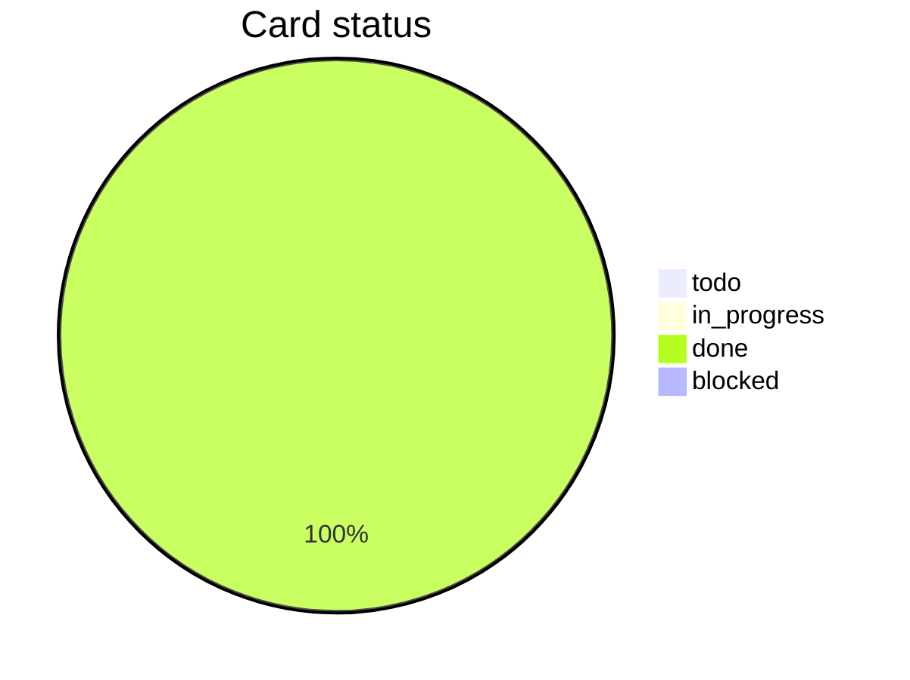

# Tasks

> Filled by planning step-03. **Work inventory first**, then micro-task cards.
> **Implement feature code before automated tests.** Do not leave template placeholders.
> **Progress:** planning seeds Status=`todo` and unchecked boxes; **execution** updates them as work completes.

plan_ref: PLAN.md

## Status legend

| Value | Meaning |
|---|---|
| `todo` | Not started |
| `in_progress` | Currently executing |
| `done` | Card AC verified for this task |
| `blocked` | Cannot proceed (note reason under Notes or on the card) |
| `skipped` | Intentionally not done (document why) |

## Work inventory

| Inv | Unit (noun + verb) | Trace (doc § / AC / contract) | Layer |
|---|---|---|---|
| I-01 | Audit atomicity for `NotificationDeliveryUseCase.createDeliveryJob()` | INVESTIGATE.md E-005 | service |
| I-02 | Audit atomicity for `NotificationDeliveryUseCase.cancelJob()` | INVESTIGATE.md E-005 | service |
| I-03 | Audit atomicity for `SendNotificationUseCase.execute()` | INVESTIGATE.md E-005 | service |
| I-04 | Add `organization_id` to `notification_jobs` idempotency unique index | INVESTIGATE.md E-006 | model |
| I-05 | Update `findByIdempotencyKey()` port + impl to accept `organizationId` | INVESTIGATE.md E-006 | model |
| I-06 | Update `createDeliveryJob()` to pass `organizationId` to idempotent create | INVESTIGATE.md E-006 | service |
| I-07 | Schedule `recoverStaleProcessing()` in `NotificationDeliveryProcessor` | INVESTIGATE.md E-004 | service |

## Progress board

| Done | ID | Title | Status |
|---|---|---|---|
| [x] | T-001 | Audit atomicity for job create/cancel/send | done |
| [x] | T-002 | Idempotency key tenant scope | done |
| [x] | T-003 | Stale delivery recovery scheduling | done |

## Progress chart

## Execution order

T-001 → T-002 → T-003

## Notes

- All 3 tasks are independent in theory, but T-001 and T-002 both touch `notification-delivery.use-case.ts` — execute sequentially to avoid merge conflicts
- Existing E2E tests at `apps/api/test/notifications.e2e.spec.ts` should continue to pass

## Tasks

### T-001: Audit atomicity for job create/cancel/send

- Status: done
- Trace: INVESTIGATE.md E-005
- Depends: none
- Work items:
  - [x] 1. `NotificationDeliveryUseCase.createDeliveryJob()` — inject `TRANSACTION_PORT`, wrap job insert + audit log in `transactionPort.run(tx => { ... })`, pass executor to both `create`/`createIdempotent` and `auditWriter.log`
  - [x] 2. `NotificationDeliveryUseCase.cancelJob()` — wrap `markCancelled()` + `auditWriter.log()` in `transactionPort.run(tx => { ... })` with same executor
  - [x] 3. `SendNotificationUseCase.execute()` — wrap `create()` + `auditWriter.log()` in `transactionPort.run(tx => { ... })` (use the existing `executor` param within the transaction)
- Description: Ensure job creation/cancellation and their audit logs are committed or rolled back atomically. If the audit write fails, the mutation is also rolled back.
- AC: `createDeliveryJob` and `cancelJob` each use a single DB transaction that includes both the mutation and audit log. `SendNotificationUseCase.execute()` also uses a transaction. If audit write throws, the mutation is not persisted.
- Verify: `npx tsc -b` clean; `pnpm test` passes; code review confirms transaction wrapping
- Flow/comment notes: Add brief comment noting why transaction is needed (audit consistency — Trace: INVESTIGATE E-005). The `createDeliveryJob` method already has a second branch for immediate `processJob()` — ensure the transaction commit happens before the immediate processing call.
- Files/scope: `packages/api-platform/src/modules/notifications/application/use-cases/notification-delivery.use-case.ts` (confidence: known)
  `packages/api-platform/src/modules/notifications/application/use-cases/send-notification.use-case.ts` (confidence: known)
- Out of scope for this card: Idempotency key changes; stale recovery

### T-002: Idempotency key tenant scope

- Status: done
- Trace: INVESTIGATE.md E-006
- Depends: none
- Work items:
  - [x] 1. Create Drizzle migration: drop `notification_jobs_actor_idempotency_key_unique` index, create new unique index on `(organization_id, actor_id, idempotency_key)` WHERE `idempotency_key IS NOT NULL`
  - [x] 2. Update `NotificationJobsRepository.findByIdempotencyKey()` to accept `organizationId: string` parameter (port doesn't declare this method — only impl)
  - [x] 3. Update `NotificationJobsRepository.findByIdempotencyKey()` impl to filter by organizationId as well
  - [x] 4. Update `NotificationJobsRepository.createIdempotent()` to pass `organizationId` through from `values.organizationId!`
  - [x] 5. Schema: update unique index to include `organization_id` + rename
  - [x] 6. `createDeliveryJob()` already spreads `jobValues` (includes `organizationId`) into `createIdempotent()` — no change needed
- Description: Add `organization_id` to the job idempotency unique constraint so the same actor using the same key in different organizations gets separate jobs instead of a false unique collision.
- AC: Unique index is `(organization_id, actor_id, idempotency_key)`; `findByIdempotencyKey()` only returns rows matching all 3 fields; `createDeliveryJob()` passes orgId when creating idempotent jobs.
- Verify: `npx tsc -b` clean; `pnpm test` passes; inspect migration SQL
- Flow/comment notes: `TODO` — `runIdempotentInsert` helper in `@repo/api-database` may need updating if its generic signature breaks. Check `packages/api-database/src/run-idempotent-insert.ts` before changing the port.
- Files/scope: `packages/api-database/src/schema/platform/notifications.ts` (confidence: known)
  `apps/api/drizzle/0023_*` (new migration file) (confidence: known)
  `packages/api-platform/src/modules/notifications/application/ports/notification-jobs.repository.port.ts` (confidence: known)
  `packages/api-platform/src/modules/notifications/infrastructure/notification-jobs.repository.ts` (confidence: known)
  `packages/api-platform/src/modules/notifications/application/use-cases/notification-delivery.use-case.ts` (confidence: known)
  `packages/api-platform/src/modules/notifications/application/use-cases/send-notification.use-case.ts` (confidence: known — if it uses `createIdempotent`)
- Out of scope for this card: Audit atomicity; stale recovery

### T-003: Stale delivery recovery scheduling

- Status: done
- Trace: INVESTIGATE.md E-004
- Depends: none
- Work items:
  - [x] 1. In `NotificationDeliveryProcessor.processDeliveries()`, added periodic `recoverStaleProcessing()` call every 10 ticks (~5min) using a tick counter
  - [x] 2. `DELIVERIES_REPOSITORY` already injected — no wiring needed
- Description: `recoverStaleProcessing()` exists in the repository but has no production caller. Add a scheduled call so PROCESSING deliveries stuck beyond timeout are automatically recovered to PENDING.
- AC: `NotificationDeliveryProcessor` periodically calls `recoverStaleProcessing()` with a reasonable timeout (e.g., 5 minutes). Stale PROCESSING rows are recovered to PENDING automatically.
- Verify: `npx tsc -b` clean; inspect processor for the recovery call
- Flow/comment notes: Use a simple counter modulo pattern (e.g., every 10th run ~= every 5 minutes) to avoid adding another cron. Add an `@Injectable` comment noting the recovery interval.
- Files/scope: `packages/api-platform/src/modules/notifications/application/services/notification-delivery.processor.ts` (confidence: known)
- Out of scope for this card: Audit atomicity; idempotency key scoping
