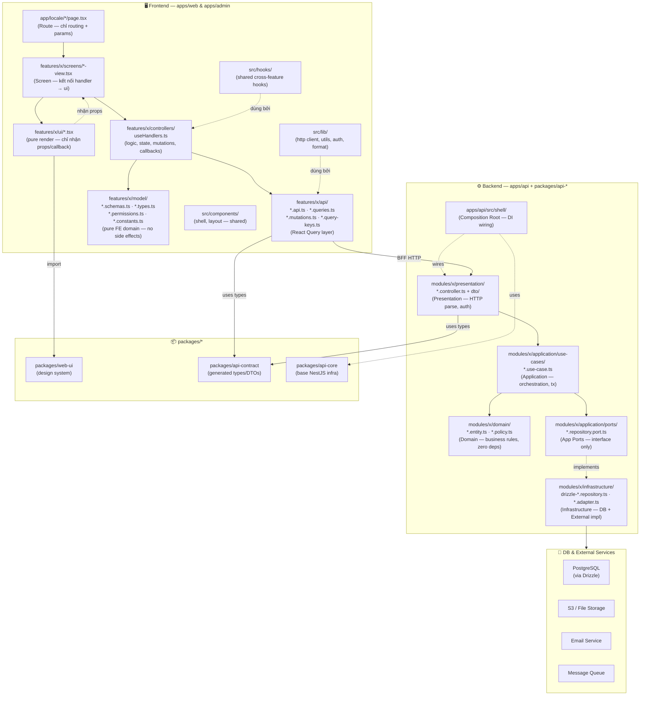
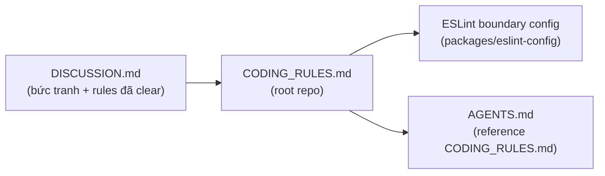

# Discussion

> Seeded by brainstorming step-01. Fill via steps 02–04. Do **not** invent PLAN/TASKS/design detail here.
> Separate **facts** vs **assumptions** vs **unknowns**. End with one clear **recommendation** + **handoff**.

## Step ledger (mandatory — update every step)

| Step | Name | Status | Evidence |
|---|---|---|---|
| 01 | Init template | `done` | `.agents/sessions/Task-5-coding-rules-brainstorming/DISCUSSION.md` |
| 02 | Frame + Spec quality | `done` | Feasibility/Correctness/Capability đã điền đầy đủ; khảo sát thư mục thực tế |
| 03 | Scope + options | `done` | Scope in/out + options matrix |
| 04 | Recommend + handoff | `done` | Chọn Option A + handoff → planning |
| 05 | Self-check | `done` | Tất cả checks passed; user đã xác nhận ISS-001,002,003 |

> **Hard rule:** Do not mark a later step `done` while an earlier step is still
> `todo`/`blocked`. Do not skip Spec quality review.

---

## Executive summary (80/20)

- **Mục tiêu:** Định nghĩa một bộ coding rules nhất quán cho toàn bộ monorepo (FE, BE, DB/External Service) để cả con người lẫn AI agent đều tuân thủ đúng, không viết lẫn lộn tầng.
- **Fact chính:** Dự án đã có kiến trúc cơ bản (Clean Architecture BE, Route→Screen→Controller→UI FE), nhưng chưa có document rules rõ ràng, enforce được để làm guideline thực thi.
- **Khuyến nghị:** Tạo tài liệu `CODING_RULES.md` chi tiết cho FE + BE + DB/External với ví dụ cụ thể và anti-pattern, áp dụng song song ESLint boundary rules để enforce tự động.
- **Rủi ro lớn nhất:** Nếu rules quá chung chung (thiếu ví dụ cụ thể) hoặc thiếu enforcement tự động, agent và dev vẫn sẽ phá vỡ kiến trúc.
- **Next action:** Chuyển sang `planning` để phân rã thành các tasks cụ thể: viết rules, viết ví dụ, cấu hình ESLint boundaries, tích hợp vào CI.

---

## Developer overview

| Field | Value |
|---|---|
| Status | `recommended` |
| Open Critical/blocking | `0` |
| Visual decisions pending | `0` |
| Next action | Handoff → `planning` |

---

## Charts (when useful)

### Bức tranh tổng thể kiến trúc — Thực tế từ codebase

### Rules flow

---

## Goal

Xây dựng bộ coding rules nhất quán và có thể enforce được cho toàn monorepo (FE Next.js, BE NestJS, DB/External), giúp cả lập trình viên và AI agent viết code đúng kiến trúc, không lẫn lộn tầng.

---

## Desired outcome

- Một tài liệu `CODING_RULES.md` (hoặc thư mục `.agents/rules/`) bao gồm:
  - Rules rõ ràng cho từng tầng (pages, features, utils, configs ở FE; Use Case, Controller, Domain, Port, Infra ở BE; Repository, Adapter ở DB/External).
  - Ví dụ đúng (Do) và sai (Don't) cụ thể, sao chép được.
  - Anti-pattern list.
- ESLint boundary config (hoặc tương đương) để tự động kiểm tra dependency sai tầng.
- Tài liệu đủ rõ để AI agent áp dụng khi viết code mà không cần hỏi lại.

---

## Confirmed facts

**Monorepo structure:**
- `apps/web`, `apps/admin` (Next.js), `apps/api` (NestJS), `apps/mobile` (Flutter), và nhiều `packages/*`.
- Stack: Node ≥ 24.14, pnpm, Turborepo, TypeScript, Drizzle ORM.

**FE — Cấu trúc thực tế (khảo sát `apps/admin/src`):**
- `features/<feature-name>/` là vertical slice chứa 5 sub-folder: `api/`, `controllers/`, `model/`, `screens/`, `ui/`.
- `api/`: `*.api.ts`, `*.queries.ts`, `*.mutations.ts`, `*.query-keys.ts` — React Query calls.
- `controllers/`: `use-*-controller.ts` — Controller Hooks (state, logic, orchestration).
- `model/`: `*.types.ts`, `*.schemas.ts`, `*.constants.ts`, `*.service.ts` — pure domain logic FE, constants, Zod schemas.
- `screens/`: `*-view.tsx` — Screen component, kết nối controller → UI.
- `ui/`: `*.tsx` — pure UI components, nhận props/callback.
- `src/hooks/`: shared hooks dùng across features (VD: `use-session.ts`, `use-bulk-mutation.ts`).
- `src/lib/`: utilities, HTTP client, auth helpers, format functions — shared infra FE.
- `src/components/`: shared shell/layout components.
- `src/app/[locale]/`: Next.js App Router pages — chỉ là routing, không chứa logic.

**apps/web — khác admin:** đơn giản hơn; features không có `controllers/` riêng, dùng `components/` thay `ui/`, có `*-service.ts` trong feature root.

**BE — Cấu trúc thực tế (packages/api-identity, api-platform):**
- `modules/<domain>/application/use-cases/` — Use Cases.
- `modules/<domain>/application/ports/` — Repository Ports (interfaces).
- `modules/<domain>/application/services/` — Application Services (nếu có).
- `modules/<domain>/domain/` — Entities, Policies, Value Objects.
- `modules/<domain>/infrastructure/` — Drizzle Repos, HTTP Adapters.
- `modules/<domain>/presentation/` — Controllers, DTOs.
- `apps/api/src/shell/` — Composition Root, module wiring.

**Business rules đã có:**
- BR-002: Cấm facade Service chỉ pass-through.
- BR-004: Application không nhận HTTP DTO trực tiếp.
- Hiện chưa có `CODING_RULES.md` hay ESLint module-boundary rules được enforce.

---

## Constraints

| Constraint | Source |
|------------|--------|
| Không thay đổi stack hoặc kiến trúc hiện tại — chỉ document + enforce rules | User |
| Rules phải machine-readable (agent-friendly), không chỉ cho con người | User |
| Phải bao quát đủ FE + BE + DB/External | User |
| Mobile (Flutter) nằm ngoài phạm vi yêu cầu lần này | Inferred từ context |

---

## Assumptions

| Assumption | Risk | Confirmed |
|------------|------|-----------|
| `features/` là vertical slice (một domain feature) | Medium | **Yes** — khảo sát thực tế `apps/admin/src/features/` xác nhận |
| Logic layer FE (`use<Feature>Handlers`) tương đương với `controllers/` hiện tại | Low | **Yes** — user xác nhận tên mới là `use<Feature>Handlers` |
| ESLint đã có tại `packages/eslint-config` | High | **Yes** — folder tồn tại trong monorepo |
| DB/External rules áp dụng cho Drizzle repos + HTTP Adapters trong `infrastructure/` | Medium | **Yes** — khảo sát `packages/api-identity/src/.../infrastructure/` xác nhận |
| Rules output là `CODING_RULES.md` tại root repo | Medium | **Yes** — user xác nhận |

---

## Unknowns

| Unknown | Blocking? | Owner |
|---------|-----------|-------|
| `apps/web` có cần cùng 5-folder structure như `apps/admin` không? (web đơn giản hơn, hiện chưa có `controllers/`) | No | User |
| External service bao gồm những loại nào? (HTTP clients, message queue, S3, email — infrastructure tự xử lý hay cần rules riêng?) | No | User |
| Có cần rules cho Flutter/Mobile không? | No | User — ngoài scope lần này |

---

## Issue triage

| ID | Issue / decision | Severity | Clarity | Blocking? | Owner | Status |
|---|---|---|---|---|---|---|
| ISS-001 | Cấu trúc thư mục `features/` FE | Medium | **Clear** | No | User | **Answered** |
| ISS-002 | Layer tách logic FE: tên convention mới | Medium | **Clear** | No | User | **Answered** |
| ISS-003 | Format/location của rules: `CODING_RULES.md` root | Medium | **Clear** | No | User | **Answered** |
| ISS-004 | Phạm vi external service (http, S3, email, queue) | Low | Partial | No | User | Open — non-blocking |
| ISS-005 | `apps/web` có cần cùng structure 5-folder như `apps/admin`? | Low | Partial | No | User | Open — non-blocking |

---

## Clarification checkpoint

| Issue ID | Focused question | Why it blocks | User answer / evidence | Resolved? |
|---|---|---|---|---|
| ISS-001 | Cấu trúc thư mục `features/` FE thực tế? | Rules cần match structure thực tế | Khảo sát `apps/admin/src/features/`: 5 sub-folder `api/`, `controllers/`, `model/`, `screens/`, `ui/` | **Yes** |
| ISS-002 | Layer tách logic FE tên gì? | Ảnh hưởng naming convention trong rules | User xác nhận: `use<Feature>Handlers` (VD: `useUsersHandlers.ts`) | **Yes** |
| ISS-003 | Format/location của rules file? | Ảnh hưởng execution | User xác nhận: `CODING_RULES.md` tại root repo | **Yes** |

> **STOP gate:** Tất cả blocking issues đã resolved. Tiếp tục scope/options.

---

## Spec quality review

### 1. Feasibility (tính khả thi)

| Question | Finding | Evidence | Verdict |
|---|---|---|---|
| Có thể xây dựng bộ rules này với stack và kiến trúc hiện tại không? | Hoàn toàn khả thi: kiến trúc đã rõ ràng (Clean Arch BE, Route→Screen→UI FE), chỉ cần document hóa và thêm lint rules | PRJ_REFERENCE.md, DESIGN.md đã mô tả layers | **Pass** |
| ESLint có thể enforce layer boundaries không? | Có — `eslint-plugin-import` + `@typescript-eslint` module-boundaries hoặc `eslint-plugin-boundaries` hỗ trợ điều này | `packages/eslint-config` hiện có | **Pass** |

- Blockers: không có

### 2. Correctness (tính đúng đắn)

| Question | Finding | Evidence | Verdict |
|---|---|---|---|
| FE layer "pages/features/utils/configs" có khớp với kiến trúc hiện tại không? | Khớp một phần: `page.tsx` là Route đã có, `features/` có thể là vertical slice grouping, `utils/` và `configs/` hợp lý. Nhưng chưa có `features/` rõ ràng trong DESIGN.md | PRJ_REFERENCE.md mô tả: Route→Screen→Controller Hook→UI | **Pass-with-gaps** |
| BE rules "Clean Architecture + DI" có khớp với NestJS pattern hiện tại không? | Khớp hoàn toàn — NestJS native DI, hiện đã có Use Cases, Domain, Ports, Infrastructure | PRJ_REFERENCE.md, DESIGN.md | **Pass** |
| "Tầng UI chỉ nhận props, không xử lý logic" có đúng với kiến trúc hiện tại? | Đúng — BR đã có: "UI Component không quản lý data"; View nhận data/callback từ Screen | PRJ_REFERENCE.md BR | **Pass** |

- Spec vs system mismatches: Khái niệm "features/" layer ở FE cần được chuẩn hóa rõ (là grouping folder hay layer riêng).

### 3. Capability recommendations (khả năng feature / gaps)

| Gap ID | Missing / weak capability | Why it matters | Suggested question / default | Blocking? |
|---|---|---|---|---|
| CAP-001 | Anti-pattern list cụ thể còn thiếu | Nếu chỉ có "do", thiếu "don't" thì developer/agent vẫn viết sai mà không nhận ra | Bổ sung ví dụ anti-pattern cho từng layer | No |
| CAP-002 | Rules cho naming conventions (file, class, hook) chưa được mention | Naming là phần quan trọng của consistency | Cần định nghĩa rõ naming pattern theo từng layer | No |
| CAP-003 | Rules cho error handling theo tầng chưa được đề cập | Lỗi throw ở tầng nào? Ai catch? Ai transform? | Định nghĩa error boundary per layer (đặc biệt BE) | No |
| CAP-004 | Thiếu rules cho testing per layer (unit, integration, e2e mapping) | Không có test rules → test sẽ lẫn lộn tầng cũng như code | Bổ sung: what to test ở mỗi layer | No |
| CAP-005 | Không có migration path / enforcement timeline | Rules tốt nhưng không có lộ trình adopt → code cũ vẫn vi phạm | Cần quyết định: enforce ngay hay grace period | No |
| CAP-006 | Rules cho State Management FE chưa có (global store vs local state vs server state) | Hay bị lộn: dùng Zustand/Context ở đâu? React Query ở đâu? | Định nghĩa rõ per layer | No |

> **STOP gate:** Không có Feasibility/Correctness Fail/Unknown blocking. Không có Capability gap Blocking=Yes. Tiếp tục step-03.

---

## Visual triage

| Issue ID | Visual need | Recommended format | Why this format helps | User confirmed? | Artifact/status |
|---|---|---|---|---|---|
| ISS-001 | useful | diagram (mermaid) | Minh họa cây thư mục FE dễ hiểu hơn text | N/A | dùng trong DISCUSSION |
| ISS-002 | none | text | Là lựa chọn naming đơn giản | N/A | inline text |
| ISS-003 | none | text | Format decision đơn giản | N/A | inline text |
| CAP-001–006 | useful | table | Gaps list, table là đủ | N/A | inline table |

---

## Scope in

- **FE (apps/web, apps/admin):** Rules cho các tầng: `page` (Route), `screen`, `feature` (vertical slice grouping), `controller hook`, `UI view`, `utils`, `configs`.
- **BE (apps/api + packages/api-*):** Rules cho Clean Architecture: `Presentation (Controller)`, `Application (Use Case)`, `Domain (Entity/Policy)`, `Application Ports (Repository Port)`, `Infrastructure (Drizzle Repo, HTTP Adapter)`.
- **DB & External Service:** Rules cho cách tương tác qua Port/Adapter pattern, không gọi raw DB/external ngoài Infrastructure layer.
- **Naming conventions** theo từng layer (file, class, hook, function).
- **Anti-pattern list** cho từng tầng.
- **ESLint boundary config** để auto-enforce.
- **Error handling rules** per layer.
- **State management rules** FE (local, server, global).
- **Agent-readable format** (rõ ràng để AI agent đọc và áp dụng).

---

## Scope out

- Mobile (Flutter) — chưa được yêu cầu trong lần này.
- `packages/web-ui` shared component rules — thuộc shared, không phải FE app layer (đã nói "không tính packages nhé").
- CI/CD pipeline config — nằm ngoài coding rules.
- Business logic cụ thể (domain rules) — chỉ define layer rules, không define business rules.
- Migration/refactor kế hoạch cho code cũ vi phạm.

---

## Non-goals

- Không thay đổi kiến trúc hiện tại — chỉ document và enforce những gì đang có.
- Không tạo code templates hay boilerplate generators ở bước này.
- Không định nghĩa API contract hay schema — đó là task khác.

---

## Options considered

| Option | Pros | Cons | Effort | Risk | Reversible? | How to verify |
|--------|------|------|--------|------|-------------|---------------|
| **A — Một file `CODING_RULES.md` toàn diện + ESLint config** | Dễ tìm, dễ reference, agent đọc một chỗ; ESLint enforce tự động | File dài nếu bao quát đủ 3 mảng; cần maintain khi kiến trúc thay đổi | Medium | Low | Yes | Review DISCUSSION → planning → review |
| **B — Nhiều file rules theo tầng (`.agents/rules/fe.md`, `be.md`, `db.md`)** | Mỗi file nhỏ, dễ update từng phần; agent chỉ cần load file liên quan | Cần index/map file; dễ bị lệch sync giữa các file | Medium | Medium | Yes | Check cross-reference và consistency |
| **C — Inline vào AGENTS.md (section mới)** | Không tạo file mới; mọi agent đã đọc AGENTS.md | AGENTS.md đã rất dài; trộn operational rules với coding rules gây khó maintain | Low | High | Yes | Kiểm tra AGENTS.md readable và không conflict |

---

## Recommendation

- **Choose:** Option A — Một file `CODING_RULES.md` toàn diện + ESLint boundary config
- **Reason:** 
  - Một điểm tham chiếu duy nhất dễ cho agent đọc và cho developer check nhanh.
  - ESLint enforce tự động → rules không chỉ là "lời khuyên" mà có răng cưa (enforcement).
  - Dễ version và review qua Git diff.
  - Phù hợp pattern đã có (AGENTS.md, CODE_COMMENTS.md, DESIGN.md — mỗi concern một file).
- **Not choosing:** 
  - B: Nhiều file gây overhead sync, phức tạp không cần thiết cho giai đoạn hiện tại.
  - C: Làm AGENTS.md nặng thêm, mixing concerns.
- **Confidence:** High

---

## Risks

| Risk | Impact | Mitigation |
|------|--------|------------|
| Rules document không đủ ví dụ cụ thể → agent vẫn viết sai | High | Mỗi rule kèm ví dụ Do/Don't và file path mẫu thực tế |
| ESLint boundary config quá strict → block valid code | Medium | Test config với codebase hiện tại trước khi merge |
| Rules stale khi kiến trúc thay đổi | Medium | Thêm note vào AGENTS.md: "khi thay đổi kiến trúc phải update CODING_RULES.md" |
| Unknown unknowns trong FE `features/` structure | Low | Khảo sát thực tế thư mục trước khi viết FE rules |

---

## Handoff

- **Next skill:** `planning`
- **Why:** Yêu cầu đủ rõ, không có blocking unknowns, kiến trúc đã được xác nhận. Planning cần phân rã thành tasks: (1) khảo sát thư mục thực tế, (2) viết FE rules, (3) viết BE rules, (4) viết DB/External rules, (5) cấu hình ESLint boundaries, (6) review + integrate.
- **Blockers before next skill:**
  - ISS-001: Cần khảo sát cấu trúc thư mục `features/` thực tế trong `apps/web` và `apps/admin` trước khi viết FE rules (có thể làm trong task planning/execution).
  - ISS-002: Layer tên "handler/logic" FE — nên xác nhận với user hoặc default là `use-*.controller.ts` (Controller Hook pattern hiện tại).
  - ISS-003: Format rules — đề xuất default là `CODING_RULES.md` ở root repo, có thể confirm với user khi planning.
