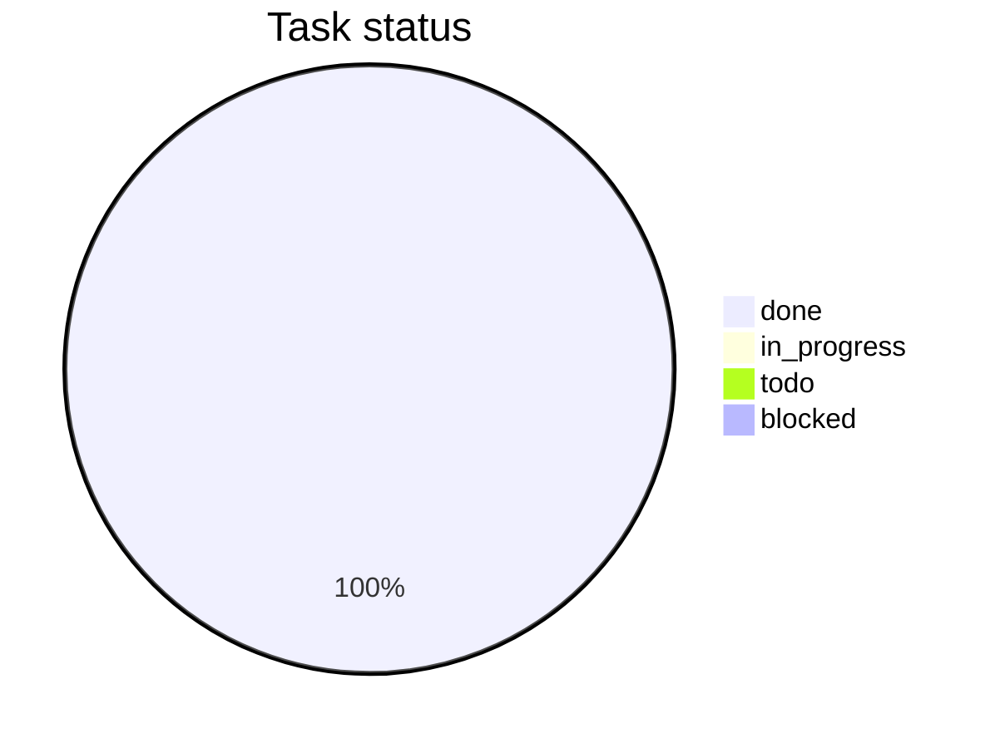

# Session overview — Task-5-coding-rules-brainstorming

> Developer landing page. Keep this scannable. Refresh after sync, execution,
> review, and done. Detail lives in sibling artifacts; this file is the map.

## At a glance (80/20)

| Field | Value |
|---|---|
| Status | `ready_for_review` |
| Goal | Tạo `CODING_RULES.md` (root repo) — rules FE + BE + DB/External + ESLint. **Round 2:** bổ sung §15 validation, §16 hook composition, §17 handler splitting, §18 error handling, §19 cache, §20 security, §21 performance |
| Progress | `17/17` cards done · `0` blocked · `0` needs info |
| Top risk / blocker | ESLint mới (`sonner` trong `api/`, params thô) = `warn` — 8 file `*.mutations.ts` vi phạm sẵn; nâng `error` sau khi migrate |
| Next action | `/review` |
| Owner | User (truongdev) |

## Progress chart

## Open decisions

| ID | Severity | Blocking? | Visual? | Question / decision | Status |
|---|---|---|---|---|---|
| DEV-001 | Low | No | none | ESLint UI/Model boundary `warn` vs `error` — nâng sau khi migrate pre-existing violations | Open (non-blocking) |

## Artifact map

| Artifact | Purpose | Freshness |
|---|---|---|
| `DISCUSSION.md` | Direction / options / architecture picture | **current** |
| `PLAN.md` | Strategy + phased approach | **current** |
| `TASKS.md` | 10 micro-task cards — all done | **current** |
| `EXECUTION.md` | Implementation log | **current** |
| `OVERVIEW.md` | This file | **current** |
| `REVIEW.md` | Quality gate | missing |
| `DONE.md` | Handoff | missing |

## Files changed summary

| File | Change |
|---|---|
| `CODING_RULES.md` (root) | ✅ Created + mở rộng — 1,799 dòng, **21 sections** |
| `packages/web-utils/src/params.ts` | ✅ New — param primitives + `parseRouteParams` / `parseSearchParams` / `internalPath` |
| `packages/web-utils/src/errors.ts` | ✅ New — `classifyError` / `getErrorMessage` / `shouldRetryQuery` |
| `packages/web-utils/src/params.test.ts` | ✅ New — 16 test (gồm 7 vector open redirect) |
| `packages/web-ui/src/components/error-fallback.tsx` | ✅ New — fallback dùng chung cho error boundary |
| `apps/{admin,web}/src/app/global-error.tsx` | ✅ New — boundary cuối cùng (repo trước đó không có) |
| `apps/{admin,web}/src/app/[locale]/error.tsx` | ✅ New — boundary theo segment, dùng `unstable_retry` |
| `apps/{admin,web}/src/app/[locale]/not-found.tsx` | ✅ New — UI 404 + ghi chú soft-404 |
| `apps/admin/.../use-user-detail-controller.ts` | ✅ Fixed — vá open redirect qua `?returnTo=` |
| `apps/admin/eslint.config.mjs` | ✅ Updated — 4 new boundary configs |
| `apps/web/eslint.config.mjs` | ✅ Updated — 4 new boundary configs (mirror) |
| `AGENTS.md` | ✅ Updated — mandatory CODING_RULES.md reference added |

## Developer notes

- **Next:** `/review` để quality gate trước khi `/done`
- **Round 2 phát hiện:** ToC đã liệt kê §15–§18 nhưng thân bài dừng ở §14 — 4 section chưa từng được viết
- **Lỗ hổng đã vá:** `?returnTo=` không kiểm tra → open redirect (phát hiện nhờ chính rule ESLint mới)
- **Next 16.2 breaking:** prop `error.tsx` là `unstable_retry`, không phải `reset`
- **ESLint warnings to watch:** 9 pre-existing violations trong `apps/admin/src/features/users/ui/` — các files import từ `controllers/` và `api/` trực tiếp trong UI layer
- **Section count:** §1..§14 (round 1) + §15 Validation, §16 Hook composition, §17 Handler splitting, §18 Error handling, §19 Cache, §20 Security, §21 Performance (round 2)
