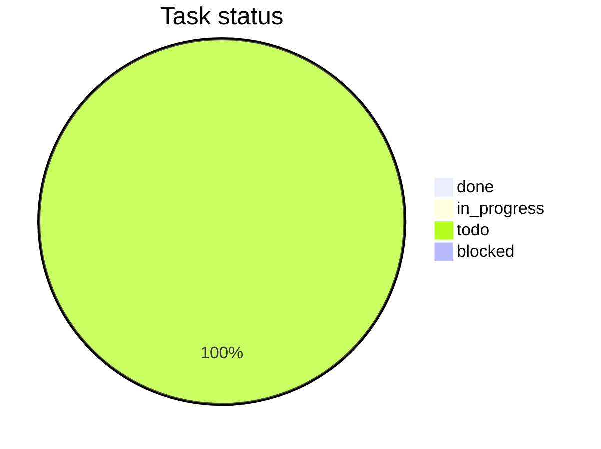

# Session overview — Task-5-coding-rules-brainstorming

> Developer landing page. Keep this scannable. Refresh after sync, execution,
> review, and done. Detail lives in sibling artifacts; this file is the map.

## At a glance (80/20)

| Field | Value |
|---|---|
| Status | `ready_for_sync` |
| Goal | Tạo `CODING_RULES.md` (root repo) — bộ rules đầy đủ FE + BE + DB/External + ESLint enforcement |
| Progress | `0/10` cards done · `0` blocked · `0` needs info |
| Top risk / blocker | ESLint plugin có thể không tương thích — fallback là document config snippet |
| Next action | `sync` → `execution` (T-001 trước: tạo CODING_RULES.md skeleton) |
| Owner | User (truongdev) |

## Progress chart

## Open decisions

| ID | Severity | Blocking? | Visual? | Question / decision | Status |
|---|---|---|---|---|---|
| ISS-004 | Low | No | none | Phạm vi external service — default: HTTP+S3+Email = Adapters | Resolved (default) |
| ISS-005 | Low | No | none | apps/web cần cùng structure 5-folder? — áp dụng as applicable | Open (non-blocking) |

## Artifact map

| Artifact | Purpose | Freshness |
|---|---|---|
| `DISCUSSION.md` | Direction / options / architecture picture | **current** |
| `PLAN.md` | Strategy + phased approach | **current** |
| `TASKS.md` | 10 micro-task cards | **current** |
| `BUSINESS_ANALYSIS.md` | Requirements | missing |
| `BASIC_DESIGN.md` / `DETAIL_DESIGN.md` | Design | missing |
| `SYNC.md` | Readiness | missing |
| `EXECUTION.md` | Implementation log | missing |
| `REVIEW.md` | Quality gate | missing |
| `TESTCASES.md` | Verification design | missing |
| `DONE.md` | Handoff | missing |

## Developer notes

- **Commands to run next:**
  - `bash .agents/tools/session/session.sh current` → confirm session path
  - Chạy `/sync` rồi `/execution` để bắt đầu viết `CODING_RULES.md`
- **Files/paths to inspect first (trước T-010):**
  - `packages/eslint-config/` — format config hiện tại
  - `AGENTS.md` — nơi thêm reference link
- **What not to touch:**
  - Không thay đổi code runtime
  - Không rename `use-*-controller.ts` cũ
  - Không sửa kiến trúc hiện tại
- **Execution T-001..T-009:** tất cả append vào cùng file `CODING_RULES.md`
