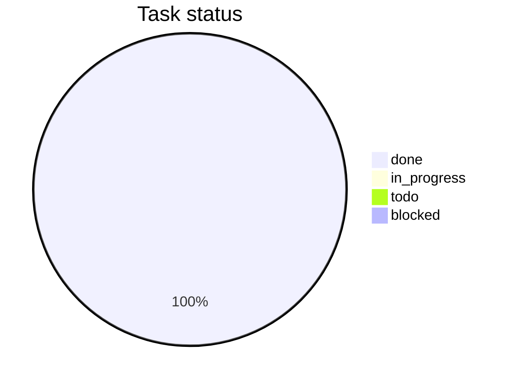

# Session overview — Task-5-coding-rules-brainstorming

> Developer landing page. Keep this scannable. Refresh after sync, execution,
> review, and done. Detail lives in sibling artifacts; this file is the map.

## At a glance (80/20)

| Field | Value |
|---|---|
| Status | `ready_for_review` |
| Goal | Tạo `CODING_RULES.md` (root repo) — bộ rules đầy đủ FE + BE + DB/External + ESLint enforcement |
| Progress | `10/10` cards done · `0` blocked · `0` needs info |
| Top risk / blocker | UI/Model ESLint rules = `warn` (pre-existing violations) — nâng lên `error` sau khi migrate |
| Next action | `/review` |
| Owner | User (truongdev) |

## Progress chart

## Open decisions

| ID | Severity | Blocking? | Visual? | Question / decision | Status |
|---|---|---|---|---|---|
| DEV-001 | Low | No | none | ESLint UI/Model boundary `warn` vs `error` — nâng sau khi migrate pre-existing violations | Open (non-blocking) |

## Artifact map

| Artifact | Purpose | Freshness |
|---|---|---|
| `DISCUSSION.md` | Direction / options / architecture picture | **current** |
| `PLAN.md` | Strategy + phased approach | **current** |
| `TASKS.md` | 10 micro-task cards — all done | **current** |
| `EXECUTION.md` | Implementation log | **current** |
| `OVERVIEW.md` | This file | **current** |
| `REVIEW.md` | Quality gate | missing |
| `DONE.md` | Handoff | missing |

## Files changed summary

| File | Change |
|---|---|
| `CODING_RULES.md` (root) | ✅ Created — 41,687 bytes, 14 sections |
| `apps/admin/eslint.config.mjs` | ✅ Updated — 4 new boundary configs |
| `apps/web/eslint.config.mjs` | ✅ Updated — 4 new boundary configs (mirror) |
| `AGENTS.md` | ✅ Updated — mandatory CODING_RULES.md reference added |

## Developer notes

- **Next:** `/review` để quality gate trước khi `/done`
- **ESLint warnings to watch:** 9 pre-existing violations trong `apps/admin/src/features/users/ui/` — các files import từ `controllers/` và `api/` trực tiếp trong UI layer
- **Section count:** CODING_RULES.md §1..§14 = Legend + Monorepo + FE Route + FE Screen + FE Handler + FE API + FE Model + FE UI + Shared dirs + Dependency matrix + BE Clean Arch + DB/External + ESLint + Naming Quick Ref
