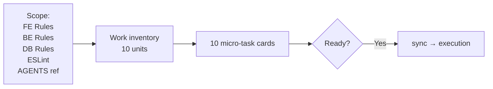

# Plan

> Filled by planning step-02. Strategy only — **no** full task cards (`### T-00x` với AC/Verify/Files) trong file này.
> Session: `.agents/sessions/Task-5-coding-rules-brainstorming/`

## Step ledger (mandatory — update every step)

| Step | Name | Status | Evidence |
|---|---|---|---|
| 01 | Init templates | `done` | PLAN.md + TASKS.md exist trong session |
| 02 | Fill PLAN + Spec quality | `done` | Feasibility Pass, Correctness Pass, Capability gaps documented |
| 03 | Fill TASKS inventory/cards | `done` | 10 inventory rows + 10 task cards |
| 04 | Self-check | `done` | Ready=Yes, no blockers |

> **Hard rule:** Do not mark a later step `done` while an earlier step is still
> `todo`/`blocked`. Do not fill TASKS before Spec quality review is done.

---

## Executive summary (80/20)

- **Goal:** Tạo `CODING_RULES.md` tại root repo — bộ rules nhất quán cho FE (5 layers), BE (Clean Arch), DB/External — enforce bởi ESLint boundaries.
- **Approach:** Viết rules theo thứ tự: FE layers → BE layers → DB/External → ESLint config → tích hợp AGENTS.md — tất cả là documentation, không thay đổi code.
- **Top risk:** Rules thiếu ví dụ Do/Don't cụ thể → agent vẫn viết sai; giảm thiểu bằng mỗi rule kèm code snippet thực tế từ codebase.
- **Ready:** Yes — không có blocker; có thể bắt đầu execution ngay.
- **Next action:** `sync` → `execution` (viết `CODING_RULES.md` + cập nhật `packages/eslint-config`).

---

## Developer overview

| Field | Value |
|---|---|
| Status | `ready_for_sync` |
| Cards drafted | `10` |
| Critical open decisions | `0` |
| Next action | sync → execution |

---

## Charts (when useful)

---

## Pre-planning decision gate

> Kế thừa từ DISCUSSION.md — tất cả issues đã resolved.

| Issue ID/source | Issue / decision | Severity | Clarity | Blocking? | Visual need/format | Resolution evidence | Status |
|---|---|---|---|---|---|---|---|
| ISS-001 / DISCUSSION | Cấu trúc `features/` FE | Medium | Clear | No | none | Khảo sát `apps/admin/src/features/`: 5 sub-folders confirmed | **Resolved** |
| ISS-002 / DISCUSSION | Tên layer logic FE | Medium | Clear | No | none | User xác nhận: `use<Feature>Handlers.ts` | **Resolved** |
| ISS-003 / DISCUSSION | Location của rules file | Medium | Clear | No | none | User xác nhận: `CODING_RULES.md` ở root repo | **Resolved** |
| ISS-004 / DISCUSSION | Phạm vi external service | Low | Partial | No | none | Default: HTTP adapters + S3 + Email = đều là Adapter trong `infrastructure/` | **Resolved (default)** |

### Questions requiring user input

| Issue | Focused question | Why the plan changes | Answer |
|---|---|---|---|
| (none) | — | — | N/A |

> **STOP gate:** Không có blocking items. Tiếp tục fill strategy.

---

## Spec quality review

### 1. Feasibility (tính khả thi)

| Finding | Evidence | Verdict |
|---|---|---|
| Toàn bộ task là viết documentation + config — không thay đổi runtime code | DISCUSSION.md khảo sát thực tế | **Pass** |
| ESLint boundary có thể thêm vào `packages/eslint-config` hiện có | Folder tồn tại trong monorepo | **Pass** |
| Không cần build step hay migration | Chỉ thêm file `.md` và update ESLint config | **Pass** |

### 2. Correctness (tính đúng đắn)

| Finding | Evidence | Verdict |
|---|---|---|
| FE 5-layer structure khớp với `apps/admin/src/features/` thực tế | Khảo sát: `api/`, `controllers/`, `model/`, `screens/`, `ui/` | **Pass** |
| BE Clean Arch khớp với `packages/api-identity/src/modules/*/` | Khảo sát: `presentation/`, `application/use-cases/`, `domain/`, `infrastructure/` | **Pass** |
| Naming convention `use<Feature>Handlers.ts` phù hợp pattern hiện tại | User xác nhận; pattern hiện tại là `use-*-controller.ts` → rename convention | **Pass-with-gaps** — cần note về backward compat naming |

### 3. Capability recommendations (khả năng feature / gaps)

| Gap ID | Missing / weak capability | Suggested question / default | Blocking? | Status |
|---|---|---|---|---|
| CAP-001 | Anti-pattern list (Don't examples) | Default: mỗi rule kèm ví dụ WRONG bên cạnh CORRECT | No | **Resolved (default)** |
| CAP-002 | Naming conventions per layer | Default: document trong CODING_RULES.md theo từng layer | No | **Resolved (default)** |
| CAP-003 | Error handling per layer | Default: document trong phần BE rules — Use Case throws, Infra translates | No | **Resolved (default)** |
| CAP-004 | State management FE rules | Default: local state trong `ui/`, server state trong `api/`, global trong `hooks/` | No | **Resolved (default)** |
| CAP-005 | Test per layer | Deferred — out of scope lần này (không có yêu cầu test rules) | No | **Deferred** |
| CAP-006 | Migration path cho code cũ | Deferred — out of scope | No | **Deferred** |

---

## Goal

Tạo tài liệu `CODING_RULES.md` tại root repo và cập nhật ESLint config, định nghĩa đầy đủ rules cho 3 mảng (FE layers, BE Clean Arch, DB/External) với ví dụ Do/Don't và naming conventions, có thể đọc được bởi cả con người lẫn AI agent.

---

## Scope

- **FE rules** — 6 deliverables:
  1. Route layer rules (`app/*/page.tsx`)
  2. Screen layer rules (`features/*/screens/*-view.tsx`)
  3. Handler layer rules (`features/*/controllers/use<Feature>Handlers.ts`)
  4. API layer rules (`features/*/api/`)
  5. Model layer rules (`features/*/model/`)
  6. UI layer rules (`features/*/ui/*.tsx`)
  7. Shared dirs rules (`src/hooks/`, `src/lib/`, `src/components/`)
- **BE rules** — 5 deliverables:
  1. Presentation layer rules (`presentation/*.controller.ts`)
  2. Application layer rules (`application/use-cases/`)
  3. Domain layer rules (`domain/`)
  4. App Ports rules (`application/ports/`)
  5. Infrastructure layer rules (`infrastructure/`)
- **DB/External rules** — 3 deliverables:
  1. Port-first pattern
  2. No raw queries outside Infrastructure
  3. Adapter pattern cho external services
- **ESLint boundary config** — 1 deliverable: `packages/eslint-config` cập nhật import boundaries
- **AGENTS.md integration** — 1 deliverable: thêm reference `CODING_RULES.md` vào AGENTS.md

---

## Non-goals

- Không thay đổi code hiện tại (chỉ document + config)
- Không refactor naming convention trong code cũ (chỉ document convention mới)
- Không viết rules cho Flutter/Mobile
- Không viết test rules (deferred)
- Không viết migration plan cho code vi phạm

---

## Assumptions

| Assumption | Risk | Confirmed |
|------------|------|-----------|
| `packages/eslint-config` có thể thêm `eslint-plugin-boundaries` hoặc `eslint-plugin-import` rules | Medium | No — cần check format hiện tại khi execution |
| `apps/web` có thể dùng cùng FE rules với `apps/admin` (chấp nhận subset) | Low | Yes — web đơn giản hơn, rules áp dụng as applicable |
| AGENTS.md có thể thêm reference link mà không phá vỡ format | Low | Yes — AGENTS.md là markdown file |

---

## Approach

1. **Phase 1 — Viết `CODING_RULES.md`:** Cấu trúc file, header, FE rules (6 layers + shared), BE rules (5 layers), DB/External rules (3 patterns) — mỗi rule kèm Do/Don't code snippet thực tế.
2. **Phase 2 — ESLint boundary config:** Khảo sát format `packages/eslint-config` hiện tại; thêm import boundary rules phù hợp để enforce layer dependency.
3. **Phase 3 — Tích hợp AGENTS.md:** Thêm reference đến `CODING_RULES.md` để agent đọc tự động khi bắt đầu task coding.

---

## Affected areas

| Area / path | Expected change | Confidence |
|-------------|-----------------|------------|
| `CODING_RULES.md` (root) | Tạo mới — file chính | known |
| `packages/eslint-config/` | Cập nhật — thêm boundary rules | inferred |
| `AGENTS.md` (root) | Cập nhật nhỏ — thêm reference link | known |

---

## Test strategy

- N/A — task là viết documentation + config, không có code logic để test.
- Verification: lint check pass sau khi thêm ESLint config.

---

## Verification strategy

- **Manual:** Đọc lại `CODING_RULES.md` và kiểm tra đủ tất cả 6 FE + 5 BE + 3 DB/External sections, mỗi section có Do/Don't.
- **Automated:** Chạy `pnpm run lint` để confirm ESLint boundary rules không break existing code (chỉ warn, không error ở bước đầu).

---

## Definition of done

- [ ] `CODING_RULES.md` tồn tại ở root repo với đầy đủ sections FE + BE + DB/External
- [ ] Mỗi layer rule có ít nhất 1 ví dụ Do và 1 ví dụ Don't với code snippet thực tế
- [ ] Naming convention được document rõ cho từng layer
- [ ] ESLint config đã được cập nhật (hoặc documented nếu plugin chưa có)
- [ ] AGENTS.md đã có reference đến CODING_RULES.md
- [ ] `TASKS.md` complete và matches Task index

---

## Rollback strategy

- **Code:** Không có code changes — chỉ tạo/sửa markdown file và ESLint config. Git revert đơn giản.
- **Config:** Nếu ESLint rule mới gây lỗi build, revert `packages/eslint-config` thay đổi.
- **Data:** N/A

---

## Risks

| Risk | Impact | Mitigation |
|------|--------|------------|
| ESLint boundary plugin không tương thích với cấu hình hiện tại | Medium | Khảo sát format ESLint config trước khi thêm; fallback là document rules thủ công |
| Rules quá chung → agent vẫn viết sai | High | Mỗi rule kèm code snippet cụ thể từ codebase; tag `WRONG` / `CORRECT` |
| CODING_RULES.md quá dài → agent không đọc hết | Medium | Dùng cấu trúc scannable (bảng, headers rõ ràng), tối đa 1 file nhưng dễ navigate |
| Naming conflict: `use<Feature>Handlers` vs `use-*-controller` hiện tại | Low | Document rõ: convention mới cho code tạo mới; code cũ không bắt buộc rename |

---

## Task index

T-001 Tạo `CODING_RULES.md` skeleton + header →
T-002 Viết FE Route layer rules →
T-003 Viết FE Screen layer rules →
T-004 Viết FE Handler layer rules (`use<Feature>Handlers`) →
T-005 Viết FE API layer rules →
T-006 Viết FE Model layer rules →
T-007 Viết FE UI layer + Shared dirs rules →
T-008 Viết BE rules (5 layers: Presentation → Application → Domain → Ports → Infra) →
T-009 Viết DB/External Service rules →
T-010 Cập nhật ESLint config + AGENTS.md reference

(xem TASKS.md)

---

## Handoff

- Ready for sync/execution? **Yes**
- Blockers: none
