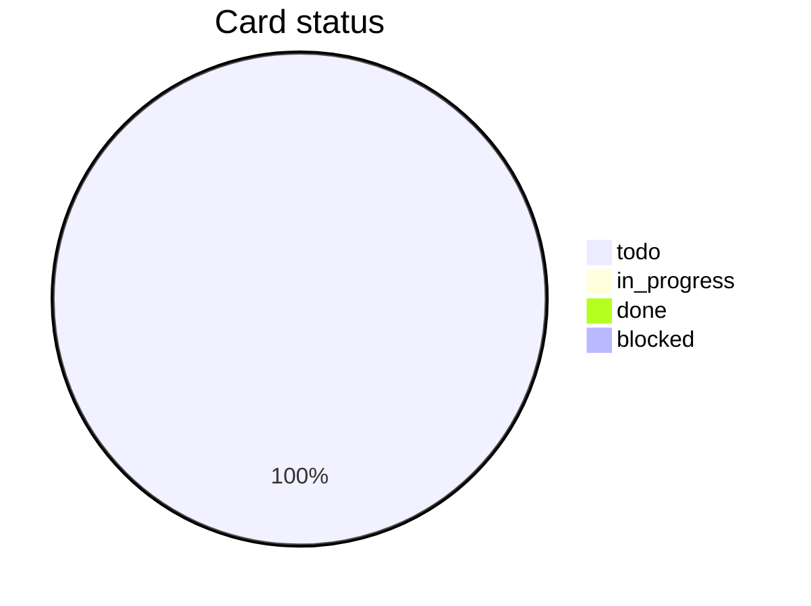

# Tasks

> Filled by planning step-03. **Work inventory first**, then micro-task cards.
> **Implement feature code before automated tests.** Do not leave template placeholders.
> **Progress:** planning seeds Status=`todo` and unchecked boxes; **execution** updates them as work completes.

plan_ref: PLAN.md

## Status legend

| Value | Meaning |
|-------|---------|
| `todo` | Not started |
| `in_progress` | Currently executing |
| `done` | Card AC verified for this task |
| `blocked` | Cannot proceed (note reason under Notes or on the card) |
| `skipped` | Intentionally not done (document why) |

---

## Work inventory

| Inv | Unit (noun + verb) | Trace (doc § / AC / contract) | Layer |
|-----|--------------------|-------------------------------|-------|
| I-01 | `CODING_RULES.md` skeleton: tạo file, header, mục lục, legend | DISCUSSION §Goal, §Scope | doc |
| I-02 | FE Route layer: viết rules + Do/Don't cho `app/*/page.tsx` | DISCUSSION §FE Rules — Route | doc/fe |
| I-03 | FE Screen layer: viết rules + Do/Don't cho `features/*/screens/*-view.tsx` | DISCUSSION §FE Rules — Screen | doc/fe |
| I-04 | FE Handler layer: viết rules + Do/Don't cho `use<Feature>Handlers.ts` | DISCUSSION §FE Rules — Handler; ISS-002 | doc/fe |
| I-05 | FE API layer: viết rules + Do/Don't cho `features/*/api/` | DISCUSSION §FE Rules — API | doc/fe |
| I-06 | FE Model layer: viết rules + Do/Don't cho `features/*/model/` | DISCUSSION §FE Rules — Model | doc/fe |
| I-07 | FE UI layer + Shared dirs: viết rules cho `features/*/ui/`, `src/hooks/`, `src/lib/` | DISCUSSION §FE Rules — UI, Shared | doc/fe |
| I-08 | BE rules (5 layers): Presentation → Application → Domain → Ports → Infra | DISCUSSION §BE Rules; PRJ_REFERENCE BR-002, BR-004 | doc/be |
| I-09 | DB/External Service rules: Port-first, no raw queries, Adapter pattern | DISCUSSION §DB/External Rules | doc/db |
| I-10 | ESLint boundary config update + AGENTS.md reference | PLAN §Affected areas; DISCUSSION §handoff | config |

---

## Progress board

| Done | ID | Title | Status |
|------|----|-------|--------|
| [ ] | T-001 | Tạo CODING_RULES.md skeleton + header | todo |
| [ ] | T-002 | Viết FE Route layer rules | todo |
| [ ] | T-003 | Viết FE Screen layer rules | todo |
| [ ] | T-004 | Viết FE Handler layer rules | todo |
| [ ] | T-005 | Viết FE API layer rules | todo |
| [ ] | T-006 | Viết FE Model layer rules | todo |
| [ ] | T-007 | Viết FE UI layer + Shared dirs rules | todo |
| [ ] | T-008 | Viết BE rules (5 layers) | todo |
| [ ] | T-009 | Viết DB/External Service rules | todo |
| [ ] | T-010 | Cập nhật ESLint config + AGENTS.md ref | todo |

## Progress chart

<!-- Do NOT hand-edit. Regenerate from card states:
`bash .agents/tools/session/session.sh status` and paste its pie here. -->

## Execution order

T-001 → T-002 → T-003 → T-004 → T-005 → T-006 → T-007 → T-008 → T-009 → T-010

## Notes

- T-001 phải done trước tất cả các T-002..T-009 vì chúng đều append vào cùng file.
- T-002..T-009 có thể viết theo thứ tự FE → BE → DB; mỗi task append section tương ứng.
- T-010 là bước cuối: chỉ thực hiện sau khi `CODING_RULES.md` đã hoàn chỉnh.
- Tất cả tasks là viết document — không có code runtime thay đổi.

---

## Tasks

### T-001: Tạo CODING_RULES.md skeleton + header

- Status: todo
- Trace: DISCUSSION §Goal, §Scope in; PLAN §Goal
- Depends: none
- Work items:
  - [ ] 1. Tạo file `CODING_RULES.md` tại root repo (cùng cấp với `AGENTS.md`)
  - [ ] 2. Viết header: mục đích file, audience (developer + AI agent), last-updated, how-to-use
  - [ ] 3. Viết mục lục (Table of Contents) với anchor links đến từng section
  - [ ] 4. Viết phần Legend/Key: giải thích ký hiệu `✅ DO`, `❌ DON'T`, naming convention notation
  - [ ] 5. Viết phần "Monorepo Structure Overview": bản đồ thư mục ngắn gọn (apps/web, apps/admin, apps/api, packages/*)
- Description: Tạo skeleton file với header, ToC, và legend — làm nền cho tất cả các section tiếp theo.
- AC: File `CODING_RULES.md` tồn tại ở root repo; có ToC với links đến ≥5 sections chính; có legend giải thích ký hiệu DO/DON'T.
- Verify: `ls CODING_RULES.md` thành công; đọc ToC và xác nhận có đủ sections FE + BE + DB + ESLint.
- Flow/comment notes: N/A — file mới hoàn toàn, không có logic phức tạp.
- Files/scope: `CODING_RULES.md` (create at repo root) (confidence: known)
- Out of scope for this card: Nội dung rules cụ thể — các T-002..T-009 sẽ viết.

---

### T-002: Viết FE Route layer rules

- Status: todo
- Trace: DISCUSSION §Confirmed facts — "app/[locale]/*/page.tsx — chỉ routing, không chứa logic"; PLAN §Scope FE #1
- Depends: T-001
- Work items:
  - [ ] 1. Append section `## FE Layer 1: Route (page.tsx)` vào `CODING_RULES.md`
  - [ ] 2. Viết trách nhiệm của Route: URL routing, đọc `searchParams`/`params`, import Screen component
  - [ ] 3. Viết rules: (a) chỉ import Screen; (b) không chứa JSX logic; (c) không gọi API; (d) không import từ `features/*/controllers/` hay `features/*/api/`
  - [ ] 4. Viết naming convention: `page.tsx` (Next.js convention), file path: `app/[locale]/(app)/<route>/page.tsx`
  - [ ] 5. Viết ví dụ `✅ DO`: route truyền params xuống Screen (lấy ví dụ từ `apps/admin/src/app/[locale]/(app)/users/page.tsx`)
  - [ ] 6. Viết ví dụ `❌ DON'T`: route chứa `useState`, `useEffect`, hay gọi API trực tiếp
- Description: Document đầy đủ Route layer rules — input/output, naming, anti-pattern.
- AC: Section FE Route trong `CODING_RULES.md` có ≥3 rules, ≥1 DO example, ≥1 DON'T example, naming convention rõ ràng.
- Verify: Đọc section; confirm có đủ rules, examples thực tế từ codebase không phải generic.
- Flow/comment notes: N/A
- Files/scope: `CODING_RULES.md` (append section) (confidence: known)
- Out of scope: Screen layer rules — T-003.

---

### T-003: Viết FE Screen layer rules

- Status: todo
- Trace: DISCUSSION §Confirmed facts — `features/*/screens/*-view.tsx`; PLAN §Scope FE #2
- Depends: T-002
- Work items:
  - [ ] 1. Append section `## FE Layer 2: Screen (*-view.tsx)` vào `CODING_RULES.md`
  - [ ] 2. Viết trách nhiệm: kết nối Handler → UI; layout; không có business logic
  - [ ] 3. Viết rules: (a) import Handler hook + UI components; (b) gọi handler functions; (c) pass data/callbacks xuống UI; (d) không gọi API trực tiếp; (e) không chứa business logic
  - [ ] 4. Viết naming convention: `<feature>-view.tsx` trong `features/<name>/screens/`
  - [ ] 5. Viết ví dụ `✅ DO`: Screen lấy data từ handler, truyền xuống table/form UI (ví dụ từ `users-view.tsx` thực tế)
  - [ ] 6. Viết ví dụ `❌ DON'T`: Screen gọi `useQuery` trực tiếp, xử lý mutation, hay chứa complex conditional logic
- Description: Document Screen layer rules với ví dụ từ `apps/admin/src/features/users/screens/users-view.tsx`.
- AC: Section FE Screen có ≥4 rules, ≥1 DO, ≥1 DON'T, naming pattern rõ.
- Verify: Đọc section; mỗi rule có thể verify bằng cách đọc file thực tế trong repo.
- Flow/comment notes: N/A
- Files/scope: `CODING_RULES.md` (append section) (confidence: known)
- Out of scope: Handler layer — T-004.

---

### T-004: Viết FE Handler layer rules

- Status: todo
- Trace: DISCUSSION ISS-002 (user confirmed: `use<Feature>Handlers`); PLAN §Scope FE #3; PRJ_REFERENCE §Frontend Controller
- Depends: T-003
- Work items:
  - [ ] 1. Append section `## FE Layer 3: Handler (use<Feature>Handlers.ts)` vào `CODING_RULES.md`
  - [ ] 2. Viết trách nhiệm: state management, React Query calls, mutations, side effects, callbacks
  - [ ] 3. Viết naming convention: `use<Feature>Handlers.ts` trong `features/<name>/controllers/` (VD: `useUsersHandlers.ts`, `useAuditLogsHandlers.ts`)
  - [ ] 4. Viết rules: (a) không render JSX; (b) return object chứa state + handlers; (c) import từ `api/` và `model/`; (d) không import UI components; (e) mỗi handler file = 1 screen scope
  - [ ] 5. Viết quy tắc naming handler functions: `handle<Action>` (VD: `handleCreateUser`, `handleBulkDelete`)
  - [ ] 6. Viết ví dụ `✅ DO`: hook return `{ users, isLoading, handleCreate, handleDelete }` (ví dụ pattern từ `use-users-list-controller.ts`)
  - [ ] 7. Viết ví dụ `❌ DON'T`: handler import React component, trực tiếp mutate DOM, hay render JSX
- Description: Document Handler layer — layer quan trọng nhất của FE, nơi tách logic khỏi UI.
- AC: Section FE Handler có ≥5 rules, naming convention rõ, ≥1 DO + ≥1 DON'T, có note về backward compat với `use-*-controller.ts` cũ.
- Verify: Đọc section; pattern `use<Feature>Handlers` rõ ràng; note backward compat có mặt.
- Flow/comment notes: Cần note rõ: code hiện tại dùng `use-*-controller.ts`, convention mới là `use<Feature>Handlers.ts` — áp dụng cho code tạo mới.
- Files/scope: `CODING_RULES.md` (append section) (confidence: known)
- Out of scope: API layer — T-005.

---

### T-005: Viết FE API layer rules

- Status: todo
- Trace: DISCUSSION §Confirmed facts — `features/*/api/`; PLAN §Scope FE #4
- Depends: T-004
- Work items:
  - [ ] 1. Append section `## FE Layer 4: API Layer (features/*/api/)` vào `CODING_RULES.md`
  - [ ] 2. Viết trách nhiệm và phân chia file: `*.api.ts` (fetch functions), `*.queries.ts` (useQuery hooks), `*.mutations.ts` (useMutation hooks), `*.query-keys.ts` (query key factory)
  - [ ] 3. Viết rules: (a) `*.api.ts` chỉ là fetch function thuần; (b) `*.queries.ts` wrap `*.api.ts` bằng `useQuery`; (c) không xử lý UI logic trong api layer; (d) error handling ở đây chỉ là re-throw, không show toast
  - [ ] 4. Viết naming convention: `<feature>.api.ts`, `<feature>.queries.ts`, `<feature>.mutations.ts`, `<feature>.query-keys.ts`
  - [ ] 5. Viết ví dụ `✅ DO`: `users.api.ts` với fetch function; `users.queries.ts` với `useQuery`
  - [ ] 6. Viết ví dụ `❌ DON'T`: gọi `toast()` trong api file; import React component; mix fetch và query hook trong 1 file
- Description: Document API layer — React Query abstraction pattern.
- AC: Section FE API có 4 file type được document, ≥3 rules, ≥1 DO, ≥1 DON'T.
- Verify: Đọc section; 4 file types có đủ; rules phân biệt rõ trách nhiệm từng file.
- Flow/comment notes: N/A
- Files/scope: `CODING_RULES.md` (append section) (confidence: known)
- Out of scope: Model layer — T-006.

---

### T-006: Viết FE Model layer rules

- Status: todo
- Trace: DISCUSSION §Confirmed facts — `features/*/model/`; PLAN §Scope FE #5
- Depends: T-005
- Work items:
  - [ ] 1. Append section `## FE Layer 5: Model (features/*/model/)` vào `CODING_RULES.md`
  - [ ] 2. Viết trách nhiệm: Zod schemas, TypeScript types, permission checks, constants, pure functions
  - [ ] 3. Viết phân chia file: `*.schemas.ts` (Zod), `*.types.ts` (TS types), `*.permissions.ts` (permission logic), `*.constants.ts`, `*.search-params.ts`
  - [ ] 4. Viết rules: (a) không import React hay hooks; (b) không gọi API; (c) không có side effects; (d) chỉ là pure functions + type definitions; (e) không import từ `controllers/`, `screens/`, `ui/`, `api/`
  - [ ] 5. Viết ví dụ `✅ DO`: `users.schemas.ts` với Zod schema; `users.permissions.ts` với pure permission check function
  - [ ] 6. Viết ví dụ `❌ DON'T`: model file import `useQuery`, gọi `fetch`, hay có `useEffect`
- Description: Document Model layer — FE domain logic thuần, không có framework dependency.
- AC: Section FE Model có ≥4 rules, file breakdown rõ, ≥1 DO, ≥1 DON'T.
- Verify: Đọc section; rules đủ rõ để phân biệt model với service layer.
- Flow/comment notes: N/A
- Files/scope: `CODING_RULES.md` (append section) (confidence: known)
- Out of scope: UI layer — T-007.

---

### T-007: Viết FE UI layer + Shared dirs rules

- Status: todo
- Trace: DISCUSSION §Confirmed facts — `features/*/ui/`, `src/hooks/`, `src/lib/`, `src/components/`; PLAN §Scope FE #6, #7
- Depends: T-006
- Work items:
  - [ ] 1. Append section `## FE Layer 6: UI Components (features/*/ui/*.tsx)` vào `CODING_RULES.md`
  - [ ] 2. Viết rules UI: (a) chỉ nhận props và callbacks; (b) không gọi `useQuery`/`useMutation`; (c) không dùng global store; (d) local state chỉ cho UI-only state (open/close dialog); (e) không import từ `api/`, `controllers/`
  - [ ] 3. Viết ví dụ DO/DON'T cho UI layer
  - [ ] 4. Append section `## FE Shared Directories` với 3 sub-sections:
    - `src/hooks/`: shared hooks dùng across ≥2 features; không chứa feature-specific logic
    - `src/lib/`: utilities, HTTP client, constants; không import từ `features/`
    - `src/components/`: shared shell/layout; không import từ `features/`
  - [ ] 5. Viết Import dependency diagram: ai có thể import từ ai (dạng bảng hoặc mermaid)
- Description: Document UI layer rules và 3 shared directories, bao gồm dependency matrix.
- AC: Section FE UI có ≥4 rules, ≥1 DO, ≥1 DON'T; 3 shared dirs được document; có dependency matrix.
- Verify: Đọc section; dependency matrix rõ ràng — layer nào được phép import từ layer nào.
- Flow/comment notes: Dependency matrix là phần quan trọng nhất — dùng bảng hoặc diagram để rõ ràng.
- Files/scope: `CODING_RULES.md` (append sections) (confidence: known)
- Out of scope: BE rules — T-008.

---

### T-008: Viết BE rules (5 layers)

- Status: todo
- Trace: DISCUSSION §BE Rules; PRJ_REFERENCE BR-002, BR-004; `packages/api-identity/src/modules/` structure
- Depends: T-007
- Work items:
  - [ ] 1. Append section `## BE Clean Architecture Rules` vào `CODING_RULES.md` với overview dependency direction
  - [ ] 2. Viết **Presentation layer** rules: parse HTTP, validate DTO, gọi Use Case; không chứa business logic; không gọi Port/Repo trực tiếp; naming: `*.controller.ts` trong `presentation/`
  - [ ] 3. Viết **Application layer** rules: orchestrate Domain + Ports; transaction boundary; không import `Request`/`Response` HTTP; naming: `*.use-case.ts` trong `application/use-cases/`; Application Service khi cần (`*.service.ts`)
  - [ ] 4. Viết **Domain layer** rules: zero framework dependency; business rules + invariants; naming: `*.entity.ts`, `*.policy.ts`; không throw HTTP errors
  - [ ] 5. Viết **App Ports layer** rules: chỉ là interface; không implement; naming: `*.repository.port.ts` trong `application/ports/`
  - [ ] 6. Viết **Infrastructure layer** rules: implement Ports; raw Drizzle queries ở đây; HTTP adapters; naming: `drizzle-*.repository.ts`, `*.adapter.ts`; không leak SQL ra ngoài
  - [ ] 7. Viết DI/NestJS convention: module wiring trong `apps/api/src/shell/`; không hardcode dependencies
  - [ ] 8. Viết ví dụ DO/DON'T tổng hợp cho BE (ít nhất 3 anti-patterns: facade service, HTTP DTO leak, DB query in Use Case)
- Description: Document toàn bộ BE Clean Architecture — 5 layers với rules, naming, và anti-patterns nghiêm ngặt nhất.
- AC: Section BE có 5 layer sub-sections, mỗi layer có naming convention + ≥2 rules; có ≥3 anti-pattern examples; dependency direction diagram có mặt.
- Verify: Đọc section; mỗi layer có đủ naming + rules; BR-002 và BR-004 được explicit mention.
- Flow/comment notes: Phải note rõ: `Presentation → Application → Domain → Ports ← Infrastructure` (Infrastructure implements Ports, không phải gọi Domain trực tiếp).
- Files/scope: `CODING_RULES.md` (append section) (confidence: known)
- Out of scope: DB/External rules — T-009.

---

### T-009: Viết DB/External Service rules

- Status: todo
- Trace: DISCUSSION §DB/External rules; PLAN §Scope DB #1-3; `packages/api-identity/src/modules/*/infrastructure/`
- Depends: T-008
- Work items:
  - [ ] 1. Append section `## DB & External Service Rules` vào `CODING_RULES.md`
  - [ ] 2. Viết **Port-first pattern**: mọi DB/External interaction phải có `*.repository.port.ts` interface trước khi có implementation; không bypass Port
  - [ ] 3. Viết **No raw queries outside Infrastructure**: Drizzle queries chỉ trong `infrastructure/`; Use Case không được import Drizzle schema trực tiếp
  - [ ] 4. Viết **Adapter pattern**: HTTP client, S3, Email, Queue đều là Adapter implement Port tương ứng; naming: `*.adapter.ts`
  - [ ] 5. Viết **Error translation rule**: Infrastructure không throw domain errors; chỉ throw infrastructure errors; Use Case hoặc Application Service chịu trách nhiệm translate
  - [ ] 6. Viết ví dụ `✅ DO`: Port interface + Drizzle implementation tách biệt
  - [ ] 7. Viết ví dụ `❌ DON'T`: Use Case import Drizzle schema; controller gọi Drizzle trực tiếp
- Description: Document DB/External rules — Port-first, no raw queries outside infra, Adapter pattern.
- AC: Section DB có 4 rules (Port-first, no raw queries, Adapter, Error translation), ≥1 DO, ≥1 DON'T.
- Verify: Đọc section; 4 rules rõ ràng; error translation rule explicit.
- Flow/comment notes: Note rõ: lý do tách Port khỏi Infrastructure là để testability và swappability — giải thích why, không chỉ what.
- Files/scope: `CODING_RULES.md` (append section) (confidence: known)
- Out of scope: ESLint config — T-010.

---

### T-010: Cập nhật ESLint config + AGENTS.md reference

- Status: todo
- Trace: PLAN §Affected areas; DISCUSSION §Recommendation (Option A includes ESLint); PLAN §Scope ESLint #1
- Depends: T-009
- Work items:
  - [ ] 1. Khảo sát `packages/eslint-config/` để xác định format hiện tại (flat config hay legacy `.eslintrc`)
  - [ ] 2. Thêm hoặc document import boundary rules cho FE layer dependencies (dùng `eslint-plugin-boundaries` hoặc `eslint-plugin-import` rules nếu tương thích)
  - [ ] 3. Nếu plugin chưa có: document rõ trong `CODING_RULES.md` phần "ESLint Enforcement" — rules nào cần thêm plugin gì, với config snippet
  - [ ] 4. Cập nhật `AGENTS.md`: thêm reference đến `CODING_RULES.md` trong phần Settings hoặc Architecture — "Read `CODING_RULES.md` at the start of any coding task"
  - [ ] 5. Chạy `pnpm run lint` để verify không có regressions từ thay đổi ESLint config
- Description: Hoàn thiện enforcement: ESLint config cập nhật + AGENTS.md được link đến CODING_RULES.md.
- AC: (a) `packages/eslint-config` có boundary rules hoặc `CODING_RULES.md` có ESLint config snippet; (b) `AGENTS.md` có reference đến `CODING_RULES.md`; (c) `pnpm run lint` pass.
- Verify: `pnpm run lint` exit 0; grep `CODING_RULES` trong `AGENTS.md` trả về kết quả.
- Flow/comment notes: Nếu `eslint-plugin-boundaries` không tương thích, fallback là document config snippet trong `CODING_RULES.md` — đừng break build.
- Files/scope: `packages/eslint-config/` (update), `AGENTS.md` (update, thêm 1-2 dòng) (confidence: inferred for eslint, known for AGENTS.md)
- Out of scope: Không refactor code hiện tại vi phạm; chỉ config + doc.
