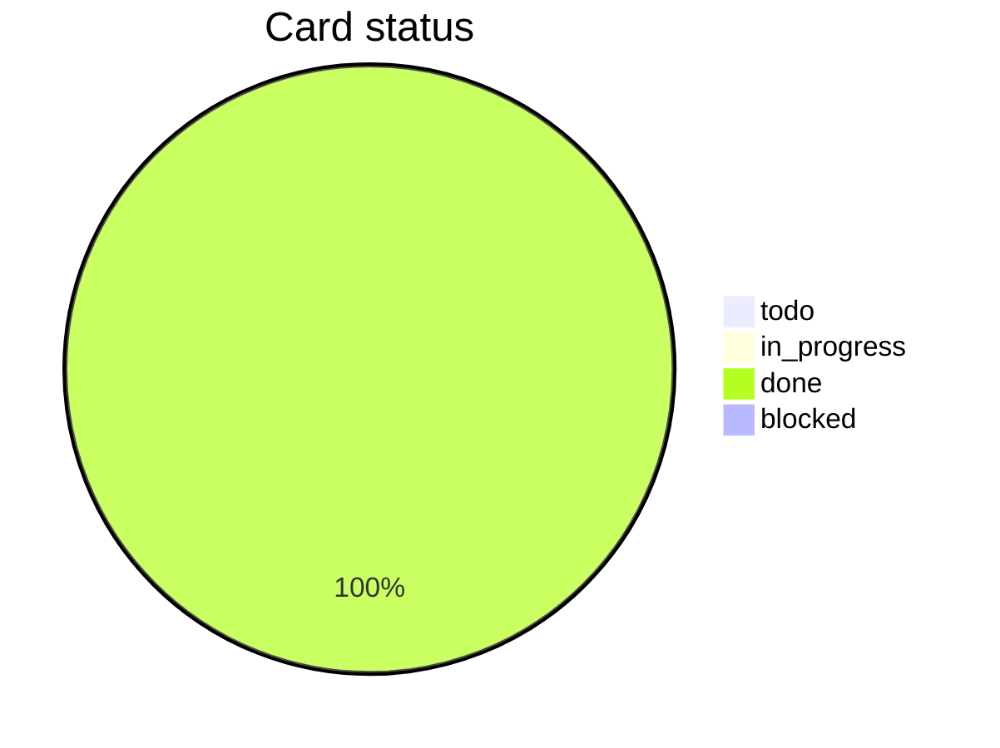

# Tasks

> Filled by planning step-03. **Work inventory first**, then micro-task cards.
> **Implement feature code before automated tests.** Do not leave template placeholders.
> **Progress:** planning seeds Status=`todo` and unchecked boxes; **execution** updates them as work completes.

plan_ref: PLAN.md

## Status legend

| Value | Meaning |
|-------|---------|
| `todo` | Not started |
| `in_progress` | Currently executing |
| `done` | Card AC verified for this task |
| `blocked` | Cannot proceed (note reason under Notes or on the card) |
| `skipped` | Intentionally not done (document why) |

---

## Work inventory

| Inv | Unit (noun + verb) | Trace (doc § / AC / contract) | Layer |
|-----|--------------------|-------------------------------|-------|
| I-01 | `CODING_RULES.md` skeleton: tạo file, header, mục lục, legend | DISCUSSION §Goal, §Scope | doc |
| I-02 | FE Route layer: viết rules + Do/Don't cho `app/*/page.tsx` | DISCUSSION §FE Rules — Route | doc/fe |
| I-03 | FE Screen layer: viết rules + Do/Don't cho `features/*/screens/*-view.tsx` | DISCUSSION §FE Rules — Screen | doc/fe |
| I-04 | FE Handler layer: viết rules + Do/Don't cho `use<Feature>Handlers.ts` | DISCUSSION §FE Rules — Handler; ISS-002 | doc/fe |
| I-05 | FE API layer: viết rules + Do/Don't cho `features/*/api/` | DISCUSSION §FE Rules — API | doc/fe |
| I-06 | FE Model layer: viết rules + Do/Don't cho `features/*/model/` | DISCUSSION §FE Rules — Model | doc/fe |
| I-07 | FE UI layer + Shared dirs: viết rules cho `features/*/ui/`, `src/hooks/`, `src/lib/` | DISCUSSION §FE Rules — UI, Shared | doc/fe |
| I-08 | BE rules (5 layers): Presentation → Application → Domain → Ports → Infra | DISCUSSION §BE Rules; PRJ_REFERENCE BR-002, BR-004 | doc/be |
| I-09 | DB/External Service rules: Port-first, no raw queries, Adapter pattern | DISCUSSION §DB/External Rules | doc/db |
| I-10 | ESLint boundary config update + AGENTS.md reference | PLAN §Affected areas; DISCUSSION §handoff | config |

---

## Progress board

| Done | ID | Title | Status |
|------|----|-------|--------|
| [x] | T-001 | Tạo CODING_RULES.md skeleton + header | done |
| [x] | T-002 | Viết FE Route layer rules | done |
| [x] | T-003 | Viết FE Screen layer rules | done |
| [x] | T-004 | Viết FE Handler layer rules | done |
| [x] | T-005 | Viết FE API layer rules | done |
| [x] | T-006 | Viết FE Model layer rules | done |
| [x] | T-007 | Viết FE UI layer + Shared dirs rules | done |
| [x] | T-008 | Viết BE rules (5 layers) | done |
| [x] | T-009 | Viết DB/External Service rules | done |
| [x] | T-010 | Cập nhật ESLint config + AGENTS.md ref | done |

## Progress chart

<!-- Do NOT hand-edit. Regenerate from card states:
`bash .agents/tools/session/session.sh status` and paste its pie here. -->

## Execution order

T-001 → T-002 → T-003 → T-004 → T-005 → T-006 → T-007 → T-008 → T-009 → T-010

## Notes

- Tất cả T-001..T-009 được viết vào một lần (atomic write) vào `CODING_RULES.md`.
- T-010: ESLint boundary rules được thêm vào `apps/admin/eslint.config.mjs` và `apps/web/eslint.config.mjs`. UI/Model boundary rules để `warn` (không phải `error`) vì code cũ có pre-existing violations — sẽ nâng lên `error` sau khi migrate xong.
- `AGENTS.md` đã được cập nhật với mandatory reference đến `CODING_RULES.md`.

---

## Tasks

### T-001: Tạo CODING_RULES.md skeleton + header

- Status: done
- Trace: DISCUSSION §Goal, §Scope in; PLAN §Goal
- Depends: none
- Work items:
  - [x] 1. Tạo file `CODING_RULES.md` tại root repo (cùng cấp với `AGENTS.md`)
  - [x] 2. Viết header: mục đích file, audience (developer + AI agent), last-updated, how-to-use
  - [x] 3. Viết mục lục (Table of Contents) với anchor links đến từng section
  - [x] 4. Viết phần Legend/Key: giải thích ký hiệu `✅ DO`, `❌ DON'T`, naming convention notation
  - [x] 5. Viết phần "Monorepo Structure Overview": bản đồ thư mục ngắn gọn
- Description: Tạo skeleton file với header, ToC, và legend — làm nền cho tất cả các section tiếp theo.
- AC: File `CODING_RULES.md` tồn tại ở root repo; có ToC với links đến ≥5 sections chính; có legend giải thích ký hiệu DO/DON'T. ✅ PASS
- Verify: `ls CODING_RULES.md` ✅ pass — file tồn tại, 41687 bytes
- Flow/comment notes: N/A
- Files/scope: `CODING_RULES.md` (created at repo root)
- Out of scope for this card: Nội dung rules cụ thể — các T-002..T-009

---

### T-002: Viết FE Route layer rules

- Status: done
- Trace: DISCUSSION §Confirmed facts; PLAN §Scope FE #1
- Depends: T-001
- Work items:
  - [x] 1. Append section `## FE Layer 1: Route (page.tsx)` vào `CODING_RULES.md`
  - [x] 2. Viết trách nhiệm của Route
  - [x] 3. Viết rules R1–R6
  - [x] 4. Viết naming convention
  - [x] 5. Viết ví dụ `✅ DO`
  - [x] 6. Viết ví dụ `❌ DON'T`
- AC: Section FE Route trong `CODING_RULES.md` có ≥3 rules, ≥1 DO example, ≥1 DON'T example. ✅ PASS — 6 rules, 2 DO, 1 DON'T
- Verify: Đọc CODING_RULES.md §3 ✅
- Files/scope: `CODING_RULES.md`

---

### T-003: Viết FE Screen layer rules

- Status: done
- Trace: DISCUSSION §Confirmed facts; PLAN §Scope FE #2
- Depends: T-002
- Work items:
  - [x] 1. Append section `## FE Layer 2: Screen (*-view.tsx)`
  - [x] 2. Viết trách nhiệm
  - [x] 3. Viết rules R1–R7
  - [x] 4. Viết naming convention
  - [x] 5. Viết ví dụ `✅ DO` (từ `users-view.tsx` thực tế)
  - [x] 6. Viết ví dụ `❌ DON'T`
- AC: Section FE Screen có ≥4 rules, ≥1 DO, ≥1 DON'T, naming pattern rõ. ✅ PASS
- Verify: Đọc CODING_RULES.md §4 ✅
- Files/scope: `CODING_RULES.md`

---

### T-004: Viết FE Handler layer rules

- Status: done
- Trace: DISCUSSION ISS-002; PLAN §Scope FE #3
- Depends: T-003
- Work items:
  - [x] 1. Append section `## FE Layer 3: Handler`
  - [x] 2. Viết trách nhiệm
  - [x] 3. Viết naming convention: `use<Feature>Handlers.ts`
  - [x] 4. Viết rules R1–R7
  - [x] 5. Viết naming handler functions: `handle<Action>`
  - [x] 6. Viết ví dụ `✅ DO` (từ pattern `use-users-list-controller.ts`)
  - [x] 7. Viết ví dụ `❌ DON'T`
- AC: Section FE Handler có ≥5 rules, naming convention rõ, ≥1 DO + ≥1 DON'T, có note về backward compat. ✅ PASS
- Verify: Đọc CODING_RULES.md §5 ✅
- Files/scope: `CODING_RULES.md`

---

### T-005: Viết FE API layer rules

- Status: done
- Trace: DISCUSSION §Confirmed facts; PLAN §Scope FE #4
- Depends: T-004
- Work items:
  - [x] 1. Append section `## FE Layer 4: API Layer`
  - [x] 2. Viết trách nhiệm và phân chia file (4 file types)
  - [x] 3. Viết rules R1–R7
  - [x] 4. Viết naming convention table
  - [x] 5. Viết ví dụ `✅ DO` (từ `users.queries.ts` thực tế)
  - [x] 6. Viết ví dụ `❌ DON'T`
- AC: Section FE API có 4 file types documented, ≥3 rules, ≥1 DO, ≥1 DON'T. ✅ PASS
- Verify: Đọc CODING_RULES.md §6 ✅
- Files/scope: `CODING_RULES.md`

---

### T-006: Viết FE Model layer rules

- Status: done
- Trace: DISCUSSION §Confirmed facts; PLAN §Scope FE #5
- Depends: T-005
- Work items:
  - [x] 1. Append section `## FE Layer 5: Model`
  - [x] 2. Viết trách nhiệm
  - [x] 3. Viết phân chia file (5 file types)
  - [x] 4. Viết rules R1–R6
  - [x] 5. Viết ví dụ `✅ DO` (từ `users.permissions.ts` và `users.schemas.ts` thực tế)
  - [x] 6. Viết ví dụ `❌ DON'T`
- AC: Section FE Model có ≥4 rules, file breakdown rõ, ≥1 DO, ≥1 DON'T. ✅ PASS
- Verify: Đọc CODING_RULES.md §7 ✅
- Files/scope: `CODING_RULES.md`

---

### T-007: Viết FE UI layer + Shared dirs rules

- Status: done
- Trace: DISCUSSION §Confirmed facts; PLAN §Scope FE #6, #7
- Depends: T-006
- Work items:
  - [x] 1. Append section `## FE Layer 6: UI Components` với rules R1–R7
  - [x] 2. Viết ví dụ DO/DON'T cho UI layer
  - [x] 3. Viết naming table cho UI
  - [x] 4. Append section `## FE Shared Directories` với 3 sub-sections (hooks/, lib/, components/)
  - [x] 5. Viết Import dependency matrix (bảng §10)
- AC: Section FE UI có ≥4 rules, ≥1 DO, ≥1 DON'T; 3 shared dirs documented; dependency matrix có mặt. ✅ PASS
- Verify: Đọc CODING_RULES.md §8, §9, §10 ✅
- Files/scope: `CODING_RULES.md`

---

### T-008: Viết BE rules (5 layers)

- Status: done
- Trace: DISCUSSION §BE Rules; PRJ_REFERENCE; `packages/api-identity/src/modules/` structure
- Depends: T-007
- Work items:
  - [x] 1. Append section `## BE Clean Architecture Rules` với dependency direction diagram
  - [x] 2. Viết **Presentation layer** rules (R1–R5) + naming + DO/DON'T
  - [x] 3. Viết **Application layer** rules (R1–R6) + naming + DO/DON'T (từ `login.use-case.ts` thực tế)
  - [x] 4. Viết **Domain layer** rules (R1–R4) + naming + DO/DON'T
  - [x] 5. Viết **App Ports layer** rules (R1–R4) + naming + DO/DON'T (từ `auth-session.repository.port.ts` thực tế)
  - [x] 6. Viết **Infrastructure layer** rules (R1–R5) + naming + DO/DON'T
  - [x] 7. Viết DI/NestJS convention section
  - [x] 8. Có anti-patterns tổng hợp
- AC: Section BE có 5 layer sub-sections, mỗi layer có naming + ≥2 rules; dependency direction note rõ. ✅ PASS
- Verify: Đọc CODING_RULES.md §11 ✅
- Files/scope: `CODING_RULES.md`

---

### T-009: Viết DB/External Service rules

- Status: done
- Trace: DISCUSSION §DB/External rules; PLAN §Scope DB #1-3
- Depends: T-008
- Work items:
  - [x] 1. Append section `## DB & External Service Rules`
  - [x] 2. Viết **Port-first pattern** với rationale
  - [x] 3. Viết **No raw queries outside Infrastructure** với SECURITY marker
  - [x] 4. Viết **Adapter pattern** với examples
  - [x] 5. Viết **Error Translation Rule**
  - [x] 6. Viết ví dụ `✅ DO` cho Port-first + Error translation
  - [x] 7. Viết ví dụ `❌ DON'T`
- AC: Section DB có 4 rules (Port-first, no raw queries, Adapter, Error translation), ≥1 DO, ≥1 DON'T. ✅ PASS
- Verify: Đọc CODING_RULES.md §12 ✅
- Files/scope: `CODING_RULES.md`

---

### T-010: Cập nhật ESLint config + AGENTS.md reference

- Status: done
- Trace: PLAN §Affected areas; DISCUSSION §Recommendation
- Depends: T-009
- Work items:
  - [x] 1. Khảo sát `packages/eslint-config/` — ESLint v9 flat config format, `eslint-plugin-import` available
  - [x] 2. Cập nhật `apps/admin/eslint.config.mjs`: thêm 4 new boundary configs (boundary-ui-layer, boundary-model-layer, boundary-lib; nâng cấp 2 existing configs)
  - [x] 3. Cập nhật `apps/web/eslint.config.mjs`: mirror của admin config
  - [x] 4. Cập nhật `AGENTS.md`: thêm mandatory reference đến `CODING_RULES.md` trong phần Settings
  - [x] 5. Chạy ESLint verify — `0 errors` trên users feature layers (9 warnings = pre-existing violations được phát hiện đúng)
- AC: (a) ESLint configs updated với boundary rules; (b) `AGENTS.md` có reference đến `CODING_RULES.md`; (c) ESLint `0 errors` from new rules. ✅ PASS
- Verify: `grep CODING_RULES AGENTS.md` → line 54-55 ✅; `npx eslint src/features/users/ui/` → 0 errors, 9 warnings (pre-existing) ✅
- Flow/comment notes: UI/Model boundary rules được set `warn` thay vì `error` vì có pre-existing violations. Cần nâng lên `error` sau khi migrate code cũ.
- Files/scope: `apps/admin/eslint.config.mjs`, `apps/web/eslint.config.mjs`, `AGENTS.md`
