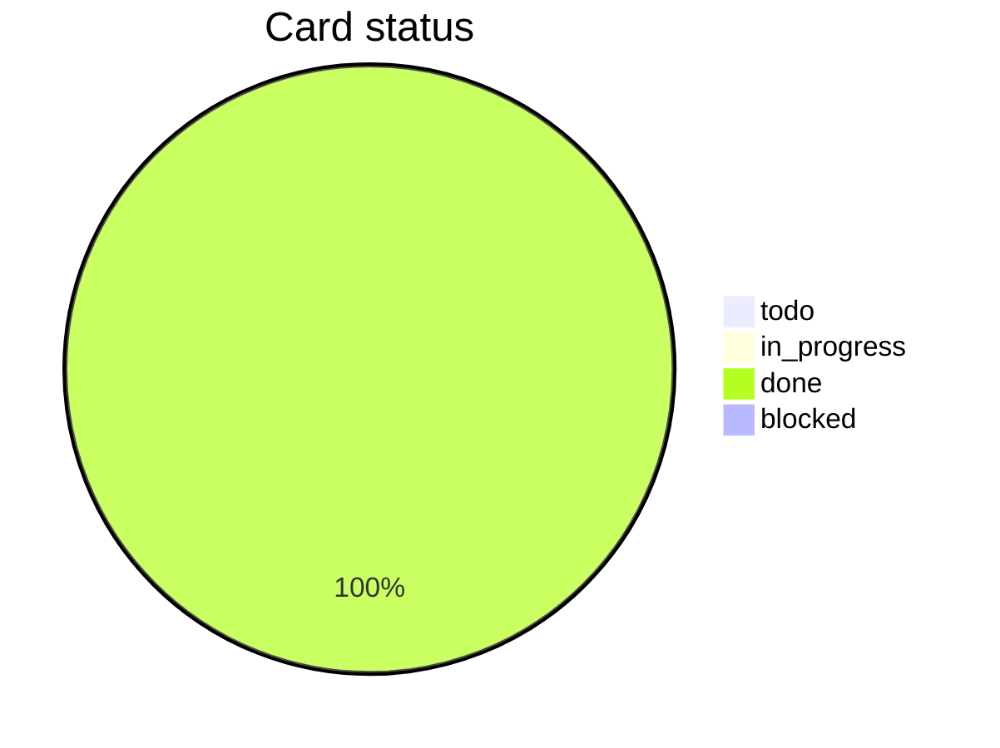

# Tasks

> Filled by planning step-03. **Work inventory first**, then micro-task cards.
> **Implement feature code before automated tests.** Do not leave template placeholders.
> **Progress:** planning seeds Status=`todo` and unchecked boxes; **execution** updates them as work completes.

plan_ref: PLAN.md

## Status legend

| Value | Meaning |
|-------|---------|
| `todo` | Not started |
| `in_progress` | Currently executing |
| `done` | Card AC verified for this task |
| `blocked` | Cannot proceed (note reason under Notes or on the card) |
| `skipped` | Intentionally not done (document why) |

---

## Work inventory

| Inv | Unit (noun + verb) | Trace (doc § / AC / contract) | Layer |
|-----|--------------------|-------------------------------|-------|
| I-01 | `CODING_RULES.md` skeleton: tạo file, header, mục lục, legend | DISCUSSION §Goal, §Scope | doc |
| I-02 | FE Route layer: viết rules + Do/Don't cho `app/*/page.tsx` | DISCUSSION §FE Rules — Route | doc/fe |
| I-03 | FE Screen layer: viết rules + Do/Don't cho `features/*/screens/*-view.tsx` | DISCUSSION §FE Rules — Screen | doc/fe |
| I-04 | FE Handler layer: viết rules + Do/Don't cho `use<Feature>Handlers.ts` | DISCUSSION §FE Rules — Handler; ISS-002 | doc/fe |
| I-05 | FE API layer: viết rules + Do/Don't cho `features/*/api/` | DISCUSSION §FE Rules — API | doc/fe |
| I-06 | FE Model layer: viết rules + Do/Don't cho `features/*/model/` | DISCUSSION §FE Rules — Model | doc/fe |
| I-07 | FE UI layer + Shared dirs: viết rules cho `features/*/ui/`, `src/hooks/`, `src/lib/` | DISCUSSION §FE Rules — UI, Shared | doc/fe |
| I-08 | BE rules (5 layers): Presentation → Application → Domain → Ports → Infra | DISCUSSION §BE Rules; PRJ_REFERENCE BR-002, BR-004 | doc/be |
| I-09 | DB/External Service rules: Port-first, no raw queries, Adapter pattern | DISCUSSION §DB/External Rules | doc/db |
| I-10 | ESLint boundary config update + AGENTS.md reference | PLAN §Affected areas; DISCUSSION §handoff | config |

---

## Progress board

| Done | ID | Title | Status |
|------|----|-------|--------|
| [x] | T-001 | Tạo CODING_RULES.md skeleton + header | done |
| [x] | T-002 | Viết FE Route layer rules | done |
| [x] | T-003 | Viết FE Screen layer rules | done |
| [x] | T-004 | Viết FE Handler layer rules | done |
| [x] | T-005 | Viết FE API layer rules | done |
| [x] | T-006 | Viết FE Model layer rules | done |
| [x] | T-007 | Viết FE UI layer + Shared dirs rules | done |
| [x] | T-008 | Viết BE rules (5 layers) | done |
| [x] | T-009 | Viết DB/External Service rules | done |
| [x] | T-010 | Cập nhật ESLint config + AGENTS.md ref | done |
| [x] | T-011 | §15 Validation rules + `@repo/web-utils/params` | done |
| [x] | T-012 | §16 Shared hook composition rules | done |
| [x] | T-013 | §17 Handler splitting + flow comments | done |
| [x] | T-014 | §18 Error handling + Next error boundaries | done |
| [x] | T-015 | §19 Cache rules | done |
| [x] | T-016 | §20 Security rules + vá open redirect | done |
| [x] | T-017 | §21 Performance rules | done |

## Progress chart

<!-- Do NOT hand-edit. Regenerate from card states:
`bash .agents/tools/session/session.sh status` and paste its pie here. -->

## Execution order

T-001 → … → T-010 → T-011 → T-012 → T-013 → T-014 → T-015 → T-016 → T-017

**Round 2 (round rà soát của user):** ToC đã liệt kê §15–§18 nhưng thân bài dừng ở §14 —
bốn section chưa từng được viết. User bổ sung thêm §19 cache, §20 security, §21 performance.

## Notes

- Tất cả T-001..T-009 được viết vào một lần (atomic write) vào `CODING_RULES.md`.
- T-010: ESLint boundary rules được thêm vào `apps/admin/eslint.config.mjs` và `apps/web/eslint.config.mjs`. UI/Model boundary rules để `warn` (không phải `error`) vì code cũ có pre-existing violations — sẽ nâng lên `error` sau khi migrate xong.
- `AGENTS.md` đã được cập nhật với mandatory reference đến `CODING_RULES.md`.

---

## Tasks

### T-001: Tạo CODING_RULES.md skeleton + header

- Status: done
- Trace: DISCUSSION §Goal, §Scope in; PLAN §Goal
- Depends: none
- Work items:
  - [x] 1. Tạo file `CODING_RULES.md` tại root repo (cùng cấp với `AGENTS.md`)
  - [x] 2. Viết header: mục đích file, audience (developer + AI agent), last-updated, how-to-use
  - [x] 3. Viết mục lục (Table of Contents) với anchor links đến từng section
  - [x] 4. Viết phần Legend/Key: giải thích ký hiệu `✅ DO`, `❌ DON'T`, naming convention notation
  - [x] 5. Viết phần "Monorepo Structure Overview": bản đồ thư mục ngắn gọn
- Description: Tạo skeleton file với header, ToC, và legend — làm nền cho tất cả các section tiếp theo.
- AC: File `CODING_RULES.md` tồn tại ở root repo; có ToC với links đến ≥5 sections chính; có legend giải thích ký hiệu DO/DON'T. ✅ PASS
- Verify: `ls CODING_RULES.md` ✅ pass — file tồn tại, 41687 bytes
- Flow/comment notes: N/A
- Files/scope: `CODING_RULES.md` (created at repo root)
- Out of scope for this card: Nội dung rules cụ thể — các T-002..T-009

---

### T-002: Viết FE Route layer rules

- Status: done
- Trace: DISCUSSION §Confirmed facts; PLAN §Scope FE #1
- Depends: T-001
- Work items:
  - [x] 1. Append section `## FE Layer 1: Route (page.tsx)` vào `CODING_RULES.md`
  - [x] 2. Viết trách nhiệm của Route
  - [x] 3. Viết rules R1–R6
  - [x] 4. Viết naming convention
  - [x] 5. Viết ví dụ `✅ DO`
  - [x] 6. Viết ví dụ `❌ DON'T`
- AC: Section FE Route trong `CODING_RULES.md` có ≥3 rules, ≥1 DO example, ≥1 DON'T example. ✅ PASS — 6 rules, 2 DO, 1 DON'T
- Verify: Đọc CODING_RULES.md §3 ✅
- Files/scope: `CODING_RULES.md`

---

### T-003: Viết FE Screen layer rules

- Status: done
- Trace: DISCUSSION §Confirmed facts; PLAN §Scope FE #2
- Depends: T-002
- Work items:
  - [x] 1. Append section `## FE Layer 2: Screen (*-view.tsx)`
  - [x] 2. Viết trách nhiệm
  - [x] 3. Viết rules R1–R7
  - [x] 4. Viết naming convention
  - [x] 5. Viết ví dụ `✅ DO` (từ `users-view.tsx` thực tế)
  - [x] 6. Viết ví dụ `❌ DON'T`
- AC: Section FE Screen có ≥4 rules, ≥1 DO, ≥1 DON'T, naming pattern rõ. ✅ PASS
- Verify: Đọc CODING_RULES.md §4 ✅
- Files/scope: `CODING_RULES.md`

---

### T-004: Viết FE Handler layer rules

- Status: done
- Trace: DISCUSSION ISS-002; PLAN §Scope FE #3
- Depends: T-003
- Work items:
  - [x] 1. Append section `## FE Layer 3: Handler`
  - [x] 2. Viết trách nhiệm
  - [x] 3. Viết naming convention: `use<Feature>Handlers.ts`
  - [x] 4. Viết rules R1–R7
  - [x] 5. Viết naming handler functions: `handle<Action>`
  - [x] 6. Viết ví dụ `✅ DO` (từ pattern `use-users-list-controller.ts`)
  - [x] 7. Viết ví dụ `❌ DON'T`
- AC: Section FE Handler có ≥5 rules, naming convention rõ, ≥1 DO + ≥1 DON'T, có note về backward compat. ✅ PASS
- Verify: Đọc CODING_RULES.md §5 ✅
- Files/scope: `CODING_RULES.md`

---

### T-005: Viết FE API layer rules

- Status: done
- Trace: DISCUSSION §Confirmed facts; PLAN §Scope FE #4
- Depends: T-004
- Work items:
  - [x] 1. Append section `## FE Layer 4: API Layer`
  - [x] 2. Viết trách nhiệm và phân chia file (4 file types)
  - [x] 3. Viết rules R1–R7
  - [x] 4. Viết naming convention table
  - [x] 5. Viết ví dụ `✅ DO` (từ `users.queries.ts` thực tế)
  - [x] 6. Viết ví dụ `❌ DON'T`
- AC: Section FE API có 4 file types documented, ≥3 rules, ≥1 DO, ≥1 DON'T. ✅ PASS
- Verify: Đọc CODING_RULES.md §6 ✅
- Files/scope: `CODING_RULES.md`

---

### T-006: Viết FE Model layer rules

- Status: done
- Trace: DISCUSSION §Confirmed facts; PLAN §Scope FE #5
- Depends: T-005
- Work items:
  - [x] 1. Append section `## FE Layer 5: Model`
  - [x] 2. Viết trách nhiệm
  - [x] 3. Viết phân chia file (5 file types)
  - [x] 4. Viết rules R1–R6
  - [x] 5. Viết ví dụ `✅ DO` (từ `users.permissions.ts` và `users.schemas.ts` thực tế)
  - [x] 6. Viết ví dụ `❌ DON'T`
- AC: Section FE Model có ≥4 rules, file breakdown rõ, ≥1 DO, ≥1 DON'T. ✅ PASS
- Verify: Đọc CODING_RULES.md §7 ✅
- Files/scope: `CODING_RULES.md`

---

### T-007: Viết FE UI layer + Shared dirs rules

- Status: done
- Trace: DISCUSSION §Confirmed facts; PLAN §Scope FE #6, #7
- Depends: T-006
- Work items:
  - [x] 1. Append section `## FE Layer 6: UI Components` với rules R1–R7
  - [x] 2. Viết ví dụ DO/DON'T cho UI layer
  - [x] 3. Viết naming table cho UI
  - [x] 4. Append section `## FE Shared Directories` với 3 sub-sections (hooks/, lib/, components/)
  - [x] 5. Viết Import dependency matrix (bảng §10)
- AC: Section FE UI có ≥4 rules, ≥1 DO, ≥1 DON'T; 3 shared dirs documented; dependency matrix có mặt. ✅ PASS
- Verify: Đọc CODING_RULES.md §8, §9, §10 ✅
- Files/scope: `CODING_RULES.md`

---

### T-008: Viết BE rules (5 layers)

- Status: done
- Trace: DISCUSSION §BE Rules; PRJ_REFERENCE; `packages/api-identity/src/modules/` structure
- Depends: T-007
- Work items:
  - [x] 1. Append section `## BE Clean Architecture Rules` với dependency direction diagram
  - [x] 2. Viết **Presentation layer** rules (R1–R5) + naming + DO/DON'T
  - [x] 3. Viết **Application layer** rules (R1–R6) + naming + DO/DON'T (từ `login.use-case.ts` thực tế)
  - [x] 4. Viết **Domain layer** rules (R1–R4) + naming + DO/DON'T
  - [x] 5. Viết **App Ports layer** rules (R1–R4) + naming + DO/DON'T (từ `auth-session.repository.port.ts` thực tế)
  - [x] 6. Viết **Infrastructure layer** rules (R1–R5) + naming + DO/DON'T
  - [x] 7. Viết DI/NestJS convention section
  - [x] 8. Có anti-patterns tổng hợp
- AC: Section BE có 5 layer sub-sections, mỗi layer có naming + ≥2 rules; dependency direction note rõ. ✅ PASS
- Verify: Đọc CODING_RULES.md §11 ✅
- Files/scope: `CODING_RULES.md`

---

### T-009: Viết DB/External Service rules

- Status: done
- Trace: DISCUSSION §DB/External rules; PLAN §Scope DB #1-3
- Depends: T-008
- Work items:
  - [x] 1. Append section `## DB & External Service Rules`
  - [x] 2. Viết **Port-first pattern** với rationale
  - [x] 3. Viết **No raw queries outside Infrastructure** với SECURITY marker
  - [x] 4. Viết **Adapter pattern** với examples
  - [x] 5. Viết **Error Translation Rule**
  - [x] 6. Viết ví dụ `✅ DO` cho Port-first + Error translation
  - [x] 7. Viết ví dụ `❌ DON'T`
- AC: Section DB có 4 rules (Port-first, no raw queries, Adapter, Error translation), ≥1 DO, ≥1 DON'T. ✅ PASS
- Verify: Đọc CODING_RULES.md §12 ✅
- Files/scope: `CODING_RULES.md`

---

### T-010: Cập nhật ESLint config + AGENTS.md reference

- Status: done
- Trace: PLAN §Affected areas; DISCUSSION §Recommendation
- Depends: T-009
- Work items:
  - [x] 1. Khảo sát `packages/eslint-config/` — ESLint v9 flat config format, `eslint-plugin-import` available
  - [x] 2. Cập nhật `apps/admin/eslint.config.mjs`: thêm 4 new boundary configs (boundary-ui-layer, boundary-model-layer, boundary-lib; nâng cấp 2 existing configs)
  - [x] 3. Cập nhật `apps/web/eslint.config.mjs`: mirror của admin config
  - [x] 4. Cập nhật `AGENTS.md`: thêm mandatory reference đến `CODING_RULES.md` trong phần Settings
  - [x] 5. Chạy ESLint verify — `0 errors` trên users feature layers (9 warnings = pre-existing violations được phát hiện đúng)
- AC: (a) ESLint configs updated với boundary rules; (b) `AGENTS.md` có reference đến `CODING_RULES.md`; (c) ESLint `0 errors` from new rules. ✅ PASS
- Verify: `grep CODING_RULES AGENTS.md` → line 54-55 ✅; `npx eslint src/features/users/ui/` → 0 errors, 9 warnings (pre-existing) ✅
- Flow/comment notes: UI/Model boundary rules được set `warn` thay vì `error` vì có pre-existing violations. Cần nâng lên `error` sau khi migrate code cũ.
- Files/scope: `apps/admin/eslint.config.mjs`, `apps/web/eslint.config.mjs`, `AGENTS.md`

---

### T-011: §15 FE Validation Rules + param helpers

- Status: done
- Trace: User feedback round 2 — "rules validate đâu? validate params đâu? fallback nếu fail đâu?"
- Work items:
  - [x] 1. Viết §15: 3 nhóm dữ liệu vào (identity / presentation / payload), R1–R8
  - [x] 2. Tạo `packages/web-utils/src/params.ts` — primitives (page, pageSize, enum, text, date, boolean, sortOrder, uuid/numeric/slug) + `parseRouteParams` + `parseSearchParams`
  - [x] 3. Recovery **theo từng key**: `?page=xx&status=ACTIVE` giữ filter, chỉ page về default
  - [x] 4. Test 16 case
- AC: §15 có ≥6 rules, bảng param primitives, DO/DON'T. Helpers có test. ✅ PASS
- Verify: `pnpm --filter @repo/web-utils test` → 16 passed; `typecheck` clean
- Notes: User chỉnh phạm vi — params **không phải chỉ là `id`**; helper được viết lại theo hướng tổng quát cho mọi loại param.

---

### T-012: §16 FE Shared Hook Composition Rules

- Status: done
- Trace: User feedback — "useSession lại đi gọi bên trong 1 hook khác, không được làm thế"
- Work items:
  - [x] 1. Viết §16 R1–R5 — shared hook phải phẳng
  - [x] 2. ESLint `shared-hooks-flat`: `src/hooks/**` cấm import `@/hooks/*` và `@/features/*` (error)
  - [x] 3. DO = `useUserRoles` (nhận mọi thứ qua tham số); DON'T = sub-hook tự gọi `useSession`
- AC: §16 có rules + ESLint enforce. ✅ PASS
- Verify: `npx eslint src/hooks` → 0 errors (hiện chưa file nào vi phạm)
- Notes: Khảo sát thấy `useSession()` được gọi ở 8 nơi, **tất cả đều là root controller/screen** → chưa vi phạm; rule là để chặn hồi quy.

---

### T-013: §17 Handler Splitting & Flow Comments

- Status: done
- Trace: User feedback — "feature quá to thì file handlers rất dày, có cơ chế tách file và comment flow chưa?"
- Work items:
  - [x] 1. Bảng ngưỡng tách (>250 dòng, >6 nhóm view model, >5 useState)
  - [x] 2. Nguyên tắc tách theo nhóm hành vi, cấm tên `-utils`/`-helpers`
  - [x] 3. Format flow comment bắt buộc ở root handler (đánh số bước + sở hữu/không sở hữu)
  - [x] 4. Ví dụ thật: `use-users-list-controller.ts` 307 dòng → 3 sub-hook
- AC: §17 có ngưỡng cụ thể + format comment + DO/DON'T. ✅ PASS

---

### T-014: §18 FE Error Handling Strategy + error boundaries

- Status: done
- Trace: User feedback — "lỗi global, lỗi local, lỗi inline như nào"; và "chú ý status code server side vs client side, check docs cẩn thận"
- Work items:
  - [x] 1. §18.1 ba tầng + bảng `ErrorKind` → scope/retry
  - [x] 2. `packages/web-utils/src/errors.ts` — `classifyError`, `getErrorMessage`, `shouldRetryQuery`
  - [x] 3. §18.2 boundary Next: tạo `global-error.tsx` + `[locale]/error.tsx` + `[locale]/not-found.tsx` cho **cả admin và web** (trước đó repo **không có file nào**)
  - [x] 4. `ErrorFallback` dùng chung trong `@repo/web-ui`
  - [x] 5. §18.3 status code — tra docs Next 16.2
  - [x] 6. §18.4 bảng phân tầng ai được toast + ESLint cấm `sonner` trong `api/`
- AC: §18 có 3 tầng, boundary thật chạy được, bảng status code. ✅ PASS
- Verify: `pnpm --filter admin typecheck` + `--filter web typecheck` clean
- Notes: **Phát hiện qua docs** — Next 16.2 đổi prop `error.tsx` từ `reset` → `unstable_retry`; đã verify trong `next@16.2.9/dist/client/components/error-boundary.d.ts`. Docs cũng xác nhận: khi đã stream thì status luôn `200`, `notFound()` sau đó chỉ là soft 404 + `noindex`.

---

### T-015: §19 FE Cache Rules

- Status: done
- Trace: User feedback round 3 — "chưa thấy rules cho xử lý cache"
- Work items:
  - [x] 1. R1–R8: key factory bắt buộc, key phải đủ biến (tenant!), staleTime theo loại dữ liệu, invalidate hẹp, clear cache khi đổi danh tính
  - [x] 2. Bảng staleTime gợi ý, đối chiếu cấu hình thật (30s, `refetchOnWindowFocus: false`)
- AC: §19 có rules + bảng + DO/DON'T. ✅ PASS

---

### T-016: §20 FE Security Rules + vá open redirect

- Status: done
- Trace: User feedback round 3 — "và xử lý cho security"
- Work items:
  - [x] 1. R1–R10: permission FE chỉ là UX, CSRF qua `webFetch`, cấm token vào localStorage, `dangerouslySetInnerHTML`, `NEXT_PUBLIC_*`
  - [x] 2. Thêm `internalPath()` chống open redirect + test 7 vector
  - [x] 3. **Vá lỗ hổng thật**: `use-user-detail-controller.ts` nhận `?returnTo=` không kiểm tra rồi dùng làm `href`
- AC: §20 có rules + lỗ hổng đã vá. ✅ PASS
- Verify: test `internalPath` chặn `https://`, `//evil.com`, `/\evil.com`, `javascript:`, control char

---

### T-017: §21 FE Performance Rules

- Status: done
- Trace: User feedback round 3 — "cuối cùng là rules optimize performance"
- Work items:
  - [x] 1. R1–R10: RSC mặc định, Suspense, debounce, placeholderData, React Compiler, waterfall, dynamic import, barrel import
  - [x] 2. Ví dụ lấy từ code thật (`useDebouncedValue` 500ms, 3 query song song trong user detail)
- AC: §21 có rules + DO/DON'T. ✅ PASS
