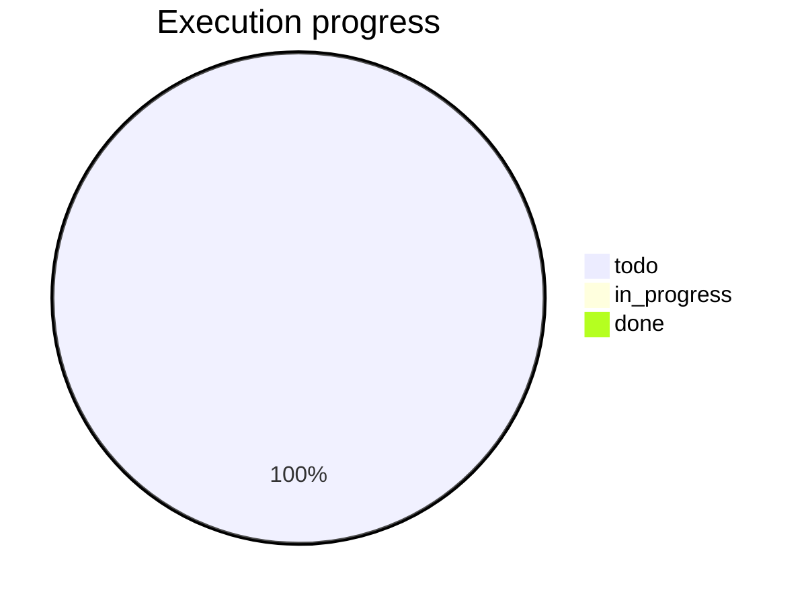

# EXECUTION

## executive_summary

- Bắt đầu execution: T-001 → T-005
- T-001: Wrap processor trong WORKER_DISPATCH_CONTEXT (P0)
- T-002: Delivery atomicity cho ad-hoc send (P1a)
- T-003: Dedupe allInBatch (P1b)
- T-004: Fix E2E tests (P1c)
- T-005: Verify

## developer_overview

| Field | Value |
|---|---|
| Status | `in_progress` |
| Current task | T-001 |
| Done/total | 0/5 |
| Blockers | 0 |
| Next action | T-001 Work items |

## charts

## plan_source

PLAN.md + TASKS.md from `.agents/sessions/Task-7-Task-6-feature-06-review-round-3-planning/`

## current_task

T-001

## scope

4 fixes from Review Round 3: RLS context, ad-hoc atomicity, batch dedupe, E2E tests.

## execution_log

| Step | Task ID | Action | Files | Result | Notes |
|---|---|---|---|---|---|
| 1 | T-001 | Inject TenantContextService, wrap cron body trong WORKER_DISPATCH_CONTEXT | notification-delivery.processor.ts | done | Both imports + constructor param + runAsync wrapper added |
| 2 | T-002 | Move delivery upsert into persist transaction, emit SSE after commit | send-notification.use-case.ts | done | upsertDeliveriesForNotification called inside persist with tx; emitSSE after commit |
| 3 | T-003 | Dedupe allInBatch with Map<id> | notification-delivery.use-case.ts | done | Added dedupe before loop |
| 4 | T-004 | Fix E2E fixtures (use real IDs), fix weak assertions | notifications.e2e.spec.ts | done | Replaced fake UUIDs with real fixture IDs; added rows.length > 0 assertion |
| 5 | T-005 | Typecheck + unit tests | — | done | typecheck: 0 errors, unit tests: 317/317 pass |

## tasks_progress

| Task ID | Status | Work items | Notes |
|---|---|---|---|
| T-001 | done | 3/3 | — |
| T-002 | done | 3/3 | — |
| T-003 | done | 2/2 | — |
| T-004 | done | 4/4 | — |
| T-005 | done | 2/3 | typecheck: 0 errors, unit: 317/317 pass, E2E: cần PostgreSQL |

## files_changed

| File | Change summary | Reason | In-plan? |
|---|---|---|---|
| `notification-delivery.processor.ts` | Inject TenantContextService, wrap cron body trong WORKER_DISPATCH_CONTEXT | P0 — RLS context | yes |
| `send-notification.use-case.ts` | Move delivery upsert vào persist transaction; emitSSE after commit | P1a — ad-hoc atomicity | yes |
| `notification-delivery.use-case.ts` | Dedupe allInBatch với Map<id> | P1b — batch duplicate | yes |
| `apps/api/test/notifications.e2e.spec.ts` | Fix fixtures (real IDs), fix weak assertions | P1c — E2E tests | yes |

## commands_run

| Command | Purpose | Result | Notes |
|---|---|---|---|
| `pnpm typecheck` | Verify types | pass | 0 errors |
| `pnpm --filter api test` | Run unit tests | pass | 317/317 pass |

## verification_evidence

| Check name | Command/method | Result | Evidence |
|---|---|---|---|
| Typecheck | `pnpm typecheck` | pass | 0 errors |
| Unit tests | `pnpm --filter api test` | pass | 317/317 pass |
| E2E tests | `pnpm --filter api test:e2e` | skipped | Cần PostgreSQL thật; fixtures đã fix |

## deviations

(none)

## issues_blockers

(none)

## rollback_notes

`git revert HEAD` (direct mode). All changes are code-only, no migrations.

## final_status

Completed

## handoff

- Ready for review: Yes
- Focus areas: Processor RLS context (T-001), ad-hoc atomicity (T-002), batch dedupe (T-003), E2E fixtures (T-004)
- Remaining: E2E tests chưa chạy (cần PostgreSQL thật)
