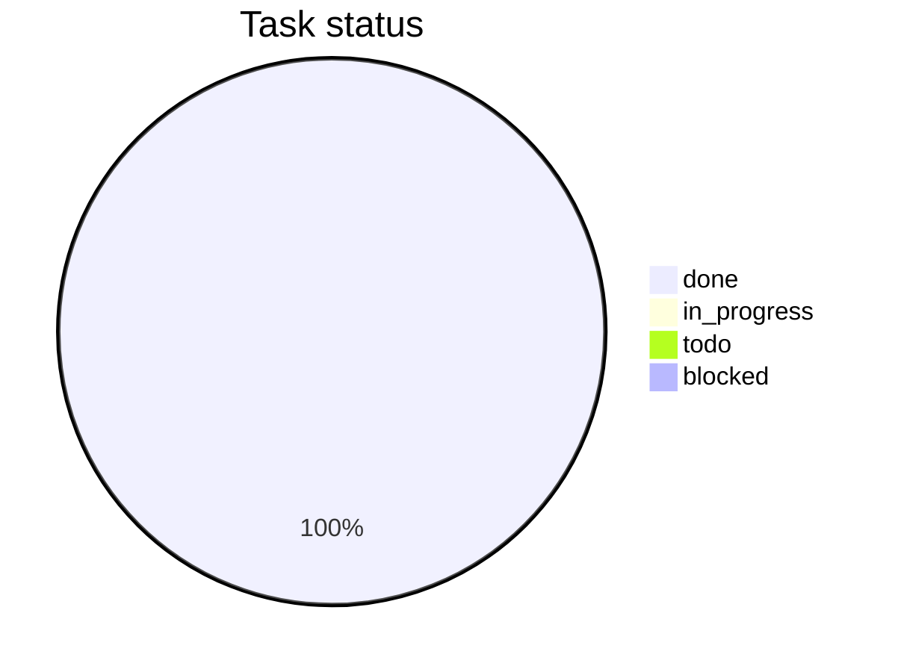
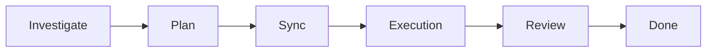

# Session overview

> Developer landing page. Keep this scannable. Refresh after sync, execution,
> review, and done. Detail lives in sibling artifacts; this file is the map.

## At a glance (80/20)

| Field | Value |
|---|---|
| Status | `done` |
| Goal | Fix 4 issues từ Feature 06 Review Round 3: RLS context, ad-hoc atomicity, batch dedupe, E2E tests |
| Progress | 5/5 cards done · 0 blocked · 0 needs info |
| Top risk / blocker | none |
| Next action | Review |

## Progress chart

## Open decisions

| ID | Severity | Blocking? | Visual? | Question / decision | Status |
|---|---|---|---|---|---|
| none | — | — | — | — | — |

## Artifact map

| Artifact | Purpose | Freshness |
|---|---|---|
| `INVESTIGATE.md` | Root cause analysis | current |
| `PLAN.md` | Strategy | current |
| `TASKS.md` | Work | current |
| `SYNC.md` | Readiness | current |
| `EXECUTION.md` | Implementation log | current |

## Developer notes

- Commands: `pnpm typecheck` (pass), `pnpm --filter api test` (317/317 pass)
- E2E: `pnpm --filter api test:e2e` (cần PostgreSQL thật)
