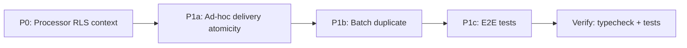

# Plan

> Filled by planning step-02. Strategy only — **no** full task cards (`### T-00x` with AC/Verify/Files) in this file.
> Session path: `.agents/sessions/Task-7-Task-6-feature-06-review-round-3-planning`. See `TASKS.md` for executable work.

## Step ledger (mandatory — update every step)

| Step | Name | Status | Evidence |
|---|---|---|---|
| 01 | Init templates | `done` | PLAN.md + TASKS.md + OVERVIEW.md exist |
| 02 | Fill PLAN + Spec quality | `done` | All sections filled |
| 03 | Fill TASKS inventory/cards | `done` | 5 cards (T-001 → T-005) |
| 04 | Self-check | `done` | Ready=Yes, all checks pass, blockers=none |

> **Hard rule:** Do not mark a later step `done` while an earlier step is still
> `todo`/`blocked`. Do not fill TASKS before Spec quality review is done.

## Executive summary (80/20)

- Fix 4 confirmed issues từ Review Round 3: P0 (RLS context) là production blocker, P1a (atomicity), P1b (batch dup), P1c (E2E tests)
- Approach: wrap cron trong WORKER_DISPATCH_CONTEXT (pattern có sẵn), đưa delivery upsert vào transaction, dedupe allInBatch, fix fixtures
- Top risk: không có — tất cả fix patterns đều có sẵn trong codebase
- Ready: có, sau khi T-001→T-004 pass, T-005 chạy typecheck + test suite

## Developer overview

| Field | Value |
|---|---|
| Status | `planning` |
| Cards drafted | `5` |
| Critical open decisions | `0` |
| Next action | Sync → Execution |

## Charts (when useful)

## Pre-planning decision gate

| Issue ID/source | Issue / decision | Severity | Clarity | Blocking? | Visual need/format | Resolution evidence | Status |
|---|---|---|---|---|---|---|---|
| INV-001 (Review R3) | Delivery processor chạy ngoài RLS context → notifications table trả 0 rows | Critical | Clear | Yes | none | INVESTIGATE.md E-001→E-003 | Resolved |
| INV-002 (Review R3) | Ad-hoc send không atomic → delivery upsert ngoài transaction | High | Clear | No | none | INVESTIGATE.md E-004 | Resolved |
| INV-003 (Review R3) | allInBatch thiếu dedupe → duplicate SSE + count | High | Clear | No | none | INVESTIGATE.md E-005→E-006 | Resolved |
| INV-004 (Review R3) | E2E tests dùng fake UUIDs, weak assertions | Medium | Clear | No | none | INVESTIGATE.md E-007 | Resolved |

### Questions requiring user input

Không có — tất cả issues đã confirmed với code path evidence, fix patterns rõ ràng.

> **STOP gate:** Strategy and TASKS stay unfilled while any Critical issue,
> blocking unknown, or unconfirmed `html-recommended` item is open.

## Spec quality review

### 1. Feasibility (tính khả thi)

| Finding | Evidence | Verdict |
|---|---|---|
| `WORKER_DISPATCH_CONTEXT` pattern có sẵn trong `ProcessJobsUseCase` + `NotificationDeliveryUseCase.processDueJobs` | process-jobs.use-case.ts, notification-delivery.use-case.ts | Pass |
| `upsertDeliveriesForNotification` đã có optional executor parameter | notification-dispatch.service.ts:49-52 | Pass |
| `allInBatch` dedupe = 1-liner `Map` convert | notification-delivery.use-case.ts:342 | Pass |
| E2E test fixtures cần real data → cần create notification + token trước | test file structure | Pass-with-gaps (cần verify postgres setup) |

### 2. Correctness (tính đúng đắn)

| Finding | Evidence | Verdict |
|---|---|---|
| Processor wrap trong WORKER_DISPATCH_CONTEXT giải quyết RLS | Policy: `app.bypass_rls = 'true' OR org_id match` | Pass |
| upsertDeliveriesForNotification trong transaction → atomic | Dùng chung tx executor | Pass |
| Dedupe by id không miss rows vì cùng transaction | Rows vừa insert có id khác rows cũ | Pass |

### 3. Capability recommendations (khả năng feature / gaps)

| Gap ID | Missing / weak capability | Suggested question / default | Blocking? | Status |
|---|---|---|---|---|
| (none) | — | — | — | — |

## Goal

Sửa 4 issues từ Feature 06 Review Round 3 để feature đạt điều kiện approve.

## Scope

- P0: Wrap `NotificationDeliveryProcessor` cron body trong `WORKER_DISPATCH_CONTEXT`
- P1a: Đưa delivery upsert vào `SendNotificationUseCase` transaction
- P1b: Dedupe `allInBatch` trước delivery upsert, SSE emit, và `deliveredCount`
- P1c: Fix E2E fixtures + assertions, chạy `test:e2e`
- Verify: typecheck + unit tests + E2E tests pass

## Non-goals

- Notification job stale recovery (đã defer trong Round 2)
- recoverStaleProcessing max attempts check (P2)
- Xóa scripts `rewrite_plan*.py` (P2 follow-up)
- Thêm test cases mới ngoài fixing existing tests

## Assumptions

| Assumption | Risk | Confirmed |
|---|---|---|
| `upsertDeliveriesForNotification` hoạt động đúng khi gọi với transaction executor nội bộ | Low | Yes (code path evidence) |
| `WORKER_DISPATCH_CONTEXT` pattern khớp hoàn toàn với processor cron context | Low | Yes (same pattern as ProcessJobsUseCase) |
| E2E tests có thể chạy với real PostgreSQL role | Medium | Cần verify (test:e2e chưa từng chạy) |

## Approach

1. **P0 — RLS context**: Inject `TenantContextService` vào processor, wrap cron body trong `WORKER_DISPATCH_CONTEXT`. Pattern copy từ `ProcessJobsUseCase.execute()`.
2. **P1a — Ad-hoc atomicity**: Gọi `dispatchService.upsertDeliveriesForNotification(view, tx)` bên trong `persist` transaction. Sau commit chỉ emit SSE.
3. **P1b — Batch dedupe**: `new Map(allInBatch.map(r => [r.id, r])).values()` trước delivery upsert loop.
4. **P1c — E2E tests**: Fix fixtures (real UUIDs), fix assertions (check rows > 0).
5. **Verify**: Typecheck → unit tests → E2E tests.

## Affected areas

| Area / path | Expected change | Confidence |
|---|---|---|
| `notification-delivery.processor.ts` | Inject TenantContextService, wrap cron trong WORKER_DISPATCH_CONTEXT | known |
| `send-notification.use-case.ts` | Gọi upsertDeliveriesForNotification trong persist transaction | known |
| `notification-dispatch.service.ts` | dispatch() chỉ emit SSE khi delivery upsert đã xong trong transaction | known |
| `notification-delivery.use-case.ts` | Dedupe allInBatch trước loop | known |
| `apps/api/test/notifications.e2e.spec.ts` | Fix fixtures và assertions | known |
| `apps/api/test/audit.e2e.spec.ts` | Fix fixtures nếu cần | inferred |

## Test strategy

- Unit tests: 317 test pass (existing) + mới cho T-001, T-002 verify mock calls
- E2E tests: `pnpm --filter api test:e2e` với fix fixtures (T-004)

## Verification strategy

- `pnpm typecheck` — 0 errors
- `pnpm test` — 317/317 pass
- `pnpm --filter api test:e2e` — pass dưới restricted role
- Code review: kiểm tra processor context, transaction boundary, dedupe logic

## Definition of done

- [ ] T-001 → T-004 implemented và verified
- [ ] `pnpm typecheck` pass
- [ ] `pnpm test` pass (317/317)
- [ ] `pnpm --filter api test:e2e` pass
- [ ] `TASKS.md` complete and matches Task index below

## Rollback strategy

- **Code:** `git revert HEAD` (direct mode, single commit)
- **Config:** không có config change
- **Data:** không có schema/migration change

## Risks

| Risk | Impact | Mitigation |
|---|---|---|
| Processor wrap sai scope → vẫn bị RLS chặn | P0 không fix được | Test pattern khớp ProcessJobsUseCase, verify với restricted role |
| `upsertDeliveriesForNotification` throw trong transaction → rollback cả notification | Ad-hoc send fail hoàn toàn | Đã đúng behavior (all-or-nothing), không muốn silent partial failure |
| E2E tests cần PostgreSQL thật | Không chạy được local | Fallback: kiểm tra FK constraint bằng unit test trước |

## Task index

T-001 Processor RLS context → T-002 Ad-hoc atomicity → T-003 Batch dedupe → T-004 E2E tests → T-005 Verify (see TASKS.md)

## Handoff

- Ready for sync/execution? **Yes**
- Blockers: none
