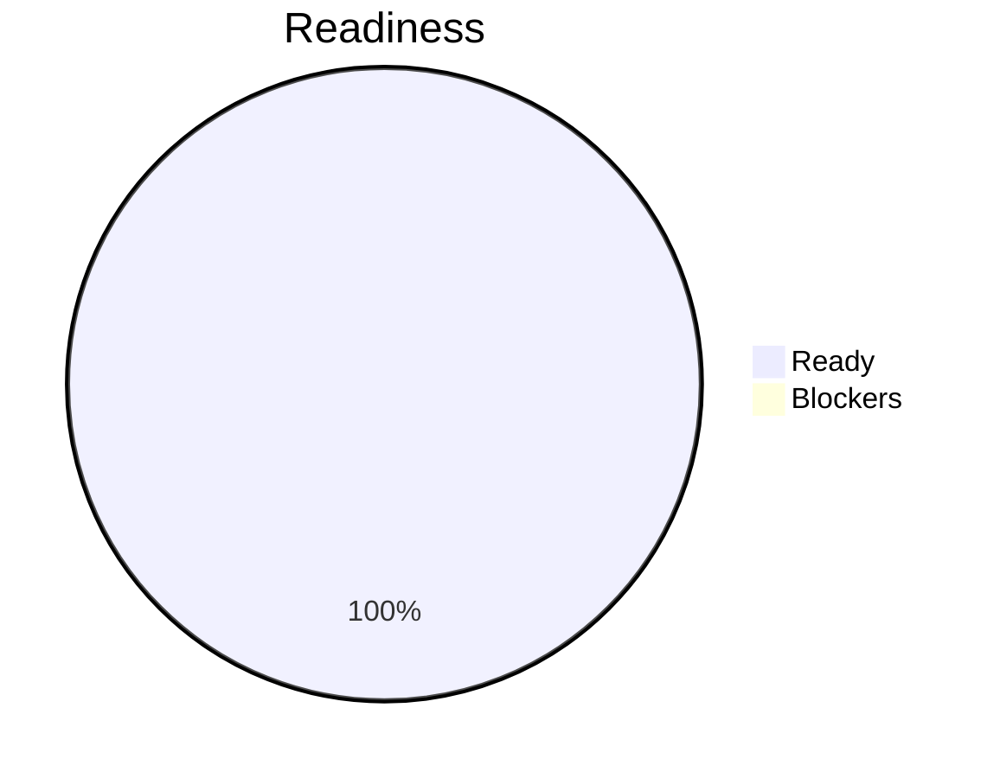

# SYNC

## executive_summary

- PLAN Ready=Yes, blockers=none. 5 task cards sẵn sàng.
- Workspace có dirty changes không liên quan (AGENTS.md, eslint configs, Task-5 session artifacts) — out of scope.
- Branch: `main` (direct mode) — đúng policy.
- Files referenced trong TASKS đều tồn tại, không có drift.
- Next action: Bắt đầu execution với T-001.

## developer_overview

| Field | Value |
|---|---|
| Status | Ready for execution |
| Resume at | T-001 (first non-done card) |
| Blocker count | 0 |
| Next action | Execution: T-001 → T-002 → T-003 → T-004 → T-005 |

## charts

## scope

Synced: session artifacts (PLAN.md, TASKS.md), git state, workspace, affected files.

## observed_facts

| Fact | Source |
|---|---|
| HEAD: `2345ebf`, branch `main`, up to date with origin/main | `git status` + `git log --oneline -1` |
| PLAN.md Handoff Ready=Yes, blockers=none | PLAN.md handoff section |
| Dirty changes: .current, Task-5 session files, AGENTS.md, eslint configs, CODING_RULES.md | `git status` |
| All dirty changes are out-of-scope (not from this task) | git diff review |
| All TASKS referenced files exist | ls check |
| `rules.branch.mode: direct` | `.agents/settings.yaml` |

## inferred_context

| Inference | Basis | Confidence |
|---|---|---|
| Dirty AGENTS.md/eslint changes từ môi trường khác, không ảnh hưởng đến task | Nội dung diff không liên quan đến notifications module | High |
| Processor file sẵn sàng để edit | `ls` xác nhận file tồn tại | High |

## drift_detected

(không có)

## dirty_changes

| File | Classification | Scope check | Action |
|---|---|---|---|
| `.agents/sessions/.current` | session metadata | in-scope (từ session.sh) | Ignore |
| `Task-5-*/` files | out-of-scope | not mine | No action |
| `AGENTS.md` | out-of-scope | not mine | No action |
| `apps/admin/eslint.config.mjs` | out-of-scope | not mine | No action |
| `apps/web/eslint.config.mjs` | out-of-scope | not mine | No action |
| `CODING_RULES.md` | out-of-scope | not mine | No action |

## risks_blockers

| Blocker | Type | Impact | Next action |
|---|---|---|---|
| (none) | — | — | Proceed to execution |

## recommendation

Ready for execution: **Yes**. Start T-001 → T-005.
