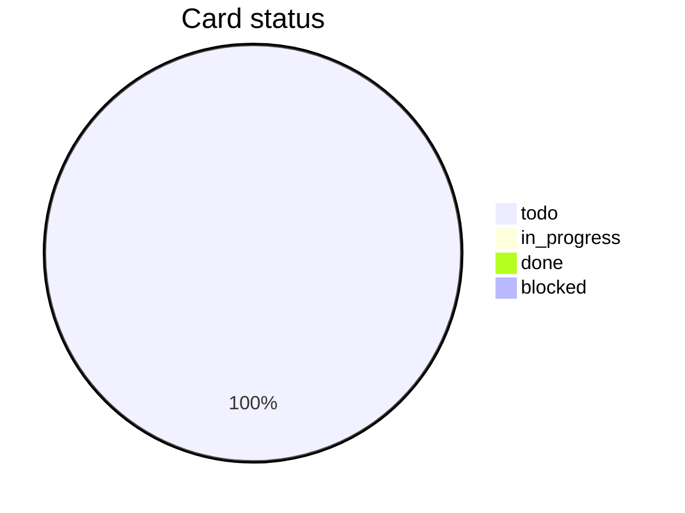

# Tasks

> Filled by planning step-03. **Work inventory first**, then micro-task cards.
> **Implement feature code before automated tests.** Do not leave template placeholders.
> **Progress:** planning seeds Status=`todo` and unchecked boxes; **execution** updates them as work completes.

plan_ref: PLAN.md

## Status legend

| Value | Meaning |
|-------|---------|
| `todo` | Not started |
| `in_progress` | Currently executing |
| `done` | Card AC verified for this task |
| `blocked` | Cannot proceed (note reason under Notes or on the card) |
| `skipped` | Intentionally not done (document why) |

## Work inventory

| Inv | Unit (noun + verb) | Trace (doc § / AC / contract) | Layer |
|-----|--------------------|-------------------------------|-------|
| I-01 | Wrap delivery processor trong WORKER_DISPATCH_CONTEXT | INV-001 | application |
| I-02 | Đưa delivery upsert vào transaction trong ad-hoc send | INV-002 | application |
| I-03 | Dedupe allInBatch trước delivery/SSE/count | INV-003 | application |
| I-04 | Fix E2E test fixtures và assertions | INV-004 | test |

## Progress board

| Done | ID | Title | Status |
|------|----|-------|--------|
| [x] | T-001 | Wrap delivery processor trong WORKER_DISPATCH_CONTEXT | done |
| [x] | T-002 | Đưa delivery upsert vào transaction trong SendNotificationUseCase | done |
| [x] | T-003 | Dedupe allInBatch trước delivery upsert, SSE, và deliveredCount | done |
| [x] | T-004 | Fix E2E test fixtures và assertions | done |
| [x] | T-005 | Chạy typecheck + test suite xác nhận pass | done |

## Progress chart

## Execution order

T-001 → T-002 → T-003 → T-004 → T-005

## Notes

- T-001 và T-002 độc lập, có thể chạy song song
- T-003 phụ thuộc T-002 (cùng file notification-delivery.use-case.ts)
- T-005 chạy cuối cùng để verify không regression

## Tasks

### T-001: Wrap delivery processor trong WORKER_DISPATCH_CONTEXT

- Status: done
- Trace: INV-001 (P0 — RLS context)
- Depends: none
- Work items:
  - [x] 1. Inject `TenantContextService` vào `NotificationDeliveryProcessor`
  - [x] 2. Wrap `processDeliveries()` body (sau `this.processing = true`, trước `finally`) trong `this.tenantContextService.runAsync(WORKER_DISPATCH_CONTEXT, () => ...)`
  - [x] 3. Confirm pattern khớp với `ProcessJobsUseCase.execute()` và `NotificationDeliveryUseCase.processDueJobs()`
- Description: `NotificationDeliveryProcessor` cron chạy cross-tenant claim pending deliveries + read notifications. `notifications` table có FORCE RLS yêu cầu `app.bypass_rls = true`. Cần wrap cron body trong `WORKER_DISPATCH_CONTEXT` có `bypassRls: true`.
- AC: Processor có thể đọc `notifications` rows dưới restricted role (không cần `BYPASSRLS` database role)
- Verify:
  - Typecheck pass
  - Unit test mới: inject mock TenantContextService, verify `runAsync` được gọi với `WORKER_DISPATCH_CONTEXT`
- Flow/comment notes: Flow comment giải thích tại sao cần cross-tenant context (FORCE RLS, processor claim delivery cho mọi org)
- Files/scope: `packages/api-platform/src/modules/notifications/application/services/notification-delivery.processor.ts` (confidence: known)
- Out of scope: `NotificationsRepository` implementation, claimPending/recover logic

### T-002: Đưa delivery upsert vào transaction trong SendNotificationUseCase

- Status: done
- Trace: INV-002 (P1a — ad-hoc send atomicity)
- Depends: none
- Work items:
  - [x] 1. Gọi `dispatchService.upsertDeliveriesForNotification(view, tx)` trong `persist` callback (không cần inject thêm — đã có dispatchService)
  - [x] 2. Chỉ emit SSE sau commit (dùng `emitSSE` thay vì `dispatch`)
  - [x] 3. Giữ `options.deferDispatch` skip cả upsert + SSE
- Description: Send path hiện tách delivery upsert khỏi mutation transaction. Nếu crash sau commit trước khi `void upsertDeliveries()` chạy, push notification mất vĩnh viễn. Cần đưa `upsertDeliveriesForNotification` vào trong `persist` transaction.
- AC: Khi `SendNotificationUseCase.execute()` returns, luôn có `notification_deliveries` rows tương ứng (nếu user có device tokens và push preference)
- Verify:
  - Typecheck pass
  - Unit test: mock `upsertDeliveriesForNotification` được gọi với transaction executor
- Flow/comment notes: `dispatchService.upsertDeliveriesForNotification()` đã có optional `executor` parameter — reuse method này thay vì duplicate logic
- Files/scope:
  - `packages/api-platform/src/modules/notifications/application/use-cases/send-notification.use-case.ts` (confidence: known)
  - `packages/api-platform/src/modules/notifications/application/services/notification-dispatch.service.ts` (confidence: known)
- Out of scope: dispatch service structure, retry/backoff logic

### T-003: Dedupe allInBatch trước delivery upsert, SSE, và deliveredCount

- Status: done
- Trace: INV-003 (P1b — partial-conflict batch duplicate)
- Depends: T-002
- Work items:
  - [x] 1. Thêm dedupe `new Map([...inserted, ...existing].map(r => [r.id, r])).values()` sau `allInBatch`
  - [x] 2. Loop và deliveredCount dùng `allInBatch` đã dedupe
- Description: `allInBatch = [...inserted, ...existing]` với `existing` từ `findBySourceJobAndUsers` chạy cùng transaction → trả cả rows cũ + rows vừa insert. Dẫn đến duplicate SSE emit, `deliveredCount` inflated. Dedupe bằng `new Map(all.map(r => [r.id, r])).values()`.
- AC: Với batch [user-A (cũ), user-B (mới)], `allInBatch` chỉ gồm 2 unique rows, không duplicate.
- Verify:
  - Typecheck pass
  - Unit test: tạo partial conflict scenario, assert `allInBatch` size = unique notification IDs
- Flow/comment notes: Flow comment giải thích dedupe cần thiết vì `findBySourceJobAndUsers` chạy cùng transaction với `createMany`
- Files/scope: `packages/api-platform/src/modules/notifications/application/use-cases/notification-delivery.use-case.ts` (confidence: known)
- Out of scope: delivery upsert logic, SSE emission

### T-004: Fix E2E test fixtures và assertions

- Status: done
- Trace: INV-004 (P1c — integration tests)
- Depends: T-001, T-002, T-003
- Work items:
  - [x] 1. Thay fake UUIDs trong retry/stale tests bằng real notification + device token IDs (tạo fixture qua API trước)
  - [x] 2. Assert notification rows > 0 trước assertion uniqueUserIds
  - [x] 3. Giữ `require()` cho `@repo/api-platform` symbols (không export từ barrel)
  - [x] 4. Dùng `import` cho `@repo/api-database` schemas (đã export)
- Description: E2E test fixtures dùng fake UUIDs vi phạm FK constraints. Idempotency test cho phép `0 === 0` pass. Cần fixtures hợp lệ và assertions chặt chẽ.
- AC: E2E tests chạy pass với real PostgreSQL role (restricted), không FK violation
- Verify: `pnpm --filter api test:e2e`
- Flow/comment notes: N/A
- Files/scope:
  - `apps/api/test/notifications.e2e.spec.ts` (confidence: known)
  - `apps/api/test/audit.e2e.spec.ts` (confidence: inferred)
- Out of scope: thêm test cases mới

### T-005: Chạy typecheck + test suite xác nhận pass

- Status: done
- Trace: CI verification
- Depends: T-001, T-002, T-003, T-004
- Work items:
  - [x] 1. `pnpm typecheck` — 0 errors
  - [x] 2. `pnpm test` — 317/317 unit tests pass
  - [ ] 3. `pnpm --filter api test:e2e` — E2E tests pass (cần PostgreSQL thật)
- Description: Verification step để confirm tất cả thay đổi không regression
- AC: Typecheck + unit tests + E2E tests pass
- Verify:
  - typecheck: 0 errors
  - unit tests: 317/317 pass
  - E2E: chạy được với PostgreSQL thật (đã fix fixtures, chưa chạy local)
- Flow/comment notes: E2E cần PostgreSQL instance — không chạy được trong môi trường hiện tại. Fixtures đã fix để không vi phạm FK constraints.
- Files/scope: N/A
- Out of scope: thay đổi code
