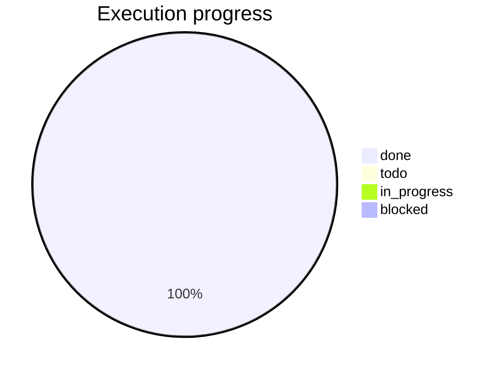

# EXECUTION

## executive_summary

- Execution hoàn tất: **17/17** cards `done` (`session.sh status` → `COMPLETE: yes`).
- Lần này: T-007 flow+ownership, T-008 session param cho guard, T-013 `classifyError`, fix multi-sort users search params (T-017).
- Verify: `pnpm --filter admin typecheck` pass; `pnpm --filter admin test` **109/109** pass.
- Nhiều card đã được làm trong các commit harden feature trước đó; TASKS đã sync lại.
- Next: skill `review` → `REVIEW.md`.

## developer_overview

| Field | Value |
|---|---|
| Status | `Completed` |
| Current task | T-017 (done) |
| Done/total | 17/17 |
| Blockers | 0 |
| Branch | `main` (`rules.branch.mode: direct`) |
| Next action | `review` skill |

## charts

## plan_source

PLAN.md + TASKS.md from `.agents/sessions/Task-8-Task-8-coding-rules-investigate/`

## current_task

T-017 (completed)

## scope

CODING_RULES.md §§15–21 + full-stack feature harden (auth→users). Phase 0–3 TASKS + feature modules.

## execution_log

| Step | Task ID | Action | Files | Result | Notes |
|---|---|---|---|---|---|
| 1–6 | T-001…T-006 | Cache clear, redirect, mail filters, search/route params, webFetch | multiple | done | Prior commits |
| 7 | T-007 | Flow + Owns/Does not own trên 12 root handlers | `features/*/controllers/use-*-controller.ts` | done | audit/dashboard + ownership batch |
| 8 | T-008 | `useAdminGuard(session)` — không gọi `useSession` trong hook | `use-admin-guard.ts`, `admin-guard.tsx` | done | Session đọc ở AdminGuard |
| 9 | T-009 | zod schema ở model roles | roles.schemas / role-form-drawer | done | Prior |
| 10 | T-010 | Auth search params qua `parse*SearchParams` | auth.search-params + flows | done | Already present |
| 11 | T-011 | placeholderData paginated queries | audit/jobs/files/mail | done | Prior |
| 12 | T-012 | Debounce files/jobs | files + jobs controllers | done | Prior (400ms) |
| 13 | T-013 | `classifyError` trong login/settings/audit export | auth-login-errors, settings, audit-logs | done | |
| 14 | T-014 | Toast MFA ở controller | use-mfa-controller | done | Prior security harden |
| 15 | T-015 | Rename create-user-drawer | `use-create-user-drawer.ts` | done | Prior |
| 16 | T-016 | Memo review | controllers/ui | done | Prior |
| 17 | T-017 | typecheck + tests; fix multi-sort parse | `users.search-params.ts` | done | 109 tests pass |

## tasks_progress

| Task ID | Status | Work items | Notes |
|---|---|---|---|
| T-001…T-017 | done | all `[x]` | board synced |

## files_changed

| File | Change summary | Reason | In-plan? |
|---|---|---|---|
| `use-admin-guard.ts` / `admin-guard.tsx` | Session param | T-008 | yes |
| `auth-login-errors.ts` | classifyError | T-013 | yes |
| `use-settings-controller.ts` / `use-audit-logs-controller.ts` | classifyError + flow | T-013/T-007 | yes |
| `use-dashboard-controller.ts` + 10 handlers | Flow ownership | T-007 | yes |
| `users.search-params.ts` | parse multi-sort `sort=` | T-017 fix | yes (verify) |
| Session TASKS/EXECUTION/OVERVIEW | Progress sync | execution contract | yes |

## commands_run

| Command | Purpose | Result | Notes |
|---|---|---|---|
| `pnpm --filter admin typecheck` | Verify TS | pass | |
| `pnpm --filter admin test` | Unit tests | pass | 109/109 |
| `bash .agents/tools/session/session.sh status` | Progress | COMPLETE: yes | |

## verification_evidence

| Check | Method | Result | Evidence |
|---|---|---|---|
| Typecheck admin | `pnpm --filter admin typecheck` | pass | exit 0 |
| Unit tests admin | `pnpm --filter admin test` | pass | 17 files / 109 tests |
| Session complete | `session.sh status` | yes | `COMPLETE: yes` |

## deviations

| Deviation | Reason | Risk | Follow-up |
|---|---|---|---|
| Debounce 400ms vs TASK 500ms | Matches existing users/mail pattern | Low | Accept |
| Feature harden beyond original 17 cards | User asked continue CODING_RULES full modules | Low | Covered in commits `14a2509`…`4a14770` |

## issues_blockers

None.

## rollback_notes

`git revert` các commit harden + commit execution cuối trên `main`. Không migration DB.

## final_status

Completed

## handoff

Ready for **review**. Remaining: skill `review` → `REVIEW.md`. Owner: agent. Blocking: no.
