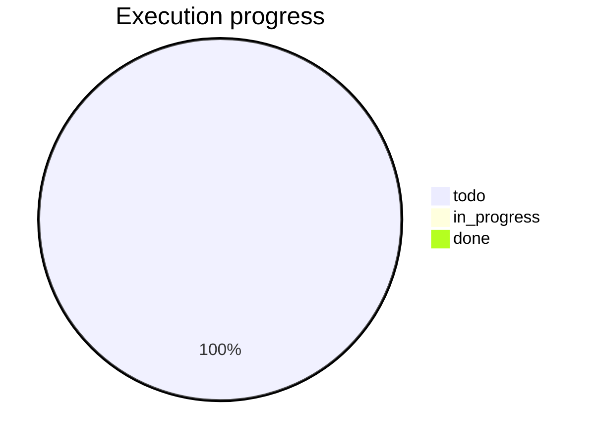

# EXECUTION

## executive_summary

- Bắt đầu execution: Phase 0 (CRITICAL) trước
- T-001: `queryClient.clear()` cho logout + org switch
- Workspace clean sau checkpoint commit
- Next: T-001

## developer_overview

| Field | Value |
|---|---|
| Status | `in_progress` |
| Current task | T-001 |
| Done/total | 0/17 |
| Blockers | 0 |
| Next action | T-001 Work items |

## charts

## plan_source

PLAN.md + TASKS.md from `.agents/sessions/Task-8-Task-8-coding-rules-investigate/`

## current_task

T-001

## scope

Fix 30 violations CODING_RULES.md §§15–21. Phase 0: CRITICAL (cache clear, open redirect, hook coupling).

## execution_log

| Step | Task ID | Action | Files | Result | Notes |
|---|---|---|---|---|---|
| 1 | T-001 | Auth: thay removeQueries → clear() | auth.mutations.ts | in_progress | |

## tasks_progress

| Task ID | Status | Work items | Notes |
|---|---|---|---|
| T-001 | in_progress | 0/2 | |
| T-002 | todo | 0/0 | |
| T-003 | todo | 0/0 | |
| T-004 | todo | 0/0 | |
| T-005 | todo | 0/0 | |
| T-006 | todo | 0/0 | |
| T-007 | todo | 0/0 | |
| T-008 | todo | 0/0 | |
| T-009 | todo | 0/0 | |
| T-010 | todo | 0/0 | |
| T-011 | todo | 0/0 | |
| T-012 | todo | 0/0 | |
| T-013 | todo | 0/0 | |
| T-014 | todo | 0/0 | |
| T-015 | todo | 0/0 | |
| T-016 | todo | 0/0 | |
| T-017 | todo | 0/0 | |

## files_changed

| File | Change summary | Reason | In-plan? |
|---|---|---|---|

## commands_run

| Command | Purpose | Result | Notes |
|---|---|---|---|

## verification_evidence

| Check name | Command/method | Result | Evidence |
|---|---|---|---|

## deviations

(none)

## issues_blockers

(none)

## rollback_notes

`git revert HEAD`. All changes are code-only, no migrations.

## final_status

In progress

## handoff

- Ready for review: No
- Current task: T-001
