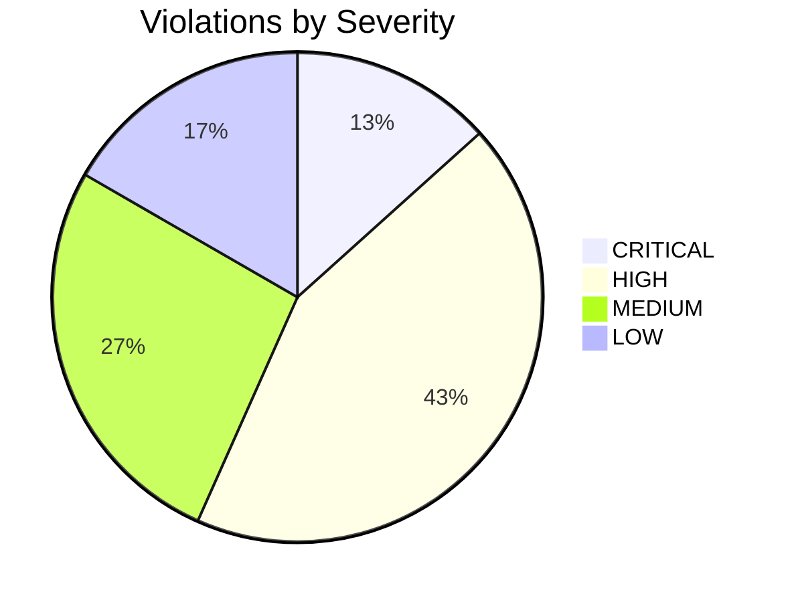
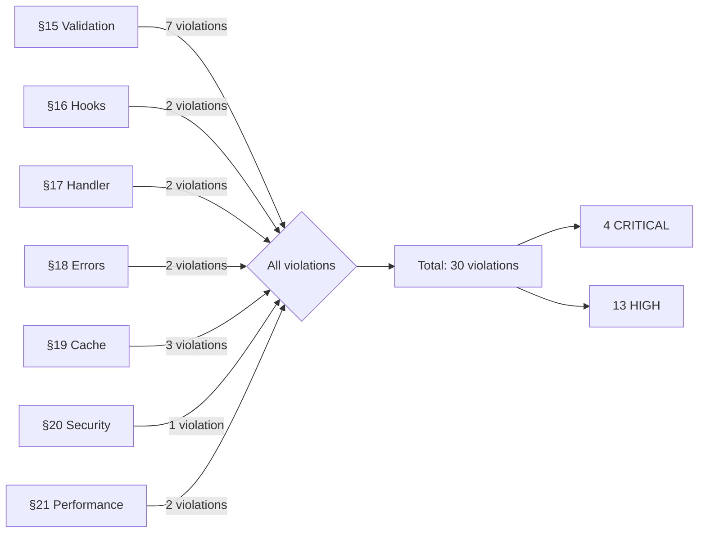

# INVESTIGATE

## Executive summary

- **Confirmed violations**: 30+ findings across §§15–21, bao gồm 4 CRITICAL (security + cache identity leak), 13 HIGH, 8 MEDIUM, 5 LOW
- **CRITICAL #1** — `useLogoutMutation` (`auth.mutations.ts:79`) dùng `removeQueries()` thay vì `queryClient.clear()` — cache user cũ rò sang phiên mới
- **CRITICAL #2** — `useSwitchOrganizationMutation` (`organizations.mutations.ts:24`) dùng `invalidateQueries()` trần thay vì `queryClient.clear()` — data tenant cũ lẫn lộn
- **CRITICAL #3** — `returnTo` trong `organization-detail-view.tsx:55` không qua `internalPath()` — open redirect vulnerability
- **CRITICAL #4** — `use-mail-filters.ts` tự phát hiện `useSearchParams()` thay vì nhận từ root handler — vi phạm §16 R4
- **Systemic gap**: `parseSearchParams`, `parseRouteParams`, `classifyError`, `queryClient.clear()` không được dùng ở đâu cả trong app code
- Next action: Lên PLAN để sửa tất cả violations

## Developer overview

| Field | Value |
|---|---|
| Investigation status | Root Cause Confirmed |
| Sections investigated | 8 (§15–§21 của CODING_RULES.md) |
| Total violations | 4 CRITICAL, 13 HIGH, 8 MEDIUM, 5 LOW |
| Systemic gaps | 4 utilities defined nhưng zero usage |
| Next action | Planning → fix theo ưu tiên |

## Violations summary

### §15 — FE Validation Rules (7 findings)

| ID | Rule | File | Severity | Mô tả |
|----|------|------|----------|-------|
| V15-1 | R2 | `roles/ui/role-form-drawer.tsx:18` | HIGH | `import { z } from "zod"` trong UI layer — schema phải ở model/ |
| V15-2 | R3 | `use-user-detail-controller.ts:69-70` | HIGH | `useParams().id` không qua `parseRouteParams()` — không có notFound() |
| V15-3 | R3 | `organization-detail-view.tsx:49-50` | HIGH | `useParams().id` không qua `parseRouteParams()` |
| V15-4 | R3 | **Systemic** — toàn bộ app | HIGH | `parseRouteParams` defined nhưng **zero usage** |
| V15-5 | R4 | **Systemic** — 7+ files | HIGH | `searchParams.get()` thủ công khắp nơi, `parseSearchParams` **zero usage** |
| V15-6 | R5 | `organization-detail-view.tsx:55`, `use-user-detail-controller.ts:77` | MEDIUM | Hardcoded literal fallback (`"/organizations"`, `"/users"`) thay vì `DEFAULT_*` constants |
| V15-7 | R7 | `organization-detail-view.tsx:55` | **CRITICAL** | `returnTo` không qua `internalPath()` — open redirect |

**Files bị ảnh hưởng bởi R4 (raw searchParams.get()):**
- `users/model/users.search-params.ts` — 7x `.get()`
- `auth/controllers/use-admin-sso-callback-flow.ts` — 2x `.get()`
- `auth/controllers/use-admin-login-flow.ts` — 1x `.get()`
- `organizations/screens/organization-detail-view.tsx` — 1x `.get()`
- `users/controllers/use-user-detail-controller.ts` — 1x `.get()`
- `audit-logs/model/audit-logs.filters.ts` — 4x `.get()`
- `mail/model/mail-schemas.ts` — 3x `.get()`
- `jobs/model/constants.ts` — 3x `.get()`
- `verify-email/components/verify-email-view.tsx` — 1x `.get()` (identity param)

### §16 — Shared Hook Composition (2 findings)

| ID | Rule | File | Severity | Mô tả |
|----|------|------|----------|-------|
| V16-1 | R3 | `auth/controllers/use-admin-guard.ts:18` | HIGH | Guard gọi `useSession()` trực tiếp — không phải root handler |
| V16-2 | R4 | `mail/controllers/use-mail-filters.ts:13` | **CRITICAL** | Sub-hook tự gọi `useSearchParams()`, `usePathname()`, `useRouter()` — phải nhận qua tham số |

### §17 — Handler Splitting & Flow Comments (2 findings)

| ID | Rule | File | Severity | Mô tả |
|----|------|------|----------|-------|
| V17-1 | R1+R5 | **12 root handlers** | HIGH | **0/12** có flow comment đúng format. `use-users-list-controller.ts` (338 dòng > 250, 9 view model groups > 6) |
| V17-2 | R2 | `use-create-user-drawer-controller.ts` | LOW | Tên sub-hook chứa "controller" — technical layer term, không phải danh từ nghiệp vụ |

**Root handlers thiếu flow comment:**
`use-audit-logs`, `use-dashboard`, `use-files`, `use-imports`, `use-jobs`, `use-mail`, `use-mfa`, `use-notifications`, `use-roles`, `use-settings`, `use-user-detail`, `use-users-list`

### §18 — Error Handling (2 findings)

| ID | Rule | File | Severity | Mô tả |
|----|------|------|----------|-------|
| V18-1 | Layers | `security/screens/security-view.tsx:56-57` | MEDIUM | `toast()` gọi trong Screen — phải ở Controller |
| V18-2 | §18.1 | **Systemic** — all controllers | MEDIUM | `classifyError()` từ `@repo/web-utils/errors` **zero usage** trong controllers |

### §19 — Cache Rules (3 findings)

| ID | Rule | File | Severity | Mô tả |
|----|------|------|----------|-------|
| V19-1 | R6 | `auth/api/auth.mutations.ts:79` | **CRITICAL** | `useLogoutMutation` dùng `removeQueries({ queryKey: sessionQueryKey })` — chỉ xoá session query, cache user cũ vẫn còn. Phải là `queryClient.clear()` |
| V19-2 | R4+R6 | `organizations/api/organizations.mutations.ts:24` | **CRITICAL** | `invalidateQueries()` trần + thiếu `clear()` khi đổi organization. Data tenant cũ lẫn với mới |
| V19-3 | R1 | `dashboard/api/dashboard.queries.ts:52` | MEDIUM | Key thủ công `[key]` tại call site |
| V19-4 | R6 | **Systemic** | **CRITICAL** | `queryClient.clear()` **never called anywhere** trong toàn bộ codebase |

### §20 — Security (1 finding)

| ID | Rule | File | Severity | Mô tả |
|----|------|------|----------|-------|
| V20-1 | R3 | `auth/api/auth.api.ts:113` | HIGH | Raw `fetch()` thay vì `webFetch()` — thiếu CSRF token header |
| V20-2 | R3 | `audit-logs/controllers/use-audit-logs-controller.ts:85,105` | HIGH | `fetch()` trần trong controller (không phải api layer) — bypass webFetch hoàn toàn |
| V20-3 | R3 | `verify-email/verify-email-service.ts:10` | HIGH | Raw `fetch()` trong web app — không có CSRF handling |

### §21 — Performance (2 findings)

| ID | Rule | File | Severity | Mô tả |
|----|------|------|----------|-------|
| V21-1 | R3 | `files/controllers/use-file-pagination.ts:10-11`, `jobs/controllers/use-jobs-controller.ts:75` | MEDIUM | Search/filter không debounce — gọi API mỗi ký tự |
| V21-2 | R4 | `audit-logs.queries.ts`, `jobs.queries.ts`, `files.queries.ts`, `mail.queries.ts` | MEDIUM | Thiếu `placeholderData: (previous) => previous` — nháy trắng khi đổi trang |
| V21-3 | R5 | ~30+ `useMemo`/`useCallback` | LOW | Volume cao nhưng chưa có profiling evidence |

## Charts

## Question

CODING_RULES.md §§15–21 có bao nhiêu violation trong codebase hiện tại?

## Status

Root Cause Confirmed

## Observed facts

| Fact | Source |
|------|--------|
| `parseSearchParams` defined trong `@repo/web-utils/params` | `packages/web-utils/src/params.ts` |
| `parseRouteParams` defined trong `@repo/web-utils/params` | `packages/web-utils/src/params.ts` |
| `classifyError` defined trong `@repo/web-utils/errors` | `packages/web-utils/src/errors.ts` |
| `internalPath` defined trong `@repo/web-utils/params` | `packages/web-utils/src/params.ts` |
| `queryClient.clear()` không được gọi ở đâu | grep results — 0 matches |
| `parseSearchParams` không được import ở app code | grep results — 0 matches |
| `parseRouteParams` không được import ở app code | grep results — 0 matches |
| 12/12 root handlers thiếu flow comment | Manual audit of `controllers/` |
| `useLogoutMutation` dùng `removeQueries()` thay vì `clear()` | `auth.mutations.ts:79` |
| `useSwitchOrganizationMutation` dùng `invalidateQueries()` trần | `organizations.mutations.ts:24` |
| `returnTo` trong `organization-detail-view.tsx` không qua `internalPath()` | `organization-detail-view.tsx:55` |
| `use-mail-filters.ts` tự gọi `useSearchParams()` | `mail/controllers/use-mail-filters.ts:13` |
| 4 paginated queries thiếu `placeholderData` | audit-logs, jobs, files, mail queries |
| Raw `fetch()` trong 3 files thay vì `webFetch` | `auth.api.ts`, `audit-logs-controller.ts`, `verify-email-service.ts` |

## Hypotheses

| Hypothesis | Supporting evidence | Counter evidence | Confidence |
|---|---|---|---|
| Các utility function mới được thêm vào nhưng chưa có task migrate code cũ | `@repo/web-utils/params` và `errors` mới được thêm gần đây (commit `c640afd`) | — | High |
| violation do copy-paste code từ trước khi có CODING_RULES | Nhiều file như `audit-logs.filters.ts`, `mail-schemas.ts` có pattern giống hệt nhau | — | High |
| Thiếu hiểu biết về `queryClient.clear()` cho identity change | pattern `removeQueries({ queryKey })` sai xuất hiện ở 2 chỗ | — | High |

## Impact

| Area affected | Impact | Confidence |
|---|---|---|
| **Security: Open redirect** (V15-7) | Attacker có thể inject `returnTo=https://evil.com` trong organization detail page | High |
| **Security: Cache leak across tenants/users** (V19-1, V19-2) | User B đăng nhập sau user A thấy dữ liệu của user A trong khoảnh khắc đầu. Org switch cũng bị lẫn | High |
| **Security: CSRF** (V20-1, V20-2, V20-3) | 3 raw `fetch()` không có CSRF token — non-GET request dễ bị CSRF | High |
| **Data integrity: Validation** (V15) | Search params không validate — dữ liệu sai có thể vào query key, gây lỗi hoặc hiển thị sai | Medium |
| **Developer experience: Maintainability** (V17) | 12 root handlers thiếu flow comment — khó hiểu luồng, khó review | Medium |
| **Performance: UI flash** (V21-2) | 4 paginated tables nháy trắng khi đổi trang | Medium |
| **Performance: Unnecessary API calls** (V21-1) | 2 features gọi API mỗi ký tự gõ | Low |
| **Architecture: Hook coupling** (V16-2) | `use-mail-filters.ts` tight coupling với Next.js navigation — khó test, khó reuse | Medium |

## Recommendation

### Priority order (Critical → High → Medium → Low)

**CRITICAL (fix ngay):**
1. `queryClient.clear()` khi logout (`auth.mutations.ts`) và switch org (`organizations.mutations.ts`) — thay `removeQueries`/`invalidateQueries` bằng `clear()`
2. `internalPath()` cho `returnTo` trong `organization-detail-view.tsx`
3. Refactor `use-mail-filters.ts` — nhận params qua argument từ root handler

**HIGH:**
4. Migrate search params sang `parseSearchParams()` — bắt đầu từ `users.search-params.ts` (mẫu đã có trong CODING_RULES)
5. `parseRouteParams()` cho `use-user-detail-controller.ts` và `organization-detail-view.tsx`
6. Thay raw `fetch()` bằng `webFetch()` trong `auth.api.ts`, `audit-logs-controller.ts`, `verify-email-service.ts`
7. Flow comment cho 12 root handlers
8. Move `zod` import từ `role-form-drawer.tsx` lên model schema
9. Restructure `use-admin-guard.ts` — nhận session qua params

**MEDIUM:**
10. `placeholderData` cho audit-logs, jobs, files, mail queries
11. Debounce cho files search và jobs type filter
12. `classifyError()` cho controller error handling
13. Move `toast()` từ `security-view.tsx` lên controller

## Handoff

Ready for planning? **Yes**

Ready for execution? **After PLAN.md + TASKS.md**

Suggested next skill: `planning` — với ưu tiên CRITICAL → HIGH → MEDIUM → LOW
