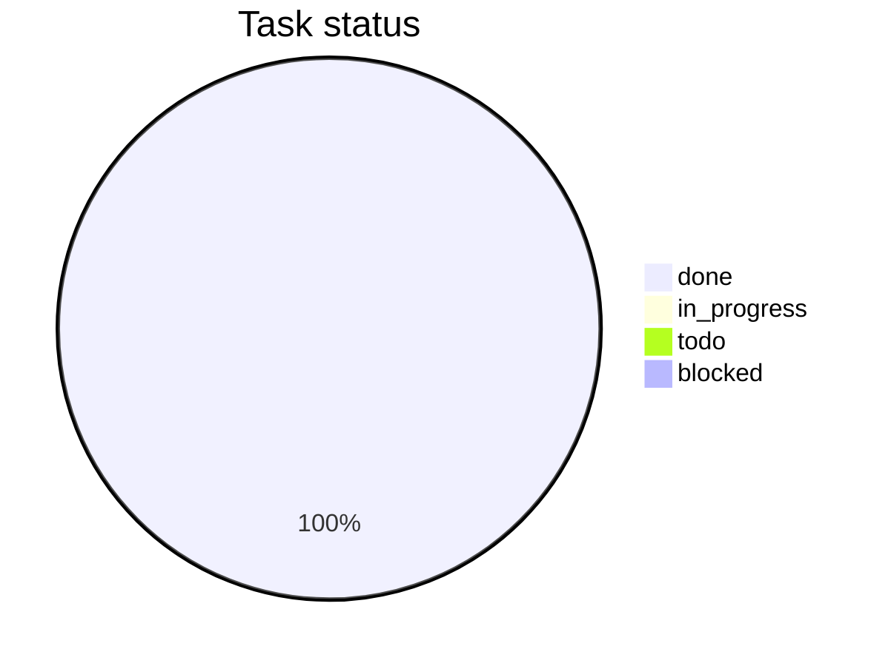
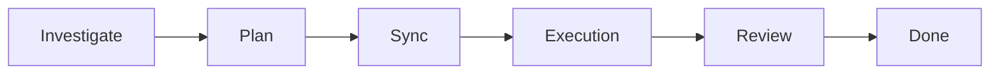

# Session overview

> Developer landing page. Keep this scannable. Refresh after sync, execution,
> review, and done. Detail lives in sibling artifacts; this file is the map.

## At a glance (80/20)

| Field | Value |
|---|---|
| Status | `execution complete` → next `review` |
| Goal | Fix CODING_RULES violations (§§15–21) + harden admin features |
| Progress | **17/17** cards done · 0 blocked · `COMPLETE: yes` |
| Top risk / blocker | None open for execution |
| Next action | Chạy skill `review` → viết `REVIEW.md` |

## Progress chart

## Open decisions

| ID | Severity | Blocking? | Visual? | Question / decision | Status |
|---|---|---|---|---|---|
| none | — | — | — | — | — |

## Artifact map

| Artifact | Purpose | Freshness |
|---|---|---|
| `INVESTIGATE.md` | Root cause analysis | current |
| `PLAN.md` | Strategy | current |
| `TASKS.md` | Work | **synced 17/17 done** |
| `EXECUTION.md` | Execution log | **current** |
| `REVIEW.md` | Post-execution review | missing → next |

## Developer notes

- Branch: `main` (direct mode)
- Related commits: `14a2509`, `c1afae6`, `4a14770` + upcoming execution commit
- Verify: `pnpm --filter admin typecheck` · `pnpm --filter admin test`
