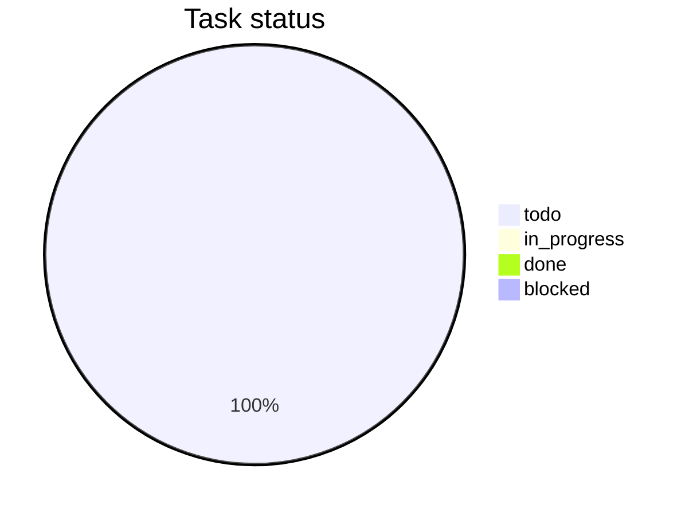
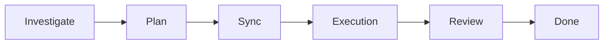

# Session overview

> Developer landing page. Keep this scannable. Refresh after sync, execution,
> review, and done. Detail lives in sibling artifacts; this file is the map.

## At a glance (80/20)

| Field | Value |
|---|---|
| Status | `planning` |
| Goal | Fix 30 violations CODING_RULES.md §§15–21 theo 4 phases |
| Progress | 0/17 cards done · 0 blocked · 0 needs info |
| Top risk / blocker | `queryClient.clear()` có thể gây flash nếu không test kỹ |
| Next action | Sync → Execution (T-001) |

## Progress chart

## Open decisions

| ID | Severity | Blocking? | Visual? | Question / decision | Status |
|---|---|---|---|---|---|
| none | — | — | — | — | — |

## Artifact map

| Artifact | Purpose | Freshness |
|---|---|---|
| `INVESTIGATE.md` | Root cause analysis | current |
| `PLAN.md` | Strategy | current |
| `TASKS.md` | Work | current |

## Developer notes

- Commands: `pnpm typecheck`, `pnpm test`
- CRITICAL first: T-001 → T-002 → T-003
- 17 cards total across 4 phases
