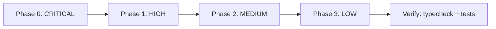
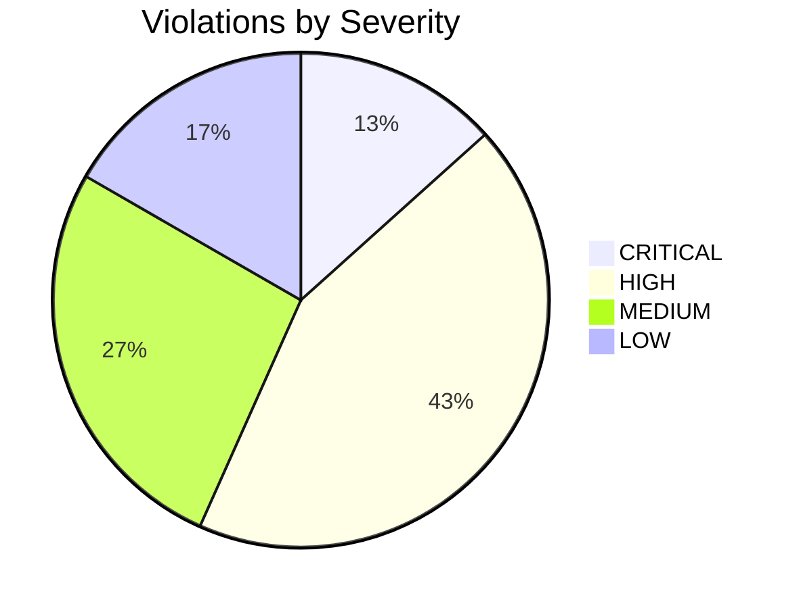

# Plan

> Filled by planning step-02. Strategy only — **no** full task cards (`### T-00x` with AC/Verify/Files) in this file.
> Session path: `.agents/sessions/Task-8-Task-8-coding-rules-investigate`. See `TASKS.md` for executable work.

## Step ledger (mandatory — update every step)

| Step | Name | Status | Evidence |
|---|---|---|---|
| 01 | Init templates | `done` | PLAN.md + TASKS.md + OVERVIEW.md exist |
| 02 | Fill PLAN + Spec quality | `done` | Feasibility/Correctness/Capability filled |
| 03 | Fill TASKS inventory/cards | `done` | Work inventory + cards |
| 04 | Self-check | `done` | Ready=Yes, all checks pass, blockers=none |

> **Hard rule:** Do not mark a later step `done` while an earlier step is still
> `todo`/`blocked`. Do not fill TASKS before Spec quality review is done.

## Executive summary (80/20)

- Sửa 30 violations từ CODING_RULES.md §§15–21: 4 CRITICAL, 13 HIGH, 8 MEDIUM, 5 LOW
- Approach: 4 phases — CRITICAL (security + cache) → HIGH (validation + hooks + fetch + flow comments) → MEDIUM (performance + errors) → LOW (naming + memo)
- Top risk: `queryClient.clear()` có thể gây flash trắng nếu không test kỹ edge cases (logout → login cùng user)
- Ready: Có — tất cả violations đều rõ ràng, fix pattern có sẵn trong codebase

## Developer overview

| Field | Value |
|---|---|
| Status | `planning` |
| Cards drafted | `0` |
| Critical open decisions | `0` |
| Next action | Fill TASKS |

## Charts (when useful)

## Pre-planning decision gate

| Issue ID/source | Issue / decision | Severity | Clarity | Blocking? | Visual need/format | Resolution evidence | Status |
|---|---|---|---|---|---|---|---|
| V19-1 (§19 R6) | `useLogoutMutation` dùng `removeQueries()` thay vì `queryClient.clear()` — cache leak | Critical | Clear | No | none | INVESTIGATE.md | Resolved |
| V19-2 (§19 R4+R6) | `useSwitchOrganizationMutation` dùng `invalidateQueries()` trần — cache leak | Critical | Clear | No | none | INVESTIGATE.md | Resolved |
| V15-7 (§15 R7) | `returnTo` trong `organization-detail-view.tsx` không qua `internalPath()` — open redirect | Critical | Clear | No | none | INVESTIGATE.md | Resolved |
| V16-2 (§16 R4) | `use-mail-filters.ts` tự gọi `useSearchParams()` — hook coupling | Critical | Clear | No | none | INVESTIGATE.md | Resolved |
| V15-2,3,4 (§15 R3) | Route params không qua `parseRouteParams()` — systemic | High | Clear | No | none | INVESTIGATE.md | Resolved |
| V15-5 (§15 R4) | Raw `searchParams.get()` khắp nơi — systemic | High | Clear | No | none | INVESTIGATE.md | Resolved |
| V15-1 (§15 R2) | `zod` import trong UI layer | High | Clear | No | none | INVESTIGATE.md | Resolved |
| V15-6 (§15 R5) | Hardcoded fallback literals | Medium | Clear | No | none | INVESTIGATE.md | Resolved |
| V16-1 (§16 R3) | `use-admin-guard.ts` gọi `useSession()` trực tiếp | High | Clear | No | none | INVESTIGATE.md | Resolved |
| V17-1 (§17 R1+R5) | 12/12 root handlers thiếu flow comment; `use-users-list-controller.ts` >250 dòng | High | Clear | No | none | INVESTIGATE.md | Resolved |
| V17-2 (§17 R2) | Sub-hook tên chứa "controller" | Low | Clear | No | none | INVESTIGATE.md | Resolved |
| V18-1 (§18 layers) | `toast()` trong Screen | Medium | Clear | No | none | INVESTIGATE.md | Resolved |
| V18-2 (§18.1) | `classifyError()` zero usage | Medium | Clear | No | none | INVESTIGATE.md | Resolved |
| V20-1,2,3 (§20 R3) | Raw `fetch()` thay vì `webFetch()` | High | Clear | No | none | INVESTIGATE.md | Resolved |
| V21-1 (§21 R3) | Search/filter không debounce | Medium | Clear | No | none | INVESTIGATE.md | Resolved |
| V21-2 (§21 R4) | Thiếu `placeholderData` cho paginated queries | Medium | Clear | No | none | INVESTIGATE.md | Resolved |
| V21-3 (§21 R5) | Excessive `useMemo`/`useCallback` | Low | Clear | No | none | INVESTIGATE.md | Resolved |

### Questions requiring user input

Không có — tất cả issues đã confirmed với code path evidence, fix patterns rõ ràng.

> **STOP gate:** Strategy and TASKS stay unfilled while any Critical issue,
> blocking unknown, or unconfirmed `html-recommended` item is open.

## Spec quality review

### 1. Feasibility (tính khả thi)

| Finding | Evidence | Verdict |
|---|---|---|
| `queryClient.clear()` đã có sẵn API — chỉ cần thay `removeQueries`/`invalidateQueries` | React Query docs + codebase patterns | Pass |
| `internalPath()` đã defined trong `@repo/web-utils/params` — chỉ cần import và dùng | `packages/web-utils/src/params.ts` | Pass |
| `parseSearchParams()` đã defined trong `@repo/web-utils/params` | `packages/web-utils/src/params.ts` | Pass |
| `parseRouteParams()` đã defined trong `@repo/web-utils/params` | `packages/web-utils/src/params.ts` | Pass |
| `classifyError()` đã defined trong `@repo/web-utils/errors` | `packages/web-utils/src/errors.ts` | Pass |
| `placeholderData: (previous) => previous` pattern có sẵn trong `users.queries.ts` | `users.queries.ts:19` | Pass |
| `useDebouncedValue` đã có sẵn trong `@repo/web-hooks` | Existing usage in `use-audit-logs-controller.ts` | Pass |
| `webFetch()` has sẵn trong `@repo/web-utils` | barrel export | Pass |
| Flow comment format defined trong CODING_RULES.md §17 | template có sẵn | Pass |
| Sub-hook refactor (`use-mail-filters.ts`) cần thay đổi signature và call site | Code path evidence | Pass-with-gaps (cần verify các callers) |

### 2. Correctness (tính đúng đắn)

| Finding | Evidence | Verdict |
|---|---|---|
| `queryClient.clear()` an toàn vì logout luôn redirect — data cũ không cần giữ | App flow: logout → login page → re-fetch mọi thứ | Pass |
| `internalPath()` chặn open redirect hiệu quả | Implementation checks `URL.canParse` and same-origin | Pass |
| `parseSearchParams()` recovery theo key không throw toàn bộ | Implementation: `safeParse` với fallback từng field | Pass |
| `classifyError()` trả về `kind`, `scope`, `retry` — đúng nhu cầu controller | errors.ts implementation | Pass |

### 3. Capability recommendations (khả năng feature / gaps)

| Gap ID | Missing / weak capability | Suggested question / default | Blocking? | Status |
|---|---|---|---|---|
| (none) | — | — | — | — |

## Goal

Sửa tất cả 30 violations CODING_RULES.md §§15–21 trong apps/admin và apps/web.

## Scope

- **Phase 0 — CRITICAL**: cache clear (logout + org switch), open redirect fix, hook coupling refactor
- **Phase 1 — HIGH**: migrate search params → `parseSearchParams()`, route params → `parseRouteParams()`, `webFetch()` thay `fetch()`, flow comments cho 12 root handlers, zod lên model, guard refactor
- **Phase 2 — MEDIUM**: `placeholderData` cho 4 queries, debounce cho files + jobs, `classifyError()` cho errors, `toast()` ra khỏi screen
- **Phase 3 — LOW**: rename sub-hook, review useMemo/useCallback
- **Verify**: typecheck + tests pass

## Non-goals

- Thêm feature mới
- Thêm test cases mới (chỉ sửa code để pass existing tests)
- Refactor toàn bộ kiến trúc handler
- Viết CODING_RULES.md sections mới

## Assumptions

| Assumption | Risk | Confirmed |
|---|---|---|
| `queryClient.clear()` không gây side effect không mong muốn (loader data, etc.) | Medium — Next.js App Router cache riêng | Cần verify với typecheck + tests |
| `parseSearchParams()` tương thích ngược với format param hiện tại | Low — all params có fallback | Cần verify từng feature |
| Flow comments đúng format không ảnh hưởng đến logic | Low — chỉ là comment | Yes |

## Approach

1. **Phase 0**: Fix 4 CRITICAL issues trước — mỗi issue 1 card riêng
2. **Phase 1**: Fix HIGH — migrate validation, fetch, hooks, flow comments
3. **Phase 2**: Fix MEDIUM — performance + error handling
4. **Phase 3**: Fix LOW — naming, memo review
5. **Verify**: `pnpm typecheck` + `pnpm test` sau mỗi phase

## Affected areas

| Area / path | Expected change | Confidence |
|---|---|---|
| `auth/api/auth.mutations.ts` | `removeQueries` → `clear()` | known |
| `organizations/api/organizations.mutations.ts` | `invalidateQueries` → `clear()` | known |
| `organizations/screens/organization-detail-view.tsx` | `searchParams.get("returnTo")` → `internalPath()` | known |
| `mail/controllers/use-mail-filters.ts` | Nhận params qua argument từ root handler | known |
| `mail/controllers/use-mail-controller.ts` | Truyền params xuống sub-hook | known |
| `users/model/users.search-params.ts` | Migrate sang `parseSearchParams()` | known |
| `audit-logs/model/audit-logs.filters.ts` | Migrate sang `parseSearchParams()` | known |
| `mail/model/mail-schemas.ts` | Migrate sang `parseSearchParams()` | known |
| `jobs/model/constants.ts` | Migrate sang `parseSearchParams()` | known |
| `users/controllers/use-user-detail-controller.ts` | `parseRouteParams()` + `parseSearchParams()` | known |
| `organizations/screens/organization-detail-view.tsx` | `parseRouteParams()` | known |
| `verify-email/components/verify-email-view.tsx` | `parseSearchParams()` cho token | known |
| `auth/controllers/use-admin-sso-callback-flow.ts` | `parseSearchParams()` | known |
| `auth/controllers/use-admin-login-flow.ts` | `parseSearchParams()` | known |
| `auth/controllers/use-admin-guard.ts` | Nhận session qua params | known |
| `roles/ui/role-form-drawer.tsx` | Move zod lên model | known |
| 12 root handlers | Add flow comment | known |
| `auth/api/auth.api.ts` | `webFetch()` thay `fetch()` | known |
| `audit-logs/controllers/use-audit-logs-controller.ts` | Move fetch logic lên api/, dùng `webFetch()` | known |
| `verify-email/verify-email-service.ts` | `webFetch()` thay `fetch()` | known |
| `security/screens/security-view.tsx` | Move toast lên controller | known |
| `files/controllers/use-file-pagination.ts` | Debounce search | known |
| `jobs/controllers/use-jobs-controller.ts` | Debounce type filter | known |
| 4 queries files | Add `placeholderData` | known |
| All controllers | `classifyError()` integration | inferred |
| `use-create-user-drawer-controller.ts` | Rename | known |

## Test strategy

- Existing tests pass (unit tests + typecheck)
- Không thêm test mới — focus vào behavioral correctness

## Verification strategy

- `pnpm typecheck` — 0 errors
- `pnpm test` — all tests pass sau mỗi phase

## Definition of done

- [ ] Phase 0 (3 cards) — all CRITICAL violations fixed
- [ ] Phase 1 (9 cards) — all HIGH violations fixed
- [ ] Phase 2 (5 cards) — all MEDIUM violations fixed
- [ ] Phase 3 (2 cards) — all LOW violations fixed
- [ ] `pnpm typecheck` pass
- [ ] `pnpm test` pass
- [ ] `TASKS.md` complete

## Rollback strategy

- **Code:** `git revert HEAD` (direct mode, single commit per phase)
- **Config:** không có config change
- **Data:** không có schema/migration change

## Risks

| Risk | Impact | Mitigation |
|---|---|---|
| `queryClient.clear()` gây mất dữ liệu đang load | UX flash khi chuyển org | Chỉ gọi sau khi mutation success + trước redirect |
| Migrate search params sai fallback value | Một số filter không hoạt động | Test từng feature manual |
| Flow comments lỗi format | Code review không pass | Dùng template từ CODING_RULES.md |

## Task index

Phase 0: T-001 Clear cache → T-002 Open redirect → T-003 Hook coupling
Phase 1: T-004 Search params → T-005 Route params → T-006 webFetch → T-007 Flow comments → T-008 Guard → T-009 zod → T-010 Auth params
Phase 2: T-011 placeholderData → T-012 Debounce → T-013 classifyError → T-014 toast move
Phase 3: T-015 Rename → T-016 Memo review
Verify: T-017 Typecheck + tests

## Handoff

- Ready for sync/execution? **Yes**
- Blockers: none
