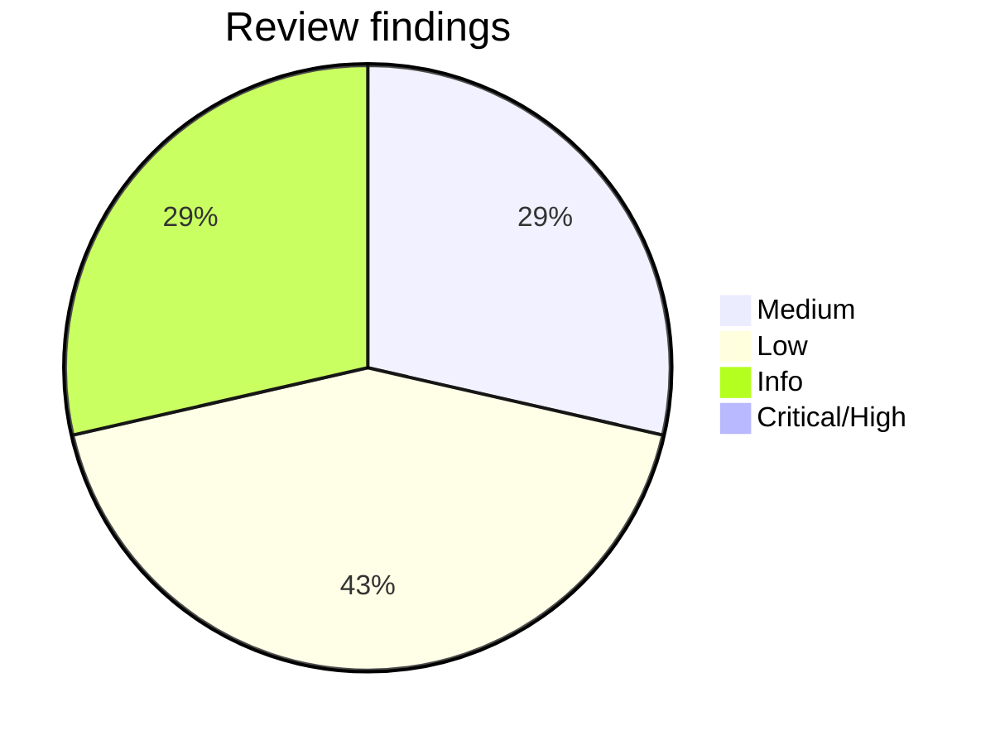

# REVIEW

## executive_summary

- **Recommendation:** Ready with risks — 17/17 TASKS done; admin typecheck + 109 unit tests pass.
- Scope lớn (~15 commits trên `main`, 327 files vs `origin/main`) gồm cả feature harden ngoài 17 cards gốc.
- CRITICAL PLAN items đã có evidence: `queryClient.clear()`, `internalPath`, mail filters params, guard session param.
- Residual: chưa chạy full-monorepo `pnpm test` / e2e; một số Low (settings BE per-key validation, security recovery-code UX).
- Next: skill `done` (PR message) hoặc spot e2e auth/org/security nếu muốn giảm rủi ro trước merge remote.

## developer_overview

| Field | Value |
|---|---|
| Recommendation | Ready with risks |
| Findings | Critical 0 · High 0 · Medium 2 · Low 3 · Info 2 |
| Verification gaps | Full workspace `pnpm test` / e2e không chạy trong execution cuối |
| Next action | `done` skill hoặc manual smoke MFA/org switch/login |

## charts

## scope_reviewed

- Diff `origin/main...HEAD` (commits CODING_RULES + admin feature harden).
- TASKS.md T-001…T-017 (board `COMPLETE: yes`).
- EXECUTION.md verify: admin typecheck + admin vitest 109/109.
- Spot-check: guard/session, classifyError, bffPath APIs, MFA QR local, users multi-sort parse.

## inputs

- PLAN.md (DoD / Phase 0–3 violations)
- TASKS.md (17 cards, synced done)
- EXECUTION.md (final_status Completed)
- `git log origin/main..HEAD`, `git diff --stat origin/main...HEAD`
- Commands: `pnpm --filter admin typecheck`, `pnpm --filter admin test`
- `.agents/CODE_COMMENTS.md` (flow/ownership check)

## findings

### M-001 — Medium · Verification

| | |
|---|---|
| **Location** | Workspace root vs `apps/admin` only |
| **Evidence** | EXECUTION chỉ ghi `pnpm --filter admin typecheck/test`. Diff đụng `packages/api-platform`, `api-identity`, `web-utils`. |
| **Impact** | Regression ngoài admin package có thể chưa bị bắt. |
| **Recommendation** | Chạy `pnpm typecheck` + `pnpm test` (hoặc turbo filter affected) trước khi push. |
| **Confidence** | High |

### M-002 — Medium · Testing gap (security UX)

| | |
|---|---|
| **Location** | `apps/admin/src/features/security/ui/mfa-setup-flow.tsx` |
| **Evidence** | QR chuyển sang `qrcode.react` (S-01 fix) — không có unit/e2e cover render QR / cancel clears secret. |
| **Impact** | Regression MFA setup có thể chỉ lộ ở manual QA. |
| **Recommendation** | Smoke manual: setup → scan/copy → confirm → disable; cancel giữa chừng. |
| **Confidence** | Medium |

### L-001 — Low · Residual capability

| | |
|---|---|
| **Location** | `packages/api-platform/.../settings` UpdateSettingDto `@IsObject()` |
| **Evidence** | Review settings ST-05 skipped — không validate shape theo key. |
| **Impact** | SUPER_ADMIN có thể ghi JSON lệch shape. |
| **Recommendation** | Follow-up task: per-key value schema. |
| **Confidence** | High |

### L-002 — Low · Residual UX

| | |
|---|---|
| **Location** | MFA disable / regenerate OTP UI |
| **Evidence** | FE OTP maxLength 6; BE chấp nhận recovery code dài hơn (S-14 Low). |
| **Impact** | Disable bằng recovery code khó hơn trên UI. |
| **Recommendation** | Optional toggle “Use recovery code”. |
| **Confidence** | Medium |

### L-003 — Low · Debounce AC drift

| | |
|---|---|
| **Location** | jobs/files/mail debounce 400ms |
| **Evidence** | TASKS T-012 ghi 500ms; implementation 400ms (khớp users). |
| **Impact** | Không functional bug. |
| **Recommendation** | Accept; cập nhật TASKS note nếu cần. |
| **Confidence** | High |

### I-001 — Info · Scope expansion

| | |
|---|---|
| **Evidence** | Ngoài 17 cards: full module harden (orgs controllers, notifications mapper DI, §22 bffPath, …). |
| **Impact** | Review khó hơn; giá trị kiến trúc tăng. |
| **Recommendation** | Ghi nhận trong DONE/PR summary. |

### I-002 — Info · Comments

| | |
|---|---|
| **Evidence** | Root handlers có `Flow:` + `Owns` / `Does not own` (T-007). Không thấy comment mâu thuẫn rõ. |
| **Impact** | N/A |
| **Recommendation** | Keep updating ownership when splitting hooks. |

**No Critical/High findings** trong vòng review này.

## requirement_coverage

| Requirement / task | Covered? | Evidence | Notes |
|---|---|---|---|
| T-001 clear cache logout/org | Yes | auth/org mutations `queryClient.clear()` | |
| T-002 internalPath returnTo | Yes | org detail / prior commit | |
| T-003 mail filters params | Yes | use-mail-filters args | |
| T-004…T-006 search/route/webFetch | Yes | model parseSearchParams + webFetch | |
| T-007 flow comments | Yes | 12 handlers + ownership | |
| T-008 guard session param | Yes | `useAdminGuard(session)` | |
| T-009–T-016 | Yes | TASKS `[x]` + code | |
| T-017 verify | Yes | admin typecheck + 109 tests | multi-sort fix included |
| PLAN CRITICAL V19/V15/V16 | Yes | See PLAN resolved table | |

## verification_reviewed

| Check | Result | Evidence | Concern |
|---|---|---|---|
| Admin typecheck | pass | EXECUTION / exit 0 | — |
| Admin unit tests | pass | 109/109 | — |
| Session COMPLETE | yes | `session.sh status` | — |
| Full monorepo tests | not run | — | M-001 |
| E2E MFA/login/org | not run | — | M-002 |

## testing_gaps

| Gap | Risk | Suggested follow-up |
|---|---|---|
| No e2e for MFA QR / password change clear | Medium | Manual smoke or Playwright path |
| api-platform/identity unit suite not re-run in last commit | Low | `pnpm --filter @repo/api-platform test` |
| Settings BE value schema | Low | New task |

## residual_risks

| Risk | Impact | Acceptance / mitigation |
|---|---|---|
| Large PR surface | Reviewer fatigue | Split summary by feature in PR body |
| `queryClient.clear()` flash | UX flicker on logout/org switch | Accept per PLAN; monitor |
| Orphan pending MFA secret on cancel | DB leftover until next setup | Documented Low; optional cancel API |

## recommendation

**Ready with risks**

## handoff

- Next skill: **`done`** (DONE.md + PR message/description).
- Owner: agent/user.
- Blocking: no — optional verify M-001/M-002 trước khi `git push`.
