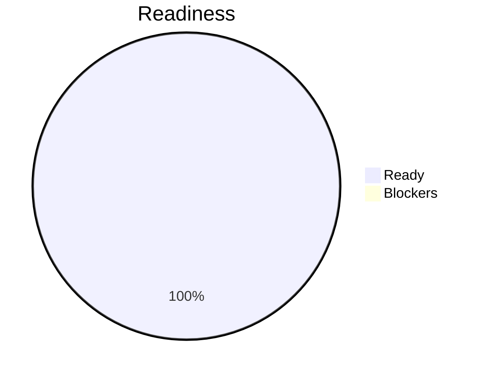

# SYNC

## executive_summary

- PLAN Ready=Yes, blockers=none. 17 task cards sẵn sàng
- Dirty changes committed — workspace clean
- Branch: `main` (direct mode) — đúng policy
- Tất cả files referenced trong TASKS đều tồn tại
- Next action: Bắt đầu execution với T-001

## developer_overview

| Field | Value |
|---|---|
| Status | Ready for execution |
| Resume at | T-001 (first non-done card) |
| Blocker count | 0 |
| Next action | Execution: T-001 → T-017 |

## charts

## scope

Synced: session artifacts (PLAN.md, TASKS.md), git state, workspace, affected files.

## observed_facts

| Fact | Source |
|---|---|
| HEAD: `546998c`, branch `main`, direct mode | `git status` + `git log` |
| PLAN.md Handoff Ready=Yes, blockers=none | PLAN.md handoff section |
| Workspace clean — no dirty changes | `git status --short` |
| All TASKS referenced files exist | File check |
| `rules.branch.mode: direct` | `.agents/settings.yaml` |

## inferred_context

| Inference | Basis | Confidence |
|---|---|---|
| Pre-existing WIP đã checkpoint — không conflict với task | `git diff` trước commit | High |

## drift_detected

(không có)

## dirty_changes

(không có — đã commit)

## risks_blockers

(không có)

## recommendation

Ready for execution: **Yes**. Start T-001 → T-017.
