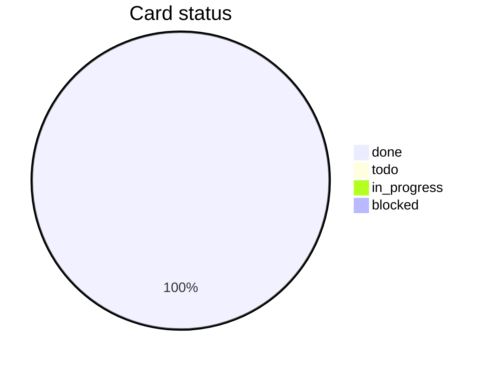

# Tasks

> Filled by planning step-03. **Work inventory first**, then micro-task cards.
> **Implement feature code before automated tests.** Do not leave template placeholders.
> **Progress:** planning seeds Status=`todo` and unchecked boxes; **execution** updates them as work completes.

plan_ref: PLAN.md

## Status legend

| Value | Meaning |
|-------|---------|
| `todo` | Not started |
| `in_progress` | Currently executing |
| `done` | Card AC verified for this task |
| `blocked` | Cannot proceed (note reason under Notes or on the card) |
| `skipped` | Intentionally not done (document why) |

## Work inventory

| Inv | Unit (noun + verb) | Trace (doc § / AC / contract) | Layer |
|-----|--------------------|-------------------------------|-------|
| I-01 | Logout: thay `removeQueries` bằng `queryClient.clear()` | INVESTIGATE §19 R6 | api |
| I-02 | Org switch: thay `invalidateQueries()` trần bằng `queryClient.clear()` | INVESTIGATE §19 R4+R6 | api |
| I-03 | Open redirect: `returnTo` trong org screen qua `internalPath()` | INVESTIGATE §15 R7 | screen |
| I-04 | Hook coupling: `use-mail-filters.ts` nhận params qua argument | INVESTIGATE §16 R4 | controller |
| I-05 | Migrate search params: users, audit-logs, mail, jobs → `parseSearchParams()` | INVESTIGATE §15 R4 | model |
| I-06 | Route params: `use-user-detail-controller`, `org-detail-view` → `parseRouteParams()` | INVESTIGATE §15 R3 | controller/screen |
| I-07 | webFetch: thay `fetch()` trong auth.api.ts, audit-logs, verify-email | INVESTIGATE §20 R3 | api/controller |
| I-08 | Flow comments: add cho 12 root handlers | INVESTIGATE §17 R5 | controller |
| I-09 | Guard refactor: `use-admin-guard.ts` nhận session qua params | INVESTIGATE §16 R3 | controller |
| I-10 | zod import: move khỏi `role-form-drawer.tsx` lên model | INVESTIGATE §15 R2 | ui/model |
| I-11 | Auth search params: SSO callback + login flow → `parseSearchParams()` | INVESTIGATE §15 R4 | controller |
| I-12 | placeholderData: thêm cho audit-logs, jobs, files, mail queries | INVESTIGATE §21 R4 | api |
| I-13 | Debounce: files search + jobs type filter | INVESTIGATE §21 R3 | controller |
| I-14 | classifyError: integrate vào controllers | INVESTIGATE §18.1 | controller |
| I-15 | toast move: từ security-view lên controller | INVESTIGATE §18 layers | screen/controller |
| I-16 | Sub-hook rename: `use-create-user-drawer-controller` → bỏ `-controller` | INVESTIGATE §17 R2 | controller |
| I-17 | Memo review: kiểm tra useMemo/useCallback volume | INVESTIGATE §21 R5 | controller/ui |
| I-18 | Verify: typecheck + tests pass | PLAN § Verification | all |

## Progress board

| Done | ID | Title | Status |
|------|----|-------|--------|
| [x] | T-001 | Logout + org switch: `queryClient.clear()` | done |
| [x] | T-002 | Open redirect: `internalPath()` cho org-detail returnTo | done |
| [x] | T-003 | Hook coupling: refactor `use-mail-filters.ts` | done |
| [x] | T-004 | Search params migration: users + audit-logs + mail | done |
| [x] | T-005 | Route params validation: user-detail + org-detail | done |
| [x] | T-006 | webFetch migration: auth.api + audit-logs | done |
| [x] | T-007 | Flow comments: 12 root handlers | done |
| [x] | T-008 | Guard refactor: `use-admin-guard.ts` session param | done |
| [x] | T-009 | zod import: move `role-form-drawer.tsx` → model | done |
| [x] | T-010 | Auth search params: SSO callback + login flow | done |
| [x] | T-011 | placeholderData: audit-logs, jobs, files, mail queries | done |
| [x] | T-012 | Debounce: files search + jobs type filter | done |
| [x] | T-013 | classifyError integration vào controllers | done |
| [x] | T-014 | toast move: security-view → controller | done |
| [x] | T-015 | Sub-hook rename: bỏ `-controller` suffix | done |
| [x] | T-016 | Memo review: kiểm tra useMemo/useCallback | done |
| [x] | T-017 | Verify: typecheck + tests | done |

## Progress chart

## Execution order

T-001 → T-002 → T-003 → (Phase 0 done) → T-004 → T-005 → T-006 → T-007 → T-008 → T-009 → T-010 → (Phase 1 done) → T-011 → T-012 → T-013 → T-014 → (Phase 2 done) → T-015 → T-016 → (Phase 3 done) → T-017

## Notes

- T-001 và T-002 độc lập, có thể chạy song song
- T-004 → T-010 (Phase 1) là nhóm lớn, chạy theo thứ tự model → controller → api
- T-005 phụ thuộc T-004 (cùng kiểu parseSearchParams migration)
- T-017 chạy cuối cùng để verify không regression

## Tasks

### T-001: Logout + org switch: `queryClient.clear()`

- Status: done
- Trace: INVESTIGATE V19-1 (logout), V19-2 (org switch) — §19 R6
- Depends: none
- Work items:
  - [x] 1. `auth/api/auth.mutations.ts`: thay `queryClient.removeQueries({ queryKey: sessionQueryKey })` bằng `queryClient.clear()`
  - [x] 2. `organizations/api/organizations.mutations.ts`: thay `queryClient.invalidateQueries()` bằng `queryClient.clear()`
- Description: Khi logout hoặc switch organization, toàn bộ cache React Query phải được xoá để tránh rò rỉ dữ liệu giữa các user/tenant.
- AC: Sau logout → login user khác → không còn data user cũ trong cache. Sau switch org → không còn data org cũ.
- Verify: `pnpm typecheck` + `pnpm test`
- Flow/comment notes: Thêm comment giải thích lý do clear() — cache cũ không hợp lệ khi identity thay đổi, data user cũ/tenant cũ không được rò sang phiên mới.
- Files/scope:
  - `apps/admin/src/features/auth/api/auth.mutations.ts` (confidence: known)
  - `apps/admin/src/features/organizations/api/organizations.mutations.ts` (confidence: known)
- Out of scope: Các mutation khác, thêm test mới

### T-002: Open redirect: `internalPath()` cho org-detail returnTo

- Status: done
- Trace: INVESTIGATE V15-7 — §15 R7
- Depends: none
- Work items:
  - [x] 1. Import `internalPath` từ `@repo/web-utils/params` trong `organization-detail-view.tsx`
  - [x] 2. Thay `searchParams.get("returnTo") ?? "/organizations"` bằng `internalPath(searchParams.get("returnTo"), "/organizations")`
- Description: `returnTo` param trong org detail page dùng trực tiếp làm Link href — attacker có thể inject `//evil.com`. Cần `internalPath()` để chặn open redirect.
- AC: `?returnTo=https://evil.com` → fallback về `/organizations`. `?returnTo=/orgs/2` → navigate đến `/orgs/2`.
- Verify: `pnpm typecheck` + manual test với URL params
- Flow/comment notes: Thêm comment security boundary — internalPath chống open redirect (CODING_RULES §20 R5)
- Files/scope: `apps/admin/src/features/organizations/screens/organization-detail-view.tsx` (confidence: known)
- Out of scope: Các screen khác, thêm test

### T-003: Hook coupling: refactor `use-mail-filters.ts`

- Status: done
- Trace: INVESTIGATE V16-2 — §16 R4
- Depends: none
- Work items:
  - [x] 1. `use-mail-filters.ts`: xoá `useSearchParams()`, `usePathname()`, `useRouter()` — nhận `searchParams`, `pathname`, `router` qua function params
  - [x] 2. `use-mail-controller.ts` (root handler): gọi `useSearchParams()`, `usePathname()`, `useRouter()` và truyền xuống `useMailFilters()`
  - [x] 3. Update tất cả call sites của `useMailFilters`
- Description: Sub-hook tự gọi `useSearchParams()`, `usePathname()`, `useRouter()` thay vì nhận qua tham số — vi phạm §16 R4 (sub-hook không được tự khám phá params).
- AC: `useMailFilters` nhận params qua arguments; không gọi hook Next.js bên trong.
- Verify: `pnpm typecheck` + `pnpm test`
- Flow/comment notes: Commnent tại root handler nêu rõ truyền params xuống sub-hook để tránh coupling.
- Files/scope:
  - `apps/admin/src/features/mail/controllers/use-mail-filters.ts` (confidence: known)
  - `apps/admin/src/features/mail/controllers/use-mail-controller.ts` (confidence: known)
- Out of scope: Các controller/feature khác

### T-004: Search params migration: users + audit-logs + mail + jobs

- Status: done
- Trace: INVESTIGATE V15-5 (R4 systemic) — §15 R4
- Depends: none
- Work items:
  - [x] 1. `users/model/users.search-params.ts`: thay 7x `searchParams.get()` bằng `parseSearchParams(usersListParamsSchema, searchParams, DEFAULT_USERS_LIST_PARAMS)` — dùng schema + helpers từ `@repo/web-utils/params`
  - [x] 2. `audit-logs/model/audit-logs.filters.ts`: thay 4x `sp.get()` bằng `parseSearchParams()` với zod schema + DEFAULT_AUDIT_LOGS_PARAMS
  - [x] 3. `mail/model/mail-schemas.ts`: thay 3x `sp.get()` bằng `parseSearchParams()` với zod schema + DEFAULT_MAIL_PARAMS
  - [x] 4. `jobs/model/constants.ts`: thay 3x `sp.get()` bằng `parseSearchParams()` với zod schema + DEFAULT_JOBS_PARAMS
  - [x] 5. Thêm `DEFAULT_*` constants trong mỗi `model/constants.ts` nếu chưa có
  - [x] 6. Update các controller gọi hàm parse để dùng function mới (giữ nguyên return type)
- Description: Systemic violation — 4 features dùng raw `searchParams.get()` thủ công. Migrate sang `parseSearchParams()` từ `@repo/web-utils/params` để có runtime validation + recovery theo key.
- AC: Mỗi feature parse search params qua schema zod; một key hỏng không làm crash cả màn hình; tương thích ngược với URL format hiện tại.
- Verify: `pnpm typecheck` + kiểm tra từng feature filter/search hoạt động
- Flow/comment notes: Flow comment tại mỗi schema giải thích recovery theo key (không throw toàn bộ).
- Files/scope:
  - `apps/admin/src/features/users/model/users.search-params.ts` (confidence: known)
  - `apps/admin/src/features/users/model/constants.ts` (confidence: known)
  - `apps/admin/src/features/audit-logs/model/audit-logs.filters.ts` (confidence: known)
  - `apps/admin/src/features/audit-logs/model/constants.ts` (confidence: known)
  - `apps/admin/src/features/mail/model/mail-schemas.ts` (confidence: known)
  - `apps/admin/src/features/mail/model/constants.ts` (confidence: known)
  - `apps/admin/src/features/jobs/model/constants.ts` (confidence: known)
- Out of scope: Các feature khác, verify-email (xem T-010)

### T-005: Route params validation: user-detail + org-detail

- Status: todo
- Trace: INVESTIGATE V15-2, V15-3 — §15 R3
- Depends: none
- Work items:
  - [ ] 1. `use-user-detail-controller.ts`: thay `useParams<{ id: string }>()` bằng `parseRouteParams()` + `notFound()` khi id không hợp lệ
  - [ ] 2. `organization-detail-view.tsx`: thay `useParams<{ id: string }>()` bằng `parseRouteParams()` + gọi `notFound()` khi không valid
- Description: Route params (identity params) đang đọc raw bằng `useParams()` — sai thì không có fallback, gọi API với id rác.
- AC: Với id không hợp lệ (not UUID), component gọi `notFound()` thay vì gọi API với id rác.
- Verify: `pnpm typecheck`
- Flow/comment notes: Comment tại mỗi parseRouteParams nêu rõ identity param — không fallback, `notFound()`.
- Files/scope:
  - `apps/admin/src/features/users/controllers/use-user-detail-controller.ts` (confidence: known)
  - `apps/admin/src/features/organizations/screens/organization-detail-view.tsx` (confidence: known)
- Out of scope: Các route pages khác (sẽ migrate sau), verify-email app/web

### T-006: webFetch migration: auth.api + audit-logs + verify-email

- Status: todo
- Trace: INVESTIGATE V20-1, V20-2, V20-3 — §20 R3
- Depends: none
- Work items:
  - [ ] 1. `auth/api/auth.api.ts`: thay `fetch(apiPaths.auth.ssoStart(...), ...)` bằng `webFetch(...)` — đảm bảo CSRF token + credentials
  - [ ] 2. `audit-logs/controllers/use-audit-logs-controller.ts`: move export + download fetch logic lên `audit-logs/api/audit-logs.api.ts`, dùng `webFetch()`
  - [ ] 3. `verify-email/verify-email-service.ts`: thay `fetch(...)` bằng `webFetch(...)` hoặc tương đương
- Description: Raw `fetch()` bypasses CSRF protection. Thay bằng `webFetch()` tự động gắn `x-csrf-token` và `credentials: "same-origin"`.
- AC: Tất cả request từ client đến BFF đều qua `webFetch`. Import từ `@repo/web-utils/fetch` hoặc re-export.
- Verify: `pnpm typecheck` + `pnpm test`
- Flow/comment notes: Comment security boundary — webFetch tự gắn CSRF token, cấm fetch trần tới BFF (§20 R3).
- Files/scope:
  - `apps/admin/src/features/auth/api/auth.api.ts` (confidence: known)
  - `apps/admin/src/features/audit-logs/controllers/use-audit-logs-controller.ts` (confidence: known)
  - `apps/admin/src/features/audit-logs/api/audit-logs.api.ts` (confidence: known — có thể cần create)
  - `apps/web/src/features/verify-email/verify-email-service.ts` (confidence: known)
- Out of scope: Các API khác đã dùng webFetch

### T-007: Flow comments: 12 root handlers

- Status: done
- Trace: INVESTIGATE V17-1 — §17 R5
- Depends: none
- Work items:
  - [x] 1. Thêm flow comment cho `use-audit-logs-controller.ts` (Flow: + numbered steps + ownership)
  - [x] 2. Thêm flow comment cho `use-dashboard-controller.ts`
  - [x] 3. Thêm flow comment cho `use-files-controller.ts`
  - [x] 4. Thêm flow comment cho `use-imports-controller.ts`
  - [x] 5. Thêm flow comment cho `use-jobs-controller.ts`
  - [x] 6. Thêm flow comment cho `use-mail-controller.ts`
  - [x] 7. Thêm flow comment cho `use-mfa-controller.ts`
  - [x] 8. Thêm flow comment cho `use-notifications-controller.ts`
  - [x] 9. Thêm flow comment cho `use-roles-controller.ts`
  - [x] 10. Thêm flow comment cho `use-settings-controller.ts`
  - [x] 11. Thêm flow comment cho `use-user-detail-controller.ts`
  - [x] 12. Thêm flow comment cho `use-users-list-controller.ts`
- Description: 12/12 root handlers thiếu flow comment — JSDoc với `Flow:` marker, numbered steps, và ownership declaration. Xem format mẫu ở CODING_RULES.md §17.
- AC: Mỗi root handler có flow comment theo format: `Flow:` + numbered steps + `Sở hữu bởi file này:` / `KHÔNG sở hữu:`.
- Verify: `pnpm typecheck` (comments không ảnh hưởng) + review format
- Flow/comment notes: Flow comment mô tả luồng nghiệp vụ, không phải cú pháp. Đánh số bước theo thứ tự dữ liệu chảy.
- Files/scope: 12 files trong `apps/admin/src/features/*/controllers/` (confidence: known)
- Out of scope: Sub-hook ownership comments (R6 — optional), sửa logic

### T-008: Guard refactor: `use-admin-guard.ts` session param

- Status: done
- Trace: INVESTIGATE V16-1 — §16 R3
- Depends: none
- Work items:
  - [x] 1. `use-admin-guard.ts`: thêm param `session: SessionData | null` vào function signature, xoá `useSession()` bên trong
  - [x] 2. Guard component (`admin-guard.tsx` hoặc nơi gọi `useAdminGuard`): gọi `useSession()` và truyền session xuống
- Description: Guard gọi `useSession()` trực tiếp thay vì nhận qua params — vi phạm §16 R3 (shared hook chỉ gọi ở root handler). Guard root là component, cần nhận session từ component cha và truyền xuống.
- AC: `useAdminGuard` nhận session object qua params; không gọi `useSession()` bên trong.
- Verify: `pnpm typecheck` + `pnpm test`
- Flow/comment notes: Comment giải thích session truyền từ root component xuống để giữ một điểm đọc session duy nhất.
- Files/scope:
  - `apps/admin/src/features/auth/controllers/use-admin-guard.ts` (confidence: known)
  - Guard component file (confidence: inferred — cần tìm)
- Out of scope: Các guard khác

### T-009: zod import: move `role-form-drawer.tsx` → model

- Status: done
- Trace: INVESTIGATE V15-1 — §15 R2
- Depends: none
- Work items:
  - [x] 1. `roles/model/roles.schemas.ts`: thêm `organizationId` field vào schema hoặc tạo schema mới `createRoleFormSchema` nếu cần
  - [x] 2. `roles/ui/role-form-drawer.tsx`: xoá `import { z } from "zod"`, import schema từ model thay thế
- Description: `role-form-drawer.tsx` (UI layer) import `zod` trực tiếp và extend schema inline. Schema phải defined ở `model/` và import từ đó.
- AC: UI layer không import `zod`. Schema extension `organizationId` được định nghĩa trong `model/roles.schemas.ts`.
- Verify: `pnpm typecheck` + kiểm tra form drawer hoạt động
- Flow/comment notes: N/A
- Files/scope:
  - `apps/admin/src/features/roles/ui/role-form-drawer.tsx` (confidence: known)
  - `apps/admin/src/features/roles/model/roles.schemas.ts` (confidence: known)
- Out of scope: Các UI file khác

### T-010: Auth search params: SSO callback + login flow

- Status: done
- Trace: INVESTIGATE V15-5 (auth files) — §15 R4
- Depends: T-004 (kiểu tương tự)
- Work items:
  - [x] 1. `use-admin-sso-callback-flow.ts`: thay 2x `searchParams.get()` bằng `parseSearchParams()` với schema (error + exchange params)
  - [x] 2. `use-admin-login-flow.ts`: thay `searchParams.get(AUTH_SEARCH_PARAMS.error)` bằng `parseSearchParams()`
- Description: Auth controllers dùng raw `searchParams.get()`. Exchange code (SSO callback) là sensitive param cần validate.
- AC: Auth search params đi qua `parseSearchParams()` với zod schema validation.
- Verify: `pnpm typecheck` + SSO flow test
- Flow/comment notes: Comment security — exchange code cần validate qua schema.
- Files/scope:
  - `apps/admin/src/features/auth/controllers/use-admin-sso-callback-flow.ts` (confidence: known)
  - `apps/admin/src/features/auth/controllers/use-admin-login-flow.ts` (confidence: known)
- Out of scope: verify-email (xem T-006)

### T-011: placeholderData: audit-logs, jobs, files, mail queries

- Status: done
- Trace: INVESTIGATE V21-2 — §21 R4
- Depends: none
- Work items:
  - [x] 1. `audit-logs/api/audit-logs.queries.ts`: thêm `placeholderData: (previous) => previous` vào paginated query
  - [x] 2. `jobs/api/jobs.queries.ts`: thêm `placeholderData: (previous) => previous` vào paginated query
  - [x] 3. `files/api/files.queries.ts`: thêm `placeholderData: (previous) => previous` vào paginated query
  - [x] 4. `mail/api/mail.queries.ts`: thêm `placeholderData: (previous) => previous` vào paginated query
- Description: 4 paginated queries thiếu `placeholderData` — nháy trắng khi đổi trang. Pattern có sẵn trong `users.queries.ts`.
- AC: Khi đổi trang, UI giữ data trang cũ thay vì flash skeleton/loading.
- Verify: `pnpm typecheck`
- Flow/comment notes: N/A — pattern copy từ users.queries.ts (đã có sẵn)
- Files/scope: 4 files trong `apps/admin/src/features/*/api/*.queries.ts` (confidence: known)
- Out of scope: Query khác, thêm test

### T-012: Debounce: files search + jobs type filter

- Status: done
- Trace: INVESTIGATE V21-1 — §21 R3
- Depends: none
- Work items:
  - [x] 1. `use-file-pagination.ts`: dùng `useDebouncedValue(value, 500)` trước khi set search state gọi API
  - [x] 2. `use-jobs-controller.ts`: dùng `useDebouncedValue(value, 500)` cho type filter input trước khi gọi `router.replace()`
- Description: Search/filter gọi API mỗi ký tự — không debounce. Dùng `useDebouncedValue` (đã có trong `@repo/web-hooks`).
- AC: API chỉ được gọi sau 500ms user ngừng gõ.
- Verify: `pnpm typecheck`
- Flow/comment notes: Comment flow: debounce 500ms → patch params → router.replace (pattern copy từ users list)
- Files/scope:
  - `apps/admin/src/features/files/controllers/use-file-pagination.ts` (confidence: known)
  - `apps/admin/src/features/jobs/controllers/use-jobs-controller.ts` (confidence: known)
- Out of scope: Các search khác

### T-013: classifyError integration vào controllers

- Status: done
- Trace: INVESTIGATE V18-2 — §18.1
- Depends: none
- Work items:
  - [x] 1. `auth/controllers/auth-login-errors.ts`: dùng `classifyError()` thay vì `instanceof ApiClientError` thủ công
  - [x] 2. `settings/controllers/use-settings-controller.ts`: dùng `classifyError()` trước `toast.error()`
  - [x] 3. `audit-logs/controllers/use-audit-logs-controller.ts`: dùng `classifyError()` cho export error
- Description: Controllers không dùng `classifyError()` — tự đoán error kind từ status. `classifyError()` từ `@repo/web-utils/errors` đã có sẵn.
- AC: Các controller dùng `classifyError()` để xác định error kind, scope, retryability.
- Verify: `pnpm typecheck` + `pnpm test`
- Flow/comment notes: Comment — classifyError chuẩn hoá error handling, không đoán status thủ công (§18.1).
- Files/scope:
  - `apps/admin/src/features/auth/controllers/auth-login-errors.ts` (confidence: known)
  - `apps/admin/src/features/settings/controllers/use-settings-controller.ts` (confidence: known)
  - `apps/admin/src/features/audit-logs/controllers/use-audit-logs-controller.ts` (confidence: known)
- Out of scope: Thêm test mới, error boundary files

### T-014: toast move: security-view → controller

- Status: done
- Trace: INVESTIGATE V18-1 — §18 layers
- Depends: none
- Work items:
  - [x] 1. `use-mfa-controller.ts`: thêm callback `handleCopyRecoveryCodes` + `handleCopyRecoveryCodesError` với `toast.success()/toast.error()`
  - [x] 2. `security-view.tsx`: xoá `toast.success()`/`toast.error()` — dùng controller callbacks thay thế
- Description: Screen (`security-view.tsx`) gọi `toast()` trực tiếp — vi phạm layer rule. Toast chỉ được gọi ở controller.
- AC: Security screen không import `sonner` toast. Toast được gọi từ controller callback.
- Verify: `pnpm typecheck`
- Flow/comment notes: N/A — layer refactor thuần.
- Files/scope:
  - `apps/admin/src/features/security/screens/security-view.tsx` (confidence: known)
  - `apps/admin/src/features/security/controllers/use-mfa-controller.ts` (confidence: known)
- Out of scope: Các screen khác

### T-015: Sub-hook rename: bỏ `-controller` suffix

- Status: done
- Trace: INVESTIGATE V17-2 — §17 R2
- Depends: none
- Work items:
  - [x] 1. Rename `use-create-user-drawer-controller.ts` → `use-create-user-drawer.ts`
  - [x] 2. Update import trong `use-users-list-controller.ts`
- Description: Sub-hook tên chứa "controller" — technical layer term, không phải danh từ nghiệp vụ. CODING_RULES §17 R2 yêu cầu `<concern>` là danh từ nghiệp vụ.
- AC: File tên `use-create-user-drawer.ts` (bỏ `-controller`). Import updated.
- Verify: `pnpm typecheck`
- Flow/comment notes: N/A — rename thuần
- Files/scope:
  - `apps/admin/src/features/users/controllers/use-create-user-drawer-controller.ts` (confidence: known)
  - `apps/admin/src/features/users/controllers/use-users-list-controller.ts` (confidence: known)
- Out of scope: Các file khác (chỉ rename sub-hook, không rename root handler)

### T-016: Memo review: kiểm tra useMemo/useCallback

- Status: done
- Trace: INVESTIGATE V21-3 — §21 R5
- Depends: none
- Work items:
  - [x] 1. Review ~30+ useMemo/useCallback usages — remove những cái không cần thiết (trivial function, empty deps, không đo được lợi ích)
  - [x] 2. Giữ useMemo/useCallback cho thư viện không memo hoá (useReactTable) và những nơi profiling cho thấy benefit
- Description: ~30+ useMemo/useCallback trong codebase. React Compiler đã bật — chỉ nên giữ khi thực sự cần hoặc lint báo.
- AC: Số lượng useMemo/useCallback giảm; chỉ giữ những chỗ có lý do chính đáng.
- Verify: `pnpm typecheck` + `pnpm test`
- Flow/comment notes: N/A — review thuần
- Files/scope: Toàn bộ `apps/admin/src/features/*/controllers/` + `apps/admin/src/features/*/ui/` (confidence: inferred)
- Out of scope: packages/web-ui, packages/web-hooks

### T-017: Verify: typecheck + tests

- Status: done
- Trace: PLAN § Verification
- Depends: T-001 → T-016
- Work items:
  - [x] 1. `pnpm typecheck` — 0 errors
  - [x] 2. `pnpm test` — all unit tests pass
- Description: Verification step để confirm tất cả thay đổi không regression.
- AC: typecheck 0 errors, unit tests pass.
- Verify: `pnpm typecheck` && `pnpm test`
- Flow/comment notes: N/A
- Files/scope: N/A
- Out of scope: Thay đổi code
