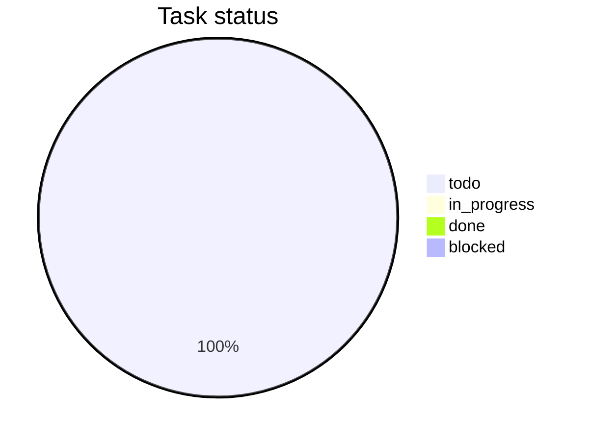

# Session overview

## At a glance (80/20)

| Field | Value |
|---|---|
| Status | `planning` |
| Goal | Sửa 4 lỗi High từ Review Round 3 |
| Progress | `0/6` cards done · `0` blocked · `0` needs info |
| Top risk / blocker | H-004 dependency propagation scope |
| Next action | Fill TASKS + execution |

## Progress chart

## Open decisions

| ID | Severity | Blocking? | Question / decision | Status |
|---|---|---|---|---|
| CAP-001 | Medium | No | Multi-level propagation defer? | Deferred |
| CAP-002 | Low | No | Propagation error isolation | Resolved |

## Artifact map

| Artifact | Purpose | Freshness |
|---|---|---|
| `PLAN.md` / `TASKS.md` | Strategy + work | current |
| `EXECUTION.md` | Implementation log | missing |
| `REVIEW.md` | Quality gate | missing |

## Developer notes

- Commands: `pnpm run typecheck --filter=@repo/api-platform`, `npx vitest run src/modules/jobs/application/use-cases/__tests__/`
- Đọc schema notification + mail trước khi sửa
