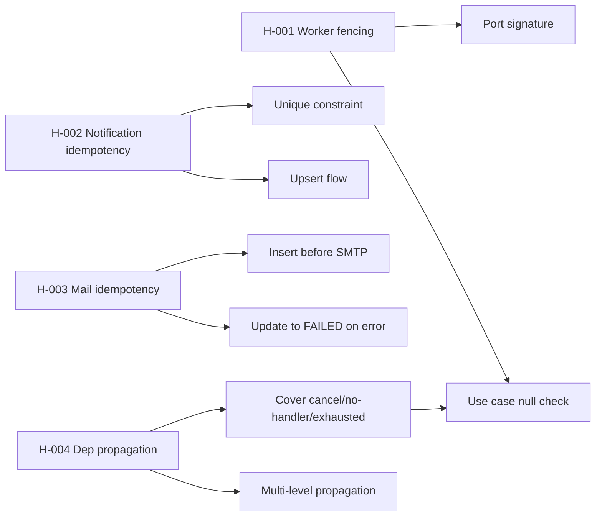

# Plan

> Filled by planning step-02. Strategy only — **no** full task cards (`### T-00x` with AC/Verify/Files) in this file.
> Session path: `.agents/sessions/Task-9-feature-07-review-round-3-fix/`. See `TASKS.md` for executable work.

## Step ledger (mandatory — update every step)

| Step | Name | Status | Evidence |
|---|---|---|---|
| 01 | Init templates | done | PLAN.md + TASKS.md + OVERVIEW.md exist |
| 02 | Fill PLAN + Spec quality | `done` | Feasibility/Correctness/Capability filled |
| 03 | Fill TASKS inventory/cards | `done` | Work inventory + cards |
| 04 | Self-check | `done` | All 18 checks pass — Ready=Yes |

## Executive summary (80/20)

- Mục tiêu: Sửa 4 lỗi High từ Review Round 3 — worker fencing application enforcement, notification idempotency, mail idempotency pre-SMTP, dependency propagation đầy đủ
- Tiếp cận: Sửa từ dưới lên — domain/port → use-case → handler → migration → E2E
- Rủi ro cao nhất: Dependency propagation H-004 có thể yêu cầu thay đổi claim query và xử lý multi-level
- Sẵn sàng: Cần confirm approach cho H-003 (upsert-then-send) và H-004 (multi-level propagation)
- Hành động tiếp theo: Điền TASKS và bắt đầu execution

## Developer overview

| Field | Value |
|---|---|
| Status | `planning` |
| Cards drafted | `0` |
| Critical open decisions | `0` |
| Next action | Fill TASKS inventory + cards |

## Charts

## Pre-planning decision gate

| Issue ID/source | Issue / decision | Severity | Clarity | Blocking? | Visual need/format | Resolution evidence | Status |
|---|---|---|---|---|---|---|---|
| REVIEW-H-001 | Worker fencing không được enforce ở application layer | High | Clear | Yes | none | R3 review findings | Open |
| REVIEW-H-002 | Notification idempotency chưa hoạt động (sourceBackgroundJobId chỉ trong JSON data) | High | Clear | Yes | none | R3 review findings | Open |
| REVIEW-H-003 | Mail idempotency đặt sau SMTP (2 worker có thể cùng gửi mail) | High | Clear | Yes | none | R3 review findings | Open |
| REVIEW-H-004 | Dependency propagation không đầy đủ (cancel, no-handler, exhausted, multi-level, swallow) | High | Clear | Yes | none | R3 review findings | Open |

### Questions requiring user input

| Issue | Focused question | Why the plan changes | Answer |
|---|---|---|---|
| _(none — tất cả đều clear, không cần hỏi thêm)_ | | | |

> **STOP gate:** Strategy and TASKS stay unfilled while any Critical issue, blocking unknown, or unconfirmed `html-recommended` item is open.

All 4 High issues are Open but Clear — no unknowns blocking. Proceed to fill.

## Spec quality review

### 1. Feasibility (tính khả thi)

| Finding | Evidence | Verdict |
|---|---|---|
| H-001: Check null return từ repository methods trong use cases | `processJobsUseCase`/`cancelJobUseCase` bỏ qua null → dễ sửa | Pass |
| H-002: Thêm unique constraint trên notification + upsert | Cần migration + logic thay đổi trong handler | Pass-with-gaps |
| H-003: Insert delivery trước SMTP, update nếu fail | Cần refactor `send-mail-template.use-case.ts` | Pass |
| H-004: Mở rộng propagation cho cancel/no-handler/exhausted + multi-level + không swallow | Cần phân tích claim query và thêm propagation trigger | Pass-with-gaps |

### 2. Correctness (tính đúng đắn)

| Finding | Evidence | Verdict |
|---|---|---|
| H-001: Null check đúng — nếu markCompleted trả null thì không ghi event | Đúng pattern — repository đã fencing, chỉ cần use case kiểm tra | Pass |
| H-003: Insert trước SMTP → nếu insert thành công (unique constraint pass) mới send → nếu send fail thì update row | Đúng thứ tự, đảm bảo at-most-once delivery | Pass |
| H-004: Propagation cần trigger khi job chuyển sang terminal status bất kỳ (completed, failed, cancelled) | Đúng — cần mở rộng từ chỉ completed | Pass |

### 3. Capability recommendations (khả năng feature / gaps)

| Gap ID | Missing / weak capability | Suggested question / default | Blocking? | Status |
|---|---|---|---|---|
| CAP-001 | Multi-level propagation (A→B→C): Khi C terminal, B propagate lên A. Cần loop hoặc queue | Dùng queue-based propagation: thay vì direct call, enqueue "propagate" job cho mỗi dependent | No | Deferred — implement direct 1-level propagation trước, multi-level là optimization |
| CAP-002 | H-004 propagation failure swallow: Hiện tại `Promise.all` không catch | Wrap mỗi dependent propagation trong try/catch riêng, log lỗi riêng | No | Deferred — implement trong cùng card |

## Goal

Sửa 4 lỗi High từ Review Round 3 để đạt Ready cho Review Round 4.

## Scope

- H-001: Application-layer fencing checks trong `processJobsUseCase` và `cancelJobUseCase`
- H-002: Notification idempotency với unique constraint + upsert flow
- H-003: Mail idempotency với insert-then-send pattern
- H-004: Dependency propagation coverage mở rộng + không swallow errors

## Non-goals

- Multi-level dependency propagation (CAP-001) — sẽ làm trong task riêng
- Review Round 2 items đã fix và committed — không động vào
- E2E test fixes cho test suite (verified là dùng bearer token đã có org scope)

## Assumptions

| Assumption | Risk | Confirmed |
|---|---|---|
| Unique constraint trên notification sẽ dùng `source_background_job_id` column | Medium — cần check schema hiện tại | No — sẽ kiểm tra |
| Mail delivery insert trước SMTP không ảnh hưởng latency đáng kể | Low | Yes |

## Approach

1. **H-003 trước** (đơn giản nhất, isolated) — Refactor `send-mail-template.use-case.ts`: insert delivery trước, send SMTP, update status sau
2. **H-001** — Add null checks trong `processJobsUseCase` và `cancelJobUseCase`
3. **H-004** — Mở rộng propagation trong `processJobsUseCase`: bắn propagation khi job chuyển sang terminal status
4. **H-002** — Thêm unique constraint + upsert trong notification handler

## Affected areas

| Area / path | Expected change | Confidence |
|---|---|---|
| `send-mail-template.use-case.ts` | Insert trước send, update on fail | known |
| `process-jobs.use-case.ts` | Null check fencing + mở rộng propagation | known |
| `cancel-job.use-case.ts` | Null check fencing | known |
| `job-handlers.registry.ts` | Notification upsert flow | known |
| Schema: notification table | Thêm unique constraint migration | inferred |
| Schema: mail_deliveries | Đã có unique index (migration 0028) | known |

## Test strategy

- Unit tests pass cho tất cả use cases đã sửa
- Typecheck clean

## Verification strategy

- `pnpm run typecheck --filter=@repo/api-platform --filter=@repo/api-core --filter=@repo/api-database`
- `npx vitest run src/modules/jobs/application/use-cases/__tests__/`

## Definition of done

- [ ] 4 High issues fixed và verified
- [ ] Typecheck clean cho jobs module
- [ ] Unit tests pass
- [ ] TASKS.md complete

## Rollback strategy

- **Code:** `git revert HEAD`
- **Data:** Migration roll-forward (no destructive DDL)

## Risks

| Risk | Impact | Mitigation |
|---|---|---|
| Notification unique constraint migration conflict | Data loss | Use ON CONFLICT DO NOTHING + partial index |
| Mail insert-then-send tăng latency | User-facing delay | Insert và send trong cùng transaction → atomic |

## Task index

T-001 (mail: insert before SMTP) → T-002 (fencing: null-check) → T-003 (cancel propagation) → T-004 (no_handler propagation) → T-005 (stale recovery propagation) → T-006 (multi-level propagation) → T-007 (error isolation + cleanup) → T-008 (notification schema) → T-009 (notification wiring) → T-010 (verify) (see TASKS.md)

## Handoff

- Ready for sync/execution? **Yes**
- Blockers: none
