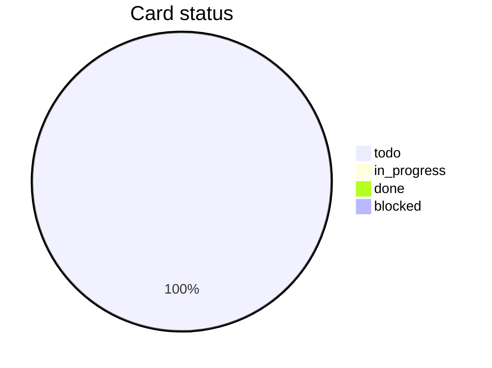

# Tasks

plan_ref: PLAN.md

## Status legend

| Value | Meaning |
|-------|---------|
| `todo` | Not started |
| `in_progress` | Currently executing |
| `done` | Card AC verified for this task |
| `blocked` | Cannot proceed (note reason under Notes or on the card) |
| `skipped` | Intentionally not done (document why) |

## Work inventory

| Inv | Unit (noun + verb) | Trace (doc § / AC / contract) | Layer |
|-----|--------------------|-------------------------------|-------|
| I-01 | Mail: refactor send flow — insert delivery before SMTP, update on error | H-003, send-mail-template.use-case.ts | service |
| I-02 | Worker fencing: add null-check returns for markCompleted/markFailed/requeueForRetry | H-001, process-jobs.use-case.ts | service |
| I-03 | Cancel propagation: add propagateToDependents after cancel | H-004, cancel-job.use-case.ts | service |
| I-04 | No-handler propagation: add propagateToDependents after no_handler markFailed | H-004, process-jobs.use-case.ts | service |
| I-05 | Stale recovery propagation: add propagation in cron recoverStaleJobs | H-004, jobs.processor.ts | service |
| I-06 | Multi-level propagation: make propagateToDependents recursive | H-004, process-jobs.use-case.ts | service |
| I-07 | Propagation error isolation: remove empty catch, log errors individually | H-004, process-jobs.use-case.ts | service |
| I-08 | Remove recoverStaleProcessing from processJob failure handler | H-004, process-jobs.use-case.ts | service |
| I-09 | Notification idempotency: add sourceBackgroundJobId column + unique index | H-002, schema + migration | model |
| I-10 | Notification idempotency: wire sourceBackgroundJobId through SendNotificationUseCase | H-002, send-notification.use-case.ts + handler | service |

## Progress board

| Done | ID | Title | Status |
|------|----|-------|--------|
| [ ] | T-001 | Mail: insert delivery before SMTP | todo |
| [ ] | T-002 | Worker fencing: null-check transitions in processJob | todo |
| [ ] | T-003 | Propagate to dependents on cancel | todo |
| [ ] | T-004 | Propagate to dependents on no_handler | todo |
| [ ] | T-005 | Propagate after stale recovery exhaustion | todo |
| [ ] | T-006 | Multi-level transitive propagation | todo |
| [ ] | T-007 | Propagation error isolation + remove recoverStaleProcessing from processJob | todo |
| [ ] | T-008 | Notification: add sourceBackgroundJobId schema + migration | todo |
| [ ] | T-009 | Notification: wire sourceBackgroundJobId through use case + handler | todo |
| [ ] | T-010 | Verify: typecheck + unit tests | todo |

## Progress chart

## Execution order

T-001 → T-002 → T-003 → T-004 → T-005 → T-006 → T-007 → T-008 → T-009 → T-010

## Notes

- H-003 (T-001) đơn giản nhất → làm trước để warm up
- H-001 (T-002) độc lập với propagation
- H-004 chia nhỏ thành T-003→T-007
- H-002 (T-008→T-009) cần migration nên để gần cuối

## Tasks

### T-001: Mail — insert delivery before SMTP

- Status: todo
- Trace: H-003, send-mail-template.use-case.ts
- Depends: none
- Work items:
  - [ ] 1. Trong `send-mail-template.use-case.ts`: insert delivery row với status `PENDING` trước, check if row was created (non-null)
  - [ ] 2. Nếu insert thành công → gửi SMTP → update status thành `SENT` + set `sentAt`
  - [ ] 3. Nếu SMTP fail → update status thành `FAILED` + set `errorMessage` (không throw lại? hoặc throw lại để báo lỗi cho job system)
  - [ ] 4. Nếu insert trả về null (ON CONFLICT DO NOTHING) → skip, không gửi SMTP
- Description: Đảo thứ tự: insert delivery (với unique constraint) trước, send SMTP sau. Nếu delivery đã tồn tại (duplicate) thì skip.
- AC: Khi duplicate source_job_id + recipient, email không được gửi lần 2. Khi SMTP fail, delivery row được update thành FAILED.
- Verify: `npx vitest run src/modules/mail/application/use-cases/__tests__/` + typecheck
- Flow/comment notes: Cần flow comment giải thích insert-first-then-send pattern và lý do (atomic idempotency guard)
- Files/scope: `packages/api-platform/src/modules/mail/application/use-cases/send-mail-template.use-case.ts` (confidence: known)
- Out of scope: Thay đổi port/repository (chỉ sửa use case)

### T-002: Worker fencing — null-check transitions in processJob

- Status: todo
- Trace: H-001, process-jobs.use-case.ts
- Depends: none
- Work items:
  - [ ] 1. `markCompleted` return: check null, nếu null (fencing fail) → skip ghi event, log warning
  - [ ] 2. `markFailed` return (terminal failure): check null, skip event nếu null
  - [ ] 3. `requeueForRetry` return: check null, skip retry event nếu null, fall through to markFailed
  - [ ] 4. `markFailed` after retry exhausted: check null, skip propagation nếu null
- Description: Repository trả null khi workerId + attempts không khớp (stale worker). Use case phải kiểm tra và không ghi event/propagation khi transition không xảy ra.
- AC: Khi markCompleted trả null (stale worker), không ghi completed event. Khi markFailed trả null, không ghi failed event/propagation.
- Verify: Xem xét code flow, typecheck + unit tests pass
- Flow/comment notes: Thêm flow comment giải thích fencing boundary — repository đã guard data, use case guard application consistency
- Files/scope: `packages/api-platform/src/modules/jobs/application/use-cases/process-jobs.use-case.ts` (confidence: known)
- Out of scope: Thay đổi repository signature

### T-003: Propagate to dependents on cancel

- Status: todo
- Trace: H-004, cancel-job.use-case.ts
- Depends: T-002
- Work items:
  - [ ] 1. Inject `JobObservabilityRepositoryPort` + `JobsRepositoryPort` into CancelJobUseCase (nếu chưa có)
  - [ ] 2. Sau khi markCancelled thành công, gọi `propagateToDependents(jobId, organizationId)` trong cùng transaction
- Description: Khi job bị cancel, các dependent job cần được block (không claim được).
- AC: Cancel job → dependent jobs bị BLOCKED.
- Verify: Unit test cho cancel propagation flow
- Flow/comment notes: N/A (pattern reuse)
- Files/scope: `packages/api-platform/src/modules/jobs/application/use-cases/cancel-job.use-case.ts` (confidence: known)
- Out of scope: Multi-level propagation

### T-004: Propagate to dependents on no_handler

- Status: todo
- Trace: H-004, process-jobs.use-case.ts §no_handler branch
- Depends: T-002
- Work items:
  - [ ] 1. Trong no_handler branch (lines 96-111), sau `markFailed` và ghi event, gọi `this.propagateToDependents(job.id, organizationId)`
  - [ ] 2. Đảm bảo propagation nằm trong cùng transaction
- Description: Khi handler không tồn tại, job bị FAILED. Các dependent job của nó cần được BLOCKED.
- AC: `no_handler` → job FAILED → dependent jobs BLOCKED.
- Verify: Code review + typecheck
- Flow/comment notes: N/A
- Files/scope: `packages/api-platform/src/modules/jobs/application/use-cases/process-jobs.use-case.ts` (confidence: known)
- Out of scope: Propagation error handling

### T-005: Propagate after stale recovery exhaustion

- Status: todo
- Trace: H-004, jobs.processor.ts §recoverStaleJobs
- Depends: T-002
- Work items:
  - [ ] 1. Trong `JobsProcessor.recoverStaleJobs()`, sau khi `recoverStaleProcessing` trả về `{ requeued, failed }`, gọi `propagateToDependents` cho mỗi job bị FAILED
  - [ ] 2. Inject `ProcessJobsUseCase` hoặc access `propagateToDependents` qua use case
- Description: Khi `recoverStaleProcessing` chuyển job thành FAILED (attempts >= max_attempts), các dependent cũng cần được block.
- AC: Stale recovery → failed jobs → dependent blocked.
- Verify: Code review + typecheck
- Flow/comment notes: propagateToDependents hiện là private method trong ProcessJobsUseCase → cần expose hoặc move đến service chung
- Files/scope: `packages/api-platform/src/modules/jobs/application/jobs.processor.ts`, `packages/api-platform/src/modules/jobs/application/use-cases/process-jobs.use-case.ts` (confidence: known)
- Out of scope: Không move propagation ra ngoài ProcessJobsUseCase (giữ nguyên, chỉ expose cần thiết)

### T-006: Multi-level transitive propagation

- Status: todo
- Trace: H-004, process-jobs.use-case.ts §propagateToDependents
- Depends: T-003, T-004, T-005
- Work items:
  - [ ] 1. Sửa `propagateToDependents` thành recursive: sau khi block một dependent, kiểm tra dependent đó có dependents không, nếu có thì block tiếp
  - [ ] 2. Dùng Set để tránh infinite loop (cycle)
  - [ ] 3. Mỗi lần block đều ghi event `dependency_failed` riêng
- Description: Nếu C fails và B depends on C, B bị BLOCKED. A depends on B cũng cần BLOCKED. Propagation phải transitive.
- AC: A→B→C, C fails → B BLOCKED → A BLOCKED.
- Verify: Unit test với dependency chain 3 levels
- Flow/comment notes: Thêm flow comment giải thích recursive propagation + cycle guard
- Files/scope: `packages/api-platform/src/modules/jobs/application/use-cases/process-jobs.use-case.ts` (confidence: known)
- Out of scope: Queue-based propagation (deferred to future task)

### T-007: Propagation error isolation + remove recoverStaleProcessing

- Status: todo
- Trace: H-004, process-jobs.use-case.ts §propagateToDependents + failure handler
- Depends: T-006
- Work items:
  - [ ] 1. Remove `recoverStaleProcessing(tx)` call from `processJob` failure handler (line 158) — nó là cron job, không phải việc của processJob
  - [ ] 2. Thay `catch {}` (line 182-184) bằng `catch` cụ thể: log lỗi cho từng dependent thay vì silent swallow
  - [ ] 3. Mỗi `markBlocked` cho mỗi dependent wrap trong try/catch riêng
- Description: recoverStaleProcessing không nên được gọi từ processJob. Propagation errors không được silent swallow.
- AC: recoverStaleProcessing chỉ chạy từ cron. Propagation fail không silent — log lỗi.
- Verify: Code review + typecheck
- Flow/comment notes: Thêm flow comment tại boundary — giải thích tại sao recoverStaleProcessing chỉ chạy từ cron
- Files/scope: `packages/api-platform/src/modules/jobs/application/use-cases/process-jobs.use-case.ts` (confidence: known)
- Out of scope: Observer pattern cho propagation (giữ nguyên direct call)

### T-008: Notification — add sourceBackgroundJobId schema + migration

- Status: todo
- Trace: H-002, notifications.ts schema + migration
- Depends: none
- Work items:
  - [ ] 1. Add `sourceBackgroundJobId: uuid('source_background_job_id').references(() => jobs.id, { onDelete: 'set null' })` to notifications table schema
  - [ ] 2. Add `uniqueIndex('notifications_source_bg_job_id_user_id_unique').on(table.sourceBackgroundJobId, table.userId).where(sql`${table.sourceBackgroundJobId} is not null`)`
  - [ ] 3. Create migration `0029_notifications_source_background_job_id.sql`
- Description: Thêm column + unique partial index cho notification idempotency khi gửi từ background job.
- AC: Migration chạy thành công. Schema có source_background_job_id column + unique index.
- Verify: Typecheck + migration syntax check
- Flow/comment notes: N/A
- Files/scope: `packages/api-database/src/schema/platform/notifications.ts`, `apps/api/drizzle/0029_notifications_source_background_job_id.sql` (confidence: known)
- Out of scope: Logic sử dụng column

### T-009: Notification — wire sourceBackgroundJobId through use case + handler

- Status: todo
- Trace: H-002, send-notification.use-case.ts + job-handlers.registry.ts
- Depends: T-008
- Work items:
  - [ ] 1. Add `sourceBackgroundJobId?: string | null` to `SendNotificationCommand` in notifications.types.ts
  - [ ] 2. Update `SendNotificationUseCase.execute()` to pass `sourceBackgroundJobId` to `notificationsRepository.create()`
  - [ ] 3. Update `JobHandlersRegistry` notification.send handler: pass `sourceBackgroundJobId: jobId` thay vì `sourceBackgroundJobId` trong JSON `data`
  - [ ] 4. Đảm bảo handler không throw khi duplicate (unique constraint)
- Description: Wire sourceBackgroundJobId từ handler → use case → repository → DB để unique constraint có tác dụng.
- AC: Khi notification.send handler chạy với cùng jobId + userId, không tạo duplicate notification.
- Verify: Typecheck + unit tests
- Flow/comment notes: Thêm flow comment giải thích idempotency flow: handler pass jobId → use case set sourceBackgroundJobId → unique index guard
- Files/scope: `packages/api-platform/src/modules/notifications/application/notifications.types.ts`, `packages/api-platform/src/modules/notifications/application/use-cases/send-notification.use-case.ts`, `packages/api-platform/src/modules/jobs/application/services/job-handlers.registry.ts` (confidence: known)
- Out of scope: Thêm sourceBackgroundJobId vào API endpoint

### T-010: Verify — typecheck + unit tests

- Status: todo
- Trace: R3 verification
- Depends: T-001, T-002, T-003, T-004, T-005, T-006, T-007, T-008, T-009
- Work items:
  - [ ] 1. Run `pnpm run typecheck --filter=@repo/api-platform --filter=@repo/api-core --filter=@repo/api-database` — confirm sạch (chỉ còn pre-existing errors ở audit/files)
  - [ ] 2. Run `npx vitest run src/modules/jobs/application/use-cases/__tests__/` — confirm pass
  - [ ] 3. Run `npx vitest run src/modules/mail/application/use-cases/__tests__/` nếu có — confirm pass
  - [ ] 4. Xác nhận không có jobs-related type errors
- Description: Verification cuối cùng trước khi commit.
- AC: Typecheck clean cho jobs module. Unit tests pass.
- Verify: `pnpm run typecheck --filter=@repo/api-platform 2>&1 | grep -i "jobs"` — 0 matches
- Flow/comment notes: N/A
- Files/scope: N/A (confidence: known)
- Out of scope: E2E tests (đã verify trong R2)
