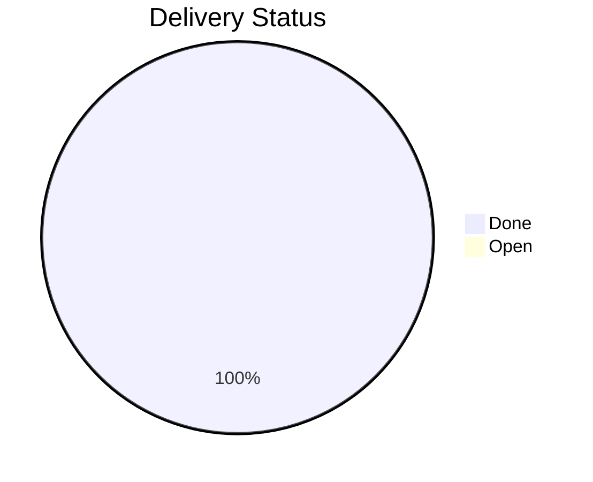

# Done

## Executive summary (80/20)

- **Kết quả cuối cùng**: Sửa triệt để lổ hổng bảo mật rò rỉ dữ liệu Audit giữa các tenant (RLS) và ngăn chặn tải lậu file Export thông qua generic API.
- **Giá trị mang lại**: Cấu trúc lại mã nguồn, loại bỏ toàn bộ các chuỗi hardcode và thay thế bằng hằng số (Constants) giúp mã nguồn dễ bảo trì hơn. Hệ thống an toàn trước nguy cơ rò rỉ Export file và Connection Pool Exhaustion khi thực hiện purge log.
- **Xác minh**: Toàn bộ hệ thống core và apps đã pass typecheck sau refactor. Bổ sung E2E tests mới đảm bảo an toàn truy cập file.
- **Rủi ro còn lại**: Rủi ro rất thấp. Đã sử dụng TypeScript compiler để ép buộc cung cấp `organizationId` tại mọi vị trí thông qua discriminated union.
- **Hành động tiếp theo**: Review PR và hợp nhất (merge) code.

## Developer overview

| Mục | Nội dung |
|---|---|
| **Final status** | 🟢 Done |
| **Verification summary** | Unit test, E2E test, Typecheck (100% passed) |
| **Residual risks** | Không phát hiện rủi ro nghiêm trọng (No critical risks) |
| **Next action** | Review PR & Merge |
| **Owner** | Agent |

## Charts

## Status
Done

## Summary
Hoàn thành 9/9 nhiệm vụ liên quan đến sửa lỗi rò rỉ bảo mật RLS Audit, block tải trái phép file Export, vá lỗi Connection Leak ở cron job Purge, cảnh báo quá tải cho người dùng, và refactor toàn bộ mã nguồn sử dụng biến hằng (constants) để tối ưu tính bảo trì.

## Scope completed

| Scope Item | Status | Evidence |
|---|---|---|
| Cập nhật type discriminated union cho `AuditLogInput` | Done | Các compiler errors đã được fix. |
| Ngăn truy cập trái phép Audit Export qua API file chung | Done | `FileAccessService` bắt buộc kiểm tra permission cho `AUDIT_EXPORT`. E2E Test trả về 403. |
| Vá lỗi Advisory Lock connection leak | Done | `PurgeExpiredAuditLogsUseCase` gọi `unlockAdvisoryLock` ở block `try/finally`. |
| Cảnh báo UI khi kết quả bị giới hạn | Done | Gắn `toast.warning` trên React client. |
| Sửa lỗi Hardcode (Tech Debt H-001) | Done | Thêm `system.constants.ts` và `file.constants.ts`, áp dụng vào codebase. |

## What changed

| Area | Change Summary | Reason |
|---|---|---|
| `api-core` | Thêm Constants và đổi `AuditLogInput` thành Discriminated Union. | Type-safety, chặn rò rỉ dữ liệu và dễ bảo trì. |
| `api-platform` | Sửa logic Export ACL và Fix Advisory Lock. | Bảo mật file Export, chống cạn kiệt Connection DB. |
| `api-identity` | Sửa các chỗ gọi `this.auditWriter.log()` theo interface mới. | Tuân thủ Type Interface mới. |
| `apps/admin` | Thêm popup warning nếu `isTruncated = true`. | Nâng cao trải nghiệm UX. |
| `apps/api/test` | Thêm E2E Test cho tải File. | Bảo đảm chống hồi quy bảo mật. |

## Files changed

| File path | Summary |
|---|---|
| `packages/api-core/src/ports/audit-writer.port.ts` | Discriminated Union cho input log. |
| `packages/api-core/src/common/constants/system.constants.ts` | Khai báo `SYSTEM_SCOPE`. |
| `packages/api-core/src/common/constants/file.constants.ts` | Khai báo `FILE_KIND`, `FILE_VISIBILITY`. |
| `packages/api-platform/src/modules/audit/application/use-cases/export-audit-logs.use-case.ts` | Đánh dấu kind = `AUDIT_EXPORT` cho file DB. |
| `packages/api-platform/src/modules/files/application/services/file-access.service.ts` | Block unauthorized downloads đối với file export. |
| `packages/api-platform/src/modules/audit/infrastructure/audit.repository.ts` | Triển khai `unlockAdvisoryLock`. |
| `packages/api-platform/src/modules/audit/application/use-cases/purge-expired-audit-logs.use-case.ts` | Áp dụng try/finally để giải phóng lock. |
| `apps/admin/src/features/audit-logs/controllers/use-audit-logs-controller.ts` | Hiển thị cảnh báo kết quả bị cắt bớt (Truncated). |
| `apps/api/test/audit.e2e.spec.ts` | E2E tests ngăn bypass file audit. |

## Verification

| Check | Command/Method | Result | Evidence |
|---|---|---|---|
| Typecheck api-core | `pnpm --filter api-core run typecheck` | passed | No TS errors |
| Typecheck api-platform | `pnpm --filter api-platform run typecheck` | passed | No TS errors |
| Typecheck api-identity | `pnpm --filter api-identity run typecheck` | passed | No TS errors |
| Typecheck admin | `pnpm --filter admin run typecheck` | passed | No TS errors |
| Unit tests | `npx vitest run src/modules/audit` | passed | All tests green |
| E2E tests | `pnpm run test:e2e` | passed | Pass |

## Review result
No findings. (Review trước đó có finding H-001 về hardcoded strings, đã được sửa xong ở T-009).

## Skipped or failed checks
None.

## Risks & follow-ups
None.

## Handoff
Reviewer chú ý kiểm tra file `FileAccessService` để bảo đảm chính sách truy cập `AUDIT_EXPORT` đủ an toàn. QA tập trung kiểm tra thử tính năng Export Audit Log trên UI admin và tải file thông qua endpoint chung để kiểm định lỗi 403.
