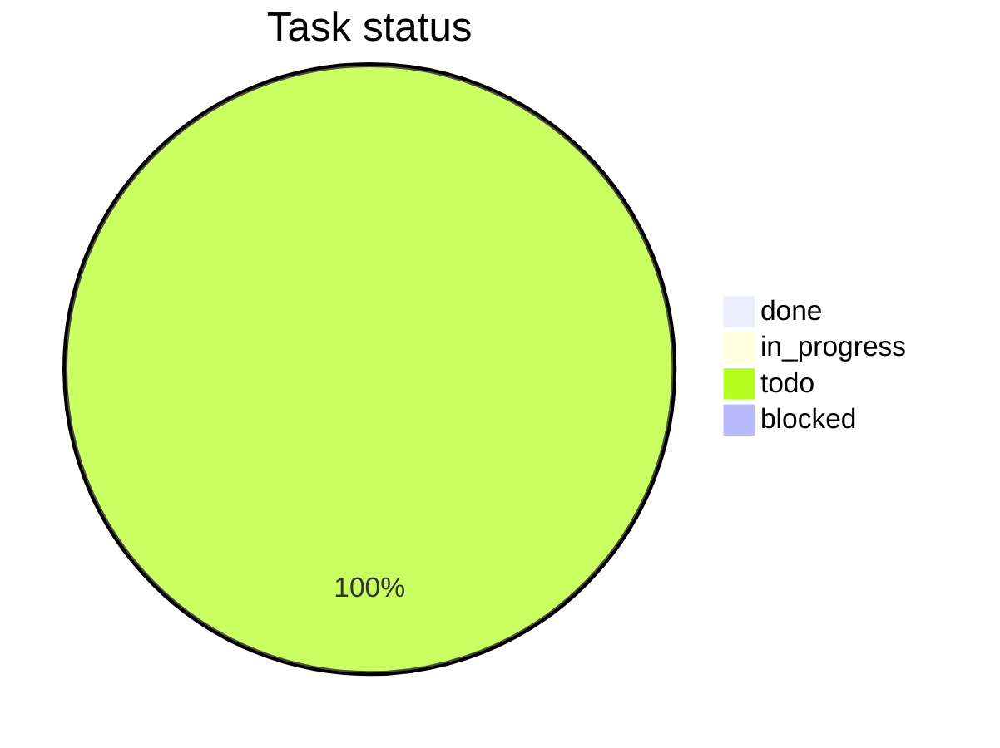

# Session overview

> Developer landing page. Keep this scannable. Refresh after sync, execution,
> review, and done. Detail lives in sibling artifacts; this file is the map.

## At a glance (80/20)

| Field | Value |
|---|---|
| Status | `ready_for_execution` |
| Goal | Hoàn tất Re-review Round 3 để Audit system đạt yêu cầu bảo mật nghiêm ngặt (đúng scope, không rò rỉ ACL, không connection leak). |
| Progress | `0/6` tasks done · `0` finding |
| Top risk / blocker | None |
| Next action | Execution (T-001) |
| Owner | Agent |

## Progress chart

## Open decisions

| ID | Severity | Blocking? | Visual? | Question / decision | Status |
|---|---|---|---|---|---|
| ISS-001 | Critical | No | No | Cơ chế truyền `organizationId` | Answered |
| ISS-002 | Critical | No | No | Cách tách biệt Export ACL | Answered |
| ISS-003 | High | No | No | Fix Advisory Lock | Answered |
| H-001 | High | Yes | No | Sửa lỗi hardcode strings (AUDIT_EXPORT, RESTRICTED, v.v) | Resolved |

## Artifact map

| Artifact | Purpose | Freshness |
|---|---|---|
| `DISCUSSION.md` | Direction / options | current |
| `BUSINESS_ANALYSIS.md` | Requirements | missing |
| `BASIC_DESIGN.md` / `DETAIL_DESIGN.md` | Design | missing |
| `PLAN.md` / `TASKS.md` | Strategy + work | current |
| `SYNC.md` | Readiness | current |
| `EXECUTION.md` | Implementation log | current |
| `REVIEW.md` / `REVIEW_PR.md` | Quality gate | current |
| `TESTCASES.md` | Verification design | missing |
| `DONE.md` | Handoff | current |

## Developer notes

- Commands to run next: Đề xuất người dùng quay lại bước thực thi để thay đổi chuỗi hardcode (constants).
