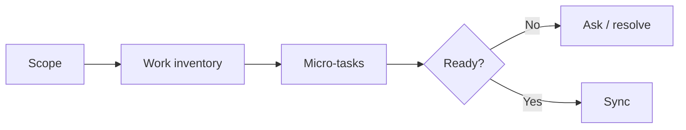

# Plan

> Filled by planning step-02. Strategy only — **no** full task cards (`### T-00x` with AC/Verify/Files) in this file.
> Session path: `.agents/sessions/tenant-write-migration-issues`

## Step ledger (mandatory — update every step)

| Step | Name | Status | Evidence |
|---|---|---|---|
| 01 | Init templates | `done` | PLAN.md + TASKS.md overwritten |
| 02 | Fill PLAN + Spec quality | `done` | Feasibility/Correctness/Capability filled |
| 03 | Fill TASKS inventory/cards | `todo` | Work inventory + cards |
| 04 | Self-check | `todo` | Ready Yes/No with evidence |

## Executive summary (80/20)

- **Goal**: Hoàn tất Re-review Round 3 cho hệ thống Audit Multi-tenant. Sửa các lỗi gán sai scope PLATFORM cho tenant events, rò rỉ ACL trong export file download, và xử lý connection leak.
- **Approach**: Chia tác vụ theo 5 nhóm vấn đề chính từ user feedback. Đảm bảo call sites truyền đúng source `organizationId`, siết chặt Export ACL, dùng platform executor cho global export, và gom logic lock purge vào 1 raw connection.
- **Top Risk**: Tính đúng đắn của việc truyền scope ở những luồng sâu (như file upload, jobs).
- **Readiness**: Sẵn sàng bắt tay vào `TASKS.md`.
- **Next Action**: Tạo file `TASKS.md` chứa work items cụ thể.

## Developer overview

| Field | Value |
|---|---|
| Status | `planning` |
| Cards drafted | `0` |
| Critical open decisions | `0` |
| Next action | Fill tasks |

## Charts (when useful)

## Pre-planning decision gate

| Issue ID/source | Issue / decision | Severity | Clarity | Blocking? | Visual need/format | Resolution evidence | Status |
|---|---|---|---|---|---|---|---|
| Re-review P0 | Call sites gán sai scope `PLATFORM` thay vì `ORGANIZATION` | Critical | Clear | No | none | Thay bằng `file.organizationId`, v.v. | Resolved |
| Re-review P0 | Generic Files endpoint có thể truy cập bằng ID file không phải Export | Critical | Clear | No | none | Bắt buộc kiểm tra `AUDIT_EXPORT` trước khi check org. | Resolved |
| Re-review P0 | Global Export bypassRls thất bại do không có org | Critical | Clear | No | none | Dùng platform executor (bypassRls=true). | Resolved |
| Re-review P1 | Export File download ACL bị uploader bypass | High | Clear | No | none | Cấm bypass theo uploadedById nếu là AUDIT_EXPORT. | Resolved |
| Re-review P1 | Advisory Lock rò rỉ vì multi-connections | High | Clear | No | none | Checkout `PoolClient` và `try/finally` trên nó. | Resolved |
| Re-review P1 | Truncated field sai tên trên frontend | Medium | Clear | No | none | Sửa `isTruncated` thành `truncated`. | Resolved |

### Questions requiring user input

| Issue | Focused question | Why the plan changes | Answer |
|---|---|---|---|
| N/A | N/A | N/A | N/A |

## Spec quality review

### 1. Feasibility (tính khả thi)

| Finding | Evidence | Verdict |
|---|---|---|
| Sửa scope trên call site | Mã nguồn `attachments`, `files`, `imports` đều có lưu `organizationId`. Việc thay thế khả thi 100%. | Pass |
| Sửa lock | Có thể inject raw executor trong `pg` hoặc Drizzle. | Pass |

### 2. Correctness (tính đúng đắn)

| Finding | Evidence | Verdict |
|---|---|---|
| Generic Files ACL | Xác nhận uploader bypass có thể lọt qua file. Cần kiểm tra `AUDIT_EXPORT` cứng và trả 404/403. | Pass |
| Field name | API trả `truncated`, UI dùng `isTruncated` -> Correctness error trên UI. Khắc phục được. | Pass |

### 3. Capability recommendations (khả năng feature / gaps)

| Gap ID | Missing / weak capability | Suggested question / default | Blocking? | Status |
|---|---|---|---|---|
| CAP-001 | Security E2E | Cần verify global export, wrong ID fetch, revocation. Sẽ đưa vào testing. | No | Resolved |

## Goal

Hoàn tất Re-review Round 3 để Audit system đạt yêu cầu bảo mật nghiêm ngặt (đúng scope, không rò rỉ ACL, không connection leak).

## Scope

- Refactor `api-platform` tenant call sites.
- Siết chặt ACL Download cho Export file.
- Fix global export `bypassRls`.
- Khắc phục lỗi Connection Leak do advisory lock trong repository.
- Sửa frontend truncation field.
- Viết bổ sung Security E2E tests.

## Non-goals

- Actor name/email trên UI (Đã bị Defer sang Round 4).

## Assumptions

| Assumption | Risk | Confirmed |
|------------|------|-----------|
| Mọi context truyền cho File/Import đều có thể lấy ra `organizationId`. | Medium | Yes |

## Approach

1. **Fix Tenant Event Scope**: Cập nhật call sites `attachments`, `files`, `imports`, v.v để dùng `ORGANIZATION` scope.
2. **Secure Export API**: Thêm block logic trên generic file, đảm bảo explicit DB executor bypass RLS cho Global export.
3. **Database Locks**: Viết transaction-level wrapper hoặc manual client checkout cho PurgeUseCase.
4. **UI Fix**: Cập nhật field frontend.
5. **Security E2E**: Chạy test kiểm chứng.

## Affected areas

| Area / path | Expected change | Confidence |
|-------------|-----------------|------------|
| `api-platform/src/modules/attachments` | Update audit call sites | known |
| `api-platform/src/modules/files` | Update audit call sites & Fix ACL | known |
| `api-platform/src/modules/imports` | Update audit call sites | known |
| `api-platform/src/modules/audit` | Fix Global export & Advisory lock | known |
| `apps/admin/src/features` | Fix UI truncate warning | known |

## Test strategy

- Security E2E: Viết test cho "Org ADMIN có files.read nhưng không audit.read", "Uploader bị thu hồi audit.read", "Audit endpoint với ordinary file ID", v.v.

## Verification strategy

- Typecheck toàn bộ `api-platform`.
- E2E tests xanh.

## Definition of done

- [ ] PLAN.md hoàn chỉnh
- [ ] TASKS.md complete and matches Task index below

## Rollback strategy

- **Code:** Git revert PR.
- **Config:** N/A
- **Data:** N/A

## Risks

| Risk | Impact | Mitigation |
|------|--------|------------|
| Quên fix một module nào đó | Lọt event PLATFORM | Kiểm tra grep thủ công toàn bộ `SYSTEM_SCOPE.PLATFORM`. |

## Task index

T-001 Fix Tenant Call-site Scope → T-002 Secure Audit Download ACL → T-003 Fix Global Export RLS → T-004 Fix Purge Advisory Lock → T-005 Fix Frontend Truncation → T-006 Write Security E2E Tests

## Handoff

- Ready for sync/execution? **Yes**
- Blockers: `none`
