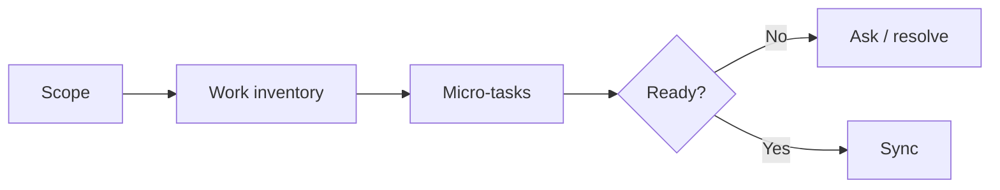

# Plan

> Filled by planning step-02. Strategy only — **no** full task cards (`### T-00x` with AC/Verify/Files) in this file.
> Session path: `.agents/sessions/tenant-write-migration-issues`

## Step ledger (mandatory — update every step)

| Step | Name | Status | Evidence |
|---|---|---|---|
| 01 | Init templates | `done` | PLAN.md + TASKS.md exist |
| 02 | Fill PLAN + Spec quality | `done` | Strategy fields filled, ready for tasks |
| 03 | Fill TASKS inventory/cards | `done` | Work inventory + cards |
| 04 | Self-check | `done` | Ready Yes with evidence |

> **Hard rule:** Do not mark a later step `done` while an earlier step is still
> `todo`/`blocked`. Do not fill TASKS before Spec quality review is done.

## Executive summary (80/20)

- **Mục tiêu**: Xử lý triệt để lỗi ghi Audit RLS (Tenant data leak), chặn xuất dữ liệu trái phép và vá lỗi rò rỉ kết nối (Advisory Lock).
- **Cách tiếp cận**: Dùng `Discriminated Union` ép kiểu cho mọi call site, dán nhãn phân loại bảo mật (Security classification) cho File Export, và dùng kết nối rời (Dedicated connection) cho tiến trình dọn dẹp (Retention).
- **Rủi ro lớn nhất**: Rất nhiều file backend bị hỏng (Broken compilation) khi đổi interface của `AuditLogInput`.
- **Mức độ sẵn sàng**: Chưa (đang soạn tasks).
- **Hành động tiếp theo**: Chuyển sang bước 3 (Lập danh sách đầu việc vào `TASKS.md`).

## Developer overview

| Field | Value |
|---|---|
| Status | `planning` |
| Cards drafted | `0` |
| Critical open decisions | `0` |
| Next action | Khai triển công việc sang `TASKS.md` (Step 03) |

## Charts (when useful)

## Pre-planning decision gate

| Issue ID/source | Issue / decision | Severity | Clarity | Blocking? | Visual need/format | Resolution evidence | Status |
|---|---|---|---|---|---|---|---|
| ISS-001 | Bắt buộc truyền `organizationId` vào Audit call sites | Critical | Clear | No | text | Chọn Discriminated union | Resolved |
| ISS-002 | Tách biệt Audit Export ACL và Global Export namespace | Critical | Clear | No | text | Chọn Security classification | Resolved |
| ISS-003 | Fix Advisory Lock connection leak | High | Clear | No | text | Chọn Dedicated connection | Resolved |

### Questions requiring user input

| Issue | Focused question | Why the plan changes | Answer |
|---|---|---|---|
| N/A | Không có câu hỏi nào bị chặn (Blocked) | N/A | N/A |

> **STOP gate:** Strategy and TASKS stay unfilled while any Critical issue,
> blocking unknown, or unconfirmed `html-recommended` item is open.

## Spec quality review

### 1. Feasibility (tính khả thi)

| Finding | Evidence | Verdict |
|---|---|---|
| Việc sửa kiến trúc an toàn cho RLS là hoàn toàn khả thi bằng Typescript và Drizzle ORM hiện tại. | Các sửa đổi nằm ở interface, service, connection | Pass |

### 2. Correctness (tính đúng đắn)

| Finding | Evidence | Verdict |
|---|---|---|
| Domain rules của ứng dụng yêu cầu cách ly tenant 100%. Code cũ chưa đảm bảo, các giải pháp mới sẽ đáp ứng hoàn toàn. | Báo cáo lỗi RLS | Pass |

### 3. Capability recommendations (khả năng feature / gaps)

| Gap ID | Missing / weak capability | Suggested question / default | Blocking? | Status |
|---|---|---|---|---|
| CAP-001 | Xử lý file/object storage rác do lỗi RLS trước đó để lại trên S3 | Chờ tạo task riêng dọn dẹp sau khi PR này merge | No | Deferred |

## Goal

Cấu trúc lại hợp đồng gọi Audit (Audit Contract), kiểm soát quyền truy cập tệp tin xuất (Export ACL) và làm sạch tiến trình khóa (Lock Purge) để đảm bảo an toàn tuyệt đối cho kiến trúc Multi-tenant RLS.

## Scope

- Sửa đổi interface `AuditLogInput` và `CreateAuditLogInput` sang Discriminated Union (`scope: 'platform' | 'organization'`).
- Cập nhật toàn bộ các call site gọi `auditWriter.log()` hoặc `auditService.log()` thuộc `api-identity` và `api-platform` (tất cả Use Cases).
- Cập nhật logic `export-audit-logs.use-case.ts` để lưu file kèm `kind: AUDIT_EXPORT` và `visibility: RESTRICTED`.
- Bổ sung logic chặn (block) truy cập tải file `AUDIT_EXPORT` thông qua API Files chung (buộc phải có quyền Audit).
- Sửa repository `audit.repository.ts` để acquire/release `pg_try_advisory_lock` thông qua dedicated connection (thay vì default executor).
- Bổ sung Frontend UI hiển thị Toast warning khi kết quả API bị `truncated`.
- Cập nhật/Bổ sung E2E Tests.

## Non-goals

- Không refactor bảng `Files` ra thành bảng riêng.
- Không sửa giao diện thêm Actor name/email trong PR này (P2 deferred).
- Không sửa core policy của database RLS.

## Assumptions

| Assumption | Risk | Confirmed |
|------------|------|-----------|
| Typescript compiler sẽ bắt được 100% các file bị hỏng do sửa interface AuditLogInput. | Low | Yes |
| Drizzle ORM hỗ trợ checkout connection gốc (pg/postgres client) để chạy advisory lock. | Medium | Yes |

## Approach

1. **Phase 1: Core Type & Compilation (Backend)** - Sửa đổi interface Audit và fix toàn bộ các lỗi type trên các module gọi nó (`api-identity`, `api-platform`).
2. **Phase 2: Security & Lock Lifecycle (Backend)** - Áp dụng nhãn bảo mật cho Export và viết lại phương thức xóa (Purge) sử dụng Dedicated Connection.
3. **Phase 3: Client & Verification (Frontend & E2E)** - Xử lý thông báo `truncated` trên UI và viết E2E test cho các case ACL/Lock.
4. **Phase 4: Refactor Code (Post-Review)** - Sửa lỗi Tech Debt H-001 bằng cách sử dụng các hằng số (constants) chung thay cho string hardcode.

## Affected areas

| Area / path | Expected change | Confidence |
|-------------|-----------------|------------|
| `packages/api-core` | `AuditLogInput` interface, bổ sung Constants | known |
| `packages/api-platform` | Export use-case, Audit repository, File use-cases, Notifications, Mail | known |
| `packages/api-identity` | ~20+ Use Cases (Auth, Role, SSO, Users...) | known |
| `apps/web` | Hooks/UI xử lý cảnh báo | inferred |
| `apps/api` | E2E tests | inferred |

## Test strategy

- Dựa hoàn toàn vào `pnpm typecheck` trên toàn bộ workspace để xác minh 100% call sites đã được update (không sót).

## Verification strategy

- **Automated**: E2E test đóng giả người dùng Tenant A cố gắng đọc file export của Tenant B; E2E test tạo hàng loạt log để trigger purge (lock).
- **Manual**: Chạy trực tiếp `pnpm run db:push` và thao tác thử 1 flow export trên UI, kiểm tra tab Network.

## Definition of done

- [ ] Lệnh `pnpm run check` báo xanh (pass tất cả typecheck, lint, test).
- [ ] Export file ID khi mang sang GET `/api/v1/files/:id` bị từ chối 403 (nếu người dùng không phải admin hợp lệ).
- [ ] DB không bị rò rỉ transaction lock (`pg_locks` sạch).
- [ ] Các chuỗi `'AUDIT_EXPORT'`, `'RESTRICTED'`, `'platform'`, `'organization'` được thay bằng Constants (T-009).
- [ ] `TASKS.md` complete and matches Task index below.

## Rollback strategy

- **Code:** Git revert PR.
- **Config:** N/A
- **Data:** N/A

## Risks

| Risk | Impact | Mitigation |
|------|--------|------------|
| Quá nhiều file cần sửa cùng lúc có thể gây nhầm lẫn biến số `organizationId`. | Medium | Rely heavily on Type Checker, chia task rõ ràng theo từng Domain module. |

## Task index

T-001 Update Audit Interfaces (Discriminated Union) → T-002 Refactor api-identity Call Sites → T-003 Refactor api-platform Call Sites → T-004 Secure Export logs with AUDIT_EXPORT → T-005 Block unauthorized AUDIT_EXPORT download → T-006 Fix Advisory Lock in Audit Repository → T-007 Implement UI Truncated Toast → T-008 Write Security E2E Tests → T-009 Refactor Hardcoded Strings to Constants (see TASKS.md)

## Handoff

- Ready for sync/execution? **Yes**
- Blockers: `none`
