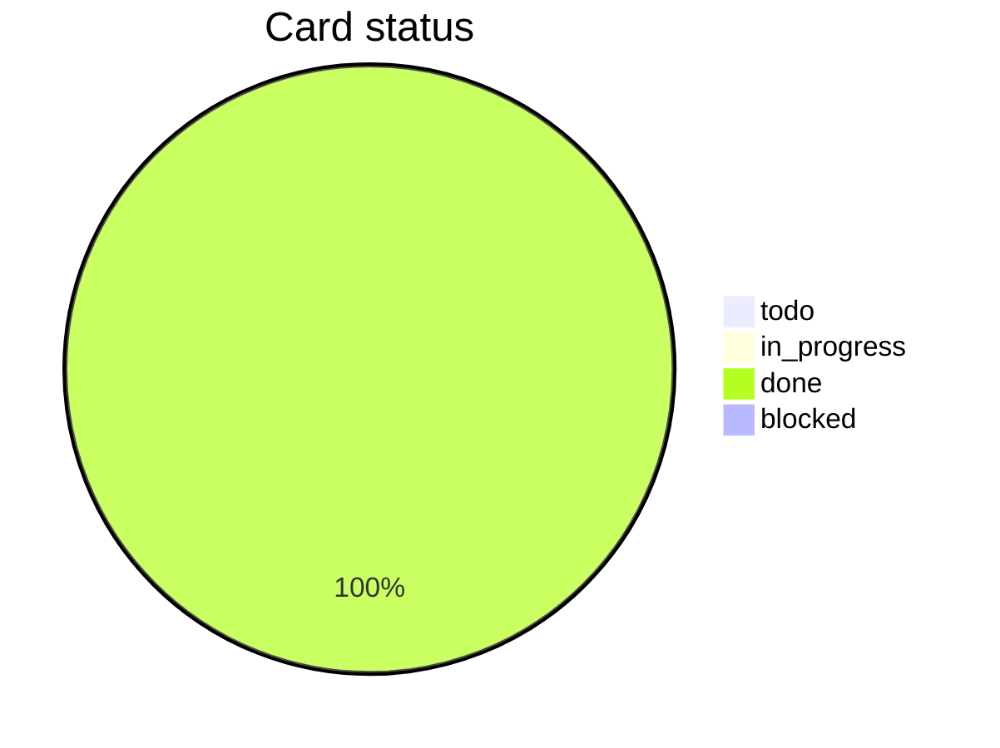

# Tasks

> Filled by planning step-03. **Work inventory first**, then micro-task cards.
> **Implement feature code before automated tests.** Do not leave template placeholders.
> **Progress:** planning seeds Status=`todo` and unchecked boxes; **execution** updates them as work completes.

plan_ref: PLAN.md

## Status legend

| Value | Meaning |
|-------|---------|
| `todo` | Not started |
| `in_progress` | Currently executing |
| `done` | Card AC verified for this task |
| `blocked` | Cannot proceed (note reason under Notes or on the card) |
| `skipped` | Intentionally not done (document why) |

## Work inventory

| Inv | Unit (noun + verb) | Trace (doc § / AC / contract) | Layer |
|-----|--------------------|-------------------------------|-------|
| I-01 | Update AuditLogInput & CreateAuditLogInput interfaces (Discriminated Union) | PLAN § Scope | model |
| I-02 | Refactor api-identity Audit log call sites | PLAN § Scope | service |
| I-03 | Refactor api-platform Audit log call sites | PLAN § Scope | service |
| I-04 | Secure Export audit logs with AUDIT_EXPORT kind | PLAN § Scope | api |
| I-05 | Block unprivileged access to AUDIT_EXPORT in generic Files API | PLAN § Scope | api |
| I-06 | Fix Advisory Lock connection leak in purge job | PLAN § Scope | db |
| I-07 | Display Truncated Toast warning on UI | PLAN § Scope | ui |
| I-08 | Write E2E Security Tests for Export ACL & Lock | PLAN § Scope | test |

## Progress board

| Done | ID | Title | Status |
|------|----|-------|--------|
| [x] | T-001 | Update Audit Interfaces (Discriminated Union) | done |
| [x] | T-002 | Refactor api-identity Call Sites | done |
| [x] | T-003 | Refactor api-platform Call Sites | done |
| [x] | T-004 | Secure Export logs with AUDIT_EXPORT | done |
| [x] | T-005 | Block unauthorized AUDIT_EXPORT download | done |
| [x] | T-006 | Fix Advisory Lock in Audit Repository | done |
| [x] | T-007 | Implement UI Truncated Toast | done |
| [x] | T-008 | Write Security E2E Tests | done |
| [x] | T-009 | Refactor Hardcoded Strings to Constants | done |

## Progress chart

## Execution order

T-001 → T-002 → T-003 → T-004 → T-005 → T-006 → T-007 → T-008 → T-009

## Notes

- Rất nhiều lỗi compilation TS sẽ xảy ra sau bước T-001. Đừng lo lắng, chúng ta sẽ dọn dẹp dần trong T-002 và T-003.

## Tasks

### T-001: Update Audit Interfaces (Discriminated Union)

- Status: done
- Trace: PLAN § Scope
- Depends: none
- Work items:
  - [x] 1. Sửa `AuditLogInput` trong `packages/api-core/src/ports/audit-writer.port.ts` thành type discriminated union dựa trên `scope: 'platform' | 'organization'`.
  - [x] 2. Nếu là `scope: 'organization'`, field `organizationId` là bắt buộc (string). Nếu `platform`, không cần truyền.
  - [x] 3. Sửa `CreateAuditLogInput` tương tự trong `api-platform/.../audit.repository.port.ts`.
- Description: Đổi type audit interface để buộc compiler kiểm tra logic phân loại scope (Tenant vs Global) tại thời điểm code.
- AC: Type compiler báo lỗi tại toàn bộ các file call site hiện hành đang thiếu trường `scope`.
- Verify: Chạy lệnh `pnpm run typecheck`, terminal hiển thị hàng loạt lỗi đỏ do thiếu parameter mới.
- Flow/comment notes: Thêm JSDoc giải thích tại sao dùng discriminated union cho `organizationId`.
- Files/scope: `packages/api-core/src/ports/audit-writer.port.ts`, `packages/api-platform/src/modules/audit/application/ports/audit.repository.port.ts` (confidence: known)
- Out of scope for this card: Việc fix các lỗi compile ở code gọi hàm.

### T-002: Refactor api-identity Call Sites

- Status: done
- Trace: PLAN § Scope
- Depends: T-001
- Work items:
  - [x] 1. Tìm toàn bộ hàm gọi `this.auditWriter.log()` trong `packages/api-identity`.
  - [x] 2. Update logic truyền object để tuân theo union: `{ scope: 'organization', organizationId: ... }` (đối với role, users, orgs, sso, auth) hoặc `platform` nếu cần (như tạo super admin).
- Description: Sửa lỗi TS compile trên module api-identity sau khi đổi audit interface.
- AC: Code module api-identity không còn lỗi Type khi typecheck.
- Verify: `pnpm --filter api-identity run typecheck` chạy qua.
- Flow/comment notes: N/A
- Files/scope: Toàn bộ Use Cases trong `packages/api-identity` (confidence: known)
- Out of scope for this card: Cập nhật call site ở api-platform.

### T-003: Refactor api-platform Call Sites

- Status: done
- Trace: PLAN § Scope
- Depends: T-001
- Work items:
  - [x] 1. Tìm toàn bộ hàm gọi `this.auditService.log()` trong `packages/api-platform` (Modules: Attachments, Exports, Files, Imports, Mail).
  - [x] 2. Update object truyền vào dựa theo active tenant / context.
- Description: Sửa lỗi TS compile trên module api-platform.
- AC: Không còn lỗi typecheck tại module api-platform.
- Verify: `pnpm --filter api-platform run typecheck` chạy qua.
- Flow/comment notes: N/A
- Files/scope: Toàn bộ Use Cases trong `packages/api-platform` (confidence: known)
- Out of scope for this card: Logic về Export ACL.

### T-004: Secure Export logs with AUDIT_EXPORT

- Status: todo
- Trace: PLAN § Scope
- Depends: T-003
- Work items:
  - [x] 1. Sửa `export-audit-logs.use-case.ts` nơi gọi API tạo file CSV/Excel cho audit.
  - [x] 2. Gắn kèm payload `kind: 'AUDIT_EXPORT'` (hoặc chuỗi phân loại tương đương) và `visibility: 'RESTRICTED'` (nếu có enum này).
  - [x] 3. Đảm bảo nếu Global Export được gọi (SUPER_ADMIN), file tạo ra phải nằm ngoài tenant nhưng chỉ truy cập được bởi chính admin đó (gắn owner ID).
- Description: Đánh dấu rõ ràng loại file Export trong DB để backend chặn về sau.
- AC: Khi export, Cột kind / visibility của file trong DB lưu đúng giá trị AUDIT_EXPORT.
- Verify: Viết Unit test hoặc gọi thử E2E API export để check giá trị lưu.
- Flow/comment notes: Thêm comment nhấn mạnh bảo mật Export ACL.
- Files/scope: `packages/api-platform/src/modules/audit/application/use-cases/export-audit-logs.use-case.ts` (confidence: known)
- Out of scope for this card: Sửa logic tải file chung.

### T-005: Block unauthorized AUDIT_EXPORT download

- Status: todo
- Trace: PLAN § Scope
- Depends: T-004
- Work items:
  - [x] 1. Tìm File Download Use Case hoặc Controller (nơi GET file).
  - [x] 2. Thêm policy check: Nếu file DB row có `kind == AUDIT_EXPORT`, bắt buộc user hiện tại phải có permission Audit hoặc là owner (tuỳ hệ thống).
  - [x] 3. Trả về `ForbiddenException` nếu không đủ quyền.
- Description: Từ chối phục vụ (chặn bypass) việc tải file Audit từ API tải file generic.
- AC: User thuộc tenant A nhưng không có quyền audit không thể download file CSV export, dù biết ID file.
- Verify: Chạy API GET `/api/v1/files/:id` với user thường và file export -> nhận mã lỗi 403.
- Flow/comment notes: Bắt buộc để lại comment ranh giới bảo mật (Security boundary).
- Files/scope: `packages/api-platform/src/modules/files/...` (confidence: inferred)
- Out of scope for this card: Advisory lock.

### T-006: Fix Advisory Lock in Audit Repository

- Status: todo
- Trace: PLAN § Scope
- Depends: none
- Work items:
  - [x] 1. Sửa hàm có lệnh `pg_try_advisory_lock` trong `packages/api-platform/src/modules/audit/infrastructure/audit.repository.ts`.
  - [x] 2. Đổi logic sang `db.transaction()` (xact_lock) NẾU query xoá purge ngắn, HOẶC dùng một connection client raw checkout, gọi try lock, thực thi xoá, rồi trong block `finally` phải gọi `pg_advisory_unlock` và thả connection lại pool.
- Description: Ngăn rò rỉ lock khi cron job dọn dẹp audit cũ hoạt động.
- AC: Logic try_lock / unlock được thực thi đầy đủ và đóng gói bằng try/finally.
- Verify: Test purge log và truy vấn `pg_locks` trên PostgreSQL không thấy lock nào lưu lại.
- Flow/comment notes: Chú thích rõ why: "Ensure connection is freed to prevent pool exhaustion".
- Files/scope: `audit.repository.ts` (confidence: known)
- Out of scope for this card: E2E testing.

### T-007: Implement UI Truncated Toast

- Status: todo
- Trace: PLAN § Scope
- Depends: T-003
- Work items:
  - [x] 1. Tìm trang Audit Logs / Export button trên `apps/web` (Next.js/React).
  - [x] 2. Sau khi gọi API query list/export, lấy biến cờ `truncated` (nếu có) từ API response.
  - [x] 3. Gọi hàm `toast.warning(...)` hoặc component thông báo của UI kit với thông điệp: "Kết quả bị giới hạn. Vui lòng dùng bộ lọc..."
- Description: Xử lý cảnh báo người dùng khi list Audit log vượt mốc hiển thị cho phép.
- AC: Hiện popup toast warning vàng khi `isTruncated = true`.
- Verify: Fake API trả về isTruncated=true, bấm tìm kiếm, thấy toast xuất hiện trên UI.
- Flow/comment notes: N/A
- Files/scope: `apps/web/src/features/audit/...` (confidence: inferred)
- Out of scope for this card: Backend API truncation logic (đã có sẵn).

### T-008: Write Security E2E Tests

- Status: todo
- Trace: PLAN § Scope
- Depends: T-001, T-004, T-005, T-006
- Work items:
  - [x] 1. Bổ sung E2E test tạo Audit Export ở Tenant A.
  - [x] 2. E2E test login user Tenant B cố gắng đọc bằng file ID -> expect 403/404.
  - [x] 3. E2E test gọi API Purge, rồi query DB check số lock tồn tại = 0.
- Description: Đảm bảo các fix RLS và Lock không bị phá vỡ trong tương lai.
- AC: CI pass toàn bộ test suite này.
- Verify: `pnpm run test:e2e`.
- Flow/comment notes: N/A
- Files/scope: `apps/api/test/...e2e.spec.ts` (confidence: inferred)
- Out of scope for this card: Unit tests (nếu đã có).

### T-009: Refactor Hardcoded Strings to Constants

- Status: done
- Trace: PLAN § Scope
- Depends: T-008
- Work items:
  - [x] 1. Khai báo `SYSTEM_SCOPE` trong `packages/api-core/src/common/constants/system.constants.ts`.
  - [x] 2. Khai báo `FILE_KIND` và `FILE_VISIBILITY` trong `packages/api-core/src/common/constants/file.constants.ts`.
  - [x] 3. Export các hằng số này trong `api-core/src/index.ts`.
  - [x] 4. Cập nhật `AuditLogInput` trong `audit-writer.port.ts` để sử dụng `SYSTEM_SCOPE`.
  - [x] 5. Sửa toàn bộ các điểm sử dụng `platform`, `organization`, `AUDIT_EXPORT`, `RESTRICTED`, `SUPER_ADMIN` tại `api-platform` và `api-core` để dùng biến hằng.
- Description: Xử lý Tech Debt H-001 từ Review bằng cách định nghĩa các hằng số chung thay vì hardcode string, nâng cao tính bảo trì của mã nguồn.
- AC: Không còn chuỗi cứng nào như 'AUDIT_EXPORT', 'RESTRICTED' hay 'platform'/'organization' liên quan đến scope trong codebase. Mọi thứ tham chiếu từ enum/constant.
- Verify: Chạy lại `pnpm typecheck` và `vitest` toàn dự án để bảo đảm không vỡ logic.
- Flow/comment notes: Sửa các type check union cho đúng giá trị của constants.
- Files/scope: `api-core/src/common/constants/...`, `api-core/src/ports/...`, `api-platform/src/...` (confidence: known)
- Out of scope for this card: Chỉnh sửa các constant không liên quan đến đợt review H-001.
