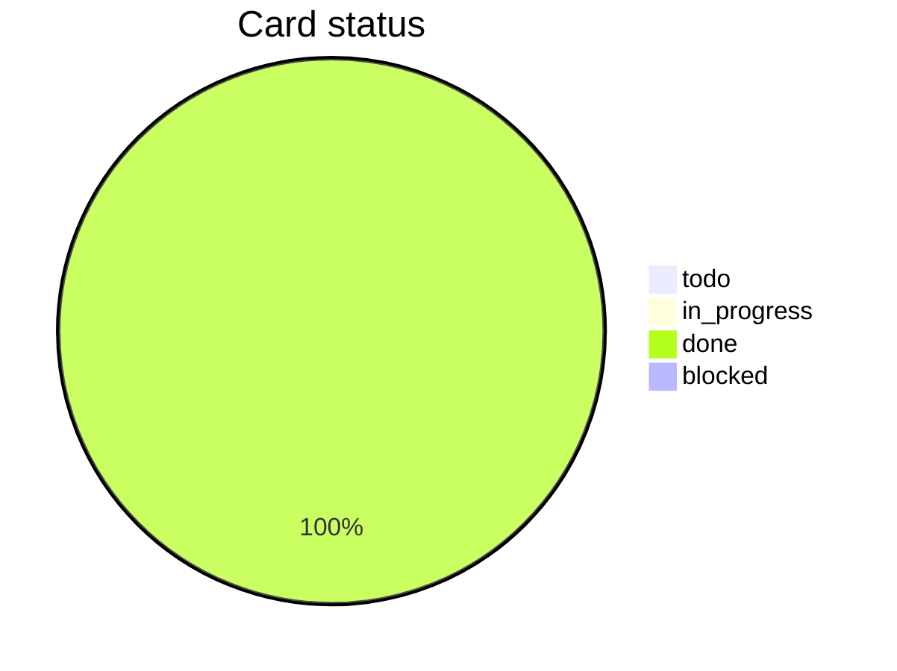

# Tasks

> Filled by planning step-03. **Work inventory first**, then micro-task cards.
> **Implement feature code before automated tests.** Do not leave template placeholders.
> **Progress:** planning seeds Status=`todo` and unchecked boxes; **execution** updates them as work completes.

plan_ref: PLAN.md

## Status legend

| Value | Meaning |
|-------|---------|
| `todo` | Not started |
| `in_progress` | Currently executing |
| `done` | Card AC verified for this task |
| `blocked` | Cannot proceed (note reason under Notes or on the card) |
| `skipped` | Intentionally not done (document why) |

## Work inventory

| Inv | Unit (noun + verb) | Trace (doc § / AC / contract) | Layer |
|-----|--------------------|-------------------------------|-------|
| I-01 | Fix Tenant Call-site Scope | PLAN § Scope | service |
| I-02 | Secure Audit Download ACL | PLAN § Scope | service |
| I-03 | Fix Global Export RLS | PLAN § Scope | service |
| I-04 | Fix Purge Advisory Lock | PLAN § Scope | db |
| I-05 | Fix Frontend Truncation | PLAN § Scope | ui |
| I-06 | Write Security E2E Tests | PLAN § Scope | test |

## Progress board

| Done | ID | Title | Status |
|------|----|-------|--------|
| [x] | T-001 | Fix Tenant Call-site Scope | done |
| [x] | T-002 | Secure Audit Download ACL | done |
| [x] | T-003 | Fix Global Export RLS | done |
| [x] | T-004 | Fix Purge Advisory Lock | done |
| [x] | T-005 | Fix Frontend Truncation | done |
| [x] | T-006 | Write Security E2E Tests | done |

## Progress chart

## Execution order

T-001 → T-002 → T-003 → T-004 → T-005 → T-006

## Notes

- Các thay đổi liên quan đến RLS cần cẩn trọng test kỹ ở môi trường E2E.

## Tasks

### T-001: Fix Tenant Call-site Scope

- Status: done
- Trace: PLAN § Scope
- Depends: none
- Work items:
  - [x] 1. Tìm tất cả các file có gọi `this.auditService.log` hoặc `this.auditWriter.log` trong `api-platform` và `api-identity` đang dùng `SYSTEM_SCOPE.PLATFORM`.
  - [x] 2. Với các tenant resources (File, Attachment, Import, Notifications, v.v), sửa thành `SYSTEM_SCOPE.ORGANIZATION` và pass `organizationId` lấy từ chính resource/actor.
  - [x] 3. Kiểm tra code lại để xác nhận chỉ các global event (login thất bại, system settings) mới dùng `PLATFORM`.
- Description: Đảm bảo audit event được gắn với tenant ID thay vì lưu vào null, tránh bị RLS reject.
- AC: Mọi file, import, attachment, ... sinh audit log đều có `organizationId` hợp lệ.
- Verify: Chạy `pnpm typecheck` và inspect file code.
- Flow/comment notes: Kiểm tra kỹ các event delete, upload file version, attach file.
- Files/scope: `packages/api-platform/src/...`, `packages/api-identity/src/...` (confidence: known)
- Out of scope for this card: ACL.

### T-002: Secure Audit Download ACL

- Status: done
- Trace: PLAN § Scope
- Depends: T-001
- Work items:
  - [x] 1. Mở `FileAccessService` ở generic download API.
  - [x] 2. Xử lý logic check: Nếu `file.kind === AUDIT_EXPORT` hoặc `visibility === RESTRICTED`, thì bắt buộc user phải có quyền `audit.read` (hoặc là Super Admin), KHÔNG áp dụng bypass `uploadedById`.
  - [x] 3. Mở endpoint download chuyên biệt của Audit (`/admin/audit-logs/exports/:fileId/download`).
  - [x] 4. Thêm rule: nếu tìm thấy file mà `kind !== AUDIT_EXPORT`, lập tức ném ra 404 (giả vờ như file không tồn tại đối với audit endpoint) để chống leak file thường.
- Description: Vá các lỗ hổng P0, P1 liên quan đến download file audit trái phép hoặc tải lậu file thường qua audit endpoint.
- AC: Unauthorized uploader bị chặn. Ordinary file không truy xuất được từ audit endpoint.
- Verify: Xem code logic if-else đảm bảo chặt chẽ.
- Flow/comment notes: Chú ý ưu tiên throw error sớm.
- Files/scope: `FileAccessService`, `DownloadAuditExportUseCase`. (confidence: known)
- Out of scope for this card: Frontend.

### T-003: Fix Global Export RLS

- Status: done
- Trace: PLAN § Scope
- Depends: T-002
- Work items:
  - [x] 1. Mở `ExportAuditLogsUseCase`.
  - [x] 2. Phát hiện chỗ gọi `FilesRepository.create(...)`. Nếu `organizationId === null` (Super Admin global mode), hãy sử dụng một explicit database executor đã bypass RLS.
  - [x] 3. (Cách tốt nhất) Dùng `this.database` wrapper bypass rls hoặc gọi thẳng query postgres. Nếu repository chưa hỗ trợ bypassRls parameter, thêm vào.
- Description: Giải quyết conflict giữa Global Audit Export (không org) và Files RLS (bắt buộc org hoặc bypass).
- AC: Global export không bị crash DB do RLS reject file insert.
- Verify: Chạy E2E tạo global export.
- Flow/comment notes: SUPER_ADMIN không có active org phải được set `bypassRls`.
- Files/scope: `packages/api-platform/src/modules/exports/application/use-cases/create-export.use-case.ts` hoặc `packages/api-platform/src/modules/files/...` (confidence: inferred)
- Out of scope for this card: Other RLS tables.

### T-004: Fix Purge Advisory Lock

- Status: done
- Trace: PLAN § Scope
- Depends: none
- Work items:
  - [x] 1. Mở `packages/api-platform/src/modules/audit/application/use-cases/purge-expired-audit-logs.use-case.ts` và `audit.repository.ts`.
  - [x] 2. Đổi logic lock: checkout một `PoolClient` (hoặc mở 1 transaction block).
  - [x] 3. Đảm bảo `try_lock`, `delete_query`, và `unlock` đều gọi qua CÙNG 1 executor instance/connection.
  - [x] 4. Đặt `unlock` trong `finally`.
- Description: Ngăn rò rỉ connection pool do advisory lock session-level.
- AC: Acquire, run, unlock trên đúng 1 connection duy nhất.
- Verify: Đọc code `pg_try_advisory_lock` và executor lifecycle.
- Flow/comment notes: Session lock requires the exact same DB connection.
- Files/scope: `audit.repository.ts`, `purge-expired-audit-logs.use-case.ts` (confidence: known)
- Out of scope for this card: E2E testing for lock.

### T-005: Fix Frontend Truncation

- Status: done
- Trace: PLAN § Scope
- Depends: none
- Work items:
  - [x] 1. Tìm trang Audit List UI frontend (`apps/admin/src/features/audit-logs/controllers/use-audit-logs-controller.ts`).
  - [x] 2. Đổi `data.isTruncated` thành `data.truncated` để match với API response.
  - [x] 3. Chỉnh sửa message warning hiển thị chính xác (VD: "Exported X of Y matching events. Narrow the filters...").
  - [x] 4. Thêm error toast nếu export request/download fails.
- Description: Đảm bảo UI báo warning khi query vượt 5000 rows.
- AC: UI hiện đúng popup warning do backend trả về `truncated: true`.
- Verify: Kiểm tra code `apps/admin`.
- Flow/comment notes: API properties match TS interface.
- Files/scope: `apps/admin/src/features/audit-logs/controllers/use-audit-logs-controller.ts` (confidence: known)
- Out of scope for this card: Backend API changes.

### T-006: Write Security E2E Tests

- Status: done
- Trace: PLAN § Scope
- Depends: T-001, T-002, T-003, T-004, T-005
- Work items:
  - [x] 1. Test: Org ADMIN có `files.read` nhưng không `audit.read` tải file audit -> 403.
  - [x] 2. Test: Uploader bị thu hồi `audit.read` tải file audit của chính mình -> 403.
  - [x] 3. Test: Endpoint `/admin/audit-logs/exports/:fileId/download` được cấp ID của ordinary file -> 404.
  - [x] 4. Test: SUPER_ADMIN global export khi `organizationId=null` -> thành công.
- Description: Test P0/P1 security vulnerabilities.
- AC: Toàn bộ tests pass, chứng minh security model hoàn hảo.
- Verify: `pnpm run test:e2e`
- Flow/comment notes: N/A
- Files/scope: `apps/api/test/audit.e2e.spec.ts` (confidence: known)
- Out of scope for this card: Load testing.
