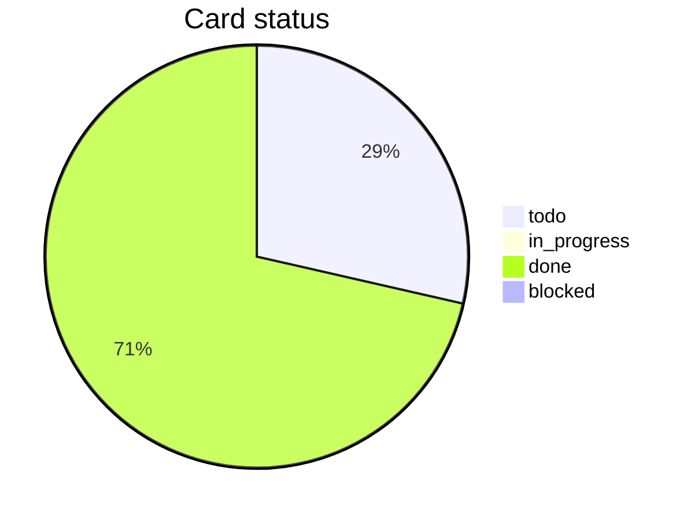

# Tasks

> Filled by planning step-03. **Work inventory first**, then micro-task cards.
> **Implement feature code before automated tests.** Do not leave template placeholders.
> **Progress:** planning seeds Status=`todo` and unchecked boxes; **execution** updates them as work completes.

plan_ref: PLAN.md

## Status legend

| Value | Meaning |
|-------|---------|
| `todo` | Not started |
| `in_progress` | Currently executing |
| `done` | Card AC verified for this task |
| `blocked` | Cannot proceed (note reason under Notes or on the card) |
| `skipped` | Intentionally not done (document why) |

## Work inventory

| Inv | Unit (noun + verb) | Trace (doc § / AC / contract) | Layer |
|-----|--------------------|-------------------------------|-------|
| I-01 | Add PlatformTransactionPort | PLAN § Scope | db |
| I-02 | Add AdvisoryLockPort | PLAN § Scope | db |
| I-03 | Refactor Application layer bounds | PLAN § Scope | app |
| I-04 | Ensure Mutation+Audit atomicity | PLAN § Scope | app |
| I-05 | Fix Export & List Scopes | PLAN § Scope | app |
| I-06 | Fix Security E2E Tests | PLAN § Scope | test |
| I-07 | Fix remaining Atomicity issues (DeleteFile, etc.) | INVESTIGATE | app |
| I-08 | Cleanup export orphan objects | INVESTIGATE | app |
| I-09 | Sync frontend/backend truncation field | INVESTIGATE | dto |
| I-10 | Fix SUPER_ADMIN list/export scope | INVESTIGATE | app |
| I-11 | Optimize Retention batching loop | INVESTIGATE | db |
| I-12 | Fix E2E DB Token & SUPER_ADMIN no-org context | INVESTIGATE | test |

## Progress board

| Done | ID | Title | Status |
|------|----|-------|--------|
| [x] | T-007 | Create PlatformTransactionPort | done |
| [x] | T-008 | Create AdvisoryLockPort & Fix Purge | done |
| [x] | T-009 | Fix Interceptor & Export RLS | done |
| [x] | T-010 | Implement Atomicity & List filter | done |
| [x] | T-011 | Fix E2E test DB & Mock bugs | done |
| [ ] | T-012 | Fix Atomicity & Truncate Issues (Round 5) | todo |
| [ ] | T-013 | Fix Export Scope, Purge Loop & E2E (Round 5) | todo |

## Progress chart

## Execution order

T-007 → T-008 → T-009 → T-010 → T-011 → T-012 → T-013

## Notes

- Chú ý tránh import `api-database` trực tiếp vào `api-platform/application`.

## Tasks

### T-007: Create PlatformTransactionPort

- Status: done
- Trace: PLAN § Scope
- Depends: none
- Work items:
  - [x] 1. Thêm `PlatformTransactionPort` (symbol `PLATFORM_TRANSACTION_PORT`) ở `packages/api-core/src/ports/platform-transaction.port.ts`. Có hàm `run<T>(fn: (tx: TransactionExecutor) => Promise<T>): Promise<T>`.
  - [x] 2. Implement interface này trong `packages/api-database/src/transaction/platform-transaction.adapter.ts`.
  - [x] 3. Đăng ký provider vào `packages/api-database/src/database.module.ts`.
  - [x] 4. Sửa `RecordAuditLogUseCase` để lấy `PLATFORM_TRANSACTION_PORT` thay cho call thẳng repository nếu scope là `PLATFORM` (hoặc bọc bên ngoài ở nơi gọi recordAuditLog). Chú ý RLS `bypassRls`.
- Description: Tạo abstraction để thực thi code ở context `bypassRls=true` mà không lộ pg chi tiết.
- AC: Port tồn tại và được export.
- Verify: Biên dịch thành công.

### T-008: Create AdvisoryLockPort & Fix Purge

- Status: done
- Trace: PLAN § Scope
- Depends: T-007
- Work items:
  - [ ] 1. Tạo `AdvisoryLockPort` với hàm `withAdvisoryLock<T>(lockId, fn)`.
  - [ ] 2. Implement ở `api-database`. checkout 1 `client = await pool.connect()`, gọi `pg_try_advisory_lock`, pass client vào callback, rồi `pg_advisory_unlock` và `client.release()` ở finally.
  - [ ] 3. Sửa `PurgeExpiredAuditLogsUseCase` để inject port này thay vì `DATABASE_POOL` (xoá dependency vào pg và any). Bọc hàm delete qua PlatformTransaction hoặc dùng trực tiếp client do lock trả ra.
- Description: Tách hạ tầng PostgreSQL lock khỏi use case.
- AC: Use case sạch, không import db connection.
- Verify: Biên dịch thành công.

### T-009: Fix Interceptor & Export RLS

- Status: done
- Trace: PLAN § Scope
- Depends: none
- Work items:
  - [ ] 1. Sửa `TenantContextInterceptor` (`packages/api-rest/src/interceptors/tenant-context.interceptor.ts`): nếu SUPER_ADMIN không có `organizationId`, tạo context `tenantId: '', bypassRls: true, userId`.
  - [ ] 2. Sửa `ExportAuditLogsUseCase`: bọc **toàn bộ flow** (query, count, upload, insert file, insert audit) bằng `PlatformTransactionPort` (chỉ khi `organizationId` là null/không có).
- Description: Sửa lỗi bypass RLS của Global export.
- AC: Export workflow hoàn toàn nguyên vẹn trong một bypass context.
- Verify: Code không còn try-catch lỏng lẻo bỏ sót audit fail.

### T-010: Implement Atomicity & List filter

- Status: done
- Trace: PLAN § Scope
- Depends: T-007
- Work items:
  - [x] 1. Sửa `UploadFileUseCase` và `CreateFileVersionUseCase` để gọi `TRANSACTION_PORT.run(...)` ôm trọn db writes (file + version + audit log).
  - [x] 2. Tương tự cho `AttachFileUseCase` và Import. Đảm bảo catch lỗi trong tx thì xoá storage object.
  - [x] 3. Sửa `ListAuditLogsUseCase` và `ListFilesUseCase` theo nhận xét (loại `AUDIT_EXPORT` khỏi list file thường, đảm bảo SUPER_ADMIN list đúng scope).
- Description: Đảm bảo atomicity.
- AC: Audit log đi kèm business data chung 1 tx.
- Verify: Không báo lỗi biên dịch, tx logic đúng đắn.

### T-011: Fix E2E test DB & Mock bugs

- Status: done
- Trace: PLAN § Scope
- Depends: T-010
- Work items:
  - [x] 1. Sửa provider `DATABASE` trong test nếu bị sai (sử dụng symbol chính xác `import { DATABASE }`).
  - [x] 2. Review mock repo trong `export-audit-logs.use-case.spec.ts` để chắc chắn behavior chuẩn.
  - [x] 3. Thêm/sửa integration test cho E2E đảm bảo ACL test pass kể cả nếu chạy database test.
- Description: Đóng gói testing.
- AC: Các issues test được fix.
- Verify: Chạy thử `pnpm test`.

### T-012: Fix Atomicity & Truncate Issues (Round 5)

- Status: todo
- Trace: INVESTIGATE
- Depends: T-011
- Work items:
  - [ ] 1. Sửa `DeleteFile`, `DeleteAttachment`, `ConfirmImport`, `CreateExport`, `UpdateSetting` sử dụng transaction. Đảm bảo xoá object chạy sau DB commit.
  - [ ] 2. Sửa `ExportAuditLogsUseCase` để có block try/catch cleanup object nếu DB TX fail.
  - [ ] 3. Đổi biến `isTruncated` về `truncated` trong backend DTO.
- Description: Fix data integrity và UI sync.
- AC: Các use-cases mutation đi qua transaction port chuẩn.
- Verify: Biên dịch thành công.

### T-013: Fix Export Scope, Purge Loop & E2E (Round 5)

- Status: todo
- Trace: INVESTIGATE
- Depends: T-012
- Work items:
  - [ ] 1. Thêm scope explicitly filter cho query của List/Export.
  - [ ] 2. Sửa `PurgeExpiredAuditLogsUseCase`: mỗi 5.000 rows chạy trong một block TX riêng bên trong lock loop.
  - [ ] 3. Sửa E2E sử dụng đúng `DATABASE` Symbol và thêm test context cho SUPER_ADMIN no-org.
- Description: Sửa logic purge memory leak và E2E correctness.
- AC: Scope nhất quán, batch purge tối ưu và test E2E hoàn chỉnh.
- Verify: Unit test, E2E test pass.
