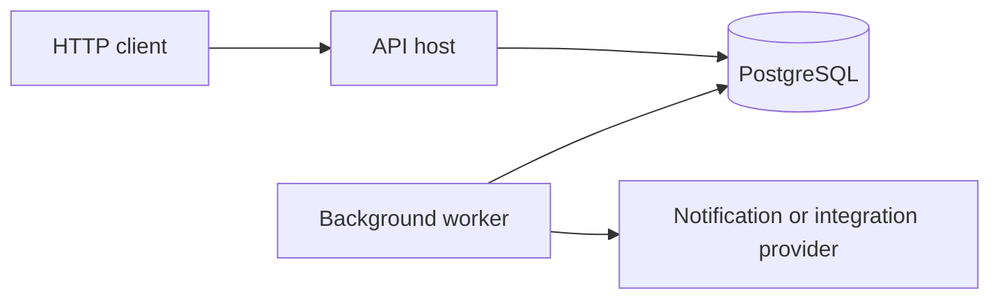
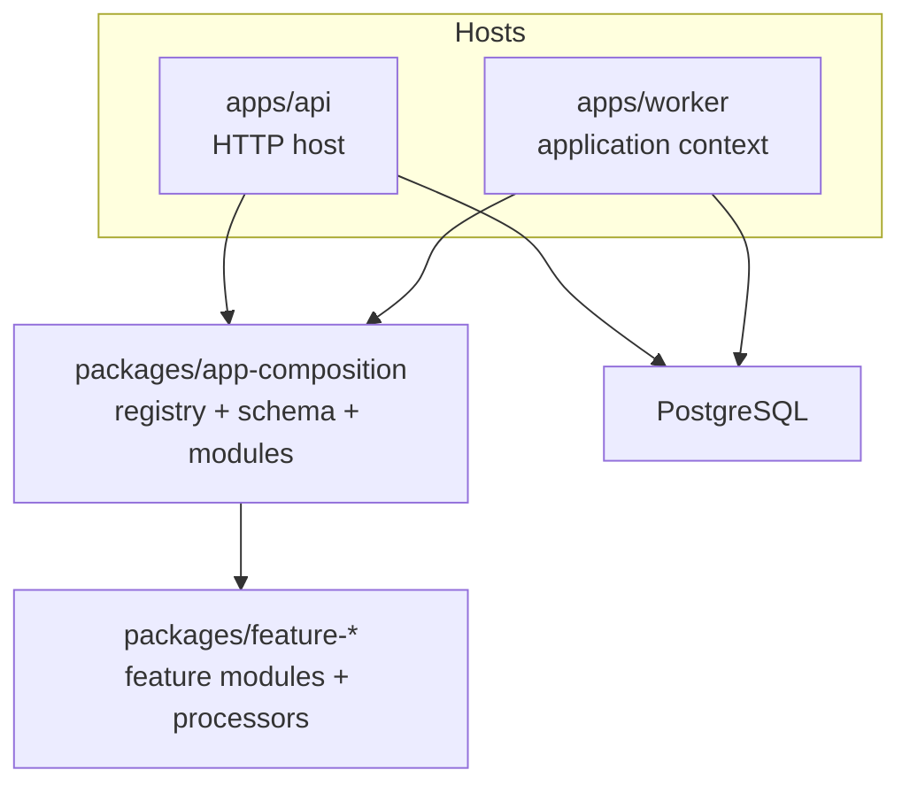
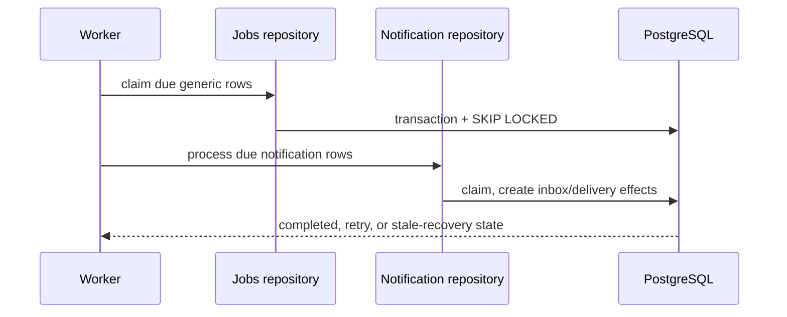

# Architecture — Super Template

- **Status:** partial — this sync documents the API/worker host split; business requirements and full system views are not present in the source set.
- **Last-synced:** `6c3ad242`

## 1. Introduction and goals

The system is a NestJS API plus a standalone Nest application-context worker. Both consume the same ordered feature graph. The API serves HTTP requests; the worker registers scheduled processors and uses PostgreSQL-backed job claims. Sources: `apps/api/src/composition/runtime.module.ts`, `apps/worker/src/worker.module.ts`, `packages/app-composition/src/feature-registry.ts`.

### Stakeholders and concerns (ISO/IEC/IEEE 42010)

| Stakeholder | Key concerns | Views that address them |
|---|---|---|
| Application engineering | deterministic feature order and host composition | Building Block, Runtime, ADR-003 |
| Operations | one scheduler owner, readiness, restart and rollback | Runtime, Deployment, Operations |
| Security/data | restricted PostgreSQL role and tenant isolation | Crosscutting, Quality, worker e2e |
| Product/API consumers | stable HTTP routes after scheduler extraction | Context, Runtime, API e2e |

## 2. Architecture constraints

- PostgreSQL remains the queue and concurrency boundary; existing `FOR UPDATE SKIP LOCKED`, retry, and stale recovery behavior is preserved. Source: `docs/adr/0003-standalone-worker-host.md`.
- `ScheduleModule.forRoot()` is owned by `apps/worker`; API runtime does not import it. Source: `apps/api/src/composition/runtime.module.ts`, `apps/worker/src/worker.module.ts`.
- No deployment platform is selected in this repository. Platform-specific liveness/readiness configuration is a documented gap. Source: `docs/deployment.md`.

## 3. Context and scope

- **Business context:** API callers use HTTP routes; background processors consume due jobs, notification jobs, outbox messages, import/export work, audit retention, and upload cleanup.
- **Technical context:** both hosts use NestJS modules, shared feature composition, environment validation, and PostgreSQL. The worker has no HTTP channel.

## 4. Solution strategy

Use a separately runnable worker package and an application-context bootstrap. Keep the feature registry/schema/module order in `@repo/app-composition`. Remove scheduler initialization from the API while retaining its controllers and job-management services. Normalize host-specific Nest pipeline tokens inside the API host. Source: `packages/app-composition/src/composed-schema.ts`, `apps/api/src/composition/global-pipeline.ts`.

## 5. Building block view

| Building block | Responsibility | Interfaces | Source |
|---|---|---|---|
| API host | HTTP routes, middleware, management endpoints | HTTP on `API_PORT` | `apps/api/src/shell/bootstrap.ts` |
| Worker host | scheduler and background processing | process lifecycle/log events | `apps/worker/src/main.ts` |
| App composition | ordered registry, schema, modules, seeders, contributions | TypeScript exports | `packages/app-composition/src/**` |
| Feature modules | domain behavior and scheduled processors | Nest modules/services | `packages/feature-*/src/**` |
| PostgreSQL | queue rows, claims, effects, tenant data | SQL/Drizzle | `packages/database-runtime/**`, feature schemas |

## 6. Runtime view

### Due job processing

Happy path, retry, stale recovery, and concurrent claims are verified by `apps/worker/test/worker-processing.e2e.spec.ts`. Provider-backed external delivery is a gap; see `05-operations/observability.md`.

## 7. Deployment view

Deploy API and worker as separate process targets from the same release. API binds `API_PORT`; worker binds no port. Start and verify the worker before disabling API scheduling. Rollback stops the worker before restoring the former API scheduler composition. Source: `docs/deployment.md`.

## 8. Crosscutting concepts

- **Composition:** one deterministic registry and schema; no duplicate API registry.
- **Concurrency:** PostgreSQL row claims with `FOR UPDATE SKIP LOCKED`.
- **Tenant/data safety:** worker uses the restricted database role and dispatch context; integration tests exercise RLS-safe reads.
- **Lifecycle:** worker emits structured startup, failure, shutdown, and shutdown-complete events.
- **HTTP pipeline:** API host resolves host-local Nest `Reflector` tokens for feature contributions.

## 9. Architecture decisions

| ADR | Title | Status |
|---|---|---|
| ADR-003 | Standalone worker host | accepted |

See [ADR-003](decisions/ADR-003-standalone-worker-host.md).

## 10. Quality requirements

| ID | Quality | Scenario (stimulus → response) | Measure |
|---|---|---|---|
| NFR-001 | Isolation | API starts without scheduler initialization → worker remains sole cron owner | API/worker smoke and host tests |
| NFR-002 | Concurrency | Two workers claim the same due set → claimed ID intersection is empty | PostgreSQL e2e asserts empty overlap and full union |
| NFR-003 | Operability | Worker receives SIGTERM → Nest/database resources close and completion event is logged | direct process smoke |

## 11. Risks and technical debt

| Risk / debt | Impact | Mitigation / plan |
|---|---|---|
| Deployment target is unknown | Live readiness and rollback are unverified | Bind documented signals to the selected supervisor before production |
| Startup event is not a liveness heartbeat | Hung worker may remain alive without progress | Monitor queue age/job progress; add heartbeat if target requires it |
| External notification provider is not exercised locally | Provider/network failures remain unverified | Run staging provider smoke |

## 12. Glossary

- **Worker:** standalone `apps/worker` application-context process that owns scheduled callbacks.
- **Scheduler owner:** the one deployed process allowed to initialize scheduled callbacks.
- **Composition:** shared registry/schema/module graph exported by `@repo/app-composition`.
- **Stale recovery:** existing repository behavior that requeues or fails abandoned processing rows.

Sources: `docs/adr/0003-standalone-worker-host.md`, `apps/api/src/**`, `apps/worker/src/**`, `packages/app-composition/src/**`, `apps/worker/test/**`.
