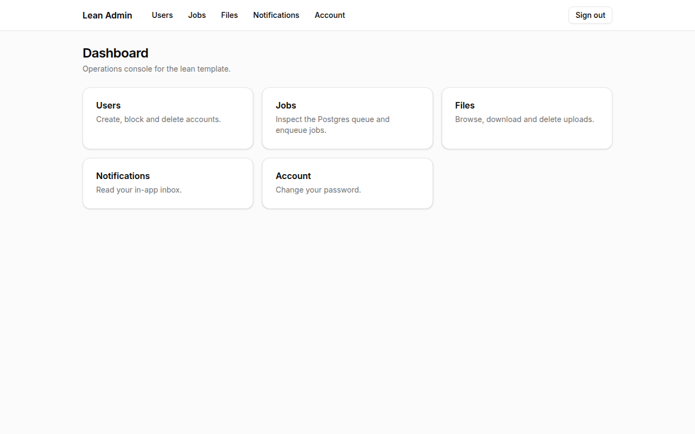
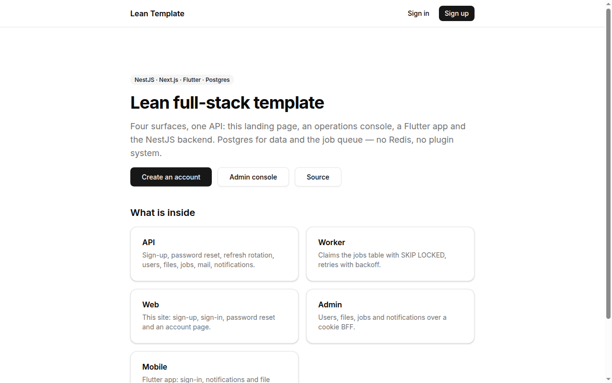
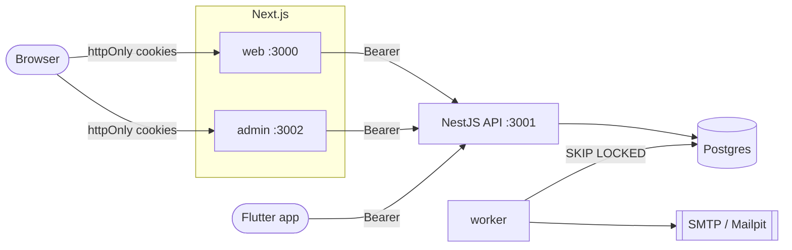

<div align="center">

# super-template

**A full-stack starter you can ship.**
NestJS API · Next.js web and admin · Flutter mobile · Postgres-backed worker

[](LICENSE)


[**Docs**](https://2tsoftwareapp.github.io/super-template/) ·
[Getting started](https://2tsoftwareapp.github.io/super-template/guide/getting-started) ·
[Add a feature](https://2tsoftwareapp.github.io/super-template/guide/add-a-feature) ·
[Deploy](https://2tsoftwareapp.github.io/super-template/guide/deployment) ·
[Make it yours](https://2tsoftwareapp.github.io/super-template/guide/customizing)

<br />




</div>

## Why this template

| **Feature**                 | **What you get**                                                                                  |
| --------------------------- | ------------------------------------------------------------------------------------------------- |
| **Accounts out of the box** | Sign-up, sign-in, rotating refresh tokens, forgot/reset/change password by email, profile page.   |
| **Secure by default**       | httpOnly cookies behind a BFF, blocking a user or changing a password kills live tokens at once.  |
| **Four surfaces, one API**  | Web, admin and mobile all call the same `/api/v1` with the same `{ data }` / `{ error }` shapes.  |
| **Jobs without Redis**      | Jobs are Postgres rows claimed with `SKIP LOCKED`: retries, backoff, stale-lock recovery.         |
| **Production-shaped**       | One Dockerfile, a compose stack that migrates itself, helmet, CORS, JSON logs, DB-aware health.   |
| **Small on purpose**        | One folder per backend feature, no ports with one implementation, no codegen. ESLint enforces it. |

## Architecture



More diagrams (request pipeline, auth flows, job lifecycle, deployment) are in the
[architecture guide](https://2tsoftwareapp.github.io/super-template/guide/architecture).

## Quick start

You need [Bun](https://bun.sh) 1.3+, Node 24 and Docker.

```bash
bun install
cp .env.example .env
bun run bootstrap        # Postgres 18 + Mailpit, migrate, seed
bun run dev:all          # api :3001 · web :3000 · admin :3002 · worker
```

Sign in to the admin at http://localhost:3002 with `admin@example.local` / `ChangeMe123!`
(from `.env`). Mail sent locally lands in Mailpit at http://localhost:8025.

<details>
<summary><b>Mobile (Flutter)</b></summary>

```bash
cd apps/mobile
flutter pub get
flutter run --dart-define=API_BASE_URL=http://10.0.2.2:3001   # Android emulator
flutter run --dart-define=API_BASE_URL=http://localhost:3001  # iOS simulator
```

Debug builds allow plain HTTP to the local API; release builds expect HTTPS.

</details>

## Commands

| Command                                                | What it does                              |
| ------------------------------------------------------ | ----------------------------------------- |
| `bun run dev:all`                                      | API, web, admin and worker in watch mode  |
| `bun run dev` / `dev:web` / `dev:admin` / `dev:worker` | one surface at a time                     |
| `bun run check`                                        | lint + typecheck + every test             |
| `bun run format` / `format:check`                      | Prettier                                  |
| `bun run db:generate` / `db:migrate` / `db:seed`       | schema → migration → database             |
| `bun run build`                                        | production builds of every TypeScript app |
| `bun run prod:up`                                      | production stack from `compose.prod.yaml` |
| `bun run docs:dev`                                     | this documentation site                   |

## Project layout

```
apps/
  api/       NestJS API: one folder per feature under src/modules/
  web/       Next.js public app (sign-up, sign-in, account)
  admin/     Next.js admin console (users, files, jobs, notifications)
  worker/    job runner for the Postgres queue
  mobile/    Flutter app (Android, iOS)
packages/
  db/        Drizzle schema, migrations, seed, queue helpers
  config/    Zod-validated environment
  next-bff/  cookie session + API proxy shared by web and admin
docs/        VitePress site + CONVENTIONS.md
```

A backend feature looks like this:

```
apps/api/src/modules/<feature>/
  <feature>.controller.ts   route + validation
  <feature>.service.ts      behaviour
  <feature>.repository.ts   Drizzle queries
  <feature>.dto.ts          request/response shapes
  __tests__/
```

The rules live in [`AGENTS.md`](AGENTS.md) (contract) and
[`docs/CONVENTIONS.md`](docs/CONVENTIONS.md) (shape); `bun run check` is the referee.

## Branches

| Branch | What it is                                                                         |
| ------ | ---------------------------------------------------------------------------------- |
| `main` | **this** lean template                                                             |
| `max`  | the full enterprise template (plugin architecture, multi-tenant, SSO/MFA, codegen) |

## License

[MIT](LICENSE)
