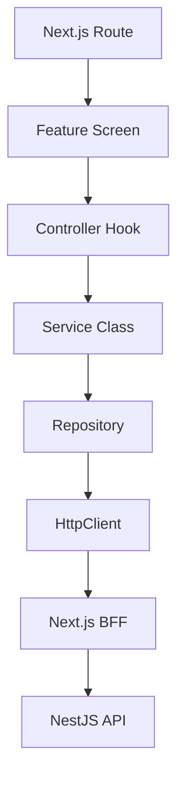
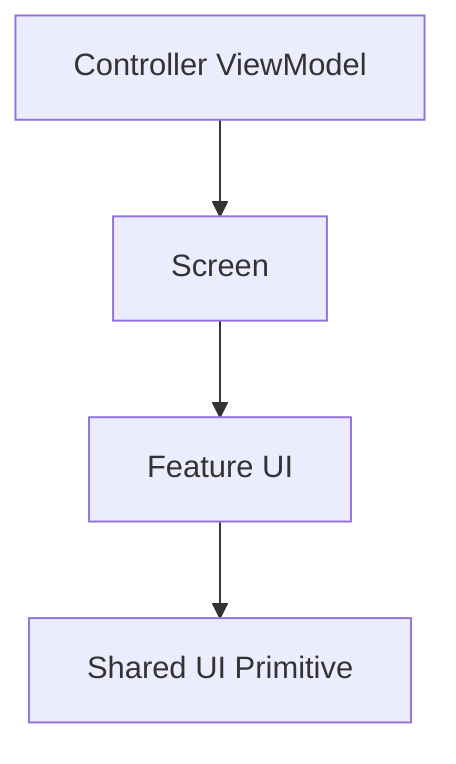

# Frontend Diagrams

## Request flow



## UI flow



## Dependency rule

```text
app
  ↓
screen
  ↓
controller
  ↓
service
  ↓
repository
  ↓
http-client
```

UI receives data and callbacks from the screen/controller path. UI never reaches down into API or service layers.
