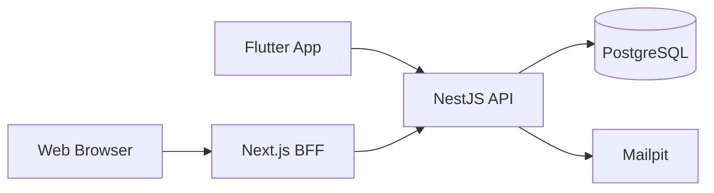
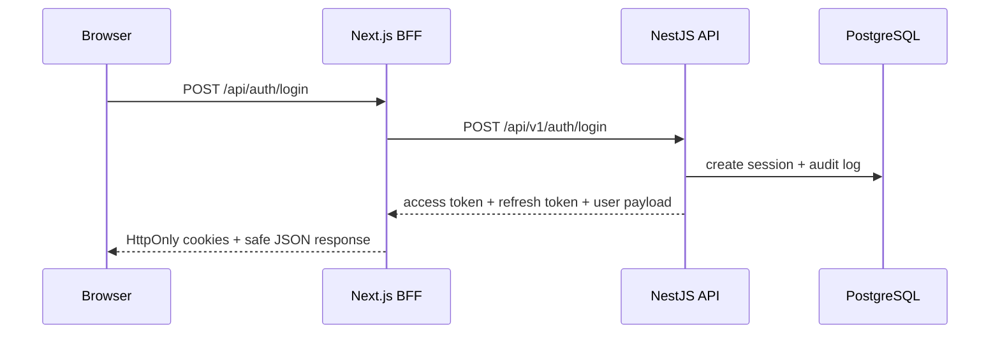

# Architecture

## Repository Architecture

- `apps/api`: modular monolith NestJS backend
- `apps/web`: Next.js App Router web app with a same-origin BFF layer
- `apps/mobile`: Flutter app using generated Dart API client
- `packages/api-contract`: generated TypeScript OpenAPI types
- `infra`: Docker Compose for PostgreSQL and Mailpit
- `scripts`: bootstrap, contract generation, verification, and infra helpers

## Backend Boundaries

- `health`: liveness and readiness
- `auth`: registration, login, refresh rotation, logout, reset, verification, session management
- `users`: self-service profile plus administrative user management
- `access-control`: roles, permissions, enforcement helpers
- `projects`: reference CRUD module with ownership and audit behavior
- `notifications`: in-app notification reads and admin send flow
- `audit`: append-only audit logging integration

The backend uses explicit repositories and feature modules. It does not use a generic repository abstraction.

## Web BFF Design

Browser requests never call the Nest API directly.

- Browser -> Next.js route handlers
- Next.js route handlers -> NestJS API
- Access and refresh tokens are kept in `HttpOnly` cookies
- Refresh happens server-side once on eligible `401` responses
- CSRF protection is applied to cookie-authenticated mutations

## Flutter Architecture

- `core/`: configuration, network, storage, auth helpers, shared widgets
- `features/`: auth, projects, notifications, profile
- `generated/api/`: OpenAPI Dart Dio client

The Flutter app stores tokens in secure storage and uses a single-flight refresh path in the Dio interceptor.

## API Contract Flow

1. NestJS Swagger metadata generates `apps/api/openapi.json`
2. TypeScript contract types are generated to `packages/api-contract`
3. Dart Dio client is generated to `apps/mobile/lib/generated/api`
4. `build_runner` generates built value companions for the Dart client

## Dependency Rules

- Web and mobile consume API DTO contracts, not Drizzle schema
- Drizzle schema remains backend-only
- Permission checks in the frontend are UX hints only
- Backend guards remain the source of truth

## Why Drizzle

- Typed schema close to SQL
- Reviewable SQL migrations
- Straightforward integration with `pg` Pool
- Explicit query construction without Prisma or TypeORM runtime layers

## System Context

## Request Flow

