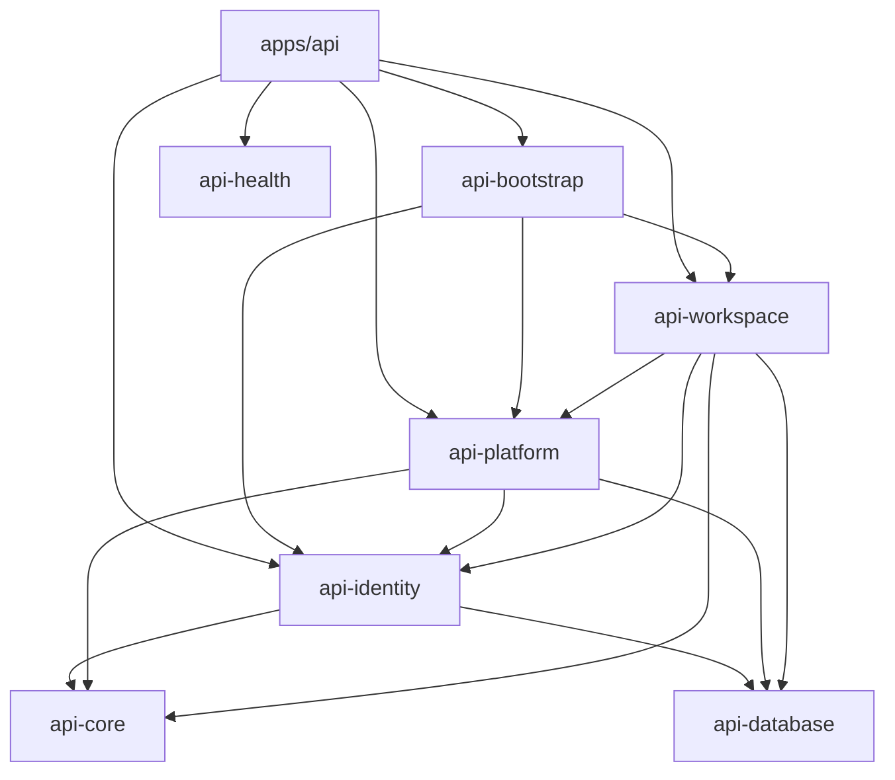
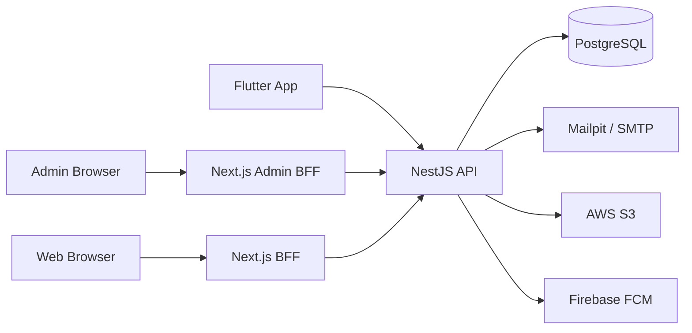
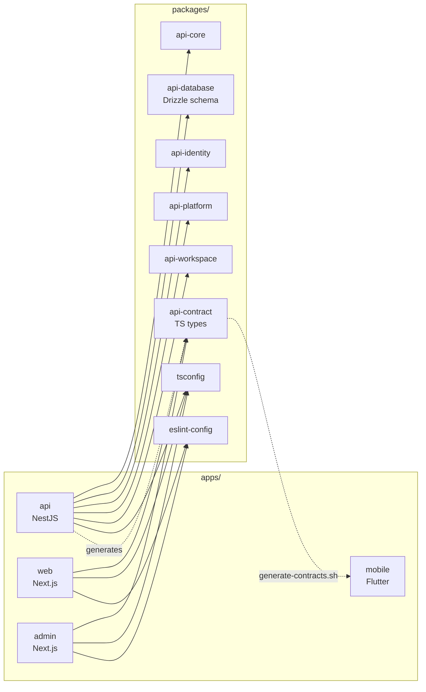
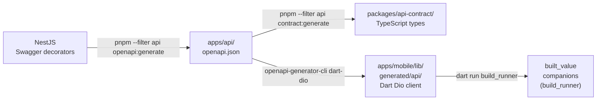
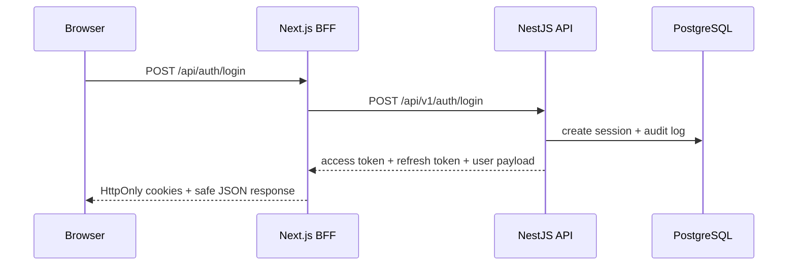

# Architecture

## Repository Architecture

- `apps/api`: modular monolith NestJS backend
- `apps/web`: Next.js App Router web app with a same-origin BFF layer
- `apps/admin`: Next.js App Router admin app with a same-origin BFF layer
- `apps/mobile`: Flutter app using generated Dart API client
- `packages/api-contract`: generated TypeScript OpenAPI types
- `packages/api-bootstrap`: API bootstrap and shared startup helpers
- `packages/api-health`: health-check module
- `packages/api-database`: Drizzle schema and migrations
- `packages/api-core`: shared backend primitives
- `packages/api-identity`: authentication and identity helpers
- `packages/api-platform`: platform-level backend primitives
- `packages/api-workspace`: workspace/domain helpers
- `infra`: Docker Compose for PostgreSQL and Mailpit
- `scripts`: bootstrap, contract generation, verification, and infra helpers

## Backend Boundaries

API features live in bounded-context packages (`api-identity`, `api-platform`, `api-workspace`) using the layered module shape documented in [clean-architecture-plan.md](./clean-architecture-plan.md): `presentation/` → `application/` → `infrastructure/`, with cross-context communication via `api-core` port tokens and global `*PortsModule` wiring at the composition root.

### Core (default)

- `health`: liveness and readiness
- `auth`: registration, login, refresh rotation, logout, reset, verification, session management
- `users`: self-service profile plus administrative user management
- `access-control`: roles, permissions, enforcement helpers
- `audit`: append-only audit logging (write + admin read API)
- `notifications`: inbox CRUD, web SSE, FCM push, scheduled sends
- `projects`: reference domain CRUD with ownership and audit behavior

### Reusable capability modules

- `storage` + `files` + `attachments`: object storage adapters, upload metadata, polymorphic attachments
- `mail`: SMTP delivery, file-based templates, delivery log
- `preferences` + `settings`: user preferences and application settings
- `jobs`: PostgreSQL-backed background job queue
- `invitations`: polymorphic invitation flows
- `imports` + `exports`: CSV import/export framework (projects demo)
- `comments` + `activities`: entity comments and human-readable activity feed

The backend uses explicit repositories and feature modules. It does not use a generic repository abstraction.

## Web BFF Design

Browser requests never call the Nest API directly.

- Browser -> Next.js route handlers
- Next.js route handlers -> NestJS API
- Access and refresh tokens are kept in `HttpOnly` cookies
- Refresh happens server-side once on eligible `401` responses
- CSRF protection is applied to cookie-authenticated mutations

## Flutter Architecture

- `core/`: configuration, network, storage, auth helpers, shared widgets
- `features/`: auth, projects, notifications, profile
- `generated/api/`: OpenAPI Dart Dio client

The Flutter app stores tokens in secure storage and uses a single-flight refresh path in the Dio interceptor.

## API Contract Flow

1. NestJS Swagger metadata generates `apps/api/openapi.json`
2. TypeScript contract types are generated to `packages/api-contract`
3. Dart Dio client is generated to `apps/mobile/lib/generated/api`
4. `build_runner` generates built value companions for the Dart client

The same flow is wrapped by `./scripts/generate-contracts.sh`.

## Dependency Rules

- Web and mobile consume API DTO contracts, not Drizzle schema
- Drizzle schema remains backend-only
- Permission checks in the frontend are UX hints only
- Backend guards remain the source of truth
- Global guard order: `ThrottlerGuard` → `AuthGuard` → `PermissionsGuard` (rate limits apply before session DB work)

## Authority Model & Tenancy

The template uses three primary roles:

| Role | Scope | RLS behavior |
|------|-------|--------------|
| `USER` | End user within their organization | Tenant-scoped by RLS and ownership checks |
| `ADMIN` | Organization administrator | Bypasses ownership checks in services but remains confined to the active organization by RLS |
| `SUPER_ADMIN` | Global platform manager | Sets `app.bypass_rls=true` and can operate across organizations |

`TenantContextInterceptor` sets `bypassRls` only when the authenticated user includes `SUPER_ADMIN`. Organization `ADMIN` accounts therefore depend on Postgres RLS for cross-tenant isolation; `tenant-isolation.e2e.spec.ts` exercises that path under the restricted `fullstack_starter_app` database role.

## Shared Runtime Cache (Optional Redis)

When `REDIS_URL` is configured:

- Rate limiting uses a Redis-backed `ThrottlerStorage`
- Notification SSE fan-out uses Redis Pub/Sub
- Access profiles (`roles` + `permissions`) are cached per user with `ACCESS_PROFILE_CACHE_TTL_SECONDS` (default `60`)

Without `REDIS_URL`, those features fall back to single-instance in-memory behavior. Access-profile cache entries are invalidated when user roles change or when role permissions are reseeded/updated.

## Package Ports (Decoupling)

Feature packages should depend on `api-core` abstractions instead of importing each other's services:

| Port | Token | Implemented by |
|------|-------|----------------|
| Audit logging | `AUDIT_WRITER` | `AuditService` |
| Templated email | `MAIL_TEMPLATE_SENDER` | `MailService` |
| User directory lookups | `USER_LOOKUP` | `UsersRepository` |
| Auth token cleanup jobs | `AUTH_TOKEN_CLEANUP` | `AuthRepository` |
| User notifications | `USER_NOTIFICATION_SENDER` | `NotificationsService` |
| Background jobs | `BACKGROUND_JOB_ENQUEUER` | `JobsService` |
| Demo import/export projects | `PROJECT_DEMO_GATEWAY` | `ProjectsRepository` |
| File ownership lookup | `FILE_LOOKUP` | `FilesRepository` |
| Entity attachments | `ENTITY_ATTACHMENT_LISTING` | `AttachmentsRepository` |

Nest composition uses `@Global()` `PlatformPortsModule` and `WorkspacePortsModule` so identity/platform services receive port providers without cyclic `package.json` dependencies.

RBAC constants (`ROLE_NAMES`, `PERMISSION_NAMES`, …) live in `api-core`. `scripts/check-package-cycles.sh` runs as part of `pnpm lint:policy` and fails on direct cross-package service/repository imports. `pnpm exec turbo boundaries` enforces layer tags (`layer:core`, `layer:identity`, `layer:platform`, `layer:workspace`, …) and acyclic package dependencies.

### Runtime package graph (acyclic)

Nest wiring uses `@Global()` `PlatformPortsModule` and `WorkspacePortsModule` so services can inject port tokens without cyclic `package.json` dependencies between identity, platform, and workspace.

Job endpoints accept optional `idempotencyKey` on export/import/notification/background-job create paths; duplicate keys return the original job row instead of enqueueing again.

## Why Drizzle

- Typed schema close to SQL
- Reviewable SQL migrations
- Straightforward integration with `pg` Pool
- Explicit query construction without Prisma or TypeORM runtime layers

## System Context

## Full Architecture

```mermaid
graph TB
    subgraph Clients["Clients"]
        Browser["Web Browser"]
        AdminBrowser["Admin Browser"]
        MobileApp["Flutter Mobile App"]
    end

    subgraph MonorepoApps["apps/"]
        subgraph WebApp["apps/web — Next.js 16"]
            AppRouter["App Router\nReact 19 + Tailwind CSS"]
            BFF["Route Handlers\nBFF Layer — HttpOnly cookies\nCSRF + token refresh"]
        end

        subgraph AdminApp["apps/admin — Next.js 16"]
            AdminUI["App Router\nReact 19 + Tailwind CSS"]
            AdminBFF["Route Handlers\nBFF Layer — HttpOnly cookies\nCSRF + token refresh"]
        end

        subgraph NestAPI["apps/api — NestJS 11"]
            subgraph CoreMods["Core Modules"]
                Auth["auth\nJWT + Argon2id\nsession management"]
                Users["users\nprofile + admin CRUD"]
                AC["access-control\nroles + permissions"]
                Audit["audit\nappend-only log"]
                Notif["notifications\nSSE + FCM + inbox"]
                Projects["projects\nreference domain"]
            end
            subgraph CapMods["Capability Modules"]
                StorageMod["storage / files / attachments\nS3 adapters + polymorphic"]
                MailMod["mail\nSMTP + templates"]
                JobsMod["jobs\nPostgreSQL job queue"]
                InviteMod["invitations\npolymorphic flows"]
                ImportExport["imports / exports\nCSV framework"]
                CommentsMod["comments / activities\nentity feed"]
                PrefsMod["preferences / settings"]
            end
            DrizzleORM["Drizzle ORM\n+ pg Pool"]
            SwaggerMeta["Swagger / OpenAPI"]
        end

        subgraph MobileApp2["apps/mobile — Flutter"]
            FlutterCore["core/\nnetwork, storage, auth"]
            FlutterFeatures["features/\nauth, projects, notifications"]
            DartClient["lib/generated/api/\nDart Dio Client"]
        end
    end

    subgraph SharedPackages["packages/"]
        ApiContract["@repo/api-contract\nTypeScript OpenAPI types"]
        ApiDatabase["@repo/api-database\nDrizzle schema + migrations"]
        ApiCore["@repo/api-core"]
        ApiIdentity["@repo/api-identity"]
        ApiPlatform["@repo/api-platform"]
        ApiWorkspace["@repo/api-workspace"]
        TSConfig["@repo/tsconfig"]
        ESLint["@repo/eslint-config"]
    end

    subgraph Infra["Infrastructure (Docker Compose)"]
        PostgreSQL[("PostgreSQL")]
        MailpitSvc["Mailpit\nlocalhost:8025"]
        S3Svc["AWS S3\nobject storage"]
        FCMSvc["Firebase FCM\nmobile push"]
    end

    Browser --> AppRouter
    AppRouter --> BFF
    AdminBrowser --> AdminUI
    AdminUI --> AdminBFF
    MobileApp --> DartClient

    BFF -->|"internal HTTP"| NestAPI
    AdminBFF -->|"internal HTTP"| NestAPI
    DartClient -->|"REST"| NestAPI

    DrizzleORM --> PostgreSQL
    MailMod --> MailpitSvc
    StorageMod --> S3Svc
    Notif --> FCMSvc

    NestAPI --> ApiCore
    NestAPI --> ApiDatabase
    NestAPI --> ApiIdentity
    NestAPI --> ApiPlatform
    NestAPI --> ApiWorkspace
    ApiDatabase --> PostgreSQL

    WebApp --> ApiContract
    AdminApp --> ApiContract
    FlutterFeatures --> DartClient
```

## Monorepo Package Graph

## API Contract Generation Flow

## Request Flow

