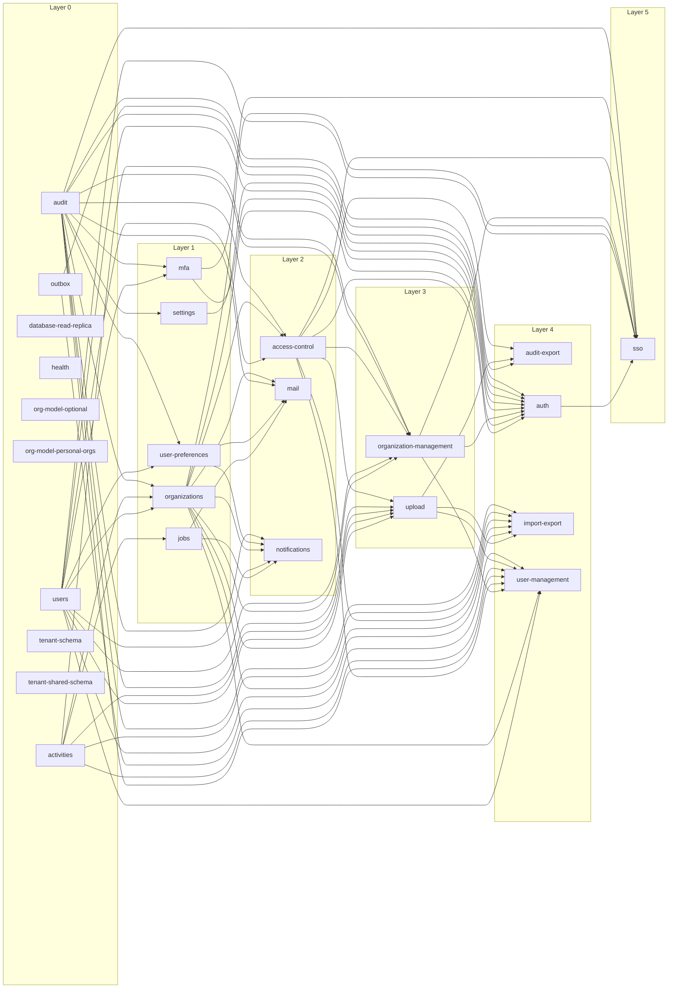

# Feature Dependency Graph

Composition map of all backend feature packages. The source of truth is the
`defineFeature` manifest inside each `packages/feature-*/src/*.feature.ts`;
this page is a snapshot of what `scripts/lib/feature-catalog.mjs` discovers
from those manifests (checked by `scripts/__tests__/create-project.spec.mjs`).

Regenerate the underlying data with:

```bash
cd scripts && node -e "import('./lib/feature-catalog.mjs').then(({ discoverFeatureCatalog }) => console.log(discoverFeatureCatalog('..').features))"
```

## Composition layers

Layer N = depends on features up to layer N-1 (longest dependency path).
`sso` (layer 5) sits on top of `auth` (layer 4); `audit` and `users` are the
foundation everything else builds on. The graph is acyclic and is validated at
generation time by `resolveFeatureSelection()` (cycle detection) and by the
bootstrap omit-feature unit matrix in `apps/api`.



## Foundation features (most depended upon)

| Feature                   | Dependents | Role                                                             |
| ------------------------- | ---------- | ---------------------------------------------------------------- |
| `audit`                   | 14         | Cross-cutting audit log — every business feature records to it   |
| `users`                   | 10         | User profiles — the primary entity every feature scopes to       |
| `organizations`           | 8          | Core org entity and membership                                   |
| `access-control`          | 7          | RBAC permissions used by every guarded feature                   |
| `activities`              | 6          | Activity stream                                                  |
| `organization-management` | 3          | Org CRUD and provisioning on top of `organizations`              |
| `upload`                  | 3          | File storage reused by import/export, audit-export, user avatars |
| `jobs`                    | 2          | Background work queue (mail, notifications)                      |
| `mfa`                     | 2          | Second factor for auth and SSO                                   |
| `outbox`                  | 2          | Transactional outbox (user-management, auth)                     |
| `user-preferences`        | 2          | Per-user preferences (mail, notifications)                       |

## Capability variants (layer 0, mutually exclusive per family)

These carry no dependencies — they alter how the composed app behaves and are
selected at generation time (`pnpm create:project`):

| Family               | Variants                                         | Effect                                                                        |
| -------------------- | ------------------------------------------------ | ----------------------------------------------------------------------------- |
| `organization-model` | `org-model-optional` / `org-model-personal-orgs` | Users may exist without an organization vs. always provisioned a personal org |
| `tenant-isolation`   | `tenant-shared-schema` / `tenant-schema`         | RLS-based shared schema vs. schema-per-tenant search path                     |
| `database-topology`  | `database-read-replica`                          | Adds a read replica with `eventual` read consistency                          |

Selecting two variants of the same family is a composition error, enforced both
here (generator mirror) and at runtime (`composeFeatures()` in
`@repo/api-plugin-kit`).

## Decoupled integrations (kernel-owned ports)

`feature-sso` consumes auth through the `SESSION_ISSUER` port (ADR 0004
Phase 1) plus the existing `AUTH_SESSION_REPOSITORY` / `AUTH_TOKEN_PROVIDER`
contracts — session issuance stays owned by `IssueSessionUseCase` behind
`SessionIssuerAdapter`, shared with password login and the post-MFA flow.

`auth` integrates with `jobs` and `mail` without depending on either package:
the port tokens `JOB_HANDLER_REGISTRY` and `MAIL_TEMPLATE_SENDER` live in
`@repo/api-kernel` (alongside `TRANSACTION_PORT`), are bound by the owning
feature when composed, and are injected `@Optional()` in auth. A composition
without mail or jobs boots fine; sending email or running the auth
token-cleanup job just requires composing those features. The settings error
codes auth raises on settings' behalf (`SETTINGS_ERROR_CODES`) also live at
kernel level, so auth has no package dependency on `feature-settings` for
constants — only the real `APPLICATION_SETTINGS_LOOKUP` port remains.

## Edge list

61 edges total. Every edge is backed by at least one cross-feature import in
the depending package's own sources — the ghost-dependency guard
(`scripts/lib/ghost-dependencies.mjs`, enforced by `discoverFeatureCatalog`
and `scripts/check-feature-manifest-deps.mjs` in the `lint:policy` chain)
fails the build when a `dependsOn` edge has no matching import. Test-support
files (`__tests__`, `*.d.ts`) are excluded from that scan.
