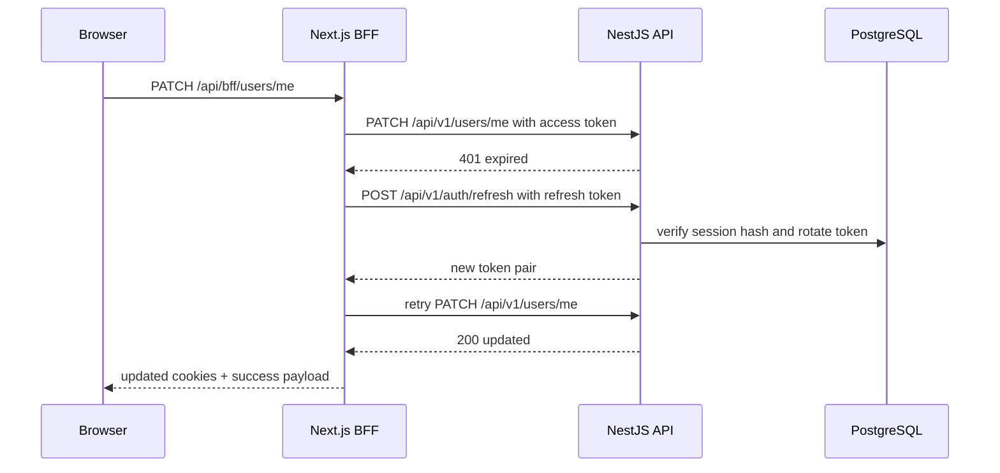
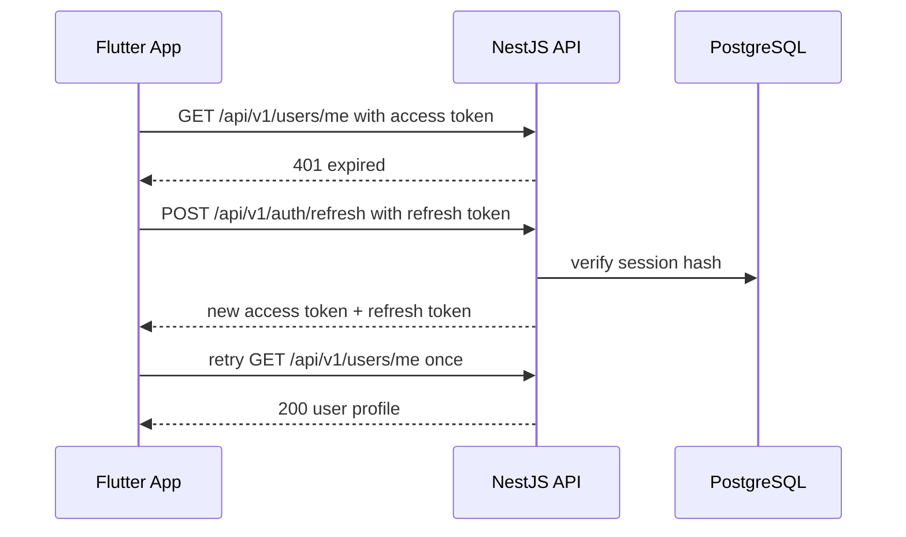

# Authentication

## Access Token Flow

- The API issues a short-lived JWT access token
- The token includes the user id, session id, and a per-token `jti`
- Backend guards authorize requests from the bearer token

## Session-Backed Access Tokens (Deliberate Tradeoff)

Access tokens are signed JWTs, but **every authenticated request re-validates the session row** in PostgreSQL (`authenticateAccessToken` loads the session, checks revocation/expiry, then resolves roles and organization context).

| Benefit | Cost |
| --- | --- |
| Instant revocation — logout, block, or reuse detection takes effect on the next request | Extra DB round-trips on every authenticated call (~3–4 queries including access profile and org resolution) |
| Short JWT TTL is a defense-in-depth layer, not the sole revocation mechanism | Access tokens are not fully stateless; horizontal scale depends on the database session lookup path |

This is intentional: the template prioritizes **revocable sessions** over minimizing per-request latency. If you need stateless verification later, introduce a session version claim or a distributed denylist and document the revocation delay you accept.

## Auth Rate Limiting

A global limit (120 requests/minute per client) applies to all routes. Sensitive public auth endpoints use stricter `@Throttle` overrides:

| Route | Limit |
| --- | --- |
| `POST /auth/login`, `POST /auth/register` | 5 / minute |
| `POST /auth/refresh` | 20 / minute |
| `POST /auth/forgot-password`, `POST /auth/reset-password`, `POST /auth/resend-verification` | 3 / hour |
| `POST /auth/verify-email` | 10 / hour |

`ThrottlerGuard` runs before `AuthGuard`, so rate limiting applies before session validation work on protected routes.

## Refresh Rotation

- Refresh tokens are longer-lived JWTs
- The API stores only the refresh token hash in PostgreSQL
- Every successful refresh rotates the refresh token
- Reusing an old refresh token triggers session revocation
- Concurrent refresh races use a compare-and-swap update on `refreshTokenHash`; a failed CAS revokes the session the same way as a hash mismatch

## Web Cookie Flow

- Next.js stores access and refresh tokens in `Secure`/`HttpOnly` cookies
- Browser JavaScript never receives the refresh token
- Same-origin Next.js route handlers inject bearer tokens when calling the API
- Cookie-authenticated mutations require the CSRF header

## Flutter Secure Storage Flow

- Access and refresh tokens are stored in platform secure storage
- Dio attaches the access token to each request
- On an eligible `401`, the app performs one refresh attempt
- Concurrent requests share the same refresh promise
- Failure clears tokens and returns the app to login

## Session Revocation

- `logout` revokes the current session
- `logout-all` revokes all active sessions for the user
- Admin user blocking also revokes active sessions

## Email Verification

- Verification tokens are single-use and time-limited
- Only hashed verification tokens are stored
- Local development sends mail through Mailpit

## Password Reset

- Forgot-password responses do not reveal whether the email exists
- Reset tokens are single-use and time-limited
- Only hashed reset tokens are stored

## Security Assumptions

- JWT secrets are environment-specific
- HTTPS is required for secure cookies in production
- Tokens, passwords, cookies, and reset data are redacted from logs
- Authorization remains server-enforced even when the UI hides actions
