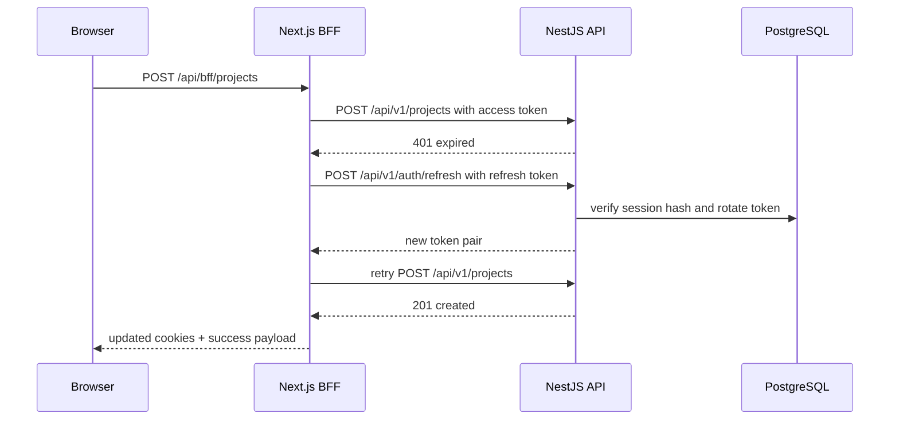
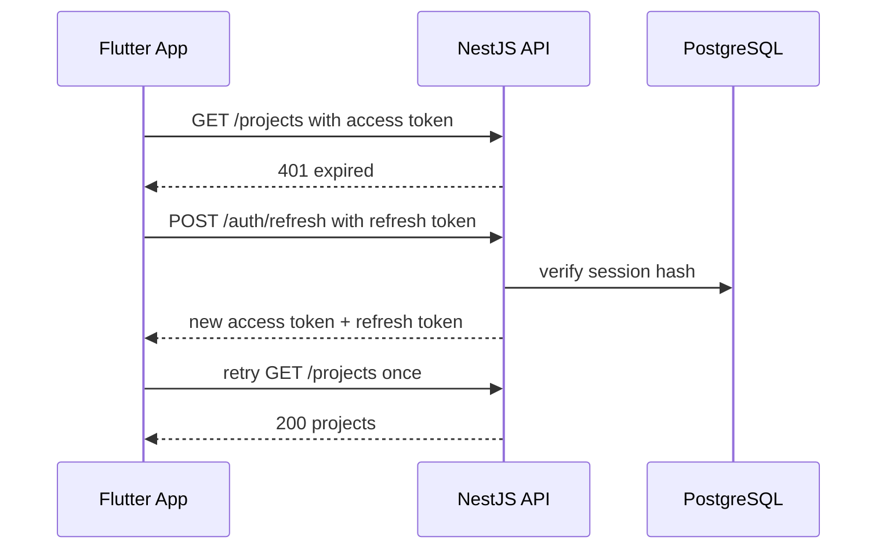

# Authentication

## Access Token Flow

- The API issues a short-lived JWT access token
- The token includes the user id, session id, and a per-token `jti`
- Backend guards authorize requests from the bearer token

## Refresh Rotation

- Refresh tokens are longer-lived JWTs
- The API stores only the refresh token hash in PostgreSQL
- Every successful refresh rotates the refresh token
- Reusing an old refresh token triggers session revocation

## Web Cookie Flow

- Next.js stores access and refresh tokens in `Secure`/`HttpOnly` cookies
- Browser JavaScript never receives the refresh token
- Same-origin Next.js route handlers inject bearer tokens when calling the API
- Cookie-authenticated mutations require the CSRF header

## Flutter Secure Storage Flow

- Access and refresh tokens are stored in platform secure storage
- Dio attaches the access token to each request
- On an eligible `401`, the app performs one refresh attempt
- Concurrent requests share the same refresh promise
- Failure clears tokens and returns the app to login

## Session Revocation

- `logout` revokes the current session
- `logout-all` revokes all active sessions for the user
- Admin user blocking also revokes active sessions

## Email Verification

- Verification tokens are single-use and time-limited
- Only hashed verification tokens are stored
- Local development sends mail through Mailpit

## Password Reset

- Forgot-password responses do not reveal whether the email exists
- Reset tokens are single-use and time-limited
- Only hashed reset tokens are stored

## Security Assumptions

- JWT secrets are environment-specific
- HTTPS is required for secure cookies in production
- Tokens, passwords, cookies, and reset data are redacted from logs
- Authorization remains server-enforced even when the UI hides actions
