# ERD

> Entity names are the **physical SQL table names**, including the lifecycle
> prefix (`m_`, `t_`, `w_`, `l_`, `r_`). Drizzle symbols stay unprefixed
> camelCase — `m_users` is exported as `users`. See
> [`architecture/NAMING_CONVENTIONS.md`](./architecture/NAMING_CONVENTIONS.md) §2.
> Columns carry their physical SQL names; junction and natural-key primary keys
> are marked `PK`, and `PK, FK` marks a natural key that is also a foreign key.

## Identity Domain

```mermaid
erDiagram
  m_organizations ||--o{ r_organization_members : has
  m_organizations ||--o{ m_roles : has
  m_organizations ||--o{ r_user_roles : scopes
  m_organizations ||--o{ w_notification_jobs : scopes
  m_organizations ||--o{ l_audit_logs : scopes
  m_organizations ||--o{ m_files : contains
  m_organizations ||--o{ w_jobs : scopes
  m_organizations ||--o{ l_activities : scopes
  m_users ||--o{ r_organization_members : belongs_to
  m_users ||--o{ t_auth_sessions : has
  m_users ||--o{ t_email_verification_tokens : owns
  m_users ||--o{ t_password_reset_tokens : owns
  m_users ||--o{ r_user_roles : assigned
  m_users ||--o{ m_user_two_factor_secrets : has
  m_users ||--o{ t_user_recovery_codes : has
  m_users ||--o{ t_mfa_challenges : has
  m_users ||--o{ r_external_identities : has
  m_users ||--o{ m_user_preferences : has
  m_users ||--o{ t_notifications : receives
  m_users ||--o{ m_notification_device_tokens : registers
  m_users ||--o{ w_notification_jobs : creates
  m_users ||--o{ l_audit_logs : acts
  m_users ||--o{ l_activities : performs
  m_users ||--o{ m_files : uploads
  m_roles ||--o{ r_user_roles : linked
  m_roles ||--o{ r_role_permissions : grants
  m_permissions ||--o{ r_role_permissions : linked
  m_files ||--o{ t_file_versions : versioned
  m_files ||--o{ r_attachments : attached
  w_jobs ||--o{ w_job_attempts : has
  w_jobs ||--o{ w_job_events : emits
  w_jobs ||--o{ r_job_dependencies : depends_on

  m_organizations {
    uuid id PK
    text name
    text slug
    timestamptz deleted_at
    timestamptz created_at
    timestamptz updated_at
  }

  r_organization_members {
    uuid id PK
    uuid organization_id FK
    uuid user_id FK
    organization_member_role role
    timestamptz created_at
    timestamptz updated_at
  }

  m_users {
    uuid id PK
    text email
    text password_hash
    text display_name
    text avatar_url
    uuid avatar_file_id
    user_status status
    timestamptz email_verified_at
    timestamptz deleted_at
    timestamptz created_at
    timestamptz updated_at
  }

  t_auth_sessions {
    uuid id PK
    uuid user_id FK
    text refresh_token_hash
    timestamptz expires_at
    timestamptz revoked_at
    timestamptz last_used_at
    varchar ip_address
    text user_agent
    timestamptz created_at
    timestamptz updated_at
  }

  t_email_verification_tokens {
    uuid id PK
    uuid user_id FK
    text token_hash
    timestamptz expires_at
    timestamptz used_at
    timestamptz created_at
  }

  t_password_reset_tokens {
    uuid id PK
    uuid user_id FK
    text token_hash
    timestamptz expires_at
    timestamptz used_at
    timestamptz created_at
  }

  m_roles {
    uuid id PK
    uuid organization_id FK
    text name
    text description
    boolean is_system
    timestamptz created_at
    timestamptz updated_at
  }

  m_permissions {
    uuid id PK
    text name
    text description
    boolean is_system
    timestamptz created_at
    timestamptz updated_at
  }

  r_user_roles {
    uuid user_id FK
    uuid organization_id FK
    uuid role_id FK
    timestamptz assigned_at
  }

  r_role_permissions {
    uuid role_id FK
    uuid permission_id FK
    timestamptz assigned_at
  }

  m_user_two_factor_secrets {
    uuid user_id PK, FK
    text secret_ciphertext
    text secret_iv
    text secret_auth_tag
    boolean enabled
    timestamptz confirmed_at
    timestamptz created_at
    timestamptz updated_at
  }

  t_user_recovery_codes {
    uuid id PK
    uuid user_id FK
    text code_hash
    timestamptz used_at
    timestamptz created_at
  }

  t_mfa_challenges {
    uuid id PK
    uuid user_id FK
    text token_hash
    integer attempts
    timestamptz expires_at
    timestamptz consumed_at
    text ip_address
    text user_agent
    timestamptz created_at
  }

  r_external_identities {
    uuid id PK
    uuid user_id FK
    text provider
    text provider_subject
    text email
    timestamptz created_at
    timestamptz updated_at
  }

  t_sso_login_states {
    uuid id PK
    text provider
    text state_hash
    text nonce
    text code_verifier
    text redirect_uri
    timestamptz expires_at
    timestamptz consumed_at
    timestamptz created_at
  }

  t_sso_session_exchanges {
    uuid id PK
    text code_hash
    text access_token
    text refresh_token
    text organization_id
    timestamptz expires_at
    timestamptz consumed_at
    timestamptz created_at
  }

  m_user_preferences {
    uuid user_id PK, FK
    text theme
    text language
    text timezone
    jsonb notification_preferences
    jsonb email_preferences
    timestamptz created_at
    timestamptz updated_at
  }

  w_outbox_messages {
    uuid id PK
    text topic
    jsonb payload
    text status
    integer attempts
    integer max_attempts
    timestamptz scheduled_at
    timestamptz processed_at
    text error_message
    timestamptz created_at
    timestamptz updated_at
  }
```

## Platform Domain

```mermaid
erDiagram
  m_organizations ||--o{ l_audit_logs : scopes
  m_organizations ||--o{ m_files : contains
  m_organizations ||--o{ t_file_versions : scopes
  m_organizations ||--o{ r_attachments : scopes
  m_organizations ||--o{ w_jobs : scopes
  m_organizations ||--o{ w_job_attempts : scopes
  m_organizations ||--o{ w_job_events : scopes
  m_organizations ||--o{ r_job_dependencies : scopes
  m_organizations ||--o{ t_file_batch_operations : scopes
  m_organizations ||--o{ w_notification_jobs : scopes
  m_organizations ||--o{ l_activities : scopes
  m_users ||--o{ l_audit_logs : acts
  m_users ||--o{ m_files : uploads
  m_users ||--o{ t_file_versions : creates
  m_users ||--o{ t_file_batch_operations : operates
  m_users ||--o{ r_attachments : attaches
  m_users ||--o{ w_jobs : creates
  m_users ||--o{ m_application_settings : updates
  m_users ||--o{ t_notifications : receives
  m_users ||--o{ m_notification_device_tokens : registers
  m_users ||--o{ w_notification_jobs : creates
  m_users ||--o{ l_activities : performs
  m_files ||--o{ t_file_versions : versioned
  m_files ||--o{ r_attachments : attached
  m_files ||--o{ t_import_jobs : imported
  m_files ||--o{ t_export_jobs : exported
  w_jobs ||--o{ w_job_attempts : has
  w_jobs ||--o{ w_job_events : emits
  w_jobs ||--o{ r_job_dependencies : depends_on
  t_notifications ||--o{ t_notification_deliveries : delivers_to

  l_audit_logs {
    uuid id PK
    uuid organization_id FK
    uuid actor_id FK
    text action
    text entity_type
    uuid entity_id
    jsonb metadata
    varchar ip_address
    text user_agent
    text request_id
    timestamptz created_at
  }

  m_files {
    uuid id PK
    uuid organization_id FK
    text storage_key
    text original_name
    text mime_type
    integer size_bytes
    text checksum
    integer latest_version
    uuid uploaded_by_id FK
    timestamptz deleted_at
    timestamptz created_at
    timestamptz updated_at
  }

  t_file_versions {
    uuid id PK
    uuid file_id FK
    uuid organization_id FK
    integer version_number
    text storage_key
    text mime_type
    integer size_bytes
    text checksum
    uuid created_by_id FK
    timestamptz created_at
  }

  t_file_batch_operations {
    uuid id PK
    uuid organization_id FK
    uuid actor_id FK
    text operation
    text idempotency_key
    jsonb results
    timestamptz created_at
  }

  r_attachments {
    uuid id PK
    uuid organization_id FK
    uuid file_id FK
    text entity_type
    uuid entity_id
    text label
    uuid created_by_id FK
    timestamptz deleted_at
    timestamptz created_at
    timestamptz updated_at
  }

  t_storage_objects {
    text storage_key PK
    text status
    timestamptz created_at
    timestamptz updated_at
  }

  w_storage_delete_outbox {
    uuid id PK
    text storage_key
    text status
    integer attempts
    integer max_attempts
    text error_message
    timestamptz created_at
    timestamptz updated_at
  }

  w_jobs {
    uuid id PK
    uuid organization_id FK
    text type
    jsonb payload
    job_status status
    timestamptz scheduled_at
    integer priority
    integer attempts
    integer max_attempts
    timestamptz started_at
    timestamptz completed_at
    timestamptz cancelled_at
    text error_message
    uuid created_by_id FK
    text idempotency_key
    timestamptz created_at
    timestamptz updated_at
  }

  w_job_attempts {
    uuid id PK
    uuid job_id FK
    uuid organization_id FK
    integer attempt_number
    text status
    timestamptz started_at
    timestamptz finished_at
    integer duration_ms
    text error_message
  }

  w_job_events {
    uuid id PK
    uuid job_id FK
    uuid organization_id FK
    uuid attempt_id FK
    text type
    text message
    jsonb metadata
    timestamptz created_at
  }

  r_job_dependencies {
    uuid id PK
    uuid job_id FK
    uuid depends_on_job_id FK
    uuid organization_id FK
    timestamptz created_at
  }

  t_import_jobs {
    uuid id PK
    uuid organization_id FK
    text type
    uuid file_id FK
    import_export_job_status status
    integer row_count
    integer success_count
    integer error_count
    jsonb errors
    uuid created_by_id FK
    timestamptz confirmed_at
    timestamptz completed_at
    text idempotency_key
    timestamptz created_at
    timestamptz updated_at
  }

  t_export_jobs {
    uuid id PK
    uuid organization_id FK
    text type
    import_export_job_status status
    uuid file_id FK
    jsonb filters
    uuid created_by_id FK
    timestamptz completed_at
    text idempotency_key
    timestamptz created_at
    timestamptz updated_at
  }

  t_mail_deliveries {
    uuid id PK
    text template_key
    text recipient
    text subject
    mail_delivery_status status
    text error_message
    jsonb metadata
    timestamptz sent_at
    timestamptz created_at
  }

  m_application_settings {
    text key PK
    jsonb value
    uuid updated_by_id FK
    timestamptz created_at
    timestamptz updated_at
  }

  t_notifications {
    uuid id PK
    uuid organization_id FK
    uuid recipient_id FK
    text type
    text title
    text body
    jsonb data
    notification_audience audience
    timestamptz read_at
    timestamptz created_at
  }

  t_notification_deliveries {
    uuid id PK
    uuid notification_id FK
    text channel
    notification_delivery_status status
    text error_message
    timestamptz delivered_at
    timestamptz created_at
  }

  m_notification_device_tokens {
    uuid id PK
    uuid user_id FK
    notification_device_platform platform
    text token
    timestamptz created_at
    timestamptz updated_at
  }

  w_notification_jobs {
    uuid id PK
    uuid organization_id FK
    uuid created_by_id FK
    notification_job_status status
    notification_audience audience
    text filter_role
    uuid filter_role_id
    jsonb metadata
    integer total_notifications
    integer sent_count
    integer failed_count
    timestamptz scheduled_at
    timestamptz completed_at
    timestamptz cancelled_at
    timestamptz created_at
    timestamptz updated_at
  }

  l_activities {
    uuid id PK
    uuid organization_id FK
    uuid actor_id FK
    text type
    text entity_type
    uuid entity_id
    jsonb metadata
    activity_visibility visibility
    timestamptz created_at
  }
```

## Removed: Workspace Domain

The workspace domain (projects, invitations, comments) has been removed from the template.

Notifications, notification_device_tokens, notification_jobs, and activities are now part of the Platform domain (see Platform ERD above) as `t_notifications`, `m_notification_device_tokens`, `w_notification_jobs`, and `l_activities`.

## Counts

- **38 tables** across 2 domains (Identity: 18, Platform: 20)
- **2 PostgreSQL enums** in identity: `user_status`, `organization_member_role`
- **8 enums** in platform: `activity_visibility`, `import_export_job_status`, `job_status`, `mail_delivery_status`, `notification_audience`, `notification_delivery_status`, `notification_device_platform`, `notification_job_status`
- Tenancy is centered on `m_organizations` — most data tables carry a scoping `organization_id` FK. In the `org-optional` organization model, users may have no organization at all; their tenant-scoped rows carry the sentinel organization id `00000000-0000-0000-0000-000000000000` and are user-scoped by RLS (migration `0038`). See "Organization model modes" in [`database.md`](./database.md).
- **14 of the 38 tables** are RLS-protected with a `<base>_tenant_isolation` policy, and four `organization_id`-bearing tables are deliberately outside RLS. See [`database.md`](./database.md) → "Row-level security coverage"
